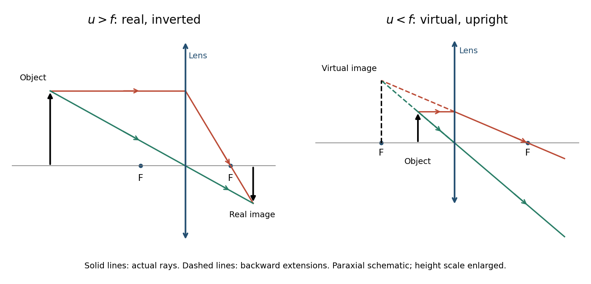

<h1 id="10/a/solution">Solution</h1>

↑ **Parent:** [A](../a.md)

Adopt positive object and real-image distances $u$ and $v$ measured from a converging [thin lens](../../../../thin-lens.md), with the object on the left. A ray through the lens centre is undeviated in the thin-lens approximation. For object height $h$ and signed image height $h'$, similar triangles give $h'/h=-v/u$.

A second ray leaves the object parallel to the axis, reaches the lens at height $h$ and then passes through the far [focal point](../../../../focal-point-of-a-hypersurface.md). Its height at distance $v$ is $h'=h(1-v/f)$. Equating the two descriptions gives

$$
-\frac vu=1-\frac vf,\qquad\boxed{\frac1u+\frac1v=\frac1f}.
$$

The signed transverse [magnification](../../../../magnification.md) is $\boxed{m=h'/h=-v/u}$. Since a real image has $v>0$ for $u>0$, $m<0$: it is inverted. Its size relative to the object is $|m|=v/u$.

**[Figure 4](#10/a/image-paraxial-ray-construction-for-real-inverted-and-virtual-upright-lens-images). Paraxial ray construction for real inverted and virtual upright lens images**.

The derivation assumes the [paraxial approximation](../../../../paraxial-approximation.md), a negligible lens thickness and a [focal length](../../../../focal-length.md) defined in the surrounding medium. The ray diagrams show actual paths as solid lines and backward extrapolations as dashed lines.

## ↑ Ancestors (12)

1. [A](../a.md)
2. [10](../../10.md)
3. [2016](../../../2016-split.md)
4. [Past exam of the physics 2 paper of the University of Oxford](../../../split.md)
5. [Physics 2 paper of the University of Oxford](../../../../physics-2-paper-of-the-university-of-oxford.md)
6. [Year 1 of the physics course of the University of Oxford](../../../../year-1-of-the-physics-course-of-the-university-of-oxford.md)
7. [Physics course of the University of Oxford](../../../../physics-course-of-the-university-of-oxford.md)
8. [Undergraduate course of the University of Oxford](../../../../undergraduate-course-of-the-university-of-oxford.md)
9. [Course of the University of Oxford](../../../../course-of-the-university-of-oxford.md)
10. [University of Oxford](../../../../university-of-oxford-split.md)
11. [List of universities](../../../../list-of-universities.md)
12. [Codex Wiki](../../../../split.md)
