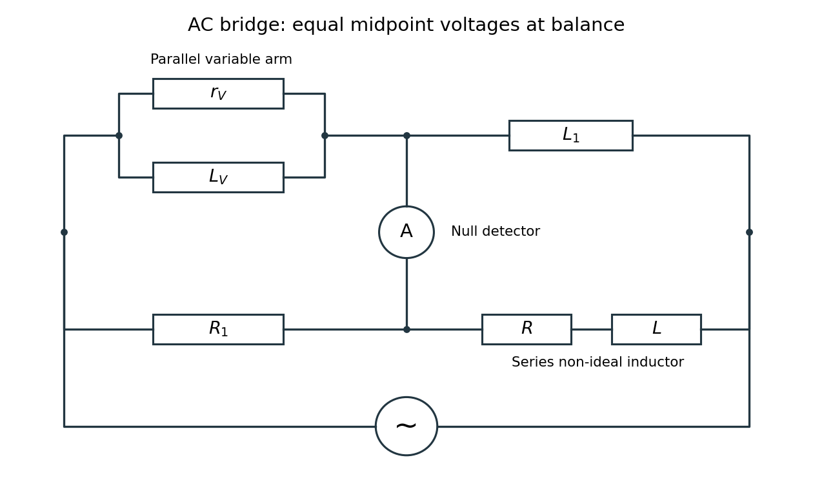

<h1 id="11/ii/solution">Solution</h1>

↑ **Parent:** [Ii](../ii.md)

The source's variable inductor and variable resistor are in **parallel**. Let their combined [complex impedance](../../../../electrical-impedance.md) be

$$
Z_V=\frac{i\omega L_Vr_V}{r_V+i\omega L_V}.
$$

Use the left and right source terminals as the drive nodes. The upper divider has arms $Z_V$ and $i\omega L_1$; the lower divider has arms $R_1$ and $R+i\omega L$. At bridge balance, the detector draws no [electric current](../../../../electric-current.md) and the divider midpoint [electric potential differences](../../../../electric-potential-difference.md) agree, so

$$
\frac{Z_V}{i\omega L_1}=\frac{R_1}{R+i\omega L},\qquad Z_V(R+i\omega L)=i\omega L_1R_1.
$$

Substitution and cancellation at a nonzero drive [frequency](../../../../frequency.md) give

$$
L_Vr_V(R+i\omega L)=L_1R_1(r_V+i\omega L_V).
$$

Equating real and imaginary parts yields

$$
\boxed{R=\frac{R_1L_1}{L_V},\qquad L=\frac{R_1L_1}{r_V}}.
$$

The first expression has units of resistance and the second units of [inductance](../../../../inductance.md). Both are independent of the drive amplitude and, for ideal frequency-independent components, of the chosen nonzero drive [frequency](../../../../frequency.md). At zero [frequency](../../../../frequency.md) the ideal inductors short their arms and the cancellation would not be valid as a measurement of $L$.

**[Figure 5](#11/ii/image-bridge-topology-with-a-parallel-variable-arm-and-a-series-lossy-inductor-arm). Bridge topology with a parallel variable arm and a series lossy-inductor arm**.

Two applications are precision comparison of an unknown [electrical resistance](../../../../electrical-resistance.md) with calibrated standards in a [Wheatstone bridge](../../../../wheatstone-bridge.md), and detecting small resistance changes in a [strain gauge](../../../../strain-gauge.md) or resistance [thermometer](../../../../thermometer.md). Alternating-current bridges additionally compare [capacitance](../../../../capacitance.md), [inductance](../../../../inductance.md) and dielectric losses; this particular bridge determines the two parameters of a non-ideal [inductor](../../../../inductor.md) from a null measurement.

## ↑ Ancestors (12)

1. [Ii](../ii.md)
2. [11](../../11.md)
3. [2016](../../../2016-split.md)
4. [Past exam of the physics 2 paper of the University of Oxford](../../../split.md)
5. [Physics 2 paper of the University of Oxford](../../../../physics-2-paper-of-the-university-of-oxford.md)
6. [Year 1 of the physics course of the University of Oxford](../../../../year-1-of-the-physics-course-of-the-university-of-oxford.md)
7. [Physics course of the University of Oxford](../../../../physics-course-of-the-university-of-oxford.md)
8. [Undergraduate course of the University of Oxford](../../../../undergraduate-course-of-the-university-of-oxford.md)
9. [Course of the University of Oxford](../../../../course-of-the-university-of-oxford.md)
10. [University of Oxford](../../../../university-of-oxford-split.md)
11. [List of universities](../../../../list-of-universities.md)
12. [Codex Wiki](../../../../split.md)
