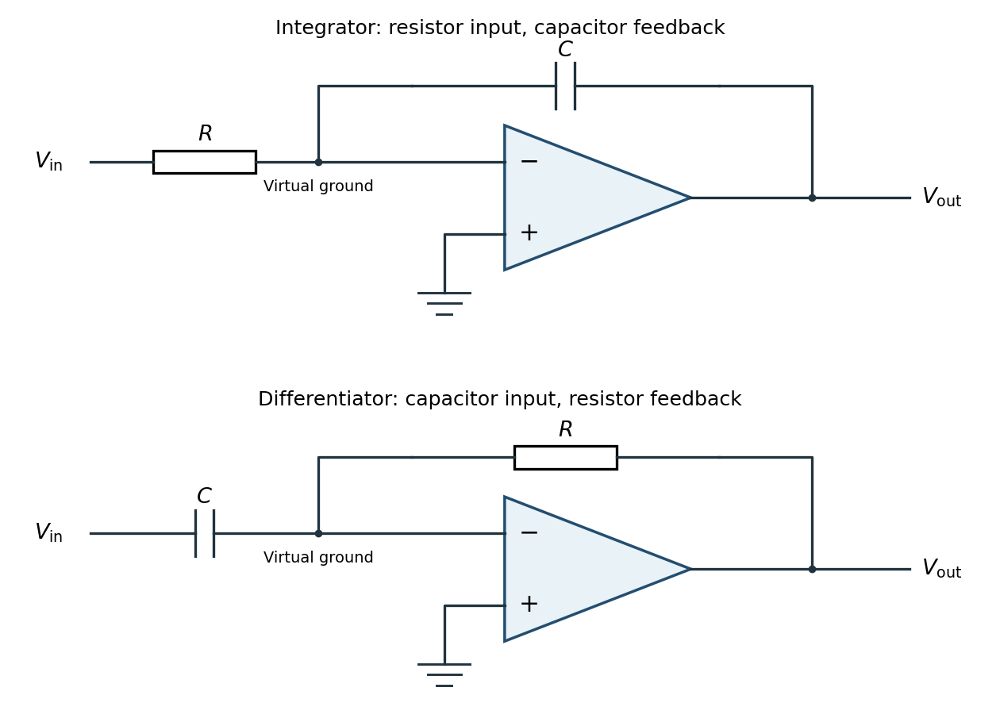

<h1 id="7/a/solution">Solution</h1>

↑ **Parent:** [A](../a.md)

Use an [ideal operational amplifier](../../../../ideal-operational-amplifier.md) with its non-inverting terminal grounded, an input [resistor](../../../../resistor.md) $R$ and a feedback [capacitor](../../../../capacitor.md) $C$, as in the upper circuit. Stable unsaturated [negative feedback](../../../../negative-feedback.md) holds the inverting terminal at [virtual ground](../../../../virtual-ground.md), while the input current into the amplifier itself vanishes.

**[Figure 1](#7/a/image-inverting-operational-amplifier-integrator-and-differentiator-circuits). Inverting operational-amplifier integrator and differentiator circuits**.

Applying [Kirchhoff's current law](../../../../kirchhoff-node-law.md) at the inverting node gives

$$
\frac{V_{\rm in}}{R}=C\frac{d(0-V_{\rm out})}{dt},\qquad\boxed{V_{\rm out}(t)=V_{\rm out}(t_0)-\frac1{RC}\int_{t_0}^{t}V_{\rm in}(t')\,dt'}.
$$

Thus the circuit is an inverting [op amp integrator](../../../../op-amp-integrator.md), with its integration constant set by the initial [capacitor charge](../../../../capacitor-charge.md). A constant input makes the output ramp until a real amplifier reaches a supply rail. A practical low-frequency design usually adds a large feedback [resistor](../../../../resistor.md) to limit drift; the ideal integral relation applies where the feedback [capacitor](../../../../capacitor.md) dominates.

## ↑ Ancestors (12)

1. [A](../a.md)
2. [7](../../7.md)
3. [2016](../../../2016-split.md)
4. [Past exam of the physics 2 paper of the University of Oxford](../../../split.md)
5. [Physics 2 paper of the University of Oxford](../../../../physics-2-paper-of-the-university-of-oxford.md)
6. [Year 1 of the physics course of the University of Oxford](../../../../year-1-of-the-physics-course-of-the-university-of-oxford.md)
7. [Physics course of the University of Oxford](../../../../physics-course-of-the-university-of-oxford.md)
8. [Undergraduate course of the University of Oxford](../../../../undergraduate-course-of-the-university-of-oxford.md)
9. [Course of the University of Oxford](../../../../course-of-the-university-of-oxford.md)
10. [University of Oxford](../../../../university-of-oxford-split.md)
11. [List of universities](../../../../list-of-universities.md)
12. [Codex Wiki](../../../../split.md)
