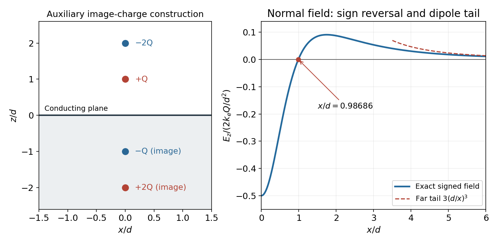

<h1 id="8/d/solution">Solution</h1>

↑ **Parent:** [D](../d.md)

Set the normal [electric field](../../../../electric-field-split.md) to zero and cancel its nonzero overall factor:

$$
\frac4{(x^2+4d^2)^{3/2}}=\frac1{(x^2+d^2)^{3/2}}.
$$

Taking the power $2/3$ gives $4^{2/3}(x^2+d^2)=x^2+4d^2$, hence

$$
\boxed{x=d\sqrt{\frac{4-4^{2/3}}{4^{2/3}-1}}\simeq0.98686d=0.98686\ \mathrm m}.
$$

The numerical value is independent of the nonzero magnitude of $Q$. Beyond this radius the signed normal [electric field](../../../../electric-field-split.md) is positive. Thus its magnitude first falls to zero, rises again and eventually decays; it is not globally monotone.

For $x\gg d$, expanding each denominator gives

$$
E_z=\frac{Qd}{2\pi\epsilon_0x^3}\left[3-\frac{45}{2}\frac{d^2}{x^2}+O\!\left(\frac{d^4}{x^4}\right)\right],\qquad\boxed{E_z\sim\frac{3Qd}{2\pi\epsilon_0x^3}>0}.
$$

This is a dipole rather than a monopole tail. The real-plus-image charge distribution has zero total charge and dipole moment $p_z=-6Qd$; in its equatorial plane a dipole produces $E_z=-k_ep_z/x^3$, confirming the coefficient and sign.

**[Figure 2](#8/d/image-image-charges-and-the-sign-changing-normal-field-above-an-infinite-conducting-plane). Image charges and the sign-changing normal field above an infinite conducting plane**.

## ↑ Ancestors (12)

1. [D](../d.md)
2. [8](../../8.md)
3. [2016](../../../2016-split.md)
4. [Past exam of the physics 2 paper of the University of Oxford](../../../split.md)
5. [Physics 2 paper of the University of Oxford](../../../../physics-2-paper-of-the-university-of-oxford.md)
6. [Year 1 of the physics course of the University of Oxford](../../../../year-1-of-the-physics-course-of-the-university-of-oxford.md)
7. [Physics course of the University of Oxford](../../../../physics-course-of-the-university-of-oxford.md)
8. [Undergraduate course of the University of Oxford](../../../../undergraduate-course-of-the-university-of-oxford.md)
9. [Course of the University of Oxford](../../../../course-of-the-university-of-oxford.md)
10. [University of Oxford](../../../../university-of-oxford-split.md)
11. [List of universities](../../../../list-of-universities.md)
12. [Codex Wiki](../../../../split.md)
