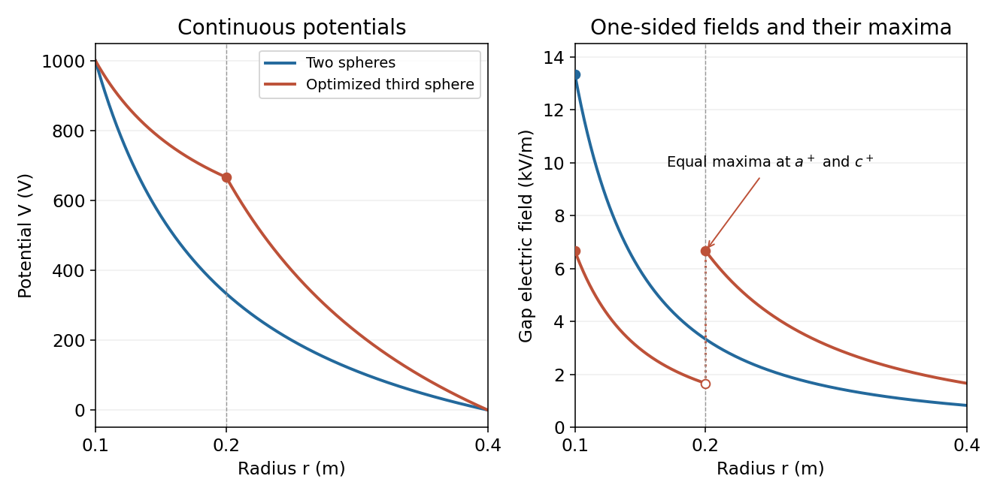

<h1 id="9/d/solution">Solution</h1>

↑ **Parent:** [D](../d.md)

The largest field in each gap lies at that gap's smaller radius. Thus the quantity to minimize is

$$
E_{\max}(V_2)=\max\left\{\frac{c|V_1-V_2|}{a(c-a)},\frac{b|V_2|}{c(b-c)}\right\}.
$$

For positive $V_1$, projecting any $V_2$ outside $[0,V_1]$ back to that interval reduces both absolute potential drops, so the optimum lies inside it. Within the interval, one candidate maximum decreases linearly with $V_2$ and the other increases linearly. Their maximum is minimized at their intersection, not by making the potential drops equal.

With $a=0.1\ \mathrm m$, $c=0.2\ \mathrm m$, $b=0.4\ \mathrm m$ and $V_1=1000\ \mathrm V$, the two maxima are $20(1000-V_2)$ and $10V_2$ in $\mathrm{V\,m^{-1}}$. Equating them gives

$$
\boxed{V_2=\frac{2000}{3}\ \mathrm V\simeq666.7\ \mathrm V,\qquad E_{\max}=\frac{20000}{3}\ \mathrm{V\,m^{-1}}\simeq6667\ \mathrm{V\,m^{-1}}}.
$$

The maximum is halved relative to the two-sphere system and is attained at both $a^+$ and $c^+$. At $c^-$ and $b^-$ the optimized field is only about $1667\ \mathrm{V\,m^{-1}}$; at $c$ the charged middle shell produces a jump.

For plotting, the two-sphere [electric potential](../../../../electric-potential.md) is $V^{(2)}(r)=V_1(1/r-1/b)/(1/a-1/b)$. In the three-sphere system it is

$$
V^{(3)}(r)=\begin{cases}
V_2+(V_1-V_2)\dfrac{1/r-1/c}{1/a-1/c},&a\le r\le c,\\
V_2\dfrac{1/r-1/b}{1/c-1/b},&c\le r\le b.
\end{cases}
$$

The [electric potential](../../../../electric-potential.md) remains continuous at $c$, while its radial derivative changes there. The graphs show both the continuous potentials and the one-sided gap fields; the marked endpoints identify all maxima.

**[Figure 3](#9/d/image-potential-and-electric-field-before-and-after-optimized-intermediate-sphere-bias). Potential and electric field before and after optimized intermediate-sphere bias**.

## ↑ Ancestors (12)

1. [D](../d.md)
2. [9](../../9.md)
3. [2016](../../../2016-split.md)
4. [Past exam of the physics 2 paper of the University of Oxford](../../../split.md)
5. [Physics 2 paper of the University of Oxford](../../../../physics-2-paper-of-the-university-of-oxford.md)
6. [Year 1 of the physics course of the University of Oxford](../../../../year-1-of-the-physics-course-of-the-university-of-oxford.md)
7. [Physics course of the University of Oxford](../../../../physics-course-of-the-university-of-oxford.md)
8. [Undergraduate course of the University of Oxford](../../../../undergraduate-course-of-the-university-of-oxford.md)
9. [Course of the University of Oxford](../../../../course-of-the-university-of-oxford.md)
10. [University of Oxford](../../../../university-of-oxford-split.md)
11. [List of universities](../../../../list-of-universities.md)
12. [Codex Wiki](../../../../split.md)
