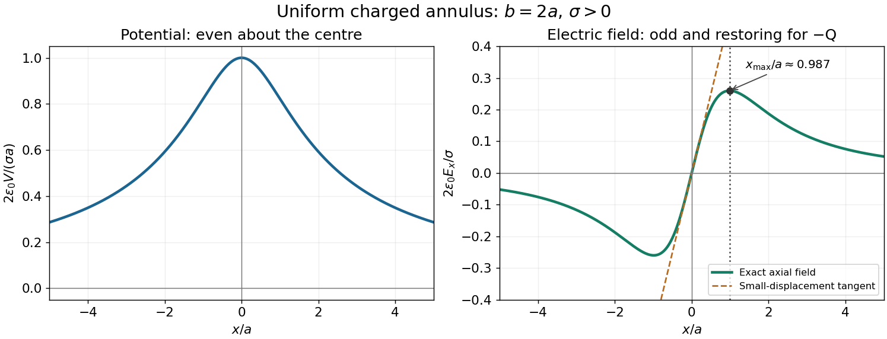
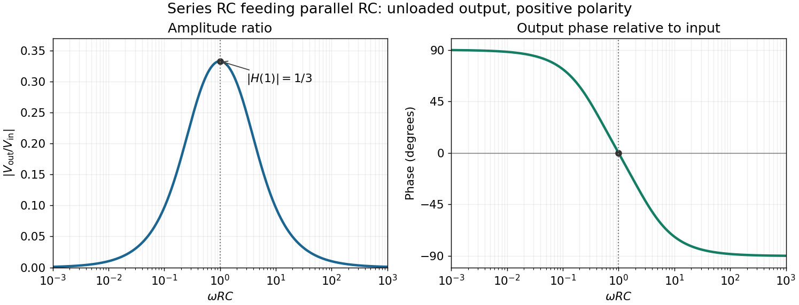

# 2017 resit

↑ **Parent:** [Past exam of the physics 2 paper of the University of Oxford](../past-exam-of-the-physics-2-paper-of-the-university-of-oxford.md)

Source paper: [Oxford public source archive, member 2017/A10288W1\_CP2\_Sept\_2017.pdf](https://www.whatdotheyknow.com/request/physics_preliminary_examinations/response/1162943/attach/3/Twain.7z?cookie_passthrough=1). The cover dates this resit to 5 September 2017. Lettered scopes below distinguish separately marked paragraphs where the source supplies no letters. All four Section B options are covered.

**Table of contents**

- [1](#1)
  - [Solution](#1/solution)
- [2](#2)
  - [a](#2/a)
    - [Solution](#2/a/solution)
  - [b](#2/b)
    - [Solution](#2/b/solution)
- [3](#3)
  - [Solution](#3/solution)
- [4](#4)
  - [Solution](#4/solution)
- [5](#5)
  - [Solution](#5/solution)
- [6](#6)
  - [Solution](#6/solution)
- [7](#7)
  - [a](#7/a)
    - [Solution](#7/a/solution)
  - [b](#7/b)
    - [Solution](#7/b/solution)
  - [c](#7/c)
    - [Solution](#7/c/solution)
  - [d](#7/d)
    - [Solution](#7/d/solution)
- [8](#8)
  - [a](#8/a)
    - [Solution](#8/a/solution)
  - [b](#8/b)
    - [Solution](#8/b/solution)
  - [c](#8/c)
    - [Solution](#8/c/solution)
- [9](#9)
  - [a](#9/a)
    - [Solution](#9/a/solution)
  - [b](#9/b)
    - [Solution](#9/b/solution)
  - [c](#9/c)
    - [Solution](#9/c/solution)
- [10](#10)
  - [a](#10/a)
    - [Solution](#10/a/solution)
  - [b](#10/b)
    - [Solution](#10/b/solution)
  - [c](#10/c)
    - [Solution](#10/c/solution)
  - [d](#10/d)
    - [Solution](#10/d/solution)

## 1

↑ **Parent:** [2017 resit](2017-resit.md)

<h3 id="1/solution">Solution</h3>

↑ **Parent:** [1](#1)

In a source-free [vacuum](../physics.md#vacuum), the [Maxwell equations](../maxwell-equations.md) in [SI](../physics.md#international-system-of-units) are

$$
\nabla\cdot\mathbf E=0,\qquad \nabla\cdot\mathbf B=0,\qquad
\nabla\times\mathbf E=-\frac{\partial\mathbf B}{\partial t},\qquad
\nabla\times\mathbf B=\mu_0\epsilon_0\frac{\partial\mathbf E}{\partial t},
$$

where $\epsilon_0$ and $\mu_0$ are the [vacuum permittivity](../permittivity.md#vacuum-permittivity) and [vacuum permeability](../maxwell-equations.md#vacuum-permeability). Take the [curl](../multivariable-calculus.md#curl) of the last equation, substitute [Faraday's law of induction](../maxwell-equations.md#faraday-s-law-of-induction), and use the [curl of the curl identity](../multivariable-calculus.md#curl-of-the-curl-identity):

$$
\nabla\times(\nabla\times\mathbf B)
=\nabla(\nabla\cdot\mathbf B)-\nabla^2\mathbf B
=-\mu_0\epsilon_0\frac{\partial^2\mathbf B}{\partial t^2}.
$$

The zero [divergence](../multivariable-calculus.md#divergence) therefore gives the [wave equation](../wave-equation.md)

$$
\boxed{\nabla^2\mathbf B=\frac1{c^2}\frac{\partial^2\mathbf B}{\partial t^2},\qquad c=\frac1{\sqrt{\mu_0\epsilon_0}}.}
$$

For a propagating [plane wave](../wave-function.md#plane-wave), write $\mathbf B=\operatorname{Re}[\mathbf B_0e^{i(\mathbf k\cdot\mathbf r-\omega t)}]$. The [wave equation](../wave-equation.md) gives $\omega^2=c^2|\mathbf k|^2$, and [Gauss's law for magnetism](../maxwell-equations.md#gauss-s-law-for-magnetism) gives $\mathbf k\cdot\mathbf B_0=0$. Thus the oscillating [magnetic field](../magnetic-field.md) is a [transverse wave](../wave.md#transverse-wave): it is perpendicular to the propagation [wavevector](../elasticity-physics.md#wavevector). A static background [magnetic field](../magnetic-field.md), if present, is separate from this propagating component.

## 2

↑ **Parent:** [2017 resit](2017-resit.md)

<h3 id="2/a">a</h3>

↑ **Parent:** [2](#2)

<h4 id="2/a/solution">Solution</h4>

↑ **Parent:** [A](#2/a)

The central [point charge](../electric-field.md#point-charge) and spherical boundaries give a [spherically symmetric charge distribution](../electrostatics.md#spherically-symmetric-charge-distribution). A [conductor in electrostatic equilibrium](../electrostatics.md#conductor-in-electrostatic-equilibrium) has zero [electric field](../electric-field.md) within its material. Consequently a spherical [Gaussian surface](../maxwell-equations.md#gaussian-surface) inside the metal encloses zero net [electric charge](../electric-charge.md), so the inner surface carries $-q$. The shell's prescribed total [electric charge](../electric-charge.md) then leaves $-2q$ on its outer surface. [Gauss's law](../maxwell-equations.md#gauss-s-law) gives

$$
\boxed{\mathbf E(r)=
\begin{cases}
\dfrac{q}{4\pi\epsilon_0r^2}\,\hat{\mathbf r},&0<r<r_1,\\[4pt]
\mathbf0,&r_1<r<r_2,\\[4pt]
-\dfrac{2q}{4\pi\epsilon_0r^2}\,\hat{\mathbf r},&r>r_2.
\end{cases}}
$$

The [electric field](../electric-field.md) is singular at the ideal central [point charge](../electric-field.md#point-charge). At each charged surface the normal component has distinct one-sided limits, as required by the [electrostatic boundary conditions at a conductor](../electrostatics.md#electrostatic-boundary-conditions-at-a-conductor). Spherical symmetry makes the outer [surface charge density](../electrostatics.md#surface-charge-density) uniform:

$$
\boxed{Q_{\rm inner}=-q,\qquad \sigma_{\rm outer}=-\frac{2q}{4\pi r_2^2}.}
$$

<h3 id="2/b">b</h3>

↑ **Parent:** [2](#2)

<h4 id="2/b/solution">Solution</h4>

↑ **Parent:** [B](#2/b)

For the [uniform space charge in a grounded spherical cavity](../electrostatics.md#uniform-space-charge-in-a-grounded-spherical-cavity), [grounding](../electrostatics.md#grounding) sets the metal's [electric potential](../electric-field.md#electric-potential) to zero. With no external sources and zero [electric potential](../electric-field.md#electric-potential) at infinity, the exterior [electric potential](../electric-field.md#electric-potential) is also zero by the [uniqueness theorem for the electrostatic potential](../electrostatics.md#uniqueness-theorem-for-the-electrostatic-potential). The original shell [electric charge](../electric-charge.md) is no longer fixed: [electric charge](../electric-charge.md) can flow to or from earth.

Inside the cavity, [Gauss's law](../maxwell-equations.md#gauss-s-law) gives $\mathbf E=\rho r\hat{\mathbf r}/(3\epsilon_0)$. Integrating the [electric field](../electric-field.md) inward from the zero boundary [electric potential](../electric-field.md#electric-potential) gives

$$
V(r)=\int_r^{r_1}\frac{\rho s}{3\epsilon_0}\,ds
=\frac{\rho(r_1^2-r^2)}{6\epsilon_0},\qquad
\boxed{V(0)=\frac{\rho r_1^2}{6\epsilon_0}.}
$$

The inner surface carries $-Q_\rho$, where $Q_\rho=4\pi\rho r_1^3/3$, and the outer surface carries zero net [electric charge](../electric-charge.md). Only the cavity contributes to the final [electrostatic energy](../electrostatics.md#electrostatic-energy):

$$
U=\frac{\epsilon_0}{2}\int |\mathbf E|^2\,d^3r
=\frac{\epsilon_0}{2}4\pi\int_0^{r_1}\left(\frac{\rho r}{3\epsilon_0}\right)^2r^2\,dr,
\qquad
\boxed{U=\frac{2\pi\rho^2r_1^5}{45\epsilon_0}
=\frac{Q_\rho^2}{40\pi\epsilon_0r_1}.}
$$

The same result follows from $U=\tfrac12\int\rho V\,d^3r$; the conductor's [surface charge](../electric-charge.md#surface-charge) contributes zero because its [electric potential](../electric-field.md#electric-potential) is zero. This is the final stored [electrostatic energy](../electrostatics.md#electrostatic-energy), not the change from the earlier central-charge configuration, whose ideal [point charge](../electric-field.md#point-charge) has divergent self-energy.

## 3

↑ **Parent:** [2017 resit](2017-resit.md)

<h3 id="3/solution">Solution</h3>

↑ **Parent:** [3](#3)

Use the [parallel-plate capacitor](../electromagnetism.md#parallel-plate-capacitor) approximation, neglecting the [fringing field of a capacitor](../electromagnetism.md#fringing-field-of-a-capacitor). With plate area $A=\pi(0.10\,\mathrm m)^2$, the initial [capacitance](../electromagnetism.md#capacitance) and opposite plate [electric charges](../electric-charge.md) are

$$
C_i=\frac{\epsilon_0A}{0.010\,\mathrm m}=2.78163\times10^{-11}\,\mathrm F,
\qquad
\boxed{Q_\pm=\pm C_i(100\,\mathrm V)=\pm2.78163\times10^{-9}\,\mathrm C.}
$$

After the [electric battery](../electrical-circuit.md#electric-battery) is disconnected, the isolated plate [electric charges](../electric-charge.md) stay fixed. Doubling the separation halves the [capacitance](../electromagnetism.md#capacitance). The quasistatic pulling work is the increase of [electrostatic energy](../electrostatics.md#electrostatic-energy):

$$
W=\frac{Q^2}{2C_f}-\frac{Q^2}{2C_i}
=\frac12C_i(100\,\mathrm V)^2,
\qquad
\boxed{W=1.39081\times10^{-7}\,\mathrm J.}
$$

The final [electric potential difference](../electric-field.md#electric-potential-difference) is therefore

$$
\boxed{\Delta V_f=\frac Q{C_f}=200\,\mathrm V.}
$$

An [electron](../physics.md#electron) released at rest gains [kinetic energy](../energy.md#kinetic-energy) $e\Delta V_f$, where $e$ is the positive [elementary charge](../electric-charge.md#elementary-charge). Neglecting radiation and the negligible perturbation caused by this one [electron](../physics.md#electron), [conservation of energy](../mathematical-physics.md#conservation-of-energy) gives

$$
\frac12m_ev^2=e\Delta V_f,
\qquad
\boxed{v=\sqrt{\frac{2e(200\,\mathrm V)}{m_e}}
=8.39\times10^6\,\mathrm{m\,s^{-1}}.}
$$

This is $0.0280c$, so the nonrelativistic [kinetic energy](../energy.md#kinetic-energy) is adequate. The circular plates have finite radii; the numerical results are leading [parallel-plate capacitor](../electromagnetism.md#parallel-plate-capacitor) values rather than exact finite-plate [capacitances](../electromagnetism.md#capacitance).

## 4

↑ **Parent:** [2017 resit](2017-resit.md)

<h3 id="4/solution">Solution</h3>

↑ **Parent:** [4](#4)

The [current density](../electric-charge.md#current-density) is the moving [charge density](../electric-charge.md#charge-density) times its [velocity](../classical-mechanics.md#velocity):

$$
\boxed{\mathbf J=\rho\mathbf v=\rho v_0\hat{\mathbf z}\quad(r<R),\qquad \mathbf J=\mathbf0\quad(r>R).}
$$

For a cylindrical [Gaussian surface](../maxwell-equations.md#gaussian-surface) of radius $r<R$ and length $\ell$, cylindrical symmetry makes the [electric field](../electric-field.md) radial. [Gauss's law](../maxwell-equations.md#gauss-s-law) gives $E(2\pi r\ell)=\rho\pi r^2\ell/\epsilon_0$. A circular [Ampère's circuital law](../maxwell-equations.md#ampere-s-circuital-law) contour encloses [electric current](../electric-charge.md#electric-current) $I(r)=\rho v_0\pi r^2$, giving $B(2\pi r)=\mu_0I(r)$. Hence

$$
\boxed{\mathbf E(r)=\frac{\rho r}{2\epsilon_0}\hat{\mathbf r},\qquad
\mathbf B(r)=\frac{\mu_0\rho v_0r}{2}\hat{\boldsymbol\phi}
=\mu_0\epsilon_0\,\mathbf v\times\mathbf E(r),\quad r<R.}
$$

The [right-hand rule](../electromagnetism.md#right-hand-rule) fixes the positive azimuthal direction of the [magnetic field](../magnetic-field.md) for positive [electric charge](../electric-charge.md) moving along $+z$. Both the [electric field](../electric-field.md) and the [magnetic field](../magnetic-field.md) vanish on the axis. These are the steady long-cylinder [electric field](../electric-field.md) and [magnetic field](../magnetic-field.md); end effects and changes of the prescribed beam distribution are excluded.

## 5

↑ **Parent:** [2017 resit](2017-resit.md)

<h3 id="5/solution">Solution</h3>

↑ **Parent:** [5](#5)

For normal incidence on a [diffraction grating](../physical-optics.md#diffraction-grating), adjacent grooves contribute a path difference $d\sin\theta$. [Constructive interference](../fourier-analysis.md#constructive-interference) occurs when the [grating equation](../physical-optics.md#grating-equation) $d\sin\theta=m\lambda$ holds. Thus the groove spacing is

$$
d=\frac{3(589\times10^{-9}\,\mathrm m)}{\sin32^\circ}
=3.334\times10^{-6}\,\mathrm m,
\qquad
\boxed{N=\frac{10^{-3}\,\mathrm m}{d}=299.9\ \text{lines per mm}\simeq300\ \text{lines per mm}.}
$$

An allowed propagating [diffraction order](../physical-optics.md#diffraction-order) must have $|\sin\theta|\leq1$. Therefore

$$
|m|\leq\frac d\lambda=\frac3{\sin32^\circ}=5.6615,
\qquad
\boxed{|m|_{\max}=5.}
$$

The fifth [diffraction order](../physical-optics.md#diffraction-order) is the highest geometrically permitted order for this [wavelength](../wave-equation.md#wavelength). Its actual brightness depends on groove shape and the [single-slit diffraction](../physical-optics.md#single-slit-diffraction) envelope, which the source does not specify; geometric permission alone does not guarantee a bright observable maximum.

## 6

↑ **Parent:** [2017 resit](2017-resit.md)

<h3 id="6/solution">Solution</h3>

↑ **Parent:** [6](#6)

The original diagram has an ideal $5\,\mathrm V$ [electric battery](../electrical-circuit.md#electric-battery) feeding series [resistors](../electric-charge.md#resistor) of $8\,\Omega$ above the tapping point and $2\,\Omega$ below it. The long battery bar is positive, so terminal $A$ is above terminal $B$ in [electric potential](../electric-field.md#electric-potential). With an [open circuit](../electrical-circuit.md#open-circuit) at the output, the internal [electric current](../electric-charge.md#electric-current) is $5/(8+2)=0.5\,\mathrm A$. The [voltage divider](../electrical-engineering.md#voltage-divider) therefore gives

$$
\boxed{\mathcal E_0=V_A-V_B=(0.5\,\mathrm A)(2\,\Omega)=1.0\,\mathrm V.}
$$

For the [Thévenin resistance](../electrical-engineering.md#thevenin-resistance), suppress the ideal voltage source by replacing it with a [short circuit](../electrical-circuit.md#short-circuit). The two [resistors](../electric-charge.md#resistor) are then in parallel as seen from $A,B$:

$$
\boxed{R_{\rm Th}=\frac{8\times2}{8+2}\,\Omega=1.6\,\Omega.}
$$

By [Thévenin's theorem](../electrical-engineering.md#thevenin-s-theorem), the terminal [voltage](../random-walk.md#voltage) under an outward load [electric current](../electric-charge.md#electric-current) $I$ is $V_A-V_B=\mathcal E_0-IR_{\rm Th}$. Consequently

$$
\boxed{I_{\rm sc}=\frac{\mathcal E_0}{R_{\rm Th}}=0.625\,\mathrm A,}
$$

flowing through an external [short circuit](../electrical-circuit.md#short-circuit) from $A$ to $B$. Directly shorting the original terminals bypasses the $2\,\Omega$ [resistor](../electric-charge.md#resistor) and leaves $5\,\mathrm V$ across $8\,\Omega$, independently confirming the result.

## 7

↑ **Parent:** [2017 resit](2017-resit.md)

<h3 id="7/a">a</h3>

↑ **Parent:** [7](#7)

<h4 id="7/a/solution">Solution</h4>

↑ **Parent:** [A](#7/a)

The integral and differential forms of [Gauss's law](../maxwell-equations.md#gauss-s-law) in [electrostatics](../electrostatics.md) are

$$
\boxed{\oint_{\partial\mathcal V}\mathbf E\cdot d\mathbf A
=\frac{Q_{\rm enc}}{\epsilon_0},\qquad
\nabla\cdot\mathbf E=\frac{\rho}{\epsilon_0}.}
$$

Here $\partial\mathcal V$ is a closed surface bounding a volume $\mathcal V$, $d\mathbf A=\hat{\mathbf n}\,dA$ is its outward area [vector](../vector-space.md#vector), $\mathbf E$ is the [electric field](../electric-field.md), $\rho$ is total volume [charge density](../electric-charge.md#charge-density), and $Q_{\rm enc}=\int_{\mathcal V}\rho\,d^3r$ is enclosed [electric charge](../electric-charge.md). The [divergence theorem](../multivariable-calculus.md#divergence-theorem) converts one form to the other. For ideal sheets or [point charges](../electric-field.md#point-charge), interpret the differential equation with their distributional [charge densities](../electric-charge.md#charge-density).

<h3 id="7/b">b</h3>

↑ **Parent:** [7](#7)

<h4 id="7/b/solution">Solution</h4>

↑ **Parent:** [B](#7/b)

Write the uniform [surface charge density](../electrostatics.md#surface-charge-density) on the [annulus](../topology.md#annulus-mathematics) as $\sigma=Q/[\pi(b^2-a^2)]$, and let $x$ be signed distance along its axis. A ring of radius $r$ and width $dr$ contains [electric charge](../electric-charge.md) $dq=2\pi\sigma r\,dr$. Its transverse [electric field](../electric-field.md) components cancel in pairs, and its [electric potential](../electric-field.md#electric-potential) is $dV=dq/[4\pi\epsilon_0\sqrt{x^2+r^2}]$. Setting $V(\infty)=0$ and integrating gives the [axial field of a uniformly charged annulus](../electrostatics.md#axial-field-of-a-uniformly-charged-annulus):

$$
\boxed{V(x)=\frac{\sigma}{2\epsilon_0}\left(\sqrt{x^2+b^2}-\sqrt{x^2+a^2}\right),}
$$

$$
\boxed{\mathbf E(x)=-\frac{dV}{dx}\hat{\mathbf x}
=\frac{\sigma x}{2\epsilon_0}\left(\frac1{\sqrt{x^2+a^2}}-\frac1{\sqrt{x^2+b^2}}\right)\hat{\mathbf x}.}
$$

At $x=0$, each element's [electric field](../electric-field.md) cancels that of the diametrically opposite element, so $\mathbf E=0$. There is no [surface charge](../electric-charge.md#surface-charge) at the centre because $a>0$; the axis [electric field](../electric-field.md) is continuous there.

For positive $Q$ and $x>0$, differentiate the signed axial [electric field](../electric-field.md):

$$
\frac{dE_x}{dx}=\frac{\sigma}{2\epsilon_0}
\left[\frac{a^2}{(x^2+a^2)^{3/2}}-\frac{b^2}{(x^2+b^2)^{3/2}}\right].
$$

Its stationary condition is $a^{4/3}(x^2+b^2)=b^{4/3}(x^2+a^2)$. Factoring with $A=a^{2/3}$ and $B=b^{2/3}$ gives

$$
\boxed{x_{\max}^2=\frac{a^{4/3}b^{4/3}}{a^{2/3}+b^{2/3}},\qquad
x_{\max}=\frac{(ab)^{2/3}}{\sqrt{a^{2/3}+b^{2/3}}}.}
$$

The derivative starts positive, has exactly one positive zero and is negative at large $x$, so this is the positive-side maximum. For either sign of $Q$, the [electric field](../electric-field.md) magnitude has equal maxima at $x=\pm x_{\max}$. As $b\to a$, the thin-ring limit is $x_{\max}\to a/\sqrt2$.

**[Figure 1](#7/b/image-axial-potential-and-electric-field-of-a-uniformly-charged-annulus). Axial potential and electric field of a uniformly charged annulus**. Original dimensionless curves for $b=2a$ and positive [surface charge density](../electrostatics.md#surface-charge-density). The dotted line marks the calculated positive-side maximum of the [electric field](../electric-field.md); the dashed tangent shows its linear behaviour near the centre.

<h3 id="7/c">c</h3>

↑ **Parent:** [7](#7)

<h4 id="7/c/solution">Solution</h4>

↑ **Parent:** [C](#7/c)

Let $m$ be the sliding [point charge](../electric-field.md#point-charge)'s [mass](../classical-mechanics.md#mass). Expanding the [axial field of a uniformly charged annulus](../electrostatics.md#axial-field-of-a-uniformly-charged-annulus) for $|x|\ll a,b$ gives

$$
E_x=\frac{\sigma}{2\epsilon_0}\left(\frac1a-\frac1b\right)x+O(x^3)
=\frac{Q}{2\pi\epsilon_0ab(a+b)}x+O(x^3).
$$

Its [electric charge](../electric-charge.md) is $-Q$, so its [electric force](../electric-field.md#electric-force) points toward the centre. [Newton's second law](../force.md#newton-s-second-law) becomes

$$
m\ddot x=-\frac{Q^2}{2\pi\epsilon_0ab(a+b)}x+O(x^3).
$$

To leading order this is [simple harmonic motion](../classical-mechanics.md#simple-harmonic-motion), with

$$
\boxed{\omega_{\rm osc}^2=\frac{Q^2}{2\pi\epsilon_0mab(a+b)},\qquad
T=2\pi\sqrt{\frac{2\pi\epsilon_0mab(a+b)}{Q^2}}.}
$$

The [mass](../classical-mechanics.md#mass) is an additional parameter, since the source supplies no numerical value. The constraint is essential: [stability](../numerical-analysis.md#stability-of-a-numerical-method) along the axis does not imply unconstrained three-dimensional trapping by a static [electric field](../electric-field.md).

<h3 id="7/d">d</h3>

↑ **Parent:** [7](#7)

<h4 id="7/d/solution">Solution</h4>

↑ **Parent:** [D](#7/d)

For a steady filamentary [electric current](../electric-charge.md#electric-current) $I$, the [Biot-Savart law](../electromagnetism.md#biot-savart-law) is

$$
\boxed{\mathbf B(\mathbf r)=\frac{\mu_0}{4\pi}\int
\frac{I\,d\boldsymbol\ell'\times(\mathbf r-\mathbf r')}{|\mathbf r-\mathbf r'|^3}.}
$$

Here $\mathbf r$ is the observation position, $\mathbf r'$ the source position, $d\boldsymbol\ell'$ points in the direction of positive [electric current](../electric-charge.md#electric-current), and $\mu_0$ is the [vacuum permeability](../maxwell-equations.md#vacuum-permeability). A circular loop has centre [magnetic field](../magnetic-field.md) $\mu_0I/(2r)$: the cross product has magnitude $r\,d\ell'$ and a constant axial direction, and $\int d\ell'=2\pi r$.

Introduce the constant signed [angular velocity](../rigid-body-dynamics.md#angular-velocity) $\Omega$ about the positive axis. A ring's [electric charge](../electric-charge.md) $dq=2\pi\sigma r\,dr$ crosses any radial cut once per rotation, so its [electric current](../electric-charge.md#electric-current) is $dI=\Omega\,dq/(2\pi)=\sigma\Omega r\,dr$. Adding loop contributions yields the [magnetic field of a rotating charged annulus](../electromagnetism.md#magnetic-field-of-a-rotating-charged-annulus):

$$
\mathbf B(0)=\hat{\mathbf x}\int_a^b\frac{\mu_0}{2r}\sigma\Omega r\,dr,
\qquad
\boxed{\mathbf B(0)=\frac{\mu_0\sigma\Omega(b-a)}2\hat{\mathbf x}
=\frac{\mu_0Q\Omega}{2\pi(a+b)}\hat{\mathbf x}.}
$$

The direction follows the [right-hand rule](../electromagnetism.md#right-hand-rule) for positive [electric charge](../electric-charge.md); reversing either $Q$ or $\Omega$ reverses the [magnetic field](../magnetic-field.md). The source supplies no rotation rate, so the answer necessarily retains $\Omega$.

## 8

↑ **Parent:** [2017 resit](2017-resit.md)

<h3 id="8/a">a</h3>

↑ **Parent:** [8](#8)

<h4 id="8/a/solution">Solution</h4>

↑ **Parent:** [A](#8/a)

Take $\mathbf d$ from the negative to the positive [point charge](../electric-field.md#point-charge). Their [electric dipole moment](../electrostatics.md#electric-dipole-moment) is $\mathbf p=q\mathbf d$. Place them at $\pm\mathbf d/2$ and use the [superposition principle](../vector-space.md#superposition-principle) for the [electric potential](../electric-field.md#electric-potential):

$$
V(\mathbf s)=\frac{q}{4\pi\epsilon_0}
\left(\frac1{|\mathbf s-\mathbf d/2|}-\frac1{|\mathbf s+\mathbf d/2|}\right).
$$

For $s\gg d$, the first-order [Taylor expansion](../calculus.md#taylor-expansion) of the reciprocal distances gives

$$
\boxed{V(s,\theta)=\frac{\mathbf p\cdot\hat{\mathbf s}}{4\pi\epsilon_0s^2}
=\frac{p\cos\theta}{4\pi\epsilon_0s^2}}
$$

to leading [electric dipole](../electrostatics.md#electric-dipole) order. In [spherical coordinates](../multivariable-calculus.md#spherical-coordinate-system) aligned with $\mathbf p$, the [gradient](../multivariable-calculus.md#gradient) gives $E_s=-\partial_sV$, $E_\theta=-s^{-1}\partial_\theta V$ and $E_\phi=0$. Thus

$$
\boxed{\mathbf E(s,\theta)=\frac{p}{4\pi\epsilon_0s^3}
\left(2\cos\theta\,\hat{\mathbf s}+\sin\theta\,\hat{\boldsymbol\theta}\right).}
$$

Equivalently, the [electric dipole field](../electrostatics.md#electric-dipole-field) is $[3(\mathbf p\cdot\hat{\mathbf s})\hat{\mathbf s}-\mathbf p]/(4\pi\epsilon_0s^3)$. The omitted terms vanish relative to these leading expressions as $d/s\to0$.

<h3 id="8/b">b</h3>

↑ **Parent:** [8](#8)

<h4 id="8/b/solution">Solution</h4>

↑ **Parent:** [B](#8/b)

The [method of images](../mathematics.md#method-of-images) replaces a conductor's induced [surface charge](../electric-charge.md#surface-charge) by suitable fictitious [image charges](../electric-field.md#image-charge) located outside the physical region in which the [electric field](../electric-field.md) is sought. Choose them so that the combined [electric potential](../electric-field.md#electric-potential) satisfies the specified conductor boundary values, has the required behaviour at infinity, and has the correct physical sources. The [uniqueness theorem for the electrostatic potential](../electrostatics.md#uniqueness-theorem-for-the-electrostatic-potential) then identifies this constructed [electric potential](../electric-field.md#electric-potential) with the physical solution in that region.

For an infinite grounded [conducting plane](../electric-charge.md#conducting-plane) at $z=0$, a [point charge](../electric-field.md#point-charge) $q$ at $(x,y,z)$ with $z>0$ has an [image charge](../electric-field.md#image-charge) $-q$ at $(x,y,-z)$. Distances to the pair are equal on the plane, so their [electric potentials](../electric-field.md#electric-potential) cancel there. This construction determines the [electric field](../electric-field.md) above the plane; below it the actual conductor has constant [electric potential](../electric-field.md#electric-potential) and zero [electric field](../electric-field.md), rather than the fictitious image's continuation.

<h3 id="8/c">c</h3>

↑ **Parent:** [8](#8)

<h4 id="8/c/solution">Solution</h4>

↑ **Parent:** [C](#8/c)

Use the [electric dipole above a grounded conducting plane](../mathematics.md#electric-dipole-above-a-grounded-conducting-plane) approximation, valid for $d\ll a$. Let $\hat{\mathbf z}$ point upward, and choose $\mathbf p=p(\sin\theta\,\hat{\mathbf x}+\cos\theta\,\hat{\mathbf z})$. Reflecting the two constituent [point charges](../electric-field.md#point-charge) and reversing their signs produces an image [electric dipole moment](../electrostatics.md#electric-dipole-moment)

$$
\mathbf p'=p(-\sin\theta\,\hat{\mathbf x}+\cos\theta\,\hat{\mathbf z})
$$

at height $-a$. Thus the parallel [electric dipole moment](../electrostatics.md#electric-dipole-moment) reverses and the normal one is unchanged. At the real [electric dipole](../electrostatics.md#electric-dipole), the separation from its image is $2a\hat{\mathbf z}$, giving the image [electric field](../electric-field.md)

$$
\mathbf E_{\rm im}=\frac{1}{4\pi\epsilon_0(2a)^3}
\left[3(\mathbf p'\cdot\hat{\mathbf z})\hat{\mathbf z}-\mathbf p'\right]
=\frac{p}{32\pi\epsilon_0a^3}
\left(\sin\theta\,\hat{\mathbf x}+2\cos\theta\,\hat{\mathbf z}\right).
$$

The physical [torque](../momentum.md#torque) is $\boldsymbol\tau=\mathbf p\times\mathbf E_{\rm im}$, so

$$
\boxed{\boldsymbol\tau=-\frac{p^2\sin\theta\cos\theta}{32\pi\epsilon_0a^3}\hat{\mathbf y}
=-\frac{p^2\sin2\theta}{64\pi\epsilon_0a^3}\hat{\mathbf y}.}
$$

For $0<\theta<\pi/2$, its direction reduces $\theta$, tending to align the [electric dipole](../electrostatics.md#electric-dipole) with the upward normal. In general it favours either normal orientation; a perfectly parallel orientation has zero [torque](../momentum.md#torque) but is unstable to tilting.

The conductor-response [potential energy](../energy.md#potential-energy) includes one half of the real-image interaction:

$$
U=-\frac12\mathbf p\cdot\mathbf E_{\rm im}
=-\frac{p^2(1+\cos^2\theta)}{64\pi\epsilon_0a^3}.
$$

This factor accounts for the induced [surface charge](../electric-charge.md#surface-charge) changing as the physical source is assembled. Differentiation with respect to height at fixed orientation gives

$$
\boxed{\mathbf F=-\frac{\partial U}{\partial a}\hat{\mathbf z}
=-\frac{3p^2(1+\cos^2\theta)}{64\pi\epsilon_0a^4}\hat{\mathbf z}.}
$$

There is no horizontal [force](../force.md), since translating the entire arrangement parallel to the plane leaves $U$ unchanged. For example, the normal and parallel orientations give respective downward [force](../force.md) magnitudes $3p^2/(32\pi\epsilon_0a^4)$ and $3p^2/(64\pi\epsilon_0a^4)$.

A single physical [point charge](../electric-field.md#point-charge) induces total plane [electric charge](../electric-charge.md) $-q$. One can verify this by integrating its induced [surface charge density](../electrostatics.md#surface-charge-density), $-qh/[2\pi(\varrho^2+h^2)^{3/2}]$, over the plane. The two physical [electric charges](../electric-charge.md) therefore induce opposite totals, giving

$$
\boxed{Q_{\rm plane}=-(+q)-(-q)=0.}
$$

The local [surface charge density](../electrostatics.md#surface-charge-density) is generally nonzero. The zero total holds for the finite neutral pair as well as its ideal [electric dipole](../electrostatics.md#electric-dipole) limit.

## 9

↑ **Parent:** [2017 resit](2017-resit.md)

<h3 id="9/a">a</h3>

↑ **Parent:** [9](#9)

<h4 id="9/a/solution">Solution</h4>

↑ **Parent:** [A](#9/a)

[Fermat's principle](../mathematical-physics.md#fermat-principle) states that the travel time, or equivalently the [optical path length](../physical-optics.md#optical-path-length) $\int n\,ds$ in a stationary medium, is stationary under small variations of the path with endpoints held fixed. It need not be a global minimum.

Let a [light ray](../geometrical-optics.md#light-ray) join a point at height $h_1$ above a plane interface to a point at depth $h_2$ below it, with horizontal separation $D$. If the crossing point is horizontally $\xi$ from the first endpoint, its [optical path length](../physical-optics.md#optical-path-length) is

$$
\mathcal L(\xi)=n_1\sqrt{h_1^2+\xi^2}
+n_2\sqrt{h_2^2+(D-\xi)^2}.
$$

Setting its derivative to zero gives

$$
\frac{n_1\xi}{\sqrt{h_1^2+\xi^2}}
=\frac{n_2(D-\xi)}{\sqrt{h_2^2+(D-\xi)^2}}.
$$

The two geometric ratios are the sines of the incident and refracted [angles](../geometry-and-topology.md#angle), measured from the interface [normal vector](../differential-geometry.md#normal-vector). Hence [Snell's law](../partial-differential-equation.md#snell-s-law) is

$$
\boxed{n_1\sin\theta_1=n_2\sin\theta_2.}
$$

<h3 id="9/b">b</h3>

↑ **Parent:** [9](#9)

<h4 id="9/b/solution">Solution</h4>

↑ **Parent:** [B](#9/b)

The [paraxial approximation](../partial-differential-equation.md#paraxial-approximation) restricts [light rays](../geometrical-optics.md#light-ray) to small slopes relative to the [optical axis](../geometrical-optics.md#optical-axis), so $\sin\beta\simeq\tan\beta\simeq\beta$ and geometric lengths can be expanded to second order in height. Treat the source's [optical lens](../geometrical-optics.md#lens-optics) as a [thin lens](../geometrical-optics.md#thin-lens) located at $x=0$, with $|y|\ll u,|v|$ and small surface slopes.

For positive real conjugate distances $u,v$, the collapsed-plane geometric path has length

$$
S(y)=\sqrt{u^2+y^2}+\sqrt{v^2+y^2}
\simeq u+v+\frac{y^2}{2}\left(\frac1u+\frac1v\right).
$$

To thin-element accuracy, a segment $s(y)=s_0-\alpha y^2$ of this path lies inside the [optical lens](../geometrical-optics.md#lens-optics), replacing the same length of air. The geometric air path is $S-s$, the material path is $s$, and the [optical path length](../physical-optics.md#optical-path-length) and travel time are therefore

$$
\mathcal L(y)=S(y)+(n-1)s(y),\qquad
ct(y)\simeq u+v+(n-1)s_0
+y^2\left[\frac1{2u}+\frac1{2v}-(n-1)\alpha\right].
$$

This distinguishes geometric length from [optical path length](../physical-optics.md#optical-path-length); adding $ns$ to $S$ without subtracting the replaced air would count that segment twice.

For a nonaxial [light ray](../geometrical-optics.md#light-ray), [Fermat's principle](../mathematical-physics.md#fermat-principle) gives $d\mathcal L/dy=0$ and hence

$$
\frac1u+\frac1v=2(n-1)\alpha.
$$

The [focal length](../geometrical-optics.md#focal-length) is obtained with the incident object at infinity:

$$
\boxed{\frac1f=2(n-1)\alpha,\qquad f=\frac1{2(n-1)\alpha}.}
$$

The constant thickness $s_0$ supplies a common delay but does not change the leading [focal length](../geometrical-optics.md#focal-length). Since $\alpha$ has units of inverse [length](../physics.md#length), this formula has the correct dimensions. These are [thin lens](../geometrical-optics.md#thin-lens) results; [paraxial approximation](../partial-differential-equation.md#paraxial-approximation) alone does not remove finite-thickness corrections in a general [thick lens](../geometrical-optics.md#thick-lens).

<h3 id="9/c">c</h3>

↑ **Parent:** [9](#9)

<h4 id="9/c/solution">Solution</h4>

↑ **Parent:** [C](#9/c)

Substituting the stated [refractive index](../electromagnetic-wave.md#refractive-index) and thickness coefficient, $\alpha=2\,\mathrm{m^{-1}}$, gives

$$
\boxed{f=\frac1{2(1.5-1)(2\,\mathrm{m^{-1}})}=0.50\,\mathrm m.}
$$

The [thin lens](../geometrical-optics.md#thin-lens) equation then gives

$$
\frac1v=\frac1f-\frac1u=2-\frac1{0.7}=\frac47\,\mathrm{m^{-1}},
\qquad
\boxed{v=1.75\,\mathrm m.}
$$

The positive image distance places a [real image](../optics.md#real-image) on the outgoing side of the [optical lens](../geometrical-optics.md#lens-optics), at $x=+1.75\,\mathrm m$. The object is beyond the [focal point](../geodesic-congruence.md#focal-point-of-a-hypersurface), so outgoing [light rays](../geometrical-optics.md#light-ray) actually converge there rather than only their backward extensions meeting.

## 10

↑ **Parent:** [2017 resit](2017-resit.md)

<h3 id="10/a">a</h3>

↑ **Parent:** [10](#10)

<h4 id="10/a/solution">Solution</h4>

↑ **Parent:** [A](#10/a)

Use [phasors](../wave.md#phasor) with time dependence $e^{i\omega t}$. The [electrical impedance](../electrical-circuit.md#electrical-impedance) $Z=\widetilde V/\widetilde I$ is the [complex number](../complex-analysis.md#complex-number) relating the sinusoidal [voltage](../random-walk.md#voltage) and [electric current](../electric-charge.md#electric-current): $|Z|$ is their [amplitude](../wave.md#wave-amplitude) ratio and $\arg Z$ is the [voltage](../random-walk.md#voltage) [phase](../wave.md#phase-waves) relative to the [electric current](../electric-charge.md#electric-current). The component laws give

$$
V=RI\ \Longrightarrow\ \boxed{Z_R=R},\qquad
I=C\frac{dV}{dt}\ \Longrightarrow\ \boxed{Z_C=\frac1{i\omega C}},\qquad
V=L\frac{dI}{dt}\ \Longrightarrow\ \boxed{Z_L=i\omega L}.
$$

Thus the [resistor](../electric-charge.md#resistor) has zero relative [phase](../wave.md#phase-waves), the [capacitor](../electromagnetism.md#capacitor) [voltage](../random-walk.md#voltage) lags its [electric current](../electric-charge.md#electric-current) by $\pi/2$, and the [inductor](../electromagnetism.md#inductor) [voltage](../random-walk.md#voltage) leads its [electric current](../electric-charge.md#electric-current) by $\pi/2$. The ideal [capacitor](../electromagnetism.md#capacitor) and [inductor](../electromagnetism.md#inductor) store and return [energy](../energy.md); the real [electrical impedance](../electrical-circuit.md#electrical-impedance) of the [resistor](../electric-charge.md#resistor) describes dissipation.

<h3 id="10/b">b</h3>

↑ **Parent:** [10](#10)

<h4 id="10/b/solution">Solution</h4>

↑ **Parent:** [B](#10/b)

The original diagram's upper arm is a series [resistor](../electric-charge.md#resistor) and [capacitor](../electromagnetism.md#capacitor); its lower arm is a parallel [resistor](../electric-charge.md#resistor) and [capacitor](../electromagnetism.md#capacitor). The output is the upper-minus-lower [voltage](../random-walk.md#voltage) across that parallel arm. Assume an ideal input voltage source and an unloaded output. Their [electrical impedances](../electrical-circuit.md#electrical-impedance) are

$$
Z_s=R+\frac1{i\omega C},\qquad Z_p=\frac{R}{1+i\omega RC}.
$$

For this [series-parallel RC band-pass filter](../electrical-engineering.md#series-parallel-rc-band-pass-filter), the [voltage divider](../electrical-engineering.md#voltage-divider) gives, with $w=\omega RC$,

$$
\boxed{H(\omega)=\frac{\widetilde V_{\rm out}}{\widetilde V_{\rm in}}
=\frac{Z_p}{Z_s+Z_p}
=\frac1{3+i(w-w^{-1})}
=\frac{iw}{1-w^2+3iw}.}
$$

Taking the real part of $V_0H e^{i\omega t}$ yields the steady output

$$
\boxed{V_{\rm out}(t)=\frac{V_0}{\sqrt{9+(w-w^{-1})^2}}
\cos\!\left[\omega t-\arctan\!\left(\frac{w-w^{-1}}3\right)\right].}
$$

Initial charging contributes decaying transients if the source is switched on at a finite time; the displayed expression is the sinusoidal steady state. The output polarity matters: reversing the indicated output [voltage](../random-walk.md#voltage) would multiply $H$ by $-1$.

<h3 id="10/c">c</h3>

↑ **Parent:** [10](#10)

<h4 id="10/c/solution">Solution</h4>

↑ **Parent:** [C](#10/c)

For positive [angular frequency](../lagrangian-mechanics.md#angular-frequency), the squared [amplitude](../wave.md#wave-amplitude) response of the [series-parallel RC band-pass filter](../electrical-engineering.md#series-parallel-rc-band-pass-filter) is

$$
|H|^2=\frac1{9+(w-w^{-1})^2}.
$$

Its denominator is minimized exactly when $w=w^{-1}$, so

$$
\boxed{\omega_0=\frac1{RC},\qquad H(\omega_0)=\frac13,\qquad
V_{\rm out}(t)=\frac{V_0}{3}\cos\omega_0t.}
$$

This is a [band-pass filter](../electrical-engineering.md#band-pass-filter) maximum produced entirely by the two RC arms; the drawn [electrical circuit](../electrical-circuit.md) contains no [inductor](../electromagnetism.md#inductor). The low- and high-[frequency](../wave.md#frequency) limits are

$$
\boxed{H\simeq i\omega RC\quad(\omega\ll\omega_0),\qquad
H\simeq-\frac{i}{\omega RC}\quad(\omega\gg\omega_0).}
$$

Thus the output [amplitude](../wave.md#wave-amplitude) tends to zero linearly with $\omega$ at low [frequency](../wave.md#frequency) and as $1/\omega$ at high [frequency](../wave.md#frequency). In real time,

$$
V_{\rm out}\simeq-V_0\omega RC\sin\omega t\quad(\omega\ll\omega_0),\qquad
V_{\rm out}\simeq\frac{V_0}{\omega RC}\sin\omega t\quad(\omega\gg\omega_0).
$$

The upper series [capacitor](../electromagnetism.md#capacitor) suppresses low [frequencies](../wave.md#frequency), while the lower shunt [capacitor](../electromagnetism.md#capacitor) suppresses high [frequencies](../wave.md#frequency).

<h3 id="10/d">d</h3>

↑ **Parent:** [10](#10)

<h4 id="10/d/solution">Solution</h4>

↑ **Parent:** [D](#10/d)

In the chosen [phasor](../wave.md#phasor) convention, output [phase](../wave.md#phase-waves) minus input [phase](../wave.md#phase-waves) is

$$
\boxed{\phi(\omega)=-\arctan\!\left[\frac{\omega RC-(\omega RC)^{-1}}3\right],\qquad \omega>0.}
$$

The real part of the denominator is positive, so this principal [arctangent](../geometry-and-topology.md#inverse-tangent) is continuous throughout the positive-[frequency](../wave.md#frequency) range. Below $\omega_0$, the output leads the input, approaching $+\pi/2$ at low [frequency](../wave.md#frequency). Above $\omega_0$, it lags, approaching $-\pi/2$ at high [frequency](../wave.md#frequency). At the maximum,

$$
\boxed{\phi(\omega_0)=0.}
$$

The input and output are in [phase](../wave.md#phase-waves) there, with the positive one-third [voltage](../random-walk.md#voltage) ratio found above.

**[Figure 2](#10/d/image-amplitude-and-phase-response-of-the-series-parallel-rc-band-pass-filter). Amplitude and phase response of the series-parallel RC band-pass filter**. Original curves against $\omega RC$ use the exact unloaded transfer function. The positive output polarity gives a peak ratio of $1/3$ and zero relative [phase](../wave.md#phase-waves) at $\omega RC=1$.

## ↑ Ancestors (9)

1. [Past exam of the physics 2 paper of the University of Oxford](../past-exam-of-the-physics-2-paper-of-the-university-of-oxford.md)
2. [Physics 2 paper of the University of Oxford](../university-of-oxford.md#physics-2-paper-of-the-university-of-oxford)
3. [Year 1 of the physics course of the University of Oxford](../university-of-oxford.md#year-1-of-the-physics-course-of-the-university-of-oxford)
4. [Physics course of the University of Oxford](../university-of-oxford.md#physics-course-of-the-university-of-oxford)
5. [Undergraduate course of the University of Oxford](../university-of-oxford.md#undergraduate-course-of-the-university-of-oxford)
6. [Course of the University of Oxford](../university-of-oxford.md#course-of-the-university-of-oxford)
7. [University of Oxford](../university-of-oxford.md)
8. [List of universities](../README.md#list-of-universities)
9. [Codex Wiki](../README.md)
