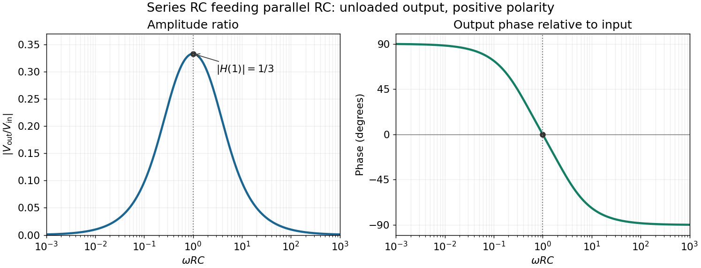

<h1 id="10/d/solution">Solution</h1>

↑ **Parent:** [D](../d.md)

In the chosen [phasor](../../../../phasor.md) convention, output [phase](../../../../phase-waves.md) minus input [phase](../../../../phase-waves.md) is

$$
\boxed{\phi(\omega)=-\arctan\!\left[\frac{\omega RC-(\omega RC)^{-1}}3\right],\qquad \omega>0.}
$$

The real part of the denominator is positive, so this principal [arctangent](../../../../inverse-tangent.md) is continuous throughout the positive-[frequency](../../../../frequency.md) range. Below $\omega_0$, the output leads the input, approaching $+\pi/2$ at low [frequency](../../../../frequency.md). Above $\omega_0$, it lags, approaching $-\pi/2$ at high [frequency](../../../../frequency.md). At the maximum,

$$
\boxed{\phi(\omega_0)=0.}
$$

The input and output are in [phase](../../../../phase-waves.md) there, with the positive one-third [voltage](../../../../voltage.md) ratio found above.

**[Figure 2](#10/d/image-amplitude-and-phase-response-of-the-series-parallel-rc-band-pass-filter). Amplitude and phase response of the series-parallel RC band-pass filter**. Original curves against $\omega RC$ use the exact unloaded transfer function. The positive output polarity gives a peak ratio of $1/3$ and zero relative [phase](../../../../phase-waves.md) at $\omega RC=1$.

## ↑ Ancestors (12)

1. [D](../d.md)
2. [10](../../10.md)
3. [2017 resit](../../../2017-resit-split.md)
4. [Past exam of the physics 2 paper of the University of Oxford](../../../split.md)
5. [Physics 2 paper of the University of Oxford](../../../../physics-2-paper-of-the-university-of-oxford.md)
6. [Year 1 of the physics course of the University of Oxford](../../../../year-1-of-the-physics-course-of-the-university-of-oxford.md)
7. [Physics course of the University of Oxford](../../../../physics-course-of-the-university-of-oxford.md)
8. [Undergraduate course of the University of Oxford](../../../../undergraduate-course-of-the-university-of-oxford.md)
9. [Course of the University of Oxford](../../../../course-of-the-university-of-oxford.md)
10. [University of Oxford](../../../../university-of-oxford-split.md)
11. [List of universities](../../../../list-of-universities.md)
12. [Codex Wiki](../../../../split.md)
