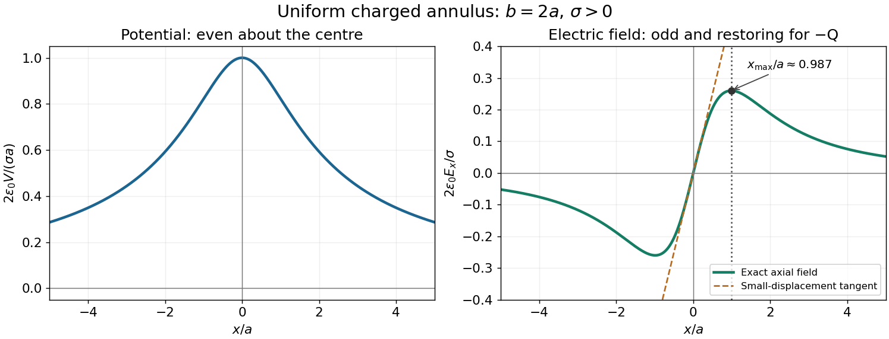

<h1 id="7/b/solution">Solution</h1>

↑ **Parent:** [B](../b.md)

Write the uniform [surface charge density](../../../../surface-charge-density.md) on the [annulus](../../../../annulus-mathematics.md) as $\sigma=Q/[\pi(b^2-a^2)]$, and let $x$ be signed distance along its axis. A ring of radius $r$ and width $dr$ contains [electric charge](../../../../electric-charge-split.md) $dq=2\pi\sigma r\,dr$. Its transverse [electric field](../../../../electric-field-split.md) components cancel in pairs, and its [electric potential](../../../../electric-potential.md) is $dV=dq/[4\pi\epsilon_0\sqrt{x^2+r^2}]$. Setting $V(\infty)=0$ and integrating gives the [axial field of a uniformly charged annulus](../../../../axial-field-of-a-uniformly-charged-annulus.md):

$$
\boxed{V(x)=\frac{\sigma}{2\epsilon_0}\left(\sqrt{x^2+b^2}-\sqrt{x^2+a^2}\right),}
$$

$$
\boxed{\mathbf E(x)=-\frac{dV}{dx}\hat{\mathbf x}
=\frac{\sigma x}{2\epsilon_0}\left(\frac1{\sqrt{x^2+a^2}}-\frac1{\sqrt{x^2+b^2}}\right)\hat{\mathbf x}.}
$$

At $x=0$, each element's [electric field](../../../../electric-field-split.md) cancels that of the diametrically opposite element, so $\mathbf E=0$. There is no [surface charge](../../../../surface-charge.md) at the centre because $a>0$; the axis [electric field](../../../../electric-field-split.md) is continuous there.

For positive $Q$ and $x>0$, differentiate the signed axial [electric field](../../../../electric-field-split.md):

$$
\frac{dE_x}{dx}=\frac{\sigma}{2\epsilon_0}
\left[\frac{a^2}{(x^2+a^2)^{3/2}}-\frac{b^2}{(x^2+b^2)^{3/2}}\right].
$$

Its stationary condition is $a^{4/3}(x^2+b^2)=b^{4/3}(x^2+a^2)$. Factoring with $A=a^{2/3}$ and $B=b^{2/3}$ gives

$$
\boxed{x_{\max}^2=\frac{a^{4/3}b^{4/3}}{a^{2/3}+b^{2/3}},\qquad
x_{\max}=\frac{(ab)^{2/3}}{\sqrt{a^{2/3}+b^{2/3}}}.}
$$

The derivative starts positive, has exactly one positive zero and is negative at large $x$, so this is the positive-side maximum. For either sign of $Q$, the [electric field](../../../../electric-field-split.md) magnitude has equal maxima at $x=\pm x_{\max}$. As $b\to a$, the thin-ring limit is $x_{\max}\to a/\sqrt2$.

**[Figure 1](#7/b/image-axial-potential-and-electric-field-of-a-uniformly-charged-annulus). Axial potential and electric field of a uniformly charged annulus**. Original dimensionless curves for $b=2a$ and positive [surface charge density](../../../../surface-charge-density.md). The dotted line marks the calculated positive-side maximum of the [electric field](../../../../electric-field-split.md); the dashed tangent shows its linear behaviour near the centre.

## ↑ Ancestors (12)

1. [B](../b.md)
2. [7](../../7.md)
3. [2017 resit](../../../2017-resit-split.md)
4. [Past exam of the physics 2 paper of the University of Oxford](../../../split.md)
5. [Physics 2 paper of the University of Oxford](../../../../physics-2-paper-of-the-university-of-oxford.md)
6. [Year 1 of the physics course of the University of Oxford](../../../../year-1-of-the-physics-course-of-the-university-of-oxford.md)
7. [Physics course of the University of Oxford](../../../../physics-course-of-the-university-of-oxford.md)
8. [Undergraduate course of the University of Oxford](../../../../undergraduate-course-of-the-university-of-oxford.md)
9. [Course of the University of Oxford](../../../../course-of-the-university-of-oxford.md)
10. [University of Oxford](../../../../university-of-oxford-split.md)
11. [List of universities](../../../../list-of-universities.md)
12. [Codex Wiki](../../../../split.md)
