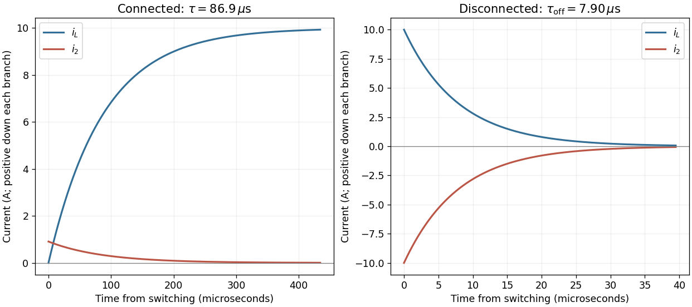

<h1 id="11/b/solution">Solution</h1>

↑ **Parent:** [B](../b.md)

The original diagram places $R_2$ in parallel with the [inductor](../../../../inductor.md); $R_1$ connects their common node to the source only when the switch is in position 2. Let $v(t)$ be their shared [voltage](../../../../voltage.md) and $i_L(t)$ the downward [inductor](../../../../inductor.md) [electric current](../../../../electric-current.md). Since $i_L(0^-)=0$ and a finite [voltage](../../../../voltage.md) cannot change it instantaneously, the [inductor](../../../../inductor.md) initially behaves as an open branch. Thus

$$
I_2(0^+)=\frac{V_0}{R_1+R_2}=\frac{100}{110}\,\mathrm A=0.909\,\mathrm A.
$$

At long times, an ideal [inductor](../../../../inductor.md) carrying constant [electric current](../../../../electric-current.md) has $v=L\dot i_L=0$, shorting $R_2$. Therefore $I_2(\infty)=0$ and $i_L(\infty)=V_0/R_1=10\,\mathrm A$.

For the full transient, [Kirchhoff's current law](../../../../kirchhoff-node-law.md) gives $(V_0-v)/R_1=i_L+v/R_2$ with $v=L\dot i_L$. Equivalently, the source seen by the [inductor](../../../../inductor.md) has the [Thévenin equivalent](../../../../thevenin-equivalent.md)

$$
V_{\rm th}=\frac{V_0R_2}{R_1+R_2},\qquad
R_{\rm th}=R_1\parallel R_2=\frac{R_1R_2}{R_1+R_2}.
$$

Solving $L\dot i_L+R_{\rm th}i_L=V_{\rm th}$ gives

$$
\boxed{i_L(t)=\frac{V_0}{R_1}(1-e^{-t/\tau}),\quad
I_2(t)=\frac{V_0}{R_1+R_2}e^{-t/\tau},\quad
\tau=\frac{L}{R_{\rm th}}=86.9\,\mathrm{\mu s}.}
$$

The relevant resistance is the parallel combination with the ideal [voltage source](../../../../voltage-source.md) suppressed, not $R_1+R_2$ and not $R_1$ alone.

**[Figure 4](#11/b/image-current-redistribution-when-the-solenoid-is-connected-and-disconnected). Current redistribution when the solenoid is connected and disconnected**. The two panels use their own time origins. On connection the inductor current grows while the parallel-resistor current decays. On disconnection both branches carry equal and opposite currents as stored magnetic energy dissipates.

## ↑ Ancestors (12)

1. [B](../b.md)
2. [11](../../11.md)
3. [2017](../../../2017-split.md)
4. [Past exam of the physics 2 paper of the University of Oxford](../../../split.md)
5. [Physics 2 paper of the University of Oxford](../../../../physics-2-paper-of-the-university-of-oxford.md)
6. [Year 1 of the physics course of the University of Oxford](../../../../year-1-of-the-physics-course-of-the-university-of-oxford.md)
7. [Physics course of the University of Oxford](../../../../physics-course-of-the-university-of-oxford.md)
8. [Undergraduate course of the University of Oxford](../../../../undergraduate-course-of-the-university-of-oxford.md)
9. [Course of the University of Oxford](../../../../course-of-the-university-of-oxford.md)
10. [University of Oxford](../../../../university-of-oxford-split.md)
11. [List of universities](../../../../list-of-universities.md)
12. [Codex Wiki](../../../../split.md)
