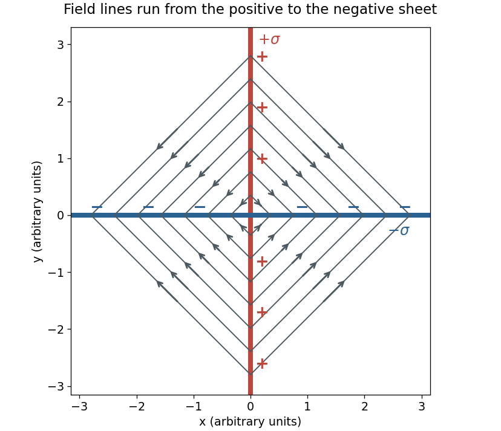

<h1 id="3/solution">Solution</h1>

↑ **Parent:** [3](../3.md)

Use a cross-section normal to the sheets' line of intersection: the positive sheet is $x=0$, and the negative sheet is $y=0$. A [Gaussian pillbox](../../../gaussian-pillbox.md) gives a single infinite sheet's [electric field](../../../electric-field-split.md) magnitude $\sigma/(2\epsilon_0)$ on either side. [Superposition](../../../superposition-principle.md) consequently gives, away from the sheets,

$$
\boxed{\mathbf E=\frac{\sigma}{2\epsilon_0}\bigl(\operatorname{sgn}(x)\hat{\mathbf x}-\operatorname{sgn}(y)\hat{\mathbf y}\bigr),\qquad
|\mathbf E|=\frac{\sigma}{\sqrt2\epsilon_0}.}
$$

The [electric field](../../../electric-field-split.md) points away from the positively charged sheet and towards the negatively charged sheet, bisecting each right angle. The [electric field lines](../../../electric-field-line.md) are straight within each quadrant: in the first quadrant, for example, $dy/dx=-1$, so $x+y$ is constant along a line. They start on $x=0$ and finish on $y=0$. At a sheet, the normal component has the usual surface-charge jump, so the quadrant formula specifies the appropriate one-sided limits rather than a unique [electric field](../../../electric-field-split.md) on the charged surface.

**[Figure 1](#3/image-cross-section-of-the-electric-field-between-perpendicular-oppositely-charged-sheets). Cross-section of the electric field between perpendicular oppositely charged sheets**. Each arrow starts on the positive sheet and terminates on the negative sheet; the diagram is an original schematic of the derived field.

## ↑ Ancestors (11)

1. [3](../3.md)
2. [2017](../../2017-split.md)
3. [Past exam of the physics 2 paper of the University of Oxford](../../split.md)
4. [Physics 2 paper of the University of Oxford](../../../physics-2-paper-of-the-university-of-oxford.md)
5. [Year 1 of the physics course of the University of Oxford](../../../year-1-of-the-physics-course-of-the-university-of-oxford.md)
6. [Physics course of the University of Oxford](../../../physics-course-of-the-university-of-oxford.md)
7. [Undergraduate course of the University of Oxford](../../../undergraduate-course-of-the-university-of-oxford.md)
8. [Course of the University of Oxford](../../../course-of-the-university-of-oxford.md)
9. [University of Oxford](../../../university-of-oxford-split.md)
10. [List of universities](../../../list-of-universities.md)
11. [Codex Wiki](../../../split.md)
