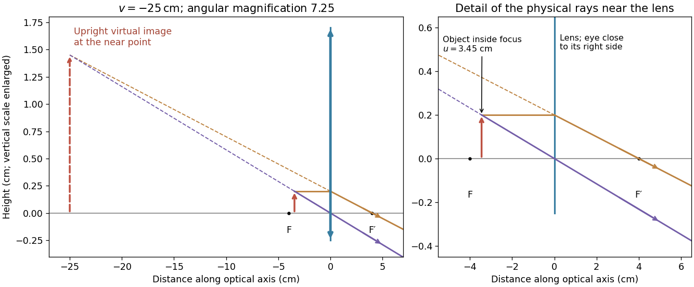

<h1 id="6/solution">Solution</h1>

↑ **Parent:** [6](../6.md)

The requested source-image relation is the [thin lens](../../../thin-lens.md) equation, using positive real-object distance $u$ and signed image distance $v$:

$$
\boxed{\frac1f=\frac1u+\frac1v.}
$$

Here $f>0$ for a converging [lens](../../../lens-optics.md), and $v<0$ denotes a [virtual image](../../../virtual-image.md). This is usually distinguished from [Lensmaker's equation](../../../lensmaker-s-equation.md), $1/f=(n-1)(1/R_1-1/R_2)$ for a thin [lens](../../../lens-optics.md) in air with the usual signed surface radii. The latter relates [focal length](../../../focal-length.md) to the [lens](../../../lens-optics.md) material and curvature, rather than to object and image positions.[§2.4: thin-lens equation, sign conventions, and [lensmaker's equation](../../../lensmaker-s-equation.md)](../../../university-physics-volume-3-by-samuel-j-ling-and-others.md)

For a [magnifying glass](../../../magnifying-glass.md) held close to the eye, compare the angle $h/u$ with the unaided near-point angle $h/D_n$, where $D_n=25\,\mathrm{cm}$. Maximum usable [angular magnification](../../../angular-magnification.md) occurs with the [virtual image](../../../virtual-image.md) at the [near point](../../../near-point.md), so $v=-D_n$. Thus

$$
u=\frac{fD_n}{D_n+f}=\frac{100}{29}\,\mathrm{cm}\simeq3.45\,\mathrm{cm},\qquad
\boxed{M_{\max}=\frac{D_n}{u}=1+\frac{D_n}{f}=7.25.}
$$

The object lies inside the front [focal length](../../../focal-length.md). The emerging [light rays](../../../light-ray.md) diverge, while their backward extensions meet at an upright enlarged [virtual image](../../../virtual-image.md) on the object's side. With the image at infinity instead, the relaxed-eye [angular magnification](../../../angular-magnification.md) would be $D_n/f=6.25$, which is smaller. A finite eye-to-lens distance $s$ changes the near-point result to $1+(D_n-s)/f$; the quoted maximum uses the conventional $s\simeq0$ limit.[§2.7, equations 2.29–2.30: near-point [angular magnification](../../../angular-magnification.md) and lens-eye separation](../../../university-physics-volume-3-by-samuel-j-ling-and-others.md)

**[Figure 2](#6/image-near-point-magnification-by-a-converging-thin-lens). Near-point magnification by a converging thin lens**. Solid rays propagate towards the eye on the right. Dashed backward extensions locate the upright virtual image 25 cm to the left of the lens. The height scale is enlarged for readability.

## ↑ Ancestors (11)

1. [6](../6.md)
2. [2017](../../2017-split.md)
3. [Past exam of the physics 2 paper of the University of Oxford](../../split.md)
4. [Physics 2 paper of the University of Oxford](../../../physics-2-paper-of-the-university-of-oxford.md)
5. [Year 1 of the physics course of the University of Oxford](../../../year-1-of-the-physics-course-of-the-university-of-oxford.md)
6. [Physics course of the University of Oxford](../../../physics-course-of-the-university-of-oxford.md)
7. [Undergraduate course of the University of Oxford](../../../undergraduate-course-of-the-university-of-oxford.md)
8. [Course of the University of Oxford](../../../course-of-the-university-of-oxford.md)
9. [University of Oxford](../../../university-of-oxford-split.md)
10. [List of universities](../../../list-of-universities.md)
11. [Codex Wiki](../../../split.md)
