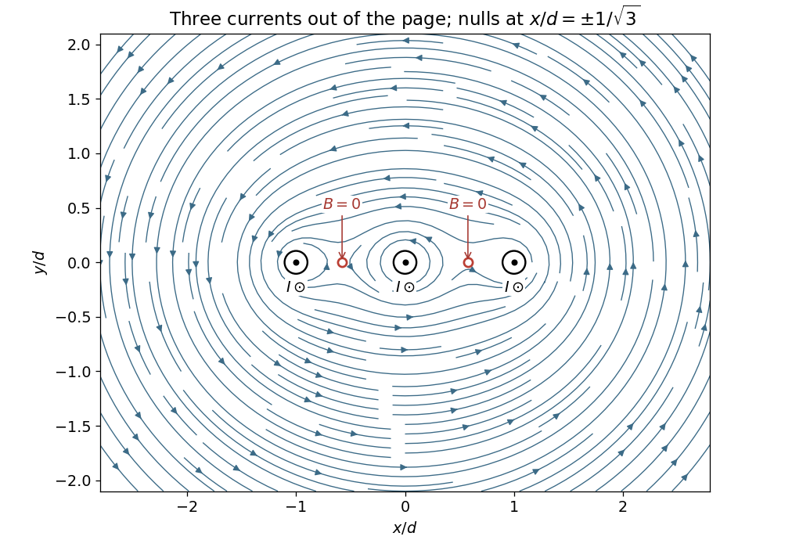

<h1 id="9/c/solution">Solution</h1>

↑ **Parent:** [C](../c.md)

Put the three wires at $(x,y)=(-d,0),(0,0),(d,0)$ with $d=1\,\mathrm{cm}$ and each current along $+z$, out of the page. Adding their [Biot-Savart law](../../../../biot-savart-law.md) [magnetic fields](../../../../magnetic-field-split.md) gives

$$
\mathbf B(x,y)=\frac{\mu_0I}{2\pi}\sum_{j=-1}^{1}
\frac{-y\hat{\mathbf x}+(x-jd)\hat{\mathbf y}}{(x-jd)^2+y^2}.
$$

For $y\ne0$, all three $x$-components have the same sign, so they cannot cancel. On $y=0$, a zero of the remaining component satisfies

$$
\frac1{x+d}+\frac1x+\frac1{x-d}
=\frac{3x^2-d^2}{x(x^2-d^2)}=0.
$$

Excluding the wire positions themselves, the two and only two finite zeros are

$$
\boxed{(x,y)=\left(\pm\frac d{\sqrt3},0\right)
=\left(\pm0.577\,\mathrm{cm},0\right).}
$$

The [magnetic field lines](../../../../magnetic-field-line.md) circulate counterclockwise about each current near that wire. Far away they circle the combined total current $3I$. The two nulls separate the nearby circulation regions in the original [magnetic field line](../../../../magnetic-field-line.md) plot below.

**[Figure 3](#9/c/image-magnetic-field-and-two-nulls-for-three-equal-parallel-currents). Magnetic field and two nulls for three equal parallel currents**. Coordinates are measured from the middle wire in units of the neighbouring-wire spacing. All three currents point out of the page; the two field zeros are marked between the wires.

## ↑ Ancestors (12)

1. [C](../c.md)
2. [9](../../9.md)
3. [2017](../../../2017-split.md)
4. [Past exam of the physics 2 paper of the University of Oxford](../../../split.md)
5. [Physics 2 paper of the University of Oxford](../../../../physics-2-paper-of-the-university-of-oxford.md)
6. [Year 1 of the physics course of the University of Oxford](../../../../year-1-of-the-physics-course-of-the-university-of-oxford.md)
7. [Physics course of the University of Oxford](../../../../physics-course-of-the-university-of-oxford.md)
8. [Undergraduate course of the University of Oxford](../../../../undergraduate-course-of-the-university-of-oxford.md)
9. [Course of the University of Oxford](../../../../course-of-the-university-of-oxford.md)
10. [University of Oxford](../../../../university-of-oxford-split.md)
11. [List of universities](../../../../list-of-universities.md)
12. [Codex Wiki](../../../../split.md)
