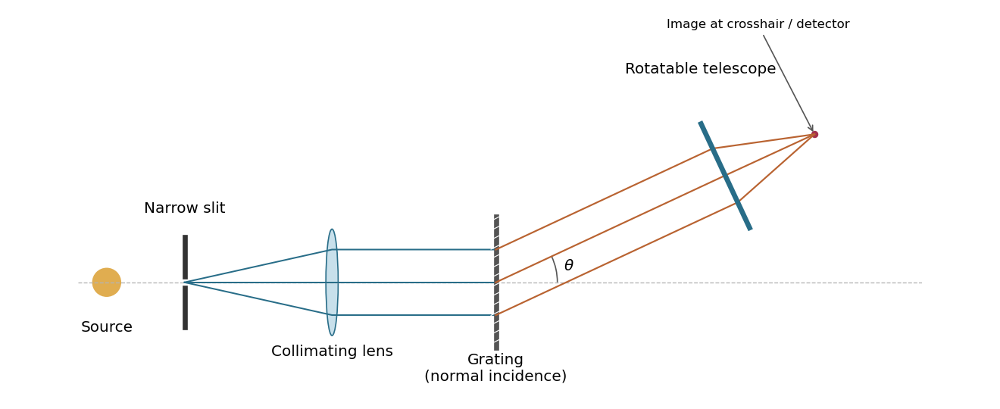
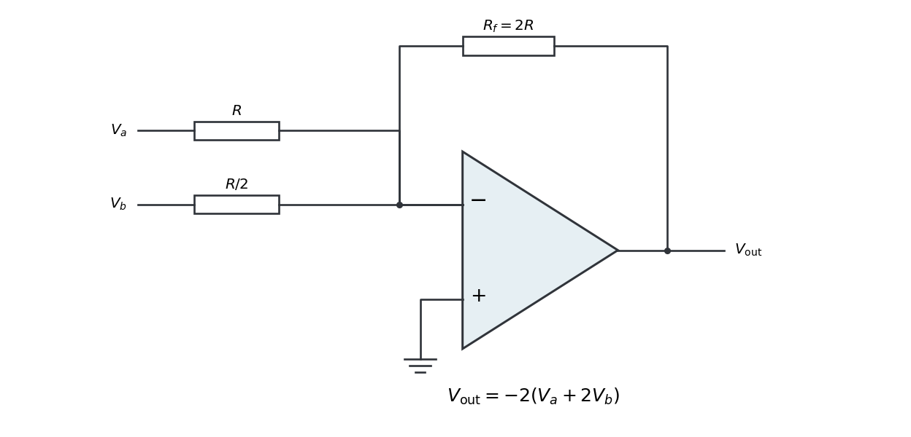
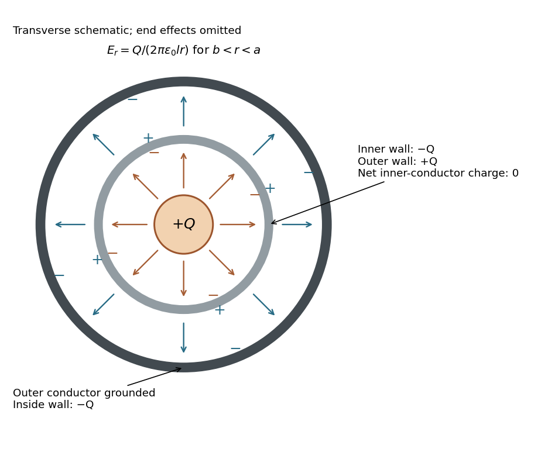
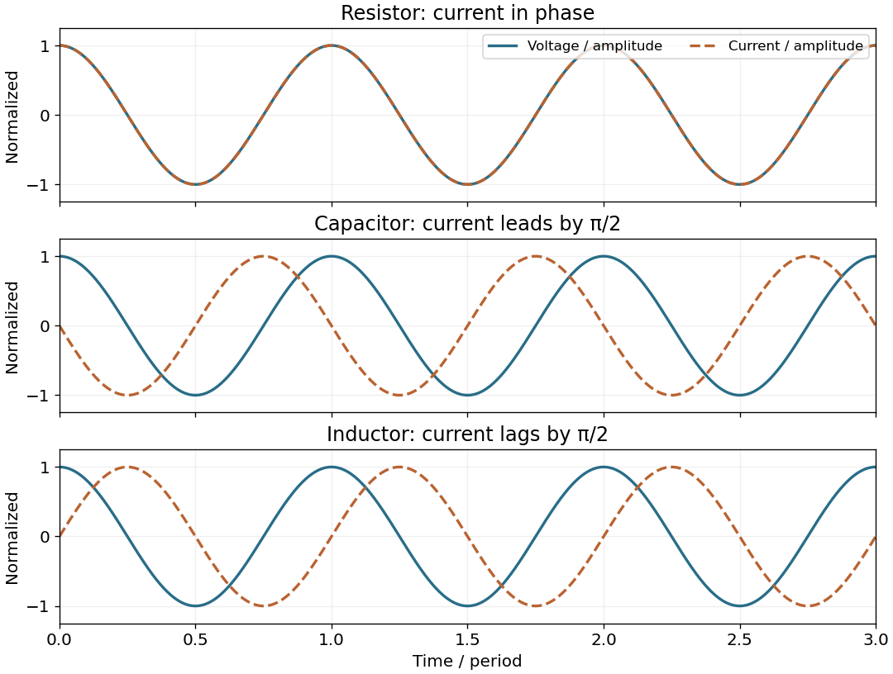
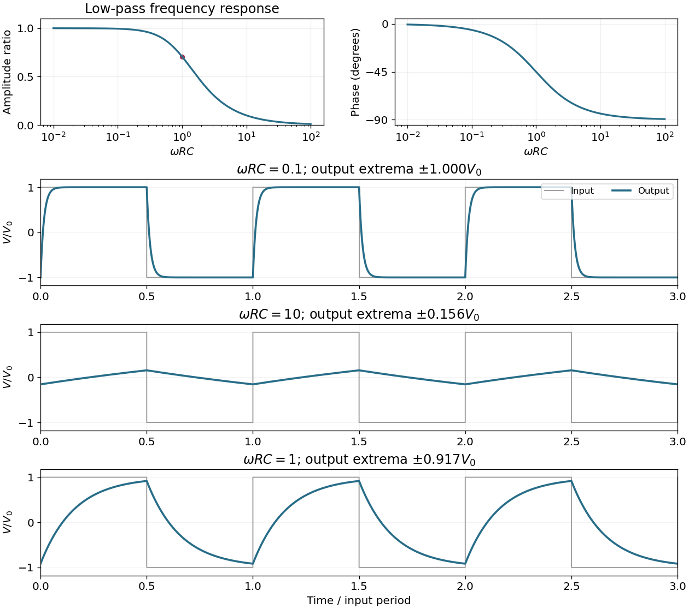
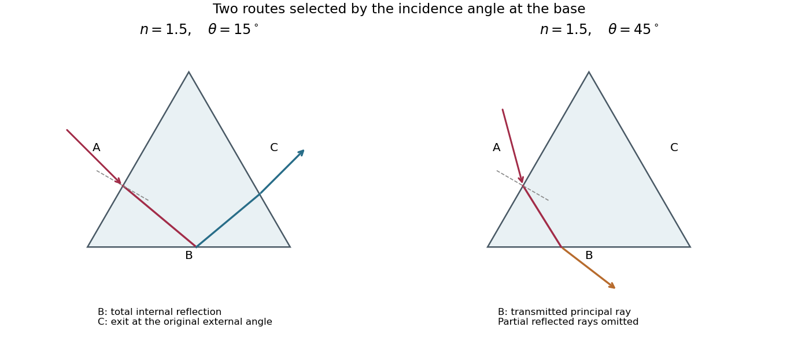

# 2018

↑ **Parent:** [Past exam of the physics 2 paper of the University of Oxford](../past-exam-of-the-physics-2-paper-of-the-university-of-oxford.md)

Source paper: [https://www.whatdotheyknow.com/request/physics_preliminary_past_papers/response/2680788/attach/2/2014%202017%20Physics%20Prelim.zip?cookie_passthrough=1](https://www.whatdotheyknow.com/request/physics_preliminary_past_papers/response/2680788/attach/2/2014%202017%20Physics%20Prelim.zip?cookie_passthrough=1)

**Table of contents**

- [1](#1)
  - [Solution](#1/solution)
- [2](#2)
  - [Solution](#2/solution)
- [3](#3)
  - [Solution](#3/solution)
- [4](#4)
  - [Solution](#4/solution)
- [5](#5)
  - [Solution](#5/solution)
- [6](#6)
  - [Solution](#6/solution)
- [7](#7)
  - [Solution](#7/solution)
  - [i](#7/i)
    - [Solution](#7/i/solution)
  - [ii](#7/ii)
    - [Solution](#7/ii/solution)
  - [iii](#7/iii)
    - [Solution](#7/iii/solution)
- [8](#8)
  - [Solution](#8/solution)
- [9](#9)
  - [Solution](#9/solution)
  - [i](#9/i)
    - [Solution](#9/i/solution)
  - [ii](#9/ii)
    - [Solution](#9/ii/solution)
  - [iii](#9/iii)
    - [Solution](#9/iii/solution)
  - [a](#9/a)
    - [Solution](#9/a/solution)
  - [b](#9/b)
    - [Solution](#9/b/solution)
  - [c](#9/c)
    - [Solution](#9/c/solution)
  - [d](#9/d)
    - [Solution](#9/d/solution)
    - [i](#9/d/i)
      - [Solution](#9/d/i/solution)
    - [ii](#9/d/ii)
      - [Solution](#9/d/ii/solution)
    - [iii](#9/d/iii)
      - [Solution](#9/d/iii/solution)
- [10](#10)
  - [Solution](#10/solution)
  - [i](#10/i)
    - [Solution](#10/i/solution)
  - [ii](#10/ii)
    - [Solution](#10/ii/solution)
  - [iii](#10/iii)
    - [Solution](#10/iii/solution)
  - [iv](#10/iv)
    - [Solution](#10/iv/solution)

## 1

↑ **Parent:** [2018](2018.md)

<h3 id="1/solution">Solution</h3>

↑ **Parent:** [1](#1)

The [electric field](../electric-field.md) of a signed point [electric charge](../electric-charge.md) in vacuum follows [Coulomb's law](../electrostatics.md#coulomb-s-law):

$$
E(r)=\frac{Q}{4\pi\epsilon_0}\frac{r}{|r|^3}.
$$

For the [conducting plane](../electric-charge.md#conducting-plane), the [method of images](../mathematics.md#method-of-images) replaces each charge $Q_j$ at height $h_j$ by an [image charge](../electric-field.md#image-charge) $-Q_j$ at height $-h_j$. The real and image [electric fields](../electric-field.md) have cancelling tangential components and equal normal components at the surface. Thus the [electric field at a conducting plane from axial point charges](../electric-field.md#electric-field-at-a-conducting-plane-from-axial-point-charges), just above the point directly below them, is

$$
E_z(0^+)=-\frac{2}{4\pi\epsilon_0}\sum_j\frac{Q_j}{h_j^2}
=\frac{60}{4\pi\epsilon_0}\left(\frac1{5000^2}-\frac1{8000^2}\right).
$$

Numerically,

$$
\boxed{E(0^+)\simeq1.31\times10^4\ \mathrm{V\,m^{-1}}\,\hat z,\quad\text{upwards}.}
$$

The surface value means the air-side limit. Inside the ideal [conductor](../electric-charge.md#electrical-conductor) the electrostatic [electric field](../electric-field.md) is zero; its discontinuity across the surface is supported by induced [surface charge](../electric-charge.md#surface-charge). Omitting the [image charges](../electric-field.md#image-charge) would give half the external answer.

## 2

↑ **Parent:** [2018](2018.md)

<h3 id="2/solution">Solution</h3>

↑ **Parent:** [2](#2)

For steady currents in vacuum, [Ampère's circuital law](../maxwell-equations.md#ampere-s-circuital-law) is

$$
\oint_C B\cdot d\ell=\mu_0I_{\mathrm{enc}}.
$$

Here $C$ is an oriented closed [curve](../topology.md#curve), $d\ell$ its tangent line element, and $I_{\mathrm{enc}}$ the signed [electric current](../electric-charge.md#electric-current) through a spanning [surface](../topological-surface.md) oriented by the [right-hand rule](../electromagnetism.md#right-hand-rule). A circular contour about a straight infinite wire has constant tangential [magnetic field](../magnetic-field.md), so $B(r)=\mu_0I/(2\pi r)$. The [Lorentz force](../relativistic-electromagnetism.md#lorentz-force) on a length $L$ of the other wire is $IL\hat\ell\times B$. Therefore

$$
\boxed{\frac FL=\frac{\mu_0I^2}{2\pi r},\qquad\text{the force is attractive}.}
$$

The [right-hand rule](../electromagnetism.md#right-hand-rule) makes the force on each parallel, same-direction current point toward the other wire.

## 3

↑ **Parent:** [2018](2018.md)

<h3 id="3/solution">Solution</h3>

↑ **Parent:** [3](#3)

The [continuity equation for electric charge](../maxwell-equations.md#charge-continuity-equation) is $\nabla\cdot J=-\partial_t\rho$. Taking the [divergence](../multivariable-calculus.md#divergence) of the magnetostatic [Ampère's law](../maxwell-equations.md#ampere-s-circuital-law) would instead require $\nabla\cdot J=0$. The [displacement current](../maxwell-equations.md#displacement-current) repairs this conflict: using [Gauss's law](../maxwell-equations.md#gauss-s-law), $\nabla\cdot(\epsilon_0\partial_tE)=\partial_t\rho$, so the [Ampère-Maxwell equation](../maxwell-equations.md#ampere-s-circuital-law) is

$$
\nabla\times B=\mu_0(J+\epsilon_0\partial_tE).
$$

In the [parallel-plate capacitor](../electromagnetism.md#parallel-plate-capacitor), neglect [fringing fields](../electric-field.md#fringing-field) and take $E_z=V_0e^{-i\omega t}/d$. A circular [Ampère loop](../maxwell-equations.md#amperian-loop) of radius $s<a$ encloses [displacement current](../maxwell-equations.md#displacement-current) $-i\omega\epsilon_0\pi s^2V_0e^{-i\omega t}/d$. Therefore the [magnetic field between circular capacitor plates](../maxwell-equations.md#magnetic-field-between-circular-capacitor-plates) has phasor and amplitude

$$
\widetilde B_\phi(s)=-\frac{i\omega\mu_0\epsilon_0V_0s}{2d},\qquad
\boxed{B_{\mathrm{amp}}(s)=\frac{\omega\mu_0\epsilon_0|V_0|}{2d}\,s,\quad0\leq s<a.}
$$

It is zero on the axis, grows linearly with radius, and is azimuthal by the [right-hand rule](../electromagnetism.md#right-hand-rule). This is a [quasistatic approximation](../maxwell-equations.md#quasistatic-approximation-electromagnetism): in addition to $d\ll a$, the uniform-field model requires $\omega a/c\ll1$ and excludes the edge region. The answer gives the oscillation amplitude, rather than a time-independent instantaneous magnitude.

## 4

↑ **Parent:** [2018](2018.md)

<h3 id="4/solution">Solution</h3>

↑ **Parent:** [4](#4)

The [intensity of an isotropic radiator](../electromagnetic-wave.md#intensity-of-an-isotropic-radiator) at distance $r$ is the radiated [power](../energy.md#power) divided by spherical area: $\mathcal I=P/(4\pi r^2)$. For a locally plane far-field [electromagnetic wave](../electromagnetic-wave.md) in air, its mean [Poynting flux](../electromagnetic-wave.md#poynting-flux) is $\mathcal I=E_{\mathrm{rms}}^2/Z_0=E_{\mathrm{peak}}^2/(2Z_0)$, where the vacuum [wave impedance](../electromagnetic-wave.md#wave-impedance) is $Z_0\simeq376.7\ \Omega$. Thus

$$
\mathcal I=\frac{10^5}{4\pi(10^5)^2}\simeq7.96\times10^{-7}\ \mathrm{W\,m^{-2}},
$$

and

$$
\boxed{E_{\mathrm{rms}}\simeq1.73\times10^{-2}\ \mathrm{V\,m^{-1}},\qquad E_{\mathrm{peak}}\simeq2.45\times10^{-2}\ \mathrm{V\,m^{-1}}.}
$$

Both conventions are given because “field strength” alone does not specify RMS or peak. This estimate treats the stated transmitter [power](../energy.md#power) as radiated power and ignores ground reflection and absorption.

## 5

↑ **Parent:** [2018](2018.md)

<h3 id="5/solution">Solution</h3>

↑ **Parent:** [5](#5)

A [grating spectrometer](../physical-optics.md#grating-spectrometer) places an illuminated narrow slit at the front focal plane of a [collimator](../optical-instrument.md#collimator). The resulting parallel beam reaches the [diffraction grating](../physical-optics.md#diffraction-grating) at known incidence, here taken normal. A rotatable telescope focuses each outgoing diffracted parallel beam onto its crosshair or detector. Align the slit with the grating rulings, focus the [collimator](../optical-instrument.md#collimator) at infinity, and illuminate many grooves across a suitable aperture. A narrow slit supplies sufficient [spatial coherence](../physical-optics.md#spatial-optical-coherence) and prevents slit width from blurring the angular separation; the telescope must also resolve the two images.

**[Figure 1](#5/image-a-grating-spectrometer-with-a-narrow-source-slit-collimator-normally-illuminated-diffraction-grating-and-rotatable-observing-telescope). A grating spectrometer with a narrow source slit, collimator, normally illuminated diffraction grating and rotatable observing telescope**.

The groove spacing is $d=(2000\times100)^{-1}\ \mathrm m=5.00\ \mu\mathrm m$. The [grating equation](../physical-optics.md#grating-equation) at normal incidence is $d\sin\theta_m=m\lambda$. For [diffraction order](../physical-optics.md#diffraction-order) $m=2$,

$$
\theta_{579}=\arcsin(0.2316)\simeq13.3913^\circ,\qquad
\theta_{577}=\arcsin(0.2308)\simeq13.3442^\circ.
$$

Therefore

$$
\boxed{\Delta\theta\simeq8.22\times10^{-4}\ \mathrm{rad}=0.0471^\circ=2.83\ \text{arcmin}.}
$$

The ideal [resolving power of a diffraction grating](../physical-optics.md#resolving-power-of-a-diffraction-grating) is $|m|N$, so the [Rayleigh criterion](../point-spread-function.md#rayleigh-criterion) for this doublet requires about $N\geq145$ illuminated grooves, spanning roughly $0.73\ \mathrm{mm}$. This is an ideal lower bound; finite slit width, aberrations and detector resolution can require a larger usable aperture.

## 6

↑ **Parent:** [2018](2018.md)

<h3 id="6/solution">Solution</h3>

↑ **Parent:** [6](#6)

Use an ideal inverting [summing amplifier](../electrical-circuit.md#summing-amplifier), grounding the non-inverting input and connecting the two sources through resistances $R$ and $R/2$. A feedback resistance $R_f=2R$ gives the desired weights. [Operational-amplifier negative feedback](../electrical-circuit.md#operational-amplifier-negative-feedback) makes the inverting node a [virtual ground](../electrical-circuit.md#virtual-ground), and negligible input current lets [Kirchhoff's current law](../random-walk.md#kirchhoff-node-law) give

$$
\frac{V_a}{R}+\frac{V_b}{R/2}=-\frac{V_{\mathrm{out}}}{2R},\qquad
\boxed{V_{\mathrm{out}}=-2(V_a+2V_b).}
$$

**[Figure 2](#6/image-an-inverting-summing-amplifier-with-input-resistances-r-r-2-and-feedback-resistance-2r). An inverting summing amplifier with input resistances $R,R/2$ and feedback resistance $2R$**.

Replacing the feedback [resistor](../electric-charge.md#resistor) by a [capacitor](../electromagnetism.md#capacitor) $C$ makes a weighted [op amp integrator](../electrical-circuit.md#op-amp-integrator):

$$
\boxed{\frac{dV_{\mathrm{out}}}{dt}=-\frac{V_a+2V_b}{RC},\qquad
V_{\mathrm{out}}(t)=V_{\mathrm{out}}(t_0)-\frac1{RC}\int_{t_0}^t[V_a(u)+2V_b(u)]\,du.}
$$

The initial capacitor charge determines the integration constant. A nonzero DC weighted input produces a ramp; a real [operational amplifier](../electrical-circuit.md#operational-amplifier) eventually reaches its output-voltage limit. A parallel feedback resistance can limit drift while preserving integration over an appropriate frequency range.

## 7

↑ **Parent:** [2018](2018.md)

<h3 id="7/solution">Solution</h3>

↑ **Parent:** [7](#7)

The integral and differential forms of [Gauss's law](../maxwell-equations.md#gauss-s-law) in vacuum are

$$
\oint_{\partial V}E\cdot n\,dA=\frac{Q_{\mathrm{enc}}}{\epsilon_0},\qquad
\nabla\cdot E=\frac\rho{\epsilon_0}.
$$

For an isolated spherical [conductor](../electric-charge.md#electrical-conductor), symmetry gives $E(r)=Q/(4\pi\epsilon_0r^2)$ outside and zero inside. Taking [electric potential](../electric-field.md#electric-potential) zero at infinity, $V(R)=\int_R^\infty E(r)\,dr=Q/(4\pi\epsilon_0R)$. Thus the [capacitance of an isolated conducting sphere](../electromagnetism.md#capacitance-of-an-isolated-conducting-sphere) is

$$
\boxed{C=4\pi\epsilon_0R.}
$$

Charging from zero gives the [electrostatic potential energy](../electrostatics.md#electrostatic-energy)

$$
\boxed{W=\int_0^Q\frac qC\,dq=\frac{Q^2}{8\pi\epsilon_0R}=\frac12CV^2.}
$$

This is also the integral of [electric field energy density](../electrostatics.md#electric-field-energy-density) $\epsilon_0E^2/2$ outside the sphere. The later insertion into a [coaxial cylindrical capacitor](../electrostatics.md#coaxial-cylindrical-capacitor) conserves its [electric charge](../electric-charge.md), not its original isolated [electric potential](../electric-field.md#electric-potential).

<h3 id="7/i">i</h3>

↑ **Parent:** [7](#7)

<h4 id="7/i/solution">Solution</h4>

↑ **Parent:** [I](#7/i)

Initially the isolated sphere has $Q=4\pi\epsilon_0RV$. After insertion without contact, its charge remains $Q$. In the long-cylinder approximation, with the sphere far from the openings, neglect electric flux escaping through the ends. A [Gauss surface](../maxwell-equations.md#gaussian-surface) running through the shielding metal and closed by end sections of negligible flux then encloses zero net charge. Its cavity wall therefore carries $-Q$. Since that cylinder is isolated and initially neutral, its outside wall carries $+Q$. The grounded outer cylinder supplies charge $-Q$ on its inside wall, terminating the annular [electric field lines](../electric-field.md#electric-field-line).

**[Figure 3](#7/i/image-transverse-schematic-of-a-charged-sphere-inside-a-neutral-coaxial-capacitor-induced-charges-and-electric-field-lines-with-no-field-inside-the-conducting-walls). Transverse schematic of a charged sphere inside a neutral coaxial capacitor: induced charges and electric field lines, with no field inside the conducting walls**.

For positive $V$, the cavity [electric field lines](../electric-field.md#electric-field-line) run from the sphere to the inner wall, while annular [electric field lines](../electric-field.md#electric-field-line) run from the outside of the inner conductor to the grounded outer conductor. Negative $V$ reverses their directions. The transverse picture is schematic: exact cavity fields depend on the sphere's position and the ends. The following annular formulas neglect end effects and place the sphere well inside the long cylindrical assembly.

<h3 id="7/ii">ii</h3>

↑ **Parent:** [7](#7)

<h4 id="7/ii/solution">Solution</h4>

↑ **Parent:** [Ii](#7/ii)

For $b<r<a$, a coaxial [Gauss surface](../maxwell-equations.md#gaussian-surface) of length $l$ encloses net charge $Q$: the sphere and the cavity-wall charge cancel, leaving $+Q$ on the outside of the inner conductor. In the long-cylinder approximation,

$$
E_r(r)\,2\pi rl=\frac Q{\epsilon_0},\qquad
\boxed{E_r(r)=\frac{Q}{2\pi\epsilon_0lr}=\frac{2RV}{lr}.}
$$

The [electric field](../electric-field.md) points radially outward for $V>0$. End effects and axial nonuniformity near the openings are excluded by the ideal [coaxial cylindrical capacitor](../electrostatics.md#coaxial-cylindrical-capacitor) approximation.

<h3 id="7/iii">iii</h3>

↑ **Parent:** [7](#7)

<h4 id="7/iii/solution">Solution</h4>

↑ **Parent:** [Iii](#7/iii)

The grounded outer cylinder fixes $\Phi(a)=0$. Integrating the annular [electric field](../electric-field.md) inward gives

$$
\boxed{\Phi(b)=\int_b^aE_r(r)\,dr=\frac{2RV}{l}\log\frac ab.}
$$

Equivalently, the [coaxial cylindrical capacitor](../electrostatics.md#coaxial-cylindrical-capacitor) has $C_{\mathrm{cyl}}=2\pi\epsilon_0l/\log(a/b)$ and carries charge $Q=4\pi\epsilon_0RV$, so $\Phi(b)=Q/C_{\mathrm{cyl}}$. The original sphere potential $V$ is used to infer its conserved charge; it is not the final potential of the sphere or of the inner cylinder.

## 8

↑ **Parent:** [2018](2018.md)

<h3 id="8/solution">Solution</h3>

↑ **Parent:** [8](#8)

The [Biot-Savart law](../electromagnetism.md#biot-savart-law) is

$$
B(r)=\frac{\mu_0I}{4\pi}\int\frac{d\ell'\times(r-r')}{|r-r'|^3}.
$$

Here $r'$ is the current-element position, $d\ell'$ follows the [electric current](../electric-charge.md#electric-current), and $r$ is the observation point. For a circular [current loop](../electromagnetism.md#current-loop), transverse components cancel on the axis. Each element contributes axial factor $a/\sqrt{a^2+x^2}$ in addition to the inverse-square distance. Integrating around length $2\pi a$ gives the [on-axis magnetic field of a circular current loop](../electromagnetism.md#on-axis-magnetic-field-of-a-circular-current-loop)

$$
\boxed{B_{\mathrm{axis}}(x)=\frac{\mu_0Ia^2}{2(a^2+x^2)^{3/2}},}
$$

with axial direction set by the [right-hand rule](../electromagnetism.md#right-hand-rule).

For a finite straight wire parametrized by $z\in[-b,b]$, at perpendicular distance $a$, the [Biot-Savart law](../electromagnetism.md#biot-savart-law) gives

$$
B=\frac{\mu_0I}{4\pi}\int_{-b}^{b}\frac{a\,dz}{(a^2+z^2)^{3/2}}
=\boxed{\frac{\mu_0Ib}{2\pi a\sqrt{a^2+b^2}}.}
$$

The direction is azimuthal about the current axis by the [right-hand rule](../electromagnetism.md#right-hand-rule). In the hairpin, the semicircle contributes $\mu_0I/(4a)$ and each semi-infinite straight segment contributes $\mu_0I/(4\pi a)$. For the indicated current, all three contributions point **out of the page**. Thus the [magnetic field at the center of a hairpin wire](../electromagnetism.md#magnetic-field-at-the-center-of-a-hairpin-wire) is

$$
\boxed{B(P)=\frac{\mu_0I}{4\pi a}(\pi+2),\quad\text{out of the page}.}
$$

## 9

↑ **Parent:** [2018](2018.md)

<h3 id="9/solution">Solution</h3>

↑ **Parent:** [9](#9)

For this question use [phasors](../wave.md#phasor) with time factor $e^{i\omega t}$, so an [electrical impedance](../electrical-circuit.md#electrical-impedance) is $Z=\widetilde V/\widetilde I$. The same [electric current](../electric-charge.md#electric-current) flows through all components of a [series circuit](../electrical-circuit.md#series-circuit), and their [voltages](../random-walk.md#voltage) add by [Kirchhoff's voltage law](../random-walk.md#kirchhoff-cycle-law). Hence the total series [electrical impedance](../electrical-circuit.md#electrical-impedance) is

$$
\boxed{Z_{\mathrm{series}}=R+i\left(\omega L-\frac1{\omega C}\right).}
$$

The individual steady sinusoidal currents and their phase relations are derived in the following three parts. The diagram normalizes each current by its own amplitude, so it compares [phase differences](../wave.md#phase-difference) without mixing unlike physical units.

**[Figure 4](#9/image-normalized-voltage-and-current-waveforms-for-a-resistor-capacitor-and-inductor-capacitor-current-leads-and-inductor-current-lags-by-a-quarter-cycle). Normalized voltage and current waveforms for a resistor, capacitor and inductor; capacitor current leads and inductor current lags by a quarter cycle**.

<h3 id="9/i">i</h3>

↑ **Parent:** [9](#9)

<h4 id="9/i/solution">Solution</h4>

↑ **Parent:** [I](#9/i)

For a [resistor](../electric-charge.md#resistor), [Ohm's law](../electric-charge.md#ohm-s-law) gives

$$
\boxed{Z_R=R,\qquad I_R(t)=\frac{V_0}{R}\cos\omega t.}
$$

The [electric current](../electric-charge.md#electric-current) and [voltage](../random-walk.md#voltage) are **in phase**.

<h3 id="9/ii">ii</h3>

↑ **Parent:** [9](#9)

<h4 id="9/ii/solution">Solution</h4>

↑ **Parent:** [Ii](#9/ii)

For a [capacitor](../electromagnetism.md#capacitor), $I_C=C\,dV/dt$, so

$$
\boxed{Z_C=\frac1{i\omega C},\qquad I_C(t)=-\omega CV_0\sin\omega t=\omega CV_0\cos(\omega t+\pi/2).}
$$

The [electric current](../electric-charge.md#electric-current) **leads the voltage by $\pi/2$**.

<h3 id="9/iii">iii</h3>

↑ **Parent:** [9](#9)

<h4 id="9/iii/solution">Solution</h4>

↑ **Parent:** [Iii](#9/iii)

For an [inductor](../electromagnetism.md#inductor), $V=L\,dI_L/dt$. In the steady AC solution with no added constant [electric current](../electric-charge.md#electric-current),

$$
\boxed{Z_L=i\omega L,\qquad I_L(t)=\frac{V_0}{\omega L}\sin\omega t=\frac{V_0}{\omega L}\cos(\omega t-\pi/2).}
$$

The [electric current](../electric-charge.md#electric-current) **lags the voltage by $\pi/2$**. An ideal [inductor](../electromagnetism.md#inductor) can also sustain an arbitrary DC current, fixed by initial conditions; it is excluded from this steady sinusoidal comparison.

<h3 id="9/a">a</h3>

↑ **Parent:** [9](#9)

<h4 id="9/a/solution">Solution</h4>

↑ **Parent:** [A](#9/a)

The output is measured across the [capacitor](../electromagnetism.md#capacitor). The [voltage divider](../electrical-engineering.md#voltage-divider) gives the [RC low-pass filter](../electrical-engineering.md#rc-low-pass-filter) transfer function

$$
H(i\omega)=\frac{Z_C}{R+Z_C}=\frac1{1+i\omega RC}.
$$

Therefore

$$
\boxed{V_{\mathrm{out}}(t)=\frac{V_0}{\sqrt{1+(\omega RC)^2}}\cos\bigl(\omega t-\arctan(\omega RC)\bigr).}
$$

The amplitude ratio tends to $1$ and the [phase shift](../wave.md#phase-shift) to zero as $\omega\to0$. For $\omega\to\infty$, the amplitude ratio is asymptotic to $1/(\omega RC)$ and the [phase shift](../wave.md#phase-shift) tends to $-\pi/2$.

**[Figure 5](#9/a/image-the-rc-low-pass-filter-amplitude-and-phase-response-and-periodic-responses-to-a-symmetric-square-wave-input-at-three-values-of-omega-rc). The RC low-pass filter amplitude and phase response, and periodic responses to a symmetric square-wave input at three values of $\omega RC$**.

<h3 id="9/b">b</h3>

↑ **Parent:** [9](#9)

<h4 id="9/b/solution">Solution</h4>

↑ **Parent:** [B](#9/b)

The half-power amplitude condition for the [RC low-pass filter](../electrical-engineering.md#rc-low-pass-filter) gives $1+(\omega RC)^2=2$. Since [angular frequency](../lagrangian-mechanics.md#angular-frequency) is positive,

$$
\boxed{\omega_c=\frac1{RC}.}
$$

At this [cutoff angular frequency](../electrical-engineering.md#cutoff-angular-frequency), the output amplitude is smaller by $1/\sqrt2$ and the [phase shift](../wave.md#phase-shift) is $-\pi/4$.

<h3 id="9/c">c</h3>

↑ **Parent:** [9](#9)

<h4 id="9/c/solution">Solution</h4>

↑ **Parent:** [C](#9/c)

The [RC low-pass filter](../electrical-engineering.md#rc-low-pass-filter) satisfies $RC\,\dot V_{\mathrm{out}}+V_{\mathrm{out}}=V$ for $t>0$. With zero initial capacitor voltage, the [first-order linear differential equation](../linear-ordinary-differential-equation.md#first-order-linear-differential-equation) gives

$$
\boxed{V_{\mathrm{out}}(t)=V\bigl(1-e^{-t/(RC)}\bigr),\quad t\geq0.}
$$

The output is continuous at switching and approaches $V$ with [time constant](../analysis.md#time-constant) $RC$.

<h3 id="9/d">d</h3>

↑ **Parent:** [9](#9)

<h4 id="9/d/solution">Solution</h4>

↑ **Parent:** [D](#9/d)

For explicit sketches take a symmetric, 50% [duty cycle](../electrical-circuit.md#duty-cycle) square wave with levels $\pm V_0$. The source does not specify levels or duty cycle; a unipolar 50% wave follows by adding its mean and rescaling. Let $\tau=RC$ and $M$ be the positive output extremum in the periodic steady state. The [square-wave response of an RC low-pass filter](../electrical-engineering.md#square-wave-response-of-an-rc-low-pass-filter) has

$$
M=V_0\tanh\frac{T}{4\tau},\qquad
V_{\mathrm{out}}(t)=\begin{cases}
V_0-(V_0+M)e^{-t/\tau},&0\leq t<T/2,\\
-V_0+(V_0+M)e^{-(t-T/2)/\tau},&T/2\leq t<T,
\end{cases}
$$

extended periodically. The extremum formula follows by imposing $V_{\mathrm{out}}(0)=-M$ and $V_{\mathrm{out}}(T/2)=M$. It makes the three regimes below quantitative, including their finite amplitudes.

<h4 id="9/d/i">i</h4>

↑ **Parent:** [D](#9/d)

<h5 id="9/d/i/solution">Solution</h5>

↑ **Parent:** [I](#9/d/i)

When $\omega RC\ll1$, each half-cycle lasts many [time constants](../analysis.md#time-constant), so $M\simeq V_0$. The output nearly follows the two input levels, with **exponentially rounded transitions** lasting order $RC$. It remains continuous rather than making ideal vertical jumps.

<h4 id="9/d/ii">ii</h4>

↑ **Parent:** [D](#9/d)

<h5 id="9/d/ii/solution">Solution</h5>

↑ **Parent:** [Ii](#9/d/ii)

When $\omega RC\gg1$, the [capacitor](../electromagnetism.md#capacitor) voltage changes little during each half-cycle. Thus $\dot V_{\mathrm{out}}\simeq V_{\mathrm{in}}/(RC)$, giving an approximately triangular output. Its extrema are

$$
\boxed{M\simeq\frac{V_0T}{4RC}=\frac{\pi V_0}{2\omega RC}.}
$$

The finite but small triangle is centered on zero for the chosen zero-mean input. A nonzero input mean shifts the output mean by the same amount.

<h4 id="9/d/iii">iii</h4>

↑ **Parent:** [D](#9/d)

<h5 id="9/d/iii/solution">Solution</h5>

↑ **Parent:** [Iii](#9/d/iii)

When $\omega RC$ is of order one, the output consists of visibly curved exponential charging and discharging arcs, with neither long flat plateaus nor nearly straight sides. At $\omega RC=1$,

$$
\boxed{M=V_0\tanh(\pi/2)\simeq0.9172V_0.}
$$

The output is continuous and lags the abrupt input transitions; its precise shape is the periodic solution given in the parent part.

## 10

↑ **Parent:** [2018](2018.md)

<h3 id="10/solution">Solution</h3>

↑ **Parent:** [10](#10)

The [Huygens-Fresnel principle](../physical-optics.md#huygens-fresnel-principle) constructs a later wavefront as the envelope of secondary wavelets emitted from the earlier one. At a planar interface, take a time interval during which one point on the incoming front travels distance $v_1\Delta t$ before reaching the interface, while the point that reached it first generates a wavelet of radius $v_2\Delta t$. The two right triangles share the interface segment, giving $\sin i/\sin r=v_1/v_2$. Since the [refractive index](../electromagnetic-wave.md#refractive-index) is $n=c/v$, this yields [Snell's law](../partial-differential-equation.md#snell-s-law):

$$
\boxed{n_1\sin i=n_2\sin r.}
$$

The angles are measured from the interface [normal](../probability-distribution.md#normal-distribution). This geometric construction assumes homogeneous media and uses the propagation speeds at the given [frequency](../wave.md#frequency).

<h3 id="10/i">i</h3>

↑ **Parent:** [10](#10)

<h4 id="10/i/solution">Solution</h4>

↑ **Parent:** [I](#10/i)

Let $r=\arcsin(\sin\theta/n)$ be the angle inside the prism relative to the inward normal of face A. For the entry position shown, below the midpoint of A, and $0<\theta<90^\circ$, the transmitted ray first reaches face B. Its incidence angle there is $i_B=|\alpha-r|$. If $n\sin i_B<1$, a transmitted ray leaves B according to [Snell's law](../partial-differential-equation.md#snell-s-law). If $n\sin i_B>1$, it undergoes [total internal reflection](../electromagnetic-wave.md#total-internal-reflection) at B and then reaches C. At the equality, transmission is grazing.

On the reflected route through this equilateral prism, the incidence angle at C is $r$, so $n\sin r=\sin\theta<1$ permits emergence from C. The [one-reflection path through an equilateral prism](../geometrical-optics.md#one-reflection-path-through-an-equilateral-prism) is drawn alongside the direct-transmission route.

**[Figure 6](#10/i/image-principal-transmitted-ray-paths-through-an-optical-prism-total-internal-reflection-at-b-followed-by-exit-at-c-or-direct-refraction-out-of-b). Principal transmitted ray paths through an optical prism: total internal reflection at B followed by exit at C, or direct refraction out of B**.

Real interfaces also produce partial [Fresnel reflection](../electromagnetic-wave.md#fresnel-reflection) below the critical angle; these additional weaker rays are omitted from the principal-path sketch. Which face a ray first reaches also depends on its entrance position, so the route statement uses the entrance geometry illustrated in the source.

<h3 id="10/ii">ii</h3>

↑ **Parent:** [10](#10)

<h4 id="10/ii/solution">Solution</h4>

↑ **Parent:** [Ii](#10/ii)

For $n=1.5$, the [critical angle](../electromagnetic-wave.md#critical-angle-for-total-internal-reflection) is $i_c=\arcsin(1/1.5)\simeq41.8103^\circ$. Here $0\leq r<i_c<\alpha=60^\circ$, so the condition at B is $\alpha-r>i_c$. At the threshold,

$$
r_*=60^\circ-i_c\simeq18.1897^\circ,\qquad
\theta_*=\arcsin(1.5\sin r_*)\simeq27.9205^\circ.
$$

Thus the requested positive-angle interval for strict [total internal reflection](../electromagnetic-wave.md#total-internal-reflection) is

$$
\boxed{0<\theta<27.9205^\circ.}
$$

At the upper equality the transmitted ray is grazing; normal incidence $\theta=0$ also gives [total internal reflection](../electromagnetic-wave.md#total-internal-reflection) at B if the endpoint is included. The distinction follows the question's positive-angle convention.

<h3 id="10/iii">iii</h3>

↑ **Parent:** [10](#10)

<h4 id="10/iii/solution">Solution</h4>

↑ **Parent:** [Iii](#10/iii)

Take the positive horizontal direction along B. The initial direction is $(\alpha-90^\circ)-\theta$. Reflection at the horizontal face B reverses the vertical direction. At C, symmetry of the equilateral geometry gives internal incidence $r$, so [Snell's law](../partial-differential-equation.md#snell-s-law) makes the emerging angle to C's normal equal to $\theta$. Its direction is therefore $(90^\circ-\alpha)+\theta$. Subtracting the incoming direction gives

$$
\boxed{\delta=180^\circ-2\alpha+2\theta=60^\circ+2\theta.}
$$

This is the smaller angle between the incident and emergent propagation directions in the requested reflection interval. The cancellation of $n$ occurs because the entry and exit [refraction angles](../optics.md#angle-of-refraction) have equal magnitudes; [refractive index](../electromagnetic-wave.md#refractive-index) still determines whether the reflected route exists and where it exits.

<h3 id="10/iv">iv</h3>

↑ **Parent:** [10](#10)

<h4 id="10/iv/solution">Solution</h4>

↑ **Parent:** [Iv](#10/iv)

Assume [normal dispersion](../geometrical-optics.md#normal-dispersion), so shorter visible wavelengths have larger [refractive indices](../electromagnetic-wave.md#refractive-index). At fixed external angle $\theta$, the relevant criticality parameter is

$$
n\sin i_B=\sin\alpha\sqrt{n^2-\sin^2\theta}-\cos\alpha\sin\theta,
$$

which increases with $n$ on this route. Thus **shorter-wavelength blue light is totally reflected at B and reaches C, while longer-wavelength red light can transmit through B**; green lies at the critical threshold. The prism separates the routes by wavelength near the green cutoff.

The totally reflected rays emerging from C have the same external deviation $180^\circ-2\alpha+2\theta$ despite their different [refractive indices](../electromagnetic-wave.md#refractive-index); their exit positions can differ. Red light also has a partially reflected component by the [Fresnel equations](../electromagnetic-wave.md#fresnel-equations), so C is not a mathematically perfect colour cutoff. The observation concerns total versus partial reflection, with the transmitted B rays spread by wavelength. Anomalous dispersion, if present, would require the actual $n(\lambda)$ instead of the normal ordering assumed here.

## ↑ Ancestors (9)

1. [Past exam of the physics 2 paper of the University of Oxford](../past-exam-of-the-physics-2-paper-of-the-university-of-oxford.md)
2. [Physics 2 paper of the University of Oxford](../university-of-oxford.md#physics-2-paper-of-the-university-of-oxford)
3. [Year 1 of the physics course of the University of Oxford](../university-of-oxford.md#year-1-of-the-physics-course-of-the-university-of-oxford)
4. [Physics course of the University of Oxford](../university-of-oxford.md#physics-course-of-the-university-of-oxford)
5. [Undergraduate course of the University of Oxford](../university-of-oxford.md#undergraduate-course-of-the-university-of-oxford)
6. [Course of the University of Oxford](../university-of-oxford.md#course-of-the-university-of-oxford)
7. [University of Oxford](../university-of-oxford.md)
8. [List of universities](../README.md#list-of-universities)
9. [Codex Wiki](../README.md)
