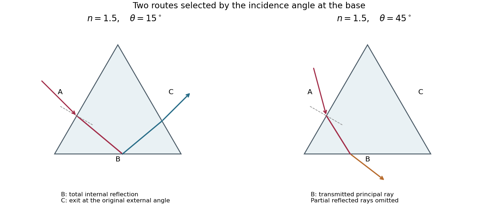

<h1 id="10/i/solution">Solution</h1>

↑ **Parent:** [I](../i.md)

Let $r=\arcsin(\sin\theta/n)$ be the angle inside the prism relative to the inward normal of face A. For the entry position shown, below the midpoint of A, and $0<\theta<90^\circ$, the transmitted ray first reaches face B. Its incidence angle there is $i_B=|\alpha-r|$. If $n\sin i_B<1$, a transmitted ray leaves B according to [Snell's law](../../../../snell-s-law.md). If $n\sin i_B>1$, it undergoes [total internal reflection](../../../../total-internal-reflection.md) at B and then reaches C. At the equality, transmission is grazing.

On the reflected route through this equilateral prism, the incidence angle at C is $r$, so $n\sin r=\sin\theta<1$ permits emergence from C. The [one-reflection path through an equilateral prism](../../../../one-reflection-path-through-an-equilateral-prism.md) is drawn alongside the direct-transmission route.

**[Figure 6](#10/i/image-principal-transmitted-ray-paths-through-an-optical-prism-total-internal-reflection-at-b-followed-by-exit-at-c-or-direct-refraction-out-of-b). Principal transmitted ray paths through an optical prism: total internal reflection at B followed by exit at C, or direct refraction out of B**.

Real interfaces also produce partial [Fresnel reflection](../../../../fresnel-reflection.md) below the critical angle; these additional weaker rays are omitted from the principal-path sketch. Which face a ray first reaches also depends on its entrance position, so the route statement uses the entrance geometry illustrated in the source.

## ↑ Ancestors (12)

1. [I](../i.md)
2. [10](../../10.md)
3. [2018](../../../2018-split.md)
4. [Past exam of the physics 2 paper of the University of Oxford](../../../split.md)
5. [Physics 2 paper of the University of Oxford](../../../../physics-2-paper-of-the-university-of-oxford.md)
6. [Year 1 of the physics course of the University of Oxford](../../../../year-1-of-the-physics-course-of-the-university-of-oxford.md)
7. [Physics course of the University of Oxford](../../../../physics-course-of-the-university-of-oxford.md)
8. [Undergraduate course of the University of Oxford](../../../../undergraduate-course-of-the-university-of-oxford.md)
9. [Course of the University of Oxford](../../../../course-of-the-university-of-oxford.md)
10. [University of Oxford](../../../../university-of-oxford-split.md)
11. [List of universities](../../../../list-of-universities.md)
12. [Codex Wiki](../../../../split.md)
