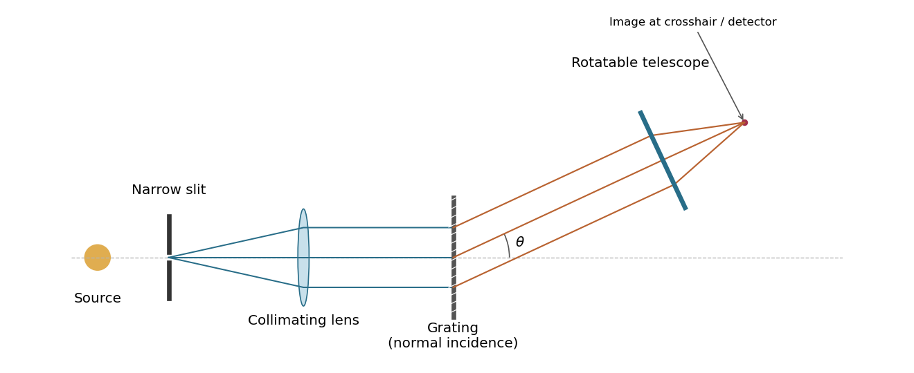

<h1 id="5/solution">Solution</h1>

↑ **Parent:** [5](../5.md)

A [grating spectrometer](../../../grating-spectrometer.md) places an illuminated narrow slit at the front focal plane of a [collimator](../../../collimator.md). The resulting parallel beam reaches the [diffraction grating](../../../diffraction-grating.md) at known incidence, here taken normal. A rotatable telescope focuses each outgoing diffracted parallel beam onto its crosshair or detector. Align the slit with the grating rulings, focus the [collimator](../../../collimator.md) at infinity, and illuminate many grooves across a suitable aperture. A narrow slit supplies sufficient [spatial coherence](../../../spatial-optical-coherence.md) and prevents slit width from blurring the angular separation; the telescope must also resolve the two images.

**[Figure 1](#5/image-a-grating-spectrometer-with-a-narrow-source-slit-collimator-normally-illuminated-diffraction-grating-and-rotatable-observing-telescope). A grating spectrometer with a narrow source slit, collimator, normally illuminated diffraction grating and rotatable observing telescope**.

The groove spacing is $d=(2000\times100)^{-1}\ \mathrm m=5.00\ \mu\mathrm m$. The [grating equation](../../../grating-equation.md) at normal incidence is $d\sin\theta_m=m\lambda$. For [diffraction order](../../../diffraction-order.md) $m=2$,

$$
\theta_{579}=\arcsin(0.2316)\simeq13.3913^\circ,\qquad
\theta_{577}=\arcsin(0.2308)\simeq13.3442^\circ.
$$

Therefore

$$
\boxed{\Delta\theta\simeq8.22\times10^{-4}\ \mathrm{rad}=0.0471^\circ=2.83\ \text{arcmin}.}
$$

The ideal [resolving power of a diffraction grating](../../../resolving-power-of-a-diffraction-grating.md) is $|m|N$, so the [Rayleigh criterion](../../../rayleigh-criterion.md) for this doublet requires about $N\geq145$ illuminated grooves, spanning roughly $0.73\ \mathrm{mm}$. This is an ideal lower bound; finite slit width, aberrations and detector resolution can require a larger usable aperture.

## ↑ Ancestors (11)

1. [5](../5.md)
2. [2018](../../2018-split.md)
3. [Past exam of the physics 2 paper of the University of Oxford](../../split.md)
4. [Physics 2 paper of the University of Oxford](../../../physics-2-paper-of-the-university-of-oxford.md)
5. [Year 1 of the physics course of the University of Oxford](../../../year-1-of-the-physics-course-of-the-university-of-oxford.md)
6. [Physics course of the University of Oxford](../../../physics-course-of-the-university-of-oxford.md)
7. [Undergraduate course of the University of Oxford](../../../undergraduate-course-of-the-university-of-oxford.md)
8. [Course of the University of Oxford](../../../course-of-the-university-of-oxford.md)
9. [University of Oxford](../../../university-of-oxford-split.md)
10. [List of universities](../../../list-of-universities.md)
11. [Codex Wiki](../../../split.md)
