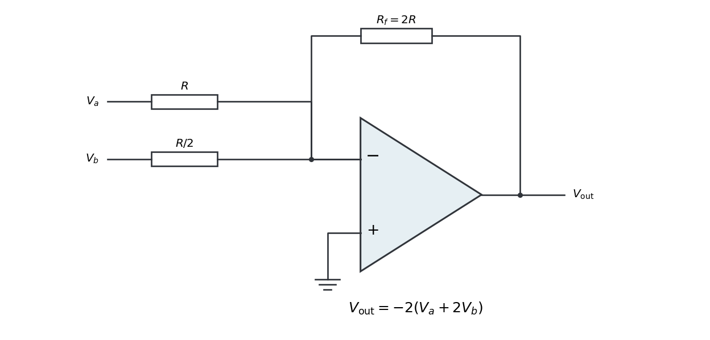

<h1 id="6/solution">Solution</h1>

↑ **Parent:** [6](../6.md)

Use an ideal inverting [summing amplifier](../../../summing-amplifier.md), grounding the non-inverting input and connecting the two sources through resistances $R$ and $R/2$. A feedback resistance $R_f=2R$ gives the desired weights. [Operational-amplifier negative feedback](../../../operational-amplifier-negative-feedback.md) makes the inverting node a [virtual ground](../../../virtual-ground.md), and negligible input current lets [Kirchhoff's current law](../../../kirchhoff-node-law.md) give

$$
\frac{V_a}{R}+\frac{V_b}{R/2}=-\frac{V_{\mathrm{out}}}{2R},\qquad
\boxed{V_{\mathrm{out}}=-2(V_a+2V_b).}
$$

**[Figure 2](#6/image-an-inverting-summing-amplifier-with-input-resistances-r-r-2-and-feedback-resistance-2r). An inverting summing amplifier with input resistances $R,R/2$ and feedback resistance $2R$**.

Replacing the feedback [resistor](../../../resistor.md) by a [capacitor](../../../capacitor.md) $C$ makes a weighted [op amp integrator](../../../op-amp-integrator.md):

$$
\boxed{\frac{dV_{\mathrm{out}}}{dt}=-\frac{V_a+2V_b}{RC},\qquad
V_{\mathrm{out}}(t)=V_{\mathrm{out}}(t_0)-\frac1{RC}\int_{t_0}^t[V_a(u)+2V_b(u)]\,du.}
$$

The initial capacitor charge determines the integration constant. A nonzero DC weighted input produces a ramp; a real [operational amplifier](../../../operational-amplifier.md) eventually reaches its output-voltage limit. A parallel feedback resistance can limit drift while preserving integration over an appropriate frequency range.

## ↑ Ancestors (11)

1. [6](../6.md)
2. [2018](../../2018-split.md)
3. [Past exam of the physics 2 paper of the University of Oxford](../../split.md)
4. [Physics 2 paper of the University of Oxford](../../../physics-2-paper-of-the-university-of-oxford.md)
5. [Year 1 of the physics course of the University of Oxford](../../../year-1-of-the-physics-course-of-the-university-of-oxford.md)
6. [Physics course of the University of Oxford](../../../physics-course-of-the-university-of-oxford.md)
7. [Undergraduate course of the University of Oxford](../../../undergraduate-course-of-the-university-of-oxford.md)
8. [Course of the University of Oxford](../../../course-of-the-university-of-oxford.md)
9. [University of Oxford](../../../university-of-oxford-split.md)
10. [List of universities](../../../list-of-universities.md)
11. [Codex Wiki](../../../split.md)
