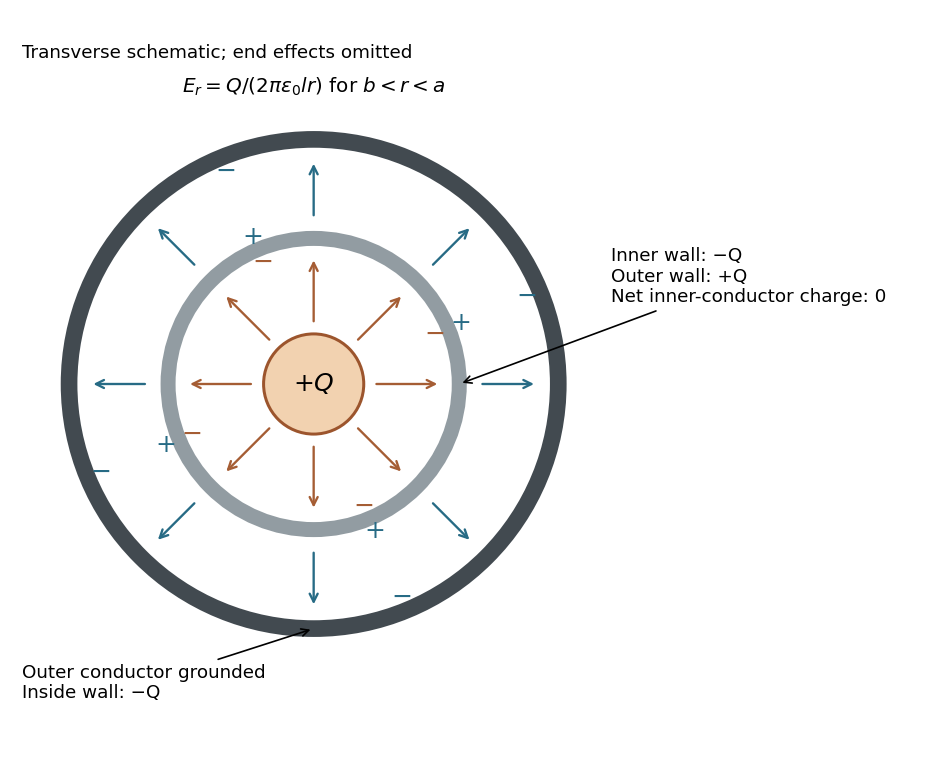

<h1 id="7/i/solution">Solution</h1>

↑ **Parent:** [I](../i.md)

Initially the isolated sphere has $Q=4\pi\epsilon_0RV$. After insertion without contact, its charge remains $Q$. In the long-cylinder approximation, with the sphere far from the openings, neglect electric flux escaping through the ends. A [Gauss surface](../../../../gaussian-surface.md) running through the shielding metal and closed by end sections of negligible flux then encloses zero net charge. Its cavity wall therefore carries $-Q$. Since that cylinder is isolated and initially neutral, its outside wall carries $+Q$. The grounded outer cylinder supplies charge $-Q$ on its inside wall, terminating the annular [electric field lines](../../../../electric-field-line.md).

**[Figure 3](#7/i/image-transverse-schematic-of-a-charged-sphere-inside-a-neutral-coaxial-capacitor-induced-charges-and-electric-field-lines-with-no-field-inside-the-conducting-walls). Transverse schematic of a charged sphere inside a neutral coaxial capacitor: induced charges and electric field lines, with no field inside the conducting walls**.

For positive $V$, the cavity [electric field lines](../../../../electric-field-line.md) run from the sphere to the inner wall, while annular [electric field lines](../../../../electric-field-line.md) run from the outside of the inner conductor to the grounded outer conductor. Negative $V$ reverses their directions. The transverse picture is schematic: exact cavity fields depend on the sphere's position and the ends. The following annular formulas neglect end effects and place the sphere well inside the long cylindrical assembly.

## ↑ Ancestors (12)

1. [I](../i.md)
2. [7](../../7.md)
3. [2018](../../../2018-split.md)
4. [Past exam of the physics 2 paper of the University of Oxford](../../../split.md)
5. [Physics 2 paper of the University of Oxford](../../../../physics-2-paper-of-the-university-of-oxford.md)
6. [Year 1 of the physics course of the University of Oxford](../../../../year-1-of-the-physics-course-of-the-university-of-oxford.md)
7. [Physics course of the University of Oxford](../../../../physics-course-of-the-university-of-oxford.md)
8. [Undergraduate course of the University of Oxford](../../../../undergraduate-course-of-the-university-of-oxford.md)
9. [Course of the University of Oxford](../../../../course-of-the-university-of-oxford.md)
10. [University of Oxford](../../../../university-of-oxford-split.md)
11. [List of universities](../../../../list-of-universities.md)
12. [Codex Wiki](../../../../split.md)
