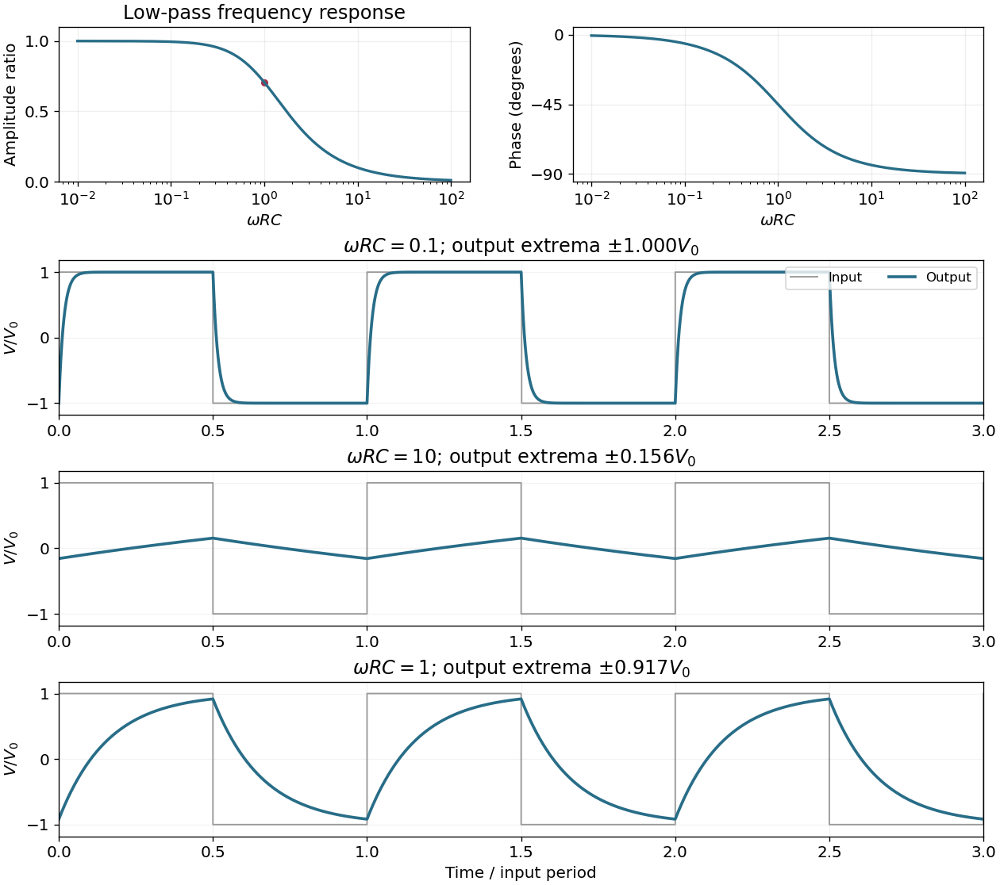

<h1 id="9/a/solution">Solution</h1>

↑ **Parent:** [A](../a.md)

The output is measured across the [capacitor](../../../../capacitor.md). The [voltage divider](../../../../voltage-divider.md) gives the [RC low-pass filter](../../../../rc-low-pass-filter.md) transfer function

$$
H(i\omega)=\frac{Z_C}{R+Z_C}=\frac1{1+i\omega RC}.
$$

Therefore

$$
\boxed{V_{\mathrm{out}}(t)=\frac{V_0}{\sqrt{1+(\omega RC)^2}}\cos\bigl(\omega t-\arctan(\omega RC)\bigr).}
$$

The amplitude ratio tends to $1$ and the [phase shift](../../../../phase-shift.md) to zero as $\omega\to0$. For $\omega\to\infty$, the amplitude ratio is asymptotic to $1/(\omega RC)$ and the [phase shift](../../../../phase-shift.md) tends to $-\pi/2$.

**[Figure 5](#9/a/image-the-rc-low-pass-filter-amplitude-and-phase-response-and-periodic-responses-to-a-symmetric-square-wave-input-at-three-values-of-omega-rc). The RC low-pass filter amplitude and phase response, and periodic responses to a symmetric square-wave input at three values of $\omega RC$**.

## ↑ Ancestors (12)

1. [A](../a.md)
2. [9](../../9.md)
3. [2018](../../../2018-split.md)
4. [Past exam of the physics 2 paper of the University of Oxford](../../../split.md)
5. [Physics 2 paper of the University of Oxford](../../../../physics-2-paper-of-the-university-of-oxford.md)
6. [Year 1 of the physics course of the University of Oxford](../../../../year-1-of-the-physics-course-of-the-university-of-oxford.md)
7. [Physics course of the University of Oxford](../../../../physics-course-of-the-university-of-oxford.md)
8. [Undergraduate course of the University of Oxford](../../../../undergraduate-course-of-the-university-of-oxford.md)
9. [Course of the University of Oxford](../../../../course-of-the-university-of-oxford.md)
10. [University of Oxford](../../../../university-of-oxford-split.md)
11. [List of universities](../../../../list-of-universities.md)
12. [Codex Wiki](../../../../split.md)
