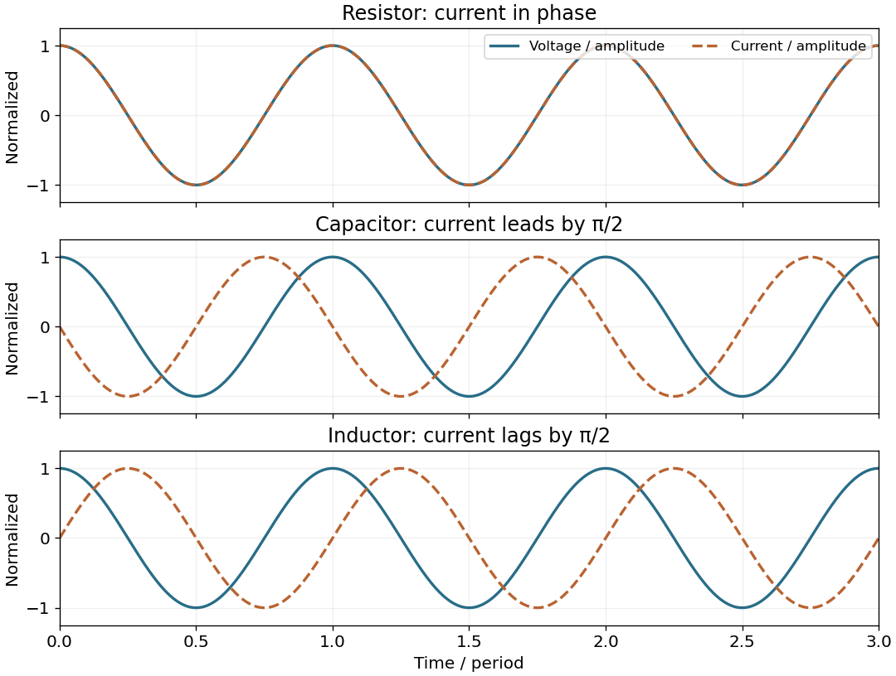

<h1 id="9/solution">Solution</h1>

↑ **Parent:** [9](../9.md)

For this question use [phasors](../../../phasor.md) with time factor $e^{i\omega t}$, so an [electrical impedance](../../../electrical-impedance.md) is $Z=\widetilde V/\widetilde I$. The same [electric current](../../../electric-current.md) flows through all components of a [series circuit](../../../series-circuit.md), and their [voltages](../../../voltage.md) add by [Kirchhoff's voltage law](../../../kirchhoff-cycle-law.md). Hence the total series [electrical impedance](../../../electrical-impedance.md) is

$$
\boxed{Z_{\mathrm{series}}=R+i\left(\omega L-\frac1{\omega C}\right).}
$$

The individual steady sinusoidal currents and their phase relations are derived in the following three parts. The diagram normalizes each current by its own amplitude, so it compares [phase differences](../../../phase-difference.md) without mixing unlike physical units.

**[Figure 4](#9/image-normalized-voltage-and-current-waveforms-for-a-resistor-capacitor-and-inductor-capacitor-current-leads-and-inductor-current-lags-by-a-quarter-cycle). Normalized voltage and current waveforms for a resistor, capacitor and inductor; capacitor current leads and inductor current lags by a quarter cycle**.

## ↑ Ancestors (11)

1. [9](../9.md)
2. [2018](../../2018-split.md)
3. [Past exam of the physics 2 paper of the University of Oxford](../../split.md)
4. [Physics 2 paper of the University of Oxford](../../../physics-2-paper-of-the-university-of-oxford.md)
5. [Year 1 of the physics course of the University of Oxford](../../../year-1-of-the-physics-course-of-the-university-of-oxford.md)
6. [Physics course of the University of Oxford](../../../physics-course-of-the-university-of-oxford.md)
7. [Undergraduate course of the University of Oxford](../../../undergraduate-course-of-the-university-of-oxford.md)
8. [Course of the University of Oxford](../../../course-of-the-university-of-oxford.md)
9. [University of Oxford](../../../university-of-oxford-split.md)
10. [List of universities](../../../list-of-universities.md)
11. [Codex Wiki](../../../split.md)
