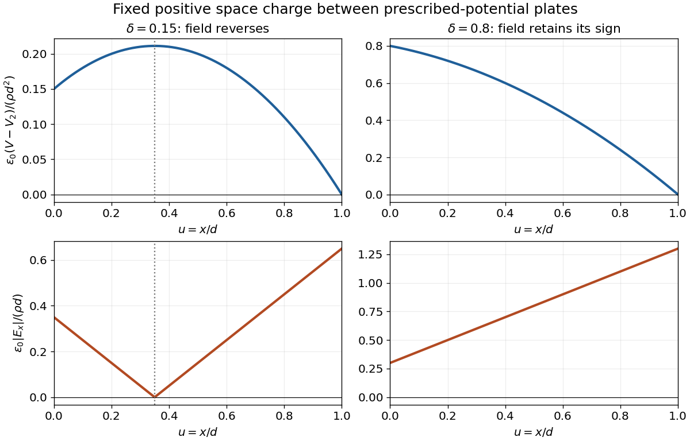
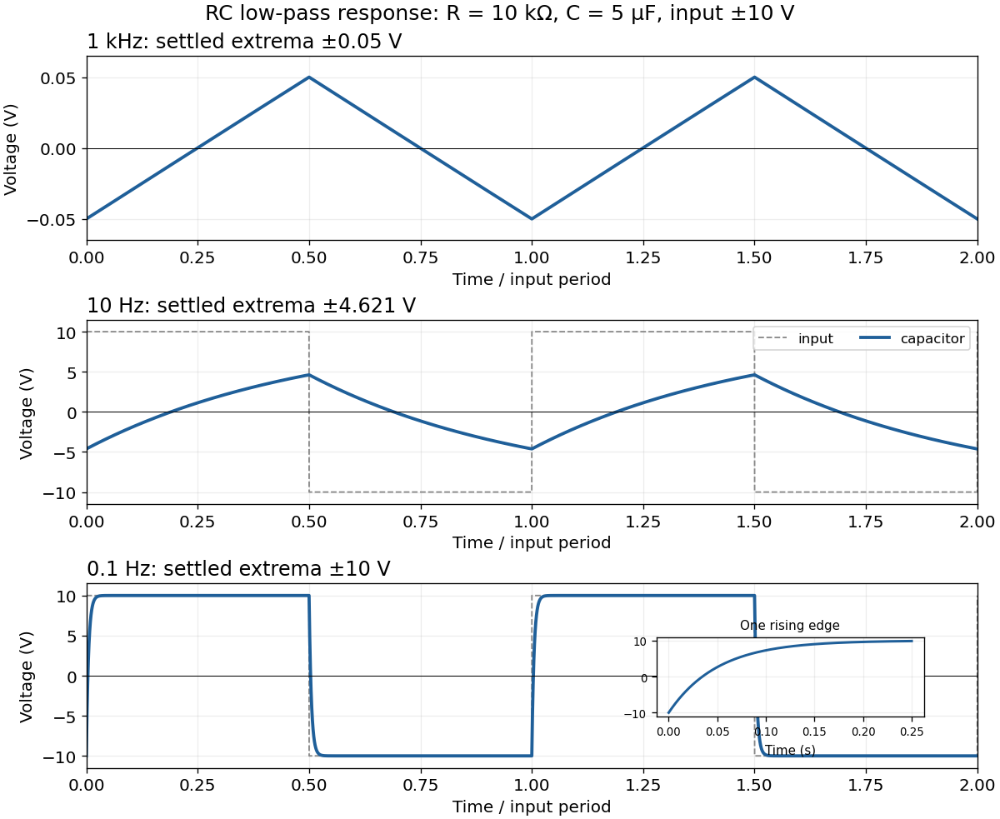

# 2019 resit

↑ **Parent:** [Past exam of the physics 2 paper of the University of Oxford](../past-exam-of-the-physics-2-paper-of-the-university-of-oxford.md)

Source paper: [Oxford public response bundle, pages 200–204](https://www.whatdotheyknow.com/request/physics_past_papers_21/response/3037379/attach/2/FOI%20202505%20441%20Response.pdf?cookie_passthrough=1). The cover identifies CP2, 3 September 2019, and bears a _Draft Only_ watermark. The recovered source lacks the diagram for [7](#7); that solution records the remaining limitation.

**Table of contents**

- [1](#1)
  - [Solution](#1/solution)
- [2](#2)
  - [Solution](#2/solution)
- [3](#3)
  - [Solution](#3/solution)
- [4](#4)
  - [Solution](#4/solution)
- [5](#5)
  - [Solution](#5/solution)
- [6](#6)
  - [Solution](#6/solution)
- [7](#7)
  - [Solution](#7/solution)
- [8](#8)
  - [Solution](#8/solution)
  - [i](#8/i)
    - [Solution](#8/i/solution)
  - [ii](#8/ii)
    - [Solution](#8/ii/solution)
  - [iii](#8/iii)
    - [Solution](#8/iii/solution)
  - [iv](#8/iv)
    - [Solution](#8/iv/solution)
- [9](#9)
  - [Solution](#9/solution)
- [10](#10)
  - [Solution](#10/solution)
- [11](#11)
  - [Solution](#11/solution)

## 1

↑ **Parent:** [2019 resit](2019-resit.md)

<h3 id="1/solution">Solution</h3>

↑ **Parent:** [1](#1)

For one wire, [Ampère's circuital law](../maxwell-equations.md#ampere-s-circuital-law) on a concentric [circle](../topology.md#circle) of radius $r$ gives

$$
2\pi r B(r)=\mu_0I,\qquad B(r)=\frac{\mu_0I}{2\pi r}.
$$

The other wire experiences the [Lorentz force](../relativistic-electromagnetism.md#lorentz-force) on its [electric current](../electric-charge.md#electric-current), $d\mathbf F=I\,d\boldsymbol\ell\times\mathbf B$. Its direction is perpendicular to this [magnetic field](../magnetic-field.md), so the [force per unit length](../force.md#force-per-unit-length) is

$$
\boxed{\frac FL=\frac{\mu_0I^2}{2\pi r}.}
$$

The [right-hand rule](../electromagnetism.md#right-hand-rule) gives attraction for parallel [electric currents](../electric-charge.md#electric-current) in the same direction and repulsion for opposite directions.

For the upper wire, the upward magnetic [force per unit length](../force.md#force-per-unit-length) balances its weight per unit length, $\lambda g$, where $g$ is the [gravitational acceleration](../newton-s-law-of-universal-gravitation.md#gravitational-acceleration). Therefore

$$
\boxed{r_{\mathrm{eq}}=\frac{\mu_0I^2}{2\pi\lambda g}.}
$$

This assumes the lower wire is held fixed and both wires remain straight. Within the vertical-motion model, increasing the separation weakens the upward [magnetic force](../relativistic-electromagnetism.md#magnetic-force), so this [equilibrium](../dynamical-systems.md#equilibrium-point-of-a-dynamical-system) is vertically restoring.

## 2

↑ **Parent:** [2019 resit](2019-resit.md)

<h3 id="2/solution">Solution</h3>

↑ **Parent:** [2](#2)

Interpret the coordinates as a plane in ordinary three-dimensional [electrostatics](../electrostatics.md). Set $k_e=1/(4\pi\epsilon_0)$, where $\epsilon_0$ is the [vacuum permittivity](../permittivity.md#vacuum-permittivity). The work required to bring the second [point charge](../electric-field.md#point-charge) in quasistatically is its [electric charge](../electric-charge.md) times the first charge's [electric potential](../electric-field.md#electric-potential):

$$
\boxed{U=-\frac{k_eQ^2}{d}.}
$$

The individual point-charge self-energies are excluded; this is the [electrostatic potential energy of point charges](../electrostatics.md#electrostatic-potential-energy-of-point-charges) relative to infinite separation.

By the [superposition principle](../vector-space.md#superposition-principle), for $\mathbf r=(x,y)$ and $\mathbf d=(d,0)$ the [electric field](../electric-field.md) is

$$
\mathbf E(\mathbf r)=k_eQ\left(\frac{\mathbf r}{|\mathbf r|^3}-\frac{\mathbf r-\mathbf d}{|\mathbf r-\mathbf d|^3}\right).
$$

At the first position both contributions point toward positive $x$, whereas at the second they oppose one another. Thus

$$
\boxed{\mathbf E(d/3,0)=\frac{45k_eQ}{4d^2}\,\hat{\mathbf x},\qquad
\mathbf E(-d/3,0)=-\frac{135k_eQ}{16d^2}\,\hat{\mathbf x}.}
$$

At $(d/2,d)$ the two distances are $\sqrt5d/2$. The vertical [electric field](../electric-field.md) components cancel and the horizontal components add:

$$
\boxed{\mathbf E(d/2,d)=\frac{8k_eQ}{5\sqrt5\,d^2}\,\hat{\mathbf x}.}
$$

**Dimensional convention.** The source's description of space as two-dimensional cannot literally mean two-dimensional [electrostatics](../electrostatics.md) with the same inverse-square formula. In a genuinely two-dimensional [Gauss's law](../maxwell-equations.md#gauss-s-law), the circumference grows as $r$, giving an [electric field](../electric-field.md) proportional to $1/r$ and a logarithmic [electric potential](../electric-field.md#electric-potential). For example, integrating $1/r$ from $d$ to infinity diverges, so the same finite reference [potential energy](../energy.md#potential-energy) at infinite separation does not exist. The displayed results use the conventional three-dimensional [Coulomb's law](../electrostatics.md#coulomb-s-law) restricted to the stated plane.

## 3

↑ **Parent:** [2019 resit](2019-resit.md)

<h3 id="3/solution">Solution</h3>

↑ **Parent:** [3](#3)

Assemble the [spherically symmetric charge distribution](../electrostatics.md#spherically-symmetric-charge-distribution) by adding thin concentric shells, with the final [charge density](../electric-charge.md#charge-density) kept uniform. When the assembled radius is $s$, the enclosed [electric charge](../electric-charge.md) and the next increment are

$$
q(s)=Q\frac{s^3}{r^3},\qquad dq=\frac{3Qs^2}{r^3}\,ds.
$$

The [electric potential](../electric-field.md#electric-potential) of the already assembled material at that shell is $k_eq(s)/s$. Consequently its assembly work is $dU=k_eq(s)\,dq/s$, and the [electrostatic energy of a uniformly charged solid sphere](../electrostatics.md#electrostatic-energy-of-a-uniformly-charged-solid-sphere) is

$$
U=\frac{3k_eQ^2}{r^6}\int_0^r s^4\,ds,
\qquad
\boxed{U=\frac{3k_eQ^2}{5r}=\frac{3Q^2}{20\pi\epsilon_0r}.}
$$

There is no extra factor of one half in this assembly [integral](../integral.md): each pair of charge elements has already been counted exactly once, when the later element was brought in. A solid uniformly charged insulator has this value; a conducting sphere has its [electric charge](../electric-charge.md) on the surface and instead has [electrostatic energy](../electrostatics.md#electrostatic-energy) $k_eQ^2/(2r)$.

## 4

↑ **Parent:** [2019 resit](2019-resit.md)

<h3 id="4/solution">Solution</h3>

↑ **Parent:** [4](#4)

For this [space-charge-filled parallel-plate capacitor](../electromagnetism.md#space-charge-filled-parallel-plate-capacitor), place the first plate at $x=0$ and the second at $x=d=x_o$, ignoring [fringing field of a capacitor](../electromagnetism.md#fringing-field-of-a-capacitor). With [vacuum permittivity](../permittivity.md#vacuum-permittivity) between the plates and fixed [charge density](../electric-charge.md#charge-density) $\rho$, [Poisson's equation](../partial-differential-equation.md#poisson-s-equation) and the prescribed boundary [electric potentials](../electric-field.md#electric-potential) give

$$
\frac{d^2V}{dx^2}=-\frac{\rho}{\epsilon_0},\qquad V(0)=V_1,\quad V(d)=V_2.
$$

Integrating twice and imposing both values yields

$$
\boxed{V(x)=V_1+\frac{V_2-V_1}{d}x+\frac{\rho}{2\epsilon_0}x(d-x).}
$$

The [electric field](../electric-field.md) is minus the [gradient](../multivariable-calculus.md#gradient) of the [electric potential](../electric-field.md#electric-potential), hence

$$
\boxed{E_x(x)=\frac{V_1-V_2}{d}+\frac{\rho}{\epsilon_0}\left(x-\frac d2\right),\qquad
|\mathbf E(x)|=\left|\frac{V_1-V_2}{d}+\frac{\rho}{\epsilon_0}\left(x-\frac d2\right)\right|.}
$$

Thus the [electric potential](../electric-field.md#electric-potential) is a parabola, concave downward for $\rho>0$ and upward for $\rho<0$. The signed [electric field](../electric-field.md) is a straight line. Its magnitude has a V-shaped corner if its zero

$$
x_* =\frac d2-\frac{\epsilon_0(V_1-V_2)}{\rho d}
$$

lies inside the gap; otherwise its magnitude is a single straight segment. An interior zero requires $|V_1-V_2|<|\rho|d^2/(2\epsilon_0)$. At that point the [electric potential](../electric-field.md#electric-potential) has its interior extremum. For $\rho=0$, these reduce to a linear [electric potential](../electric-field.md#electric-potential) and a uniform [electric field](../electric-field.md).

**[Figure 1](#4/image-potential-and-electric-field-magnitude-in-a-parallel-plate-capacitor-with-fixed-space-charge). Potential and electric-field magnitude in a parallel-plate capacitor with fixed space charge**. Illustrative dimensionless curves for positive [charge density](../electric-charge.md#charge-density), using $u=x/d$, $W=\epsilon_0(V-V_2)/(\rho d^2)$ and $\delta=\epsilon_0(V_1-V_2)/(\rho d^2)$. The two choices show an interior field reversal and a field with one sign throughout. They do not assume numerical source data.

## 5

↑ **Parent:** [2019 resit](2019-resit.md)

<h3 id="5/solution">Solution</h3>

↑ **Parent:** [5](#5)

Let $v_C$ denote the [capacitor](../electromagnetism.md#capacitor) [voltage](../random-walk.md#voltage) with the same polarity as the applied [voltage](../random-walk.md#voltage). By [Kirchhoff's voltage law](../random-walk.md#kirchhoff-cycle-law), [Ohm's law](../electric-charge.md#ohm-s-law) and $I=C\,dv_C/dt$,

$$
RC\frac{dv_C}{dt}+v_C=V,\qquad v_C(0)=0.
$$

Solving this first-order [differential equation](../differential-equation.md) gives the [RC low-pass step response](../electrical-engineering.md#rc-low-pass-step-response)

$$
\boxed{v_C(t)=V\left(1-e^{-t/\tau}\right),\qquad \tau=RC=0.050\,\mathrm s.}
$$

The [capacitor](../electromagnetism.md#capacitor) [voltage](../random-walk.md#voltage) is continuous at switching because an instantaneous finite jump would require an impulsive [electric current](../electric-charge.md#electric-current).

For the [square-wave response of an RC low-pass filter](../electrical-engineering.md#square-wave-response-of-an-rc-low-pass-filter), take equal positive and negative half-periods. Let $A=10\,\mathrm V$, $T=1/f$, $h=T/2$ and $\alpha=e^{-h/\tau}$. After the transient, symmetry makes the [capacitor](../electromagnetism.md#capacitor) [voltage](../random-walk.md#voltage) alternate between $-v_p$ and $+v_p$. Over the positive half-period,

$$
v_C(t)=A-(A+v_p)e^{-t/\tau},\quad 0\leq t<h.
$$

Requiring $v_C(h)=v_p$ gives

$$
\boxed{v_p=A\frac{1-\alpha}{1+\alpha}=A\tanh\!\left(\frac{T}{4\tau}\right).}
$$

The next half-period is the sign-reversed copy. These exact expressions explain the requested sketches:

- At $1\,\mathrm{kHz}$, $h/\tau=0.01$. The [voltage](../random-walk.md#voltage) barely changes in each half-period, so the output is nearly triangular about zero, with extrema about $\pm0.0500\,\mathrm V$. Its small-signal slope is approximately $\pm A/\tau=\pm200\,\mathrm{V\,s^{-1}}$.
- At $10\,\mathrm{Hz}$, $h=\tau$. Clearly curved exponential rises and falls reach only $\pm4.621\,\mathrm V$; the output never settles to either input level.
- At $0.1\,\mathrm{Hz}$, $h=100\tau$. The output closely follows the input plateaux at $\pm10\,\mathrm V$, joined by continuous exponential transitions with [time constant](../analysis.md#time-constant) $0.050\,\mathrm s$.

**[Figure 2](#5/image-steady-periodic-capacitor-voltages-for-three-square-wave-frequencies). Steady periodic capacitor voltages for three square-wave frequencies**. The blue curves use the exact periodic [RC low-pass filter](../electrical-engineering.md#rc-low-pass-filter) solution with $RC=0.050\,\mathrm s$. Dashed grey curves show the applied [square wave](../fourier-series.md#square-wave) in the lower panels; the first panel uses an expanded output scale. Time is measured in input periods.

## 6

↑ **Parent:** [2019 resit](2019-resit.md)

<h3 id="6/solution">Solution</h3>

↑ **Parent:** [6](#6)

Treat the given orbital separation as the projected separation on the sky. The small [angular separation](../astronomy.md#angular-separation) is

$$
\theta\simeq\frac{1.5\times10^{11}}{2\times10^{17}}=7.5\times10^{-7}\,\mathrm{rad}.
$$

For an ideal circular [telescope](../physics.md#telescope) aperture of diameter $D$, the [Rayleigh criterion](../point-spread-function.md#rayleigh-criterion) requires $1.22\lambda/D\leq\theta$. Therefore

$$
\boxed{D\geq\frac{1.22(500\times10^{-9})}{7.5\times10^{-7}}\,\mathrm m\simeq0.81\,\mathrm m.}
$$

This is the [diffraction](../quantum-scattering.md#diffraction) limit, assuming comparable image brightness and adequate sampling. Atmospheric image blurring can require correction or space-based observing. A smaller actual projected separation of the [binary star](../stellar-astrophysics.md#binary-star) would require a larger aperture.

## 7

↑ **Parent:** [2019 resit](2019-resit.md)

<h3 id="7/solution">Solution</h3>

↑ **Parent:** [7](#7)

**TODO: the source glass-rod diagram is unavailable.** The recovered prose gives a surface curvature and object distance, but the diagram's orientation, labels and any further optical surfaces cannot be verified. The following solves the surviving request for a single convex entrance surface; it is conditional on that interpretation and does not reconstruct the missing diagram or supply a rod length.

For [refraction at a spherical surface](../optics.md#refraction-at-a-spherical-surface), take incident [light](../optics.md#light) travelling rightwards from [refractive index](../electromagnetic-wave.md#refractive-index) $n_0$ to $n_g$, object distance $u>0$ to the left of the vertex, image distance $v$ positive to the right, and signed curvature $R_s$ positive when the centre is inside the rod. In the [paraxial approximation](../partial-differential-equation.md#paraxial-approximation), applying [Snell's law](../partial-differential-equation.md#snell-s-law) to a [light ray](../geometrical-optics.md#light-ray) at height $y$ gives

$$
n_0\left(\frac yu+\frac y{R_s}\right)
=n_g\left(\frac y{R_s}-\frac yv\right).
$$

After cancelling $y$, the image position and transverse [magnification](../optics.md#magnification) are

$$
\boxed{\frac{n_0}{u}+\frac{n_g}{v}=\frac{n_g-n_0}{R_s},\qquad
v=\frac{n_guR_s}{(n_g-n_0)u-n_0R_s},\qquad
M=-\frac{n_0v}{n_gu}.}
$$

The [magnification](../optics.md#magnification) follows by considering a paraxial [light ray](../geometrical-optics.md#light-ray) through the vertex: [Snell's law](../partial-differential-equation.md#snell-s-law) there gives $n_0(-y_o/u)=n_g(y_i/v)$.

For a convex entrance, $R_s=+20\,\mathrm{mm}$ and $u=60\,\mathrm{mm}$. In air, the denominator $(n_g-n_0)/R_s-n_0/u$ is $1/75\,\mathrm{mm^{-1}}$, giving

$$
\boxed{v_{\mathrm{air}}=120\,\mathrm{mm},\qquad M_{\mathrm{air}}=-1.25.}
$$

This is a real, inverted image within a sufficiently long glass rod, before any subsequent surface.

For water with [refractive index](../electromagnetic-wave.md#refractive-index) $1.33$, the denominator is $-13/1500\,\mathrm{mm^{-1}}$, and

$$
\boxed{v_{\mathrm{water}}=-\frac{2400}{13}\,\mathrm{mm}\simeq-184.6\,\mathrm{mm},\qquad
M_{\mathrm{water}}=\frac{133}{52}\simeq+2.558.}
$$

The emerging [light rays](../geometrical-optics.md#light-ray) diverge as though from an upright virtual image on the object side. The change of sign is consistent with $v$ diverging when $n_0=n_gu/(u+R_s)=1.20$. A reversed curvature or a second exit surface changes these answers; the unavailable diagram prevents a definitive answer for the full illustrated arrangement.

## 8

↑ **Parent:** [2019 resit](2019-resit.md)

<h3 id="8/solution">Solution</h3>

↑ **Parent:** [8](#8)

[Faraday's law of induction](../maxwell-equations.md#faraday-s-law-of-induction) states that the oriented [electromotive force](../electric-charge.md#electromotive-force) around a closed material circuit is minus the rate of change of its linked [magnetic flux](../magnetic-field.md#magnetic-flux):

$$
\mathcal E=\oint_{C(t)}(\mathbf E+\mathbf u\times\mathbf B)\cdot d\boldsymbol\ell
=-\frac{d}{dt}\int_{S(t)}\mathbf B\cdot d\mathbf S.
$$

The surface orientation and circuit direction obey the [right-hand rule](../electromagnetism.md#right-hand-rule). The minus sign expresses [Lenz's law](../maxwell-equations.md#lenz-s-law): the induced [electric current](../electric-charge.md#electric-current), when allowed to flow, produces a [magnetic field](../magnetic-field.md) opposing the change of linked [magnetic flux](../magnetic-field.md#magnetic-flux). For a stationary circuit this reduces to $\oint\mathbf E\cdot d\boldsymbol\ell=-d\Phi_B/dt$.

The source's “Lorenz force” is the [Lorentz force](../relativistic-electromagnetism.md#lorentz-force), $q(\mathbf E+\mathbf v\times\mathbf B)$. A wire element of cross-section $A_c$ contains $nA_c\,d\ell$ carriers of charge $q$ with drift [velocity](../classical-mechanics.md#velocity) $\mathbf v_d$. Adding their magnetic [forces](../force.md) and using $I=nqA_cv_d$ gives

$$
\boxed{d\mathbf F=I\,d\boldsymbol\ell\times\mathbf B,\qquad
\mathbf F=I\mathbf L\times\mathbf B}
$$

for a straight wire in a uniform [magnetic field](../magnetic-field.md). The length [vector](../vector-space.md#vector) follows conventional [electric current](../electric-charge.md#electric-current), irrespective of the carrier sign.

For the unlabelled upward-motion request, define $\hat{\mathbf t}=(\cos\phi,0,-\sin\phi)$ down the slope, $\hat{\mathbf b}=(0,1,0)$ across the rails and $\hat{\mathbf n}=(\sin\phi,0,\cos\phi)$ out of their plane. Choose the vertical [magnetic field](../magnetic-field.md) as $\mathbf B=B\hat{\mathbf z}$. An [electric current](../electric-charge.md#electric-current) $I$ across the bar in direction $-\hat{\mathbf b}$ gives a horizontal [magnetic force](../relativistic-electromagnetism.md#magnetic-force) $-IBs\hat{\mathbf x}$. The other [forces](../force.md) are weight $-mg\hat{\mathbf z}$ and the rail [normal force](../force.md#normal-force) $N\hat{\mathbf n}$. Uniform upward [velocity](../classical-mechanics.md#velocity) requires

$$
mg\sin\phi-IBs\cos\phi=0,\qquad
N-mg\cos\phi-IBs\sin\phi=0.
$$

Consequently

$$
\boxed{I=\frac{mg\tan\phi}{Bs},\qquad
F_B=\frac{mg\sin\phi}{\cos\phi},\qquad N=\frac{mg}{\cos\phi}.}
$$

Each symmetric rail supplies half of $N$. The [electric current](../electric-charge.md#electric-current) must make $I\mathbf L\times\mathbf B$ point horizontally toward the uphill side; for the coordinates just defined it flows along $-\hat{\mathbf b}$. Reversing the vertical [magnetic field](../magnetic-field.md) reverses this current direction. The external supply must maintain that [electric current](../electric-charge.md#electric-current) against the motional [electromotive force](../electric-charge.md#electromotive-force) during ascent. For $\cos\phi=0$, no finite horizontal [magnetic force](../relativistic-electromagnetism.md#magnetic-force) can support uniform motion along the vertical rails.

<h3 id="8/i">i</h3>

↑ **Parent:** [8](#8)

<h4 id="8/i/solution">Solution</h4>

↑ **Parent:** [I](#8/i)

Use the coordinates in [8](#8). At downhill speed $v$, the moving bar has $\mathbf v\times\mathbf B=-Bv\cos\phi\,\hat{\mathbf b}$. The [electromotive force](../electric-charge.md#electromotive-force) and induced [electric current](../electric-charge.md#electric-current) are therefore

$$
\boxed{\mathcal E=Bs v\cos\phi,\qquad I=\frac{Bs v\cos\phi}{R}.}
$$

Here $I$ is positive along $-\hat{\mathbf b}$ across the sliding bar, then returns through the rails and [resistor](../electric-charge.md#resistor). This direction makes the [magnetic force](../relativistic-electromagnetism.md#magnetic-force) oppose downhill motion, as required by [Lenz's law](../maxwell-equations.md#lenz-s-law). The factor $\cos\phi$ is essential: only the component of [magnetic field](../magnetic-field.md) normal to the rail plane threads the circuit. Rail and bar [electrical resistances](../electric-charge.md#electrical-resistance) and circuit [self-inductance](../electromagnetism.md#self-inductance) are neglected relative to the stated large $R$ model.

<h3 id="8/ii">ii</h3>

↑ **Parent:** [8](#8)

<h4 id="8/ii/solution">Solution</h4>

↑ **Parent:** [Ii](#8/ii)

The component of [magnetic force](../relativistic-electromagnetism.md#magnetic-force) along the slope has magnitude $IBs\cos\phi$. The rate at which the sliding bar does work against this magnetic braking is

$$
P_{\mathrm{brake}}=IBs v\cos\phi=I\mathcal E.
$$

By [Ohm's law](../electric-charge.md#ohm-s-law), $\mathcal E=IR$, so

$$
\boxed{P_{\mathrm{brake}}=I^2R=\frac{B^2s^2v^2\cos^2\phi}{R}.}
$$

This exactly equals the [Joule heating](../electric-charge.md#joule-heating) in the [resistor](../electric-charge.md#resistor) in the negligible-[self-inductance](../electromagnetism.md#self-inductance) approximation. The [normal force](../force.md#normal-force) does no work because it is perpendicular to the [velocity](../classical-mechanics.md#velocity).

The gravitational [power](../energy.md#power) is instead $mgv\sin\phi$. By the [work-energy theorem](../energy.md#work-energy-theorem),

$$
mgv\sin\phi=I^2R+\frac{d}{dt}\left(\frac12mv^2\right).
$$

It equals the [Joule heating](../electric-charge.md#joule-heating) only at constant speed. For a concrete counterexample, during the initial acceleration the [kinetic energy](../energy.md#kinetic-energy) increases, so some gravitational [power](../energy.md#power) remains mechanical.

<h3 id="8/iii">iii</h3>

↑ **Parent:** [8](#8)

<h4 id="8/iii/solution">Solution</h4>

↑ **Parent:** [Iii](#8/iii)

Project [Newton's second law](../force.md#newton-s-second-law) down the slope. The normal reaction has no component along the rails, while the magnetic term opposes motion:

$$
\boxed{m\frac{dv}{dt}=mg\sin\phi-IBs\cos\phi
=mg\sin\phi-\frac{B^2s^2\cos^2\phi}{R}v.}
$$

This first-order linear [differential equation](../differential-equation.md) has the release-from-rest solution

$$
v(t)=\frac{mgR\sin\phi}{B^2s^2\cos^2\phi}\left(1-e^{-t/\tau_m}\right),\qquad
\tau_m=\frac{mR}{B^2s^2\cos^2\phi}.
$$

The electrical [self-inductance](../electromagnetism.md#self-inductance) has been neglected; retaining it introduces a coupled [electric current](../electric-charge.md#electric-current) equation rather than this instantaneous resistive response.

<h3 id="8/iv">iv</h3>

↑ **Parent:** [8](#8)

<h4 id="8/iv/solution">Solution</h4>

↑ **Parent:** [Iv](#8/iv)

At the [terminal velocity](../classical-mechanics.md#terminal-velocity), the acceleration in [iii](#8/iii) vanishes. Thus

$$
\boxed{v_{\mathrm t}=\frac{mgR\sin\phi}{B^2s^2\cos^2\phi}.}
$$

For $0<\phi<\pi/2$ and nonzero $B$, the magnetic drag increases linearly with speed and this terminal state is stable. Horizontal rails have no gravitational drive. Vertical rails have no linked vertical [magnetic flux](../magnetic-field.md#magnetic-flux) change, so the model gives free fall rather than a finite [terminal velocity](../classical-mechanics.md#terminal-velocity).

## 9

↑ **Parent:** [2019 resit](2019-resit.md)

<h3 id="9/solution">Solution</h3>

↑ **Parent:** [9](#9)

In SI units, [Maxwell's equations](../maxwell-equations.md) in [vacuum](../physics.md#vacuum), allowing [charge density](../electric-charge.md#charge-density) $\rho$ and [electric current density](../electric-charge.md#current-density) $\mathbf J$, are

$$
\boxed{\begin{aligned}
\nabla\cdot\mathbf E&=\rho/\epsilon_0,&\nabla\cdot\mathbf B&=0,\\
\nabla\times\mathbf E&=-\partial_t\mathbf B,&
\nabla\times\mathbf B&=\mu_0\mathbf J+\mu_0\epsilon_0\partial_t\mathbf E.
\end{aligned}}
$$

The source-free specialization sets $\rho=0$ and $\mathbf J=0$; it cannot describe the charged objects at their locations. Applying the [divergence theorem](../multivariable-calculus.md#divergence-theorem) to the first equation gives [Gauss's law](../maxwell-equations.md#gauss-s-law):

$$
\oint_{\partial\Omega}\mathbf E\cdot d\mathbf S
=\int_\Omega\nabla\cdot\mathbf E\,d^3x
=\frac{Q_{\mathrm{enc}}}{\epsilon_0}.
$$

For an isolated [point charge](../electric-field.md#point-charge) $q_1$, [spherical symmetry](../geometry-and-topology.md#spherical-symmetry) makes the [electric field](../electric-field.md) radial and constant in magnitude on a concentric sphere. Therefore $4\pi r^2E_r=q_1/\epsilon_0$. Multiplying by a second [point charge](../electric-field.md#point-charge) gives [Coulomb's law](../electrostatics.md#coulomb-s-law),

$$
\boxed{\mathbf E=\frac{q_1}{4\pi\epsilon_0r^2}\hat{\mathbf r},\qquad
\mathbf F_{2}=\frac{q_1q_2}{4\pi\epsilon_0r^2}\hat{\mathbf r}.}
$$

The [force](../force.md) points away from the first charge for like signs and toward it for opposite signs.

For the [spherical capacitor](../electromagnetism.md#spherical-capacitor), a Gaussian sphere between the shells encloses $q$, so $E_r=q/(4\pi\epsilon_0r^2)$ for $a<r<b$. Integrating the [electric field](../electric-field.md) inward from the outer shell yields

$$
V(r)-V(b)=-\int_b^r\frac{q}{4\pi\epsilon_0s^2}\,ds
=\frac{q}{4\pi\epsilon_0}\left(\frac1r-\frac1b\right).
$$

An arbitrary constant $V(b)$ remains unless a reference is specified. The [capacitance](../electromagnetism.md#capacitance) is determined by the potential difference:

$$
\boxed{C=\frac{q}{V(a)-V(b)}=4\pi\epsilon_0\frac{ab}{b-a}.}
$$

For the subsequent charging operation, take the initial outer shell to be earthed, or interpret the stated $V$ as the inner-to-outer [voltage](../random-walk.md#voltage) with the outer reference zero. Isolating the inner shell fixes its [electric charge](../electric-charge.md) at $q=CV$. Removing the outer shell leaves an isolated conducting sphere. Its [electric field](../electric-field.md) and [electric potential](../electric-field.md#electric-potential), now with zero at infinity, are

$$
\mathbf E(r)=\begin{cases}0,&r<a,\\q\hat{\mathbf r}/(4\pi\epsilon_0r^2),&r>a,\end{cases}
\qquad
V(r)=\frac{q}{4\pi\epsilon_0r}\quad(r\geq a).
$$

Consequently

$$
\boxed{V_{\mathrm{surface}}=\frac{bV}{b-a},\qquad
V_{\mathrm{old\ outer\ position}}=\frac{aV}{b-a}.}
$$

These changes of [electric potential](../electric-field.md#electric-potential) are compatible with constant [electric charge](../electric-charge.md). Without the initial reference convention the absolute stated $V$ does not determine $q=CV$: for example, if the outer shell were initially isolated and neutral, the absolute inner [electric potential](../electric-field.md#electric-potential) would instead be $q/(4\pi\epsilon_0a)$.

Finally take the connected spheres to be sufficiently far apart that the long wire's [capacitance](../electromagnetism.md#capacitance) and their mutual influence can be neglected. Their common [electric potential](../electric-field.md#electric-potential) requires

$$
\frac{q_a}{a}=\frac{q_{2a}}{2a},\qquad q_a+q_{2a}=q,
$$

so $q_a=q/3$ and $q_{2a}=2q/3$. The magnitudes of the surface [electric fields](../electric-field.md) are

$$
E_a=\frac{q}{12\pi\epsilon_0a^2},\qquad E_{2a}=\frac{q}{24\pi\epsilon_0a^2},\qquad
\boxed{E_a:E_{2a}=2:1.}
$$

This is the usual widely separated-sphere approximation. A wire enforces an [equipotential](../electric-field.md#equipotential), but alone does not make this ratio exact for arbitrary arrangements. As a concrete counterexample, if the second shell enclosed the first concentrically and they were connected, all net [electric charge](../electric-charge.md) would reside on the exterior and the inner sphere's surface [electric field](../electric-field.md) would be zero.

## 10

↑ **Parent:** [2019 resit](2019-resit.md)

<h3 id="10/solution">Solution</h3>

↑ **Parent:** [10](#10)

In the [Huygens-Fresnel principle](../physical-optics.md#huygens-fresnel-principle) construction, after a time $\Delta t$ the incident disturbance advances $v_1\Delta t$ while the secondary disturbance in the second medium advances $v_2\Delta t$. The two right triangles share the segment along the interface. Hence

$$
\frac{\sin\theta_1}{\sin\theta_2}=\frac{v_1}{v_2}=\frac{n_2}{n_1},\qquad
\boxed{\theta_2=\arcsin\!\left(\frac{n_1}{n_2}\sin\theta_1\right).}
$$

Here both [angles](../geometry-and-topology.md#angle) are measured from the [normal vector](../differential-geometry.md#normal-vector), and $v_j=c/n_j$ are [phase velocities](../dispersion-relation.md#phase-velocity). This is [Snell's law](../partial-differential-equation.md#snell-s-law). For $n_1>n_2$, no real transmitted [angle](../geometry-and-topology.md#angle) exists when

$$
\boxed{\theta_1>\theta_c=\arcsin(n_2/n_1).}
$$

This is [total internal reflection](../electromagnetic-wave.md#total-internal-reflection); equality is the limiting grazing geometry. The statement concerns an ideal transparent interface, not material absorption or losses at a nearby second boundary.

Let $\beta$ be the internal [angle](../geometry-and-topology.md#angle) to the [optical axis](../geometrical-optics.md#optical-axis) in the straight [step-index optical fiber](../optical-instrument.md#step-index-optical-fiber). At its flat entrance, [Snell's law](../partial-differential-equation.md#snell-s-law) gives $\sin\theta_i=n_1\sin\beta$. At the side wall a [meridional ray](../geometrical-optics.md#meridional-ray) has [angle of incidence](../optics.md#angle-of-incidence) $\pi/2-\beta$. The limiting [total internal reflection](../electromagnetic-wave.md#total-internal-reflection) condition is $\cos\beta=n_2/n_1$. Thus the [optical fiber acceptance angle](../optical-instrument.md#optical-fiber-acceptance-angle) satisfies

$$
\boxed{\sin\theta_{i,\max}=\sqrt{n_1^2-n_2^2}\equiv\mathrm{NA},\qquad
\theta_{i,\max}=\arcsin\sqrt{n_1^2-n_2^2}.}
$$

The [numerical aperture](../point-spread-function.md#numerical-aperture) expression assumes the square root is at most one for air; otherwise all forward launch [angles](../geometry-and-topology.md#angle) are admitted by this ideal ray test. Strictly confined [meridional rays](../geometrical-optics.md#meridional-ray) lie inside the limiting cone.

For $n_1=1.48$ and $n_2=1.46$, $\mathrm{NA}=0.242487$ and $\theta_{i,\max}=14.0334^\circ$. A [light ray](../geometrical-optics.md#light-ray) at internal [angle](../geometry-and-topology.md#angle) $\beta$ travels distance $L/\cos\beta$ along a guide of axial length $L$. In the nondispersive approximation its [travel time](../dispersion-relation.md#travel-time) is $t=n_1L/(c\cos\beta)$. Therefore

$$
\begin{aligned}
t_{\max}&=\frac{n_1^2L}{cn_2}=5.00438\,\mu\mathrm s,\\
t_{\mathrm{half}}&=\frac{n_1L}{c\sqrt{1-\sin^2(\theta_{i,\max}/2)/n_1^2}}
=4.95365\,\mu\mathrm s,
\end{aligned}
\qquad
\boxed{\Delta t\simeq50.7\,\mathrm{ns}.}
$$

Here $L=1000\,\mathrm m$ and $c=299792458\,\mathrm{m\,s^{-1}}$; using $3.00\times10^8\,\mathrm{m\,s^{-1}}$ gives $5.001\,\mu\mathrm s$ and $4.950\,\mu\mathrm s$. The halving applies to the external launch [angle](../geometry-and-topology.md#angle), not to $\beta$. For actual short pulses the [group refractive index](../physical-optics.md#group-refractive-index) $n_{\mathrm g}$ replaces the prefactor $n_1$ in $t=n_{\mathrm g}L/(c\cos\beta)$; the source supplies no [optical dispersion](../geometrical-optics.md#dispersion-optics) data. The difference calculated here is geometrical [intermodal dispersion](../dispersion-relation.md#intermodal-dispersion) in a nondispersive [geometrical optics](../geometrical-optics.md) model.

Bending lowers the outer-wall [angle of incidence](../optics.md#angle-of-incidence), allowing a previously guided [light ray](../geometrical-optics.md#light-ray) to escape into the cladding. To calculate a definite [meridional ray bend threshold](../optical-instrument.md#meridional-ray-bend-threshold), continue the on-axis launch assumption and take a [meridional ray](../geometrical-optics.md#meridional-ray) in the plane of the circular bend. Its initial internal [angle](../geometry-and-topology.md#angle) to the centreline tangent obeys $\sin\beta=\sin10^\circ/n_1$. Its straight path has distance $b_{\mathrm{ray}}=R\cos\beta$ from the bend centre. At the outer wall of radius $R+r$, elementary right-triangle geometry gives

$$
\sin i_{\mathrm{out}}=\frac{R\cos\beta}{R+r}.
$$

At the loss threshold, this equals $n_2/n_1$. Solving for the centreline radius gives

$$
\boxed{R_c=\frac{n_2r}{n_1\cos\beta-n_2}
=\frac{n_2r}{\sqrt{n_1^2-\sin^2 10^\circ}-n_2}
=14.93\,\mathrm{mm}.}
$$

For this launch, $R<R_c$ violates the [total internal reflection](../electromagnetic-wave.md#total-internal-reflection) condition at the outer wall; $R=R_c$ is the limiting case. A real [optical fiber](../optical-instrument.md#optical-fiber) has gradual bend loss governed by its [electromagnetic wave](../electromagnetic-wave.md) modes, rather than a universal abrupt cutoff.

**Launch dependence.** The final sentence does not separately specify the entry position or orientation of the bend relative to the incident [light ray](../geometrical-optics.md#light-ray). For a planar launch displaced by $u$ from the centreline toward the outer wall, replace the numerator of $\sin i_{\mathrm{out}}$ by $(R+u)\cos\beta$. For example, a launch at the inner edge, $u=-r$, instead gives

$$
R_{c,\mathrm{inner}}=r\frac{n_1\cos\beta+n_2}{n_1\cos\beta-n_2}=29.96\,\mathrm{mm}.
$$

Thus $14.93\,\mathrm{mm}$ is the result for the stated on-axis continuation; it is not an entry-independent threshold. No missing figure is needed for these explicitly specified ray models.

## 11

↑ **Parent:** [2019 resit](2019-resit.md)

<h3 id="11/solution">Solution</h3>

↑ **Parent:** [11](#11)

Use [phasors](../wave.md#phasor) with time dependence $e^{i\omega t}$ and [electrical impedance](../electrical-circuit.md#electrical-impedance) $Z=\widetilde V/\widetilde I$. The element laws $V=IR$, $I=C\,dV/dt$ and $V=L\,dI/dt$ give

$$
\boxed{Z_R=R,\qquad Z_C=\frac1{i\omega C}=-\frac{i}{\omega C},\qquad Z_L=i\omega L.}
$$

A [complex number](../complex-analysis.md#complex-number) records both [amplitude](../wave.md#wave-amplitude) and [phase](../wave.md#phase-waves), turning the linear [differential equations](../differential-equation.md) of a sinusoidally driven [electrical circuit](../electrical-circuit.md) into algebraic equations. A [resistor](../electric-charge.md#resistor) has in-phase [voltage](../random-walk.md#voltage) and [electric current](../electric-charge.md#electric-current) and dissipates average [power](../energy.md#power). For an ideal [capacitor](../electromagnetism.md#capacitor), the [electric current](../electric-charge.md#electric-current) leads the [voltage](../random-walk.md#voltage) by $90^\circ$; for an ideal [inductor](../electromagnetism.md#inductor), it lags by $90^\circ$. Their imaginary [electrical impedances](../electrical-circuit.md#electrical-impedance) express reversible energy storage and return, with zero net average [power](../energy.md#power) over a period. Using $e^{-i\omega t}$ would conjugate the displayed reactive signs without changing predictions.

In the illustrated [Maxwell bridge](../electrical-circuit.md#maxwell-bridge), the left and right vertices are the supply terminals and the upper and lower vertices are detector terminals. Insert a sensitive AC null detector between the latter and drive the former with a sinusoidal source. The upper-left arm is $Z_x=R_x+i\omega L_x$, the upper-right arm is $R_3$, the lower-left arm is $R_2$, and the lower-right arm is the parallel combination

$$
Z_p=\left(\frac1{R_1}+i\omega C\right)^{-1}.
$$

At a null no detector [electric current](../electric-charge.md#electric-current) flows, so the two voltage dividers give

$$
\frac{R_3}{Z_x+R_3}=\frac{Z_p}{R_2+Z_p},\qquad
Z_xZ_p=R_2R_3.
$$

Multiplying by the parallel-arm [electrical admittance](../electrical-circuit.md#electrical-admittance) yields

$$
R_x+i\omega L_x=R_2R_3\left(\frac1{R_1}+i\omega C\right).
$$

Equating real and imaginary parts therefore gives

$$
\boxed{R_x=\frac{R_2R_3}{R_1},\qquad L_x=CR_2R_3.}
$$

Two independent adjustments are needed to annul the in-phase and quadrature detector signals. For example, change $R_2$ to set $L_x$ and $R_1$ to set $R_x$, iterating until the detector reads zero. Alternatively, with fixed $R_2,R_3$, independently vary $R_1$ and $C$.

The [Maxwell bridge](../electrical-circuit.md#maxwell-bridge) compares an unknown lossy [inductor](../electromagnetism.md#inductor) with a stable standard [capacitor](../electromagnetism.md#capacitor), avoiding the need for an accurately known reference [inductor](../electromagnetism.md#inductor). The ideal balance equations contain no [frequency](../wave.md#frequency), and a null measurement need not rely on absolute detector calibration. In practice choose a suitable [frequency](../wave.md#frequency) below the coil's self-resonance, where the series $R_x,L_x$ model and the standard [capacitor](../electromagnetism.md#capacitor) remain accurate.

If the initial setting is far from balance, the bridge as drawn needs adjustable components and a detector, not merely a more precise readout. Fit resistance boxes or switched ranges for $R_1$ and a ratio arm, and a selectable standard $C$. Choose ranges around

$$
R_2R_3=\frac{L_x}{C},\qquad R_1=\frac{L_x}{CR_x}.
$$

Then approach the null with coarse adjustments followed by finer ones. A large required $R_1$ can be brought into range by increasing $C$ and decreasing $R_2R_3$ proportionally. Start with reduced excitation or reduced detector sensitivity to avoid overload, then increase sensitivity near the null. Changing [frequency](../wave.md#frequency) alone cannot repair an impossible component range, since the ideal balance conditions are frequency-independent. Stray [capacitance](../electromagnetism.md#capacitance) and lead [electrical resistance](../electric-charge.md#electrical-resistance) set practical accuracy limits and may require shielding and short connections.

## ↑ Ancestors (9)

1. [Past exam of the physics 2 paper of the University of Oxford](../past-exam-of-the-physics-2-paper-of-the-university-of-oxford.md)
2. [Physics 2 paper of the University of Oxford](../university-of-oxford.md#physics-2-paper-of-the-university-of-oxford)
3. [Year 1 of the physics course of the University of Oxford](../university-of-oxford.md#year-1-of-the-physics-course-of-the-university-of-oxford)
4. [Physics course of the University of Oxford](../university-of-oxford.md#physics-course-of-the-university-of-oxford)
5. [Undergraduate course of the University of Oxford](../university-of-oxford.md#undergraduate-course-of-the-university-of-oxford)
6. [Course of the University of Oxford](../university-of-oxford.md#course-of-the-university-of-oxford)
7. [University of Oxford](../university-of-oxford.md)
8. [List of universities](../README.md#list-of-universities)
9. [Codex Wiki](../README.md)
