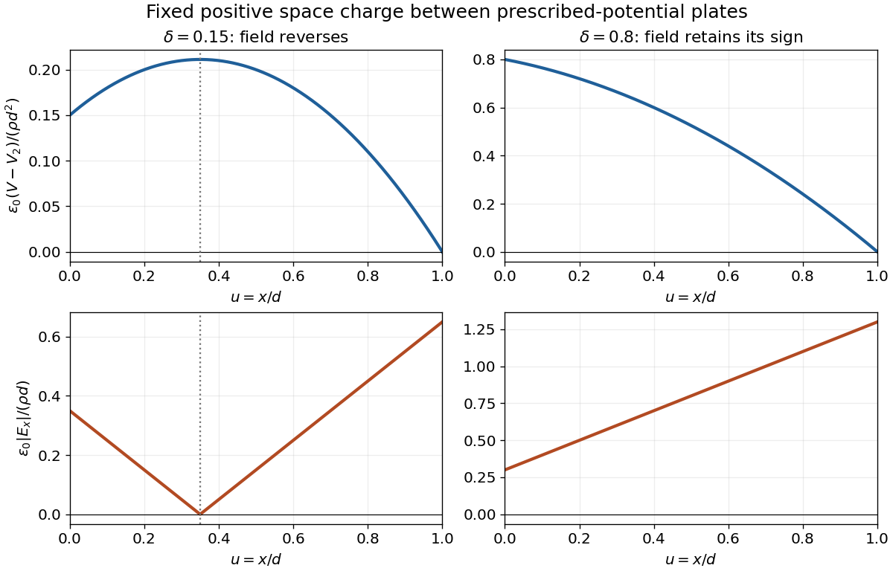

<h1 id="4/solution">Solution</h1>

↑ **Parent:** [4](../4.md)

For this [space-charge-filled parallel-plate capacitor](../../../space-charge-filled-parallel-plate-capacitor.md), place the first plate at $x=0$ and the second at $x=d=x_o$, ignoring [fringing field of a capacitor](../../../fringing-field-of-a-capacitor.md). With [vacuum permittivity](../../../vacuum-permittivity.md) between the plates and fixed [charge density](../../../charge-density.md) $\rho$, [Poisson's equation](../../../poisson-s-equation.md) and the prescribed boundary [electric potentials](../../../electric-potential.md) give

$$
\frac{d^2V}{dx^2}=-\frac{\rho}{\epsilon_0},\qquad V(0)=V_1,\quad V(d)=V_2.
$$

Integrating twice and imposing both values yields

$$
\boxed{V(x)=V_1+\frac{V_2-V_1}{d}x+\frac{\rho}{2\epsilon_0}x(d-x).}
$$

The [electric field](../../../electric-field-split.md) is minus the [gradient](../../../gradient.md) of the [electric potential](../../../electric-potential.md), hence

$$
\boxed{E_x(x)=\frac{V_1-V_2}{d}+\frac{\rho}{\epsilon_0}\left(x-\frac d2\right),\qquad
|\mathbf E(x)|=\left|\frac{V_1-V_2}{d}+\frac{\rho}{\epsilon_0}\left(x-\frac d2\right)\right|.}
$$

Thus the [electric potential](../../../electric-potential.md) is a parabola, concave downward for $\rho>0$ and upward for $\rho<0$. The signed [electric field](../../../electric-field-split.md) is a straight line. Its magnitude has a V-shaped corner if its zero

$$
x_* =\frac d2-\frac{\epsilon_0(V_1-V_2)}{\rho d}
$$

lies inside the gap; otherwise its magnitude is a single straight segment. An interior zero requires $|V_1-V_2|<|\rho|d^2/(2\epsilon_0)$. At that point the [electric potential](../../../electric-potential.md) has its interior extremum. For $\rho=0$, these reduce to a linear [electric potential](../../../electric-potential.md) and a uniform [electric field](../../../electric-field-split.md).

**[Figure 1](#4/image-potential-and-electric-field-magnitude-in-a-parallel-plate-capacitor-with-fixed-space-charge). Potential and electric-field magnitude in a parallel-plate capacitor with fixed space charge**. Illustrative dimensionless curves for positive [charge density](../../../charge-density.md), using $u=x/d$, $W=\epsilon_0(V-V_2)/(\rho d^2)$ and $\delta=\epsilon_0(V_1-V_2)/(\rho d^2)$. The two choices show an interior field reversal and a field with one sign throughout. They do not assume numerical source data.

## ↑ Ancestors (11)

1. [4](../4.md)
2. [2019 resit](../../2019-resit-split.md)
3. [Past exam of the physics 2 paper of the University of Oxford](../../split.md)
4. [Physics 2 paper of the University of Oxford](../../../physics-2-paper-of-the-university-of-oxford.md)
5. [Year 1 of the physics course of the University of Oxford](../../../year-1-of-the-physics-course-of-the-university-of-oxford.md)
6. [Physics course of the University of Oxford](../../../physics-course-of-the-university-of-oxford.md)
7. [Undergraduate course of the University of Oxford](../../../undergraduate-course-of-the-university-of-oxford.md)
8. [Course of the University of Oxford](../../../course-of-the-university-of-oxford.md)
9. [University of Oxford](../../../university-of-oxford-split.md)
10. [List of universities](../../../list-of-universities.md)
11. [Codex Wiki](../../../split.md)
