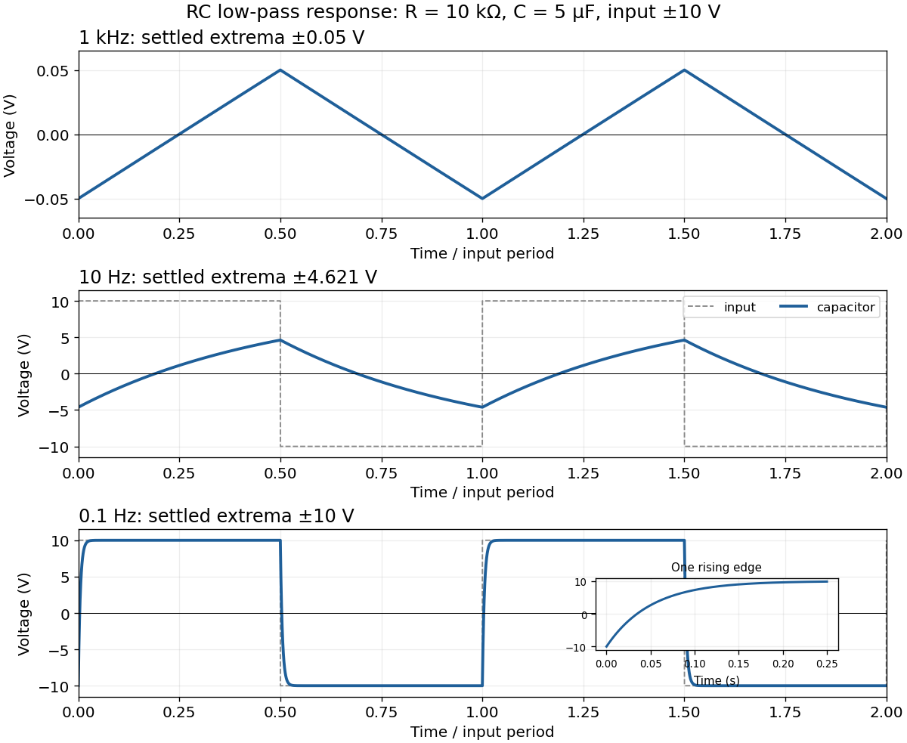

<h1 id="5/solution">Solution</h1>

↑ **Parent:** [5](../5.md)

Let $v_C$ denote the [capacitor](../../../capacitor.md) [voltage](../../../voltage.md) with the same polarity as the applied [voltage](../../../voltage.md). By [Kirchhoff's voltage law](../../../kirchhoff-cycle-law.md), [Ohm's law](../../../ohm-s-law.md) and $I=C\,dv_C/dt$,

$$
RC\frac{dv_C}{dt}+v_C=V,\qquad v_C(0)=0.
$$

Solving this first-order [differential equation](../../../differential-equation-split.md) gives the [RC low-pass step response](../../../rc-low-pass-step-response.md)

$$
\boxed{v_C(t)=V\left(1-e^{-t/\tau}\right),\qquad \tau=RC=0.050\,\mathrm s.}
$$

The [capacitor](../../../capacitor.md) [voltage](../../../voltage.md) is continuous at switching because an instantaneous finite jump would require an impulsive [electric current](../../../electric-current.md).

For the [square-wave response of an RC low-pass filter](../../../square-wave-response-of-an-rc-low-pass-filter.md), take equal positive and negative half-periods. Let $A=10\,\mathrm V$, $T=1/f$, $h=T/2$ and $\alpha=e^{-h/\tau}$. After the transient, symmetry makes the [capacitor](../../../capacitor.md) [voltage](../../../voltage.md) alternate between $-v_p$ and $+v_p$. Over the positive half-period,

$$
v_C(t)=A-(A+v_p)e^{-t/\tau},\quad 0\leq t<h.
$$

Requiring $v_C(h)=v_p$ gives

$$
\boxed{v_p=A\frac{1-\alpha}{1+\alpha}=A\tanh\!\left(\frac{T}{4\tau}\right).}
$$

The next half-period is the sign-reversed copy. These exact expressions explain the requested sketches:

- At $1\,\mathrm{kHz}$, $h/\tau=0.01$. The [voltage](../../../voltage.md) barely changes in each half-period, so the output is nearly triangular about zero, with extrema about $\pm0.0500\,\mathrm V$. Its small-signal slope is approximately $\pm A/\tau=\pm200\,\mathrm{V\,s^{-1}}$.
- At $10\,\mathrm{Hz}$, $h=\tau$. Clearly curved exponential rises and falls reach only $\pm4.621\,\mathrm V$; the output never settles to either input level.
- At $0.1\,\mathrm{Hz}$, $h=100\tau$. The output closely follows the input plateaux at $\pm10\,\mathrm V$, joined by continuous exponential transitions with [time constant](../../../time-constant.md) $0.050\,\mathrm s$.

**[Figure 2](#5/image-steady-periodic-capacitor-voltages-for-three-square-wave-frequencies). Steady periodic capacitor voltages for three square-wave frequencies**. The blue curves use the exact periodic [RC low-pass filter](../../../rc-low-pass-filter.md) solution with $RC=0.050\,\mathrm s$. Dashed grey curves show the applied [square wave](../../../square-wave.md) in the lower panels; the first panel uses an expanded output scale. Time is measured in input periods.

## ↑ Ancestors (11)

1. [5](../5.md)
2. [2019 resit](../../2019-resit-split.md)
3. [Past exam of the physics 2 paper of the University of Oxford](../../split.md)
4. [Physics 2 paper of the University of Oxford](../../../physics-2-paper-of-the-university-of-oxford.md)
5. [Year 1 of the physics course of the University of Oxford](../../../year-1-of-the-physics-course-of-the-university-of-oxford.md)
6. [Physics course of the University of Oxford](../../../physics-course-of-the-university-of-oxford.md)
7. [Undergraduate course of the University of Oxford](../../../undergraduate-course-of-the-university-of-oxford.md)
8. [Course of the University of Oxford](../../../course-of-the-university-of-oxford.md)
9. [University of Oxford](../../../university-of-oxford-split.md)
10. [List of universities](../../../list-of-universities.md)
11. [Codex Wiki](../../../split.md)
