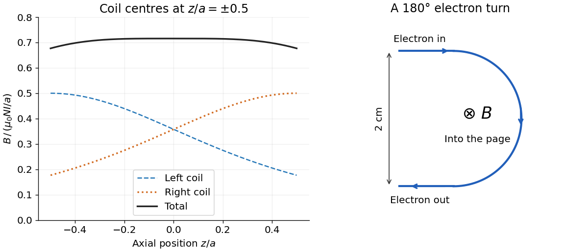
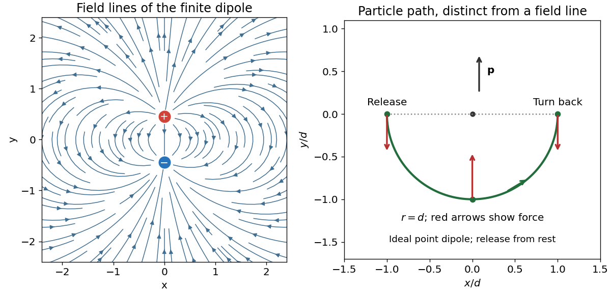
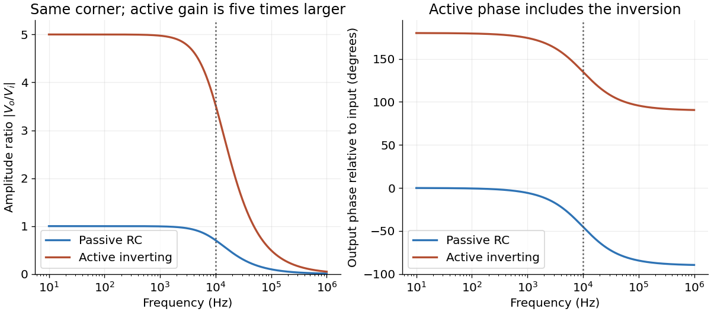
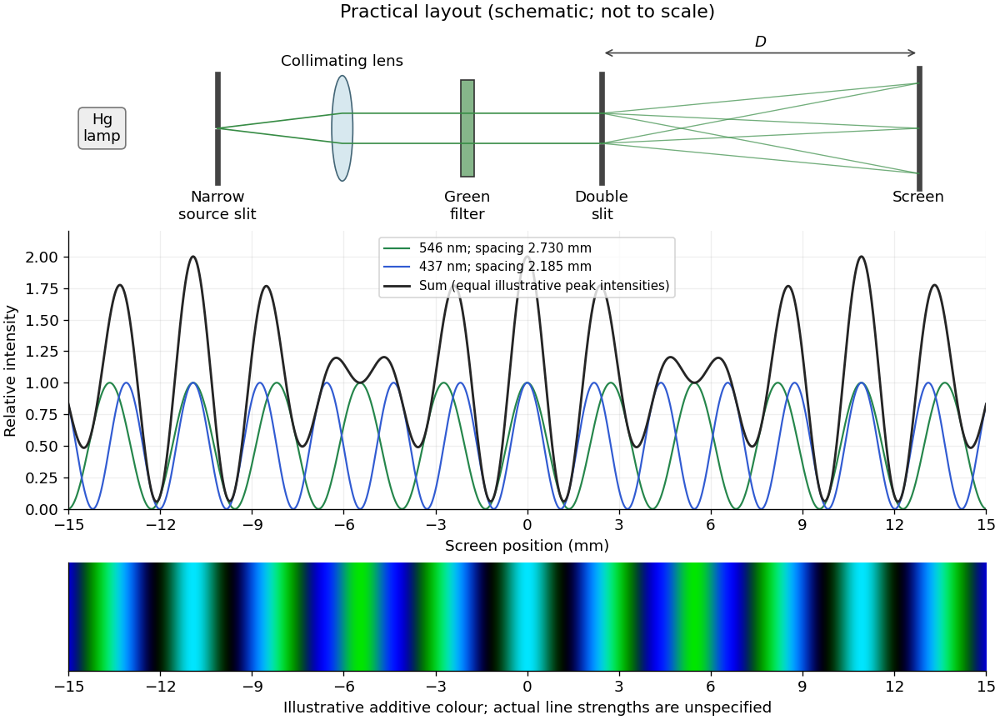

# 2019

↑ **Parent:** [Past exam of the physics 2 paper of the University of Oxford](../past-exam-of-the-physics-2-paper-of-the-university-of-oxford.md)

Source paper: [https://www.whatdotheyknow.com/request/oxford_physics_past_papers_2/response/2340696/attach/7/Physics%20Papers%202018.pdf?cookie_passthrough=1.](https://www.whatdotheyknow.com/request/oxford_physics_past_papers_2/response/2340696/attach/7/Physics%20Papers%202018.pdf?cookie_passthrough=1.) The cover identifies the ordinary sitting of 11 June 2019; the annual bundle's filename does not determine the year. Letters below distinguish successive unlettered blocks of the source.

**Table of contents**

- [1](#1)
  - [Solution](#1/solution)
- [2](#2)
  - [Solution](#2/solution)
- [3](#3)
  - [a](#3/a)
    - [Solution](#3/a/solution)
  - [b](#3/b)
    - [Solution](#3/b/solution)
- [4](#4)
  - [Solution](#4/solution)
- [5](#5)
  - [Solution](#5/solution)
- [6](#6)
  - [Solution](#6/solution)
- [7](#7)
  - [a](#7/a)
    - [Solution](#7/a/solution)
  - [b](#7/b)
    - [Solution](#7/b/solution)
- [8](#8)
  - [a](#8/a)
    - [Solution](#8/a/solution)
  - [b](#8/b)
    - [Solution](#8/b/solution)
  - [c](#8/c)
    - [Solution](#8/c/solution)
- [9](#9)
  - [a](#9/a)
    - [i](#9/a/i)
      - [Solution](#9/a/i/solution)
    - [ii](#9/a/ii)
      - [Solution](#9/a/ii/solution)
  - [b](#9/b)
    - [Solution](#9/b/solution)
  - [c](#9/c)
    - [Solution](#9/c/solution)
- [10](#10)
  - [a](#10/a)
    - [Solution](#10/a/solution)
  - [b](#10/b)
    - [Solution](#10/b/solution)
  - [c](#10/c)
    - [Solution](#10/c/solution)
- [11](#11)
  - [a](#11/a)
    - [Solution](#11/a/solution)
  - [b](#11/b)
    - [Solution](#11/b/solution)
  - [c](#11/c)
    - [Solution](#11/c/solution)

## 1

↑ **Parent:** [2019](2019.md)

<h3 id="1/solution">Solution</h3>

↑ **Parent:** [1](#1)

Take an [electric current](../electric-charge.md#electric-current) $I_1$ in the long [solenoid](../magnetic-field.md#solenoid). Away from its ends, [Ampère's circuital law](../maxwell-equations.md#ampere-s-circuital-law) gives the approximately uniform [magnetic field](../magnetic-field.md)

$$
B_1=\mu_0\frac{N_1}{L}I_1.
$$

Here $\mu_0$ is the [vacuum permeability](../maxwell-equations.md#vacuum-permeability); an air core is understood. Each turn of the short surrounding [coil](../electromagnetism.md#electromagnetic-coil) encloses the [magnetic flux](../magnetic-field.md#magnetic-flux) $B_1\pi R^2$. Thus its [magnetic flux linkage](../electromagnetism.md#magnetic-flux-linkage) is $\Lambda_2=N_2B_1\pi R^2$, and the [mutual inductance](../electromagnetism.md#mutual-inductance) is

$$
\boxed{M=\frac{\Lambda_2}{I_1}=\mu_0\frac{N_1N_2\pi R^2}{L}.}
$$

The short [coil](../electromagnetism.md#electromagnetic-coil) lies in the nearly uniform central [magnetic field](../magnetic-field.md); its own axial length therefore does not enter. With consistent winding orientations, [Faraday's law of induction](../maxwell-equations.md#faraday-s-law-of-induction) gives $\mathcal E_2=-M\,dI_1/dt$. Reversing a winding reverses this signed coupling, while the stated magnitude is unchanged.

## 2

↑ **Parent:** [2019](2019.md)

<h3 id="2/solution">Solution</h3>

↑ **Parent:** [2](#2)

The [method of images](../mathematics.md#method-of-images) replaces [electrical conductors](../electric-charge.md#electrical-conductor) by fictitious [image charges](../electric-field.md#image-charge) outside the physical region. Choose the [image charges](../electric-field.md#image-charge) so that the physical [electric charges](../electric-charge.md) and their images produce the prescribed constant [electric potential](../electric-field.md#electric-potential) on every conducting boundary. The [uniqueness theorem for the electrostatic potential](../electrostatics.md#uniqueness-theorem-for-the-electrostatic-potential) then identifies this constructed [electric potential](../electric-field.md#electric-potential) with the physical solution in the charge-containing region. Several conducting planes can require several, or infinitely many, [image charges](../electric-field.md#image-charge); a single reflected image is sufficient for one infinite plane.

Put the plane at $z=0$ and the [point charge](../electric-field.md#point-charge) at $(0,0,d)$. For $z>0$, use an [image charge](../electric-field.md#image-charge) $-q$ at $(0,0,-d)$:

$$
\phi(x,y,z)=\frac{q}{4\pi\epsilon_0}\left[\frac1{\sqrt{x^2+y^2+(z-d)^2}}-\frac1{\sqrt{x^2+y^2+(z+d)^2}}\right].
$$

This vanishes on the plane. An arbitrary constant can be added if a different reference [electric potential](../electric-field.md#electric-potential) is chosen. Excluding the [point charge](../electric-field.md#point-charge)'s own [electric field](../electric-field.md), [Coulomb's law](../electrostatics.md#coulomb-s-law) gives

$$
\boxed{\mathbf F=-\frac{q^2}{16\pi\epsilon_0d^2}\,\hat{\mathbf z}.}
$$

The separation from the [image charge](../electric-field.md#image-charge) is $2d$, and the [force](../force.md) is attractive for either sign of $q$. No imposed external [electric field](../electric-field.md) is included.

## 3

↑ **Parent:** [2019](2019.md)

<h3 id="3/a">a</h3>

↑ **Parent:** [3](#3)

<h4 id="3/a/solution">Solution</h4>

↑ **Parent:** [A](#3/a)

At [electrostatic equilibrium](../electrostatics.md#electrostatic-equilibrium) the [electric field](../electric-field.md) in the metal is zero. The empty cavity also has zero [electric field](../electric-field.md), by the [uniqueness theorem for the electrostatic potential](../electrostatics.md#uniqueness-theorem-for-the-electrostatic-potential). The [electric charge](../electric-charge.md) lies on the outer surface. For the isolated [conducting sphere](../electrostatics.md#conducting-sphere), [spherical symmetry](../geometry-and-topology.md#spherical-symmetry) and [Gauss's law](../maxwell-equations.md#gauss-s-law) give

$$
\boxed{\mathbf E(r)=\begin{cases}0,&r<R,\\ \dfrac{Q}{4\pi\epsilon_0r^2}\hat{\mathbf r},&r>R.\end{cases}}
$$

Taking the [electric potential](../electric-field.md#electric-potential) to vanish at infinity and using $E_r=-d\phi/dr$ gives

$$
\boxed{\phi(r)=\begin{cases}\dfrac{Q}{4\pi\epsilon_0R},&r\leq R,\\ \dfrac{Q}{4\pi\epsilon_0r},&r\geq R.\end{cases}}
$$

The [electric potential](../electric-field.md#electric-potential) is continuous at the surface, while the normal [electric field](../electric-field.md) jumps by $\sigma/\epsilon_0$, with [surface charge density](../electrostatics.md#surface-charge-density) $\sigma=Q/(4\pi R^2)$.

<h3 id="3/b">b</h3>

↑ **Parent:** [3](#3)

<h4 id="3/b/solution">Solution</h4>

↑ **Parent:** [B](#3/b)

Electrical contact equalizes [electric potential](../electric-field.md#electric-potential) and preserves total [electric charge](../electric-charge.md). **The usual isolated-sphere approximation** assigns the two [conducting spheres](../electrostatics.md#conducting-sphere) the [capacitances](../electromagnetism.md#capacitance) $4\pi\epsilon_0R$ and $8\pi\epsilon_0R$. It then gives

$$
\frac{Q_R}{R}=\frac{Q_{2R}}{2R},\qquad Q_R+Q_{2R}=Q,
\qquad \boxed{Q_R\simeq Q/3,\quad Q_{2R}\simeq2Q/3.}
$$

These are accurate when the [conducting spheres](../electrostatics.md#conducting-sphere) are far apart and joined by a thin wire. **Literal touching changes the answer:** each [conducting sphere](../electrostatics.md#conducting-sphere) polarizes the other, so its [electric potential](../electric-field.md#electric-potential) is not its isolated value. The source does not specify an approximation which would remove this effect.

For completeness, the exact result for ideal externally tangent [conducting spheres](../electrostatics.md#conducting-sphere) can be obtained by the [method of images](../mathematics.md#method-of-images). Let their radii be $a,b$, their centre separation $D=a+b$, and their common [electric potential](../electric-field.md#electric-potential) $V$. Begin with central [image charges](../electric-field.md#image-charge) $4\pi\epsilon_0Va$ and $4\pi\epsilon_0Vb$. Reflect each external [image charge](../electric-field.md#image-charge) $q'$ at centre-distance $s$ into the other [conducting sphere](../electrostatics.md#conducting-sphere) of radius $a$: the new [image charge](../electric-field.md#image-charge) is $-a q'/s$ at centre-distance $a^2/s$ toward the original. Repeat, alternately, in the two [conducting spheres](../electrostatics.md#conducting-sphere). Pairing successive opposite-sign terms gives the convergent net [electric charges](../electric-charge.md)

$$
\begin{aligned}
Q_a&=4\pi\epsilon_0Vab\sum_{n=0}^{\infty}\left(\frac1{b+nD}-\frac1{(n+1)D}\right),\\
Q_b&=4\pi\epsilon_0Vab\sum_{n=0}^{\infty}\left(\frac1{a+nD}-\frac1{(n+1)D}\right).
\end{aligned}
$$

Each reflection cancels a nonconstant surface [electric potential](../electric-field.md#electric-potential); the remaining central term fixes $V$. The total internal [image charge](../electric-field.md#image-charge) equals the exterior [electric flux](../electric-field.md#electric-flux) divided by $1/\epsilon_0$, so these sums give the physical net [electric charges](../electric-charge.md).

For $a=R,b=2R$, multiply both dimensionless sums by the common factor $4\pi\epsilon_0V(2R/3)$. Their values follow by writing reciprocals as [integrals](../integral.md) and setting $t=u^3$:

$$
\begin{aligned}
S_a&=\sum_{n=0}^{\infty}\left(\frac1{n+2/3}-\frac1{n+1}\right)=3\int_0^1\frac{u\,du}{1+u+u^2}=\frac32\ln3-\frac{\pi}{2\sqrt3},\\
S_b&=\sum_{n=0}^{\infty}\left(\frac1{n+1/3}-\frac1{n+1}\right)=3\int_0^1\frac{(1+u)\,du}{1+u+u^2}=\frac32\ln3+\frac{\pi}{2\sqrt3}.
\end{aligned}
$$

Dividing by $S_a+S_b$ enforces [conservation of electric charge](../electric-charge.md#charge-conservation) and yields

$$
\boxed{Q_R=Q\left(\frac12-\frac{\pi}{6\sqrt3\ln3}\right)\simeq0.22483Q,\qquad Q_{2R}=Q\left(\frac12+\frac{\pi}{6\sqrt3\ln3}\right)\simeq0.77517Q.}
$$

This concrete touching-sphere result disproves applying the isolated $1:2$ sharing rule to literal contact.

## 4

↑ **Parent:** [2019](2019.md)

<h3 id="4/solution">Solution</h3>

↑ **Parent:** [4](#4)

Let $\theta=\omega t+\theta_0$ be the angle between the [coil](../electromagnetism.md#electromagnetic-coil)'s area normal and the [magnetic field](../magnetic-field.md). Its [magnetic flux linkage](../electromagnetism.md#magnetic-flux-linkage) is $\Lambda=NB\pi r^2\cos\theta$. Consequently [Faraday's law of induction](../maxwell-equations.md#faraday-s-law-of-induction) gives

$$
\boxed{\mathcal E(t)=-\frac{d\Lambda}{dt}=NB\pi r^2\omega\sin(\omega t+\theta_0).}
$$

The sign refers to the winding orientation used to define the normal. The initial [phase](../wave.md#phase-waves) $\theta_0$ depends on the chosen time origin; one can set it to zero when the normal first points along $+x$. The minimum [absolute value](../real-analysis.md#absolute-value) is zero, attained at $\theta=m\pi$: the [coil](../electromagnetism.md#electromagnetic-coil)'s normal is parallel or antiparallel to the $x$-axis, and the plane of the [coil](../electromagnetism.md#electromagnetic-coil) is perpendicular to that axis. At this orientation the [magnetic flux](../magnetic-field.md#magnetic-flux) is extremal and its [derivative](../calculus.md#derivative) with respect to time vanishes.

## 5

↑ **Parent:** [2019](2019.md)

<h3 id="5/solution">Solution</h3>

↑ **Parent:** [5](#5)

This is a [plane electromagnetic wave](../electromagnetic-wave.md#plane-electromagnetic-wave) with [linear polarization](../electromagnetic-wave.md#linear-polarization). $\mathbf E$ is the [electric field](../electric-field.md); $E_0$ its peak [amplitude](../wave.md#wave-amplitude); $x$ the position along propagation; $t$ the time; $k=2\pi/\lambda$ the [wavenumber](../wave-equation.md#wavenumber); and $\omega=2\pi f$ the [angular frequency](../lagrangian-mechanics.md#angular-frequency). Here $\lambda$ is the [wavelength](../wave-equation.md#wavelength), $f$ the [frequency](../wave.md#frequency), and $\hat{\mathbf y}$ the [unit vector](../vector-space.md#unit-vector) in the direction of the [electric field](../electric-field.md). Constant [phase](../wave.md#phase-waves) $kx-\omega t$ moves along $+x$ with [phase velocity](../dispersion-relation.md#phase-velocity) $\omega/k$.

Put $\theta=kx-\omega t$. The differential [Faraday's law of induction](../maxwell-equations.md#faraday-s-law-of-induction) gives

$$
\nabla\times\mathbf E=-kE_0\sin\theta\,\hat{\mathbf z}=-\frac{\partial\mathbf B}{\partial t}.
$$

The accompanying oscillating [magnetic field](../magnetic-field.md), excluding any independent static background, is therefore $\mathbf B=(k/\omega)E_0\cos\theta\,\hat{\mathbf z}$. To determine the propagation speed, also use the source-free [Ampere-Maxwell law](../maxwell-equations.md#ampere-s-circuital-law):

$$
\nabla\times\mathbf B=\mu_0\epsilon_0\frac{\partial\mathbf E}{\partial t},\qquad
k\frac{k}{\omega}E_0\sin\theta=\mu_0\epsilon_0\omega E_0\sin\theta.
$$

Thus

$$
\boxed{v=\frac\omega k=\frac1{\sqrt{\mu_0\epsilon_0}}=c,\qquad \mathbf B(x,t)=\frac{E_0}{c}\cos(kx-\omega t)\,\hat{\mathbf z}.}
$$

The [electric field](../electric-field.md) and [magnetic field](../magnetic-field.md) oscillate in [phase](../wave.md#phase-waves), perpendicular to one another and to propagation; $\mathbf E\times\mathbf B$ points along $+x$.

## 6

↑ **Parent:** [2019](2019.md)

<h3 id="6/solution">Solution</h3>

↑ **Parent:** [6](#6)

A [wirewound resistor](../electric-charge.md#wirewound-resistor) uses a metal alloy chosen for stable [electrical resistivity](../electric-charge.md#electrical-resistivity). Compared with a typical [carbon composition resistor](../electric-charge.md#carbon-composition-resistor), it can offer tighter [resistor tolerance](../electric-charge.md#resistor-tolerance), a smaller [temperature coefficient of resistance](../electric-charge.md#temperature-coefficient-of-resistance), lower excess [electrical noise](../electrical-engineering.md#electronic-noise), and greater continuous [electrical dissipation](../electric-charge.md#joule-heating) when its construction provides an adequate heat path. These are design-dependent advantages, rather than guarantees for every alloy or package.

The winding has parasitic [inductance](../electromagnetism.md#inductance) and interturn [capacitance](../electromagnetism.md#capacitance). Its [electrical impedance](../electrical-circuit.md#electrical-impedance) therefore ceases to be a nearly real [electrical resistance](../electric-charge.md#electrical-resistance) at sufficiently high [frequencies](../wave.md#frequency); an approximate model is a [series circuit](../electrical-circuit.md#series-circuit) $R+i\omega L$ shunted by a small parasitic [capacitance](../electromagnetism.md#capacitance). A [resonance](../dynamical-systems.md#resonance) can occur, making a [wirewound resistor](../electric-charge.md#wirewound-resistor) unsuitable where a nearly frequency-independent [electrical resistance](../electric-charge.md#electrical-resistance) is required. Noninductive winding patterns reduce this problem. For comparable small-signal duties it is usually larger and more expensive. A [carbon composition resistor](../electric-charge.md#carbon-composition-resistor) is compact and has relatively small parasitic [inductance](../electromagnetism.md#inductance), but commonly has poorer stability, larger [resistor tolerance](../electric-charge.md#resistor-tolerance), and more excess [electrical noise](../electrical-engineering.md#electronic-noise).

## 7

↑ **Parent:** [2019](2019.md)

<h3 id="7/a">a</h3>

↑ **Parent:** [7](#7)

<h4 id="7/a/solution">Solution</h4>

↑ **Parent:** [A](#7/a)

In the [paraxial approximation](../partial-differential-equation.md#paraxial-approximation), apply [refraction](../optics.md#refraction) at each surface of the [thin lens](../geometrical-optics.md#thin-lens) in air. With signed radii $R_1$ and $R_2$, the first surface obeys $n/v_1-1/u=(n-1)/R_1$, and the second obeys $1/v-n/v_1=(1-n)/R_2$. The separation of the surfaces is neglected, so the intermediate image coordinate $v_1$ cancels:

$$
\frac1v-\frac1u=(n-1)\left(\frac1{R_1}-\frac1{R_2}\right)=\frac1f.
$$

This is [Lensmaker's equation](../geometrical-optics.md#lensmaker-s-equation), with [Cartesian coordinate system](../linear-algebra.md#cartesian-coordinate-system) object coordinate $u<0$ for a real object. For an equiconvex [thin lens](../geometrical-optics.md#thin-lens) and light travelling left to right, $R_1=R$ and $R_2=-R$. Hence

$$
\boxed{\frac1f=\frac{2(n-1)}R,\qquad f=\frac{R}{2(n-1)}.}
$$

<h3 id="7/b">b</h3>

↑ **Parent:** [7](#7)

<h4 id="7/b/solution">Solution</h4>

↑ **Parent:** [B](#7/b)

Set the red image at coordinate zero, the blue image at $\delta=0.010\,\mathrm m$, and the screen at $D=1.000\,\mathrm m$. Let the correcting [thin lens](../geometrical-optics.md#thin-lens) be at $x$, with $\delta<x<D$. Both original images are then real objects for the correcting [thin lens](../geometrical-optics.md#thin-lens), with positive object distances $u_r=x$, $u_b=x-\delta$, and common positive image distance $v=D-x$. The [thin lens](../geometrical-optics.md#thin-lens) equation gives

$$
\boxed{f_r=\frac{x(D-x)}D,\qquad f_b=\frac{(x-\delta)(D-x)}{D-\delta}.}
$$

The [refractive indices](../electromagnetic-wave.md#refractive-index) and [Lensmaker's equation](../geometrical-optics.md#lensmaker-s-equation) require

$$
\frac{f_b}{f_r}=\frac{n_r-1}{n_b-1}=\frac{10}{11}=\rho.
$$

Substitute the two [focal lengths](../geometrical-optics.md#focal-length) and cancel $D-x$:

$$
D(x-\delta)=\rho x(D-\delta),\qquad
x=\frac{D\delta}{D-\rho(D-\delta)}=0.1000\,\mathrm m.
$$

Thus the correcting [thin lens](../geometrical-optics.md#thin-lens) is $100\,\mathrm{mm}$ beyond the red image and $900\,\mathrm{mm}$ before the screen. The required [focal lengths](../geometrical-optics.md#focal-length) and surface radius are

$$
\boxed{f_r=90.0\,\mathrm{mm},\qquad f_b=81.818\ldots\,\mathrm{mm},\qquad R=2(n_r-1)f_r=72.0\,\mathrm{mm}.}
$$

The blue [focal length](../geometrical-optics.md#focal-length) is shorter because the blue [refractive index](../electromagnetic-wave.md#refractive-index) is larger; these two differing object distances are mapped to the same screen, removing the specified longitudinal [chromatic aberration](../geometrical-optics.md#chromatic-aberration).

## 8

↑ **Parent:** [2019](2019.md)

<h3 id="8/a">a</h3>

↑ **Parent:** [8](#8)

<h4 id="8/a/solution">Solution</h4>

↑ **Parent:** [A](#8/a)

For a circular [coil](../electromagnetism.md#electromagnetic-coil), use the [Biot-Savart law](../electromagnetism.md#biot-savart-law)

$$
d\mathbf B=\frac{\mu_0 I}{4\pi}\frac{d\boldsymbol\ell\times\mathbf r}{r^3}.
$$

At an axial position $x$, every wire element is at distance $r=\sqrt{a^2+x^2}$. The transverse [magnetic field](../magnetic-field.md) contributions cancel by rotational [symmetry](../physics.md#symmetry-physics). The axial part of $d\boldsymbol\ell\times\mathbf r$ is $a\,d\ell$, and $\oint d\ell=2\pi a$. Multiplying by the $N$ turns gives

$$
\boxed{\mathbf B(x)=\frac{\mu_0NIa^2}{2(a^2+x^2)^{3/2}}\,\hat{\mathbf x}.}
$$

The [electric current](../electric-charge.md#electric-current)'s sense fixes the axial direction by the right-hand rule.

<h3 id="8/b">b</h3>

↑ **Parent:** [8](#8)

<h4 id="8/b/solution">Solution</h4>

↑ **Parent:** [B](#8/b)

Put the two [coil](../electromagnetism.md#electromagnetic-coil) centres at $z=\pm a/2$. By [superposition](../vector-space.md#superposition-principle), their axial [magnetic field](../magnetic-field.md) is

$$
B(z)=\frac{\mu_0NIa^2}{2}\left\{\frac1{[a^2+(z-a/2)^2]^{3/2}}+\frac1{[a^2+(z+a/2)^2]^{3/2}}\right\}.
$$

Both [magnetic field](../magnetic-field.md) contributions point the same way. Evaluation gives

$$
\boxed{B(0)=\left(\frac45\right)^{3/2}\frac{\mu_0NI}{a},\qquad
B(\pm a/2)=\frac{\mu_0NI}{2a}\left(1+\frac1{2\sqrt2}\right).}
$$

The corresponding coefficients are $0.715542$ and $0.676777$. Each individual [magnetic field](../magnetic-field.md) falls as one moves away from its own [coil](../electromagnetism.md#electromagnetic-coil); their sum is much flatter near the midpoint.

For a single [coil](../electromagnetism.md#electromagnetic-coil), differentiating $(a^2+x^2)^{-3/2}$ twice produces $3(4x^2-a^2)(a^2+x^2)^{-7/2}$. At $x=a/2$ this vanishes. Thus the pair has $B'(0)=0$ by reflection [symmetry](../physics.md#symmetry-physics) and $B''(0)=0$ by its chosen separation; all odd [derivatives](../calculus.md#derivative) vanish there. In fact,

$$
\frac{B(z)}{B(0)}=1-\frac{144}{125}\left(\frac za\right)^4+O\!\left((z/a)^6\right).
$$

This [Helmholtz coil](../electromagnetism.md#helmholtz-coil) arrangement produces a nearly uniform central [magnetic field](../magnetic-field.md), useful for controlled [charged particle in a uniform magnetic field](../electromagnetism.md#charged-particle-in-a-uniform-magnetic-field) and [magnetic field](../magnetic-field.md) calibration. The small orbit used below lies within that central region.

**[Figure 1](#8/b/image-helmholtz-axial-magnetic-field-and-a-semicircular-electron-trajectory). Helmholtz axial magnetic field and a semicircular electron trajectory**.

<h3 id="8/c">c</h3>

↑ **Parent:** [8](#8)

<h4 id="8/c/solution">Solution</h4>

↑ **Parent:** [C](#8/c)

The [electron](../physics.md#electron) follows a semicircle under the transverse [Lorentz force](../relativistic-electromagnetism.md#lorentz-force). Parallel, oppositely directed incoming and outgoing paths are separated by a diameter, so the orbit radius is $r=1.00\,\mathrm{cm}$. Acceleration from rest through the [electric potential difference](../electric-field.md#electric-potential-difference) $V$ gives [kinetic energy](../energy.md#kinetic-energy) $m_ev^2/2=eV$, where $e>0$ is the elementary [electric charge](../electric-charge.md). Equating the [Lorentz force](../relativistic-electromagnetism.md#lorentz-force) magnitude to the required [centripetal force](../classical-mechanics.md#centripetal-force) gives

$$
e v B=\frac{m_ev^2}{r},\qquad
\boxed{B=\frac1r\sqrt{\frac{2m_eV}{e}}\simeq3.372\times10^{-2}\,\mathrm T.}
$$

The [magnetic field](../magnetic-field.md) must be perpendicular to the plane of the turn, with its sign chosen for the [electron](../physics.md#electron)'s negative [electric charge](../electric-charge.md). In the illustration the [electron](../physics.md#electron) enters rightwards at the upper endpoint, so a [magnetic field](../magnetic-field.md) into the page bends it downwards.

The nonrelativistic estimate has $v\simeq0.198c$. If the small [special relativity](../special-relativity.md) correction is retained, use $pc=\sqrt{K(K+2m_ec^2)}$ with $K=eV$ and $B=p/(er)$. This gives $B\simeq3.389\times10^{-2}\,\mathrm T$, about $0.49\%$ larger. The leading answer is adequate at the precision implicit in the classical treatment.

## 9

↑ **Parent:** [2019](2019.md)

<h3 id="9/a">a</h3>

↑ **Parent:** [9](#9)

<h4 id="9/a/i">i</h4>

↑ **Parent:** [A](#9/a)

<h5 id="9/a/i/solution">Solution</h5>

↑ **Parent:** [I](#9/a/i)

The fixed [point charge](../electric-field.md#point-charge) produces [electric potential](../electric-field.md#electric-potential) $\phi(r)=k_eq/r$, where $k_e=1/(4\pi\epsilon_0)$. The external quasistatic [work](../energy.md#work) is the increase in [Coulomb potential energy](../electrostatics.md#coulomb-potential-energy):

$$
\boxed{W_{+}=q\,[\phi(d)-\phi(2d)]=\frac{k_eq^2}{2d}=\frac{q^2}{8\pi\epsilon_0d}.}
$$

The endpoints have radii $2d$ and $d$, irrespective of their opposite coordinate signs. One must use a path avoiding the singular [point charge](../electric-field.md#point-charge) at the origin. The [electric field](../electric-field.md) is conservative on such paths, so the endpoint calculation suffices; a literal straight path through the origin is inadmissible. The [work](../energy.md#work) done by the [electric field](../electric-field.md) has the opposite sign.

<h4 id="9/a/ii">ii</h4>

↑ **Parent:** [A](#9/a)

<h5 id="9/a/ii/solution">Solution</h5>

↑ **Parent:** [Ii](#9/a/ii)

For the negative test [electric charge](../electric-charge.md), use the same change in the fixed [point charge](../electric-field.md#point-charge)'s [electric potential](../electric-field.md#electric-potential):

$$
\boxed{W_{-}=(-q)\,[\phi(d)-\phi(2d)]=-\frac{k_eq^2}{2d}=-\frac{q^2}{8\pi\epsilon_0d}.}
$$

The external agent extracts [energy](../energy.md), since the final [Coulomb potential energy](../electrostatics.md#coulomb-potential-energy) is lower. Again the path must avoid the fixed [point charge](../electric-field.md#point-charge), and the [work](../energy.md#work) done by the [electric field](../electric-field.md) is $-W_{-}$.

<h3 id="9/b">b</h3>

↑ **Parent:** [9](#9)

<h4 id="9/b/solution">Solution</h4>

↑ **Parent:** [B](#9/b)

The [electric dipole moment](../electrostatics.md#electric-dipole-moment) is $\mathbf p=qa\,\hat{\mathbf y}$. Write $\theta$ for the angle measured from $+y$, with $\hat{\boldsymbol\theta}$ pointing toward increasing $\theta$. The exact [electric potential](../electric-field.md#electric-potential) is

$$
\phi(\mathbf r)=k_eq\left(\frac1{|\mathbf r-(a/2)\hat{\mathbf y}|}-\frac1{|\mathbf r+(a/2)\hat{\mathbf y}|}\right).
$$

For $r\gg a$, expand the reciprocals to first order in $a/r$. Their common $1/r$ terms cancel, giving the [electric dipole](../electrostatics.md#electric-dipole) approximation

$$
\boxed{\phi(r,\theta)=\frac{k_ep\cos\theta}{r^2},\qquad
\mathbf E=\frac{k_ep}{r^3}\left(2\cos\theta\,\hat{\mathbf r}+\sin\theta\,\hat{\boldsymbol\theta}\right).}
$$

The radial [electric field](../electric-field.md) follows from $E_r=-\partial\phi/\partial r$, and the tangential [electric field](../electric-field.md) from $E_\theta=-(1/r)\partial\phi/\partial\theta$. The omitted terms are of relative order $a^2/r^2$ away from zeros of a component. Multiplying by the test [electric charge](../electric-charge.md) gives the [force](../force.md) components

$$
\boxed{F_r=\frac{2k_epQ\cos\theta}{r^3},\qquad F_\theta=\frac{k_epQ\sin\theta}{r^3}.}
$$

The [electric field lines](../electric-field.md#electric-field-line) emerge from the positive [electric charge](../electric-charge.md) and terminate on the negative [electric charge](../electric-charge.md). They are mirror-symmetric about the [electric dipole](../electrostatics.md#electric-dipole) axis and bow out across its equatorial plane. In the point-[electric dipole](../electrostatics.md#electric-dipole) limit their meridional curves obey $dr/(r\,d\theta)=E_r/E_\theta=2\cot\theta$, hence $r=C\sin^2\theta$.

**[Figure 2](#9/b/image-electric-dipole-field-lines-and-the-released-charge-s-ideal-trajectory). Electric dipole field lines and the released charge's ideal trajectory**.

<h3 id="9/c">c</h3>

↑ **Parent:** [9](#9)

<h4 id="9/c/solution">Solution</h4>

↑ **Parent:** [C](#9/c)

In a [Cartesian coordinate system](../linear-algebra.md#cartesian-coordinate-system) the leading [electric dipole field](../electrostatics.md#electric-dipole-field) gives

$$
\mathbf F(x,y)=\frac{k_epQ}{(x^2+y^2)^{5/2}}\left(3xy\,\hat{\mathbf x}+(2y^2-x^2)\,\hat{\mathbf y}\right).
$$

Therefore

$$
\boxed{\mathbf F(-d,0)=\mathbf F(d,0)=-\frac{k_epQ}{d^3}\hat{\mathbf y},\qquad
\mathbf F(0,-d)=\frac{2k_epQ}{d^3}\hat{\mathbf y}.}
$$

The [force](../force.md) is downwards on the equator and upwards on the negative axial side. A free positive [electric charge](../electric-charge.md) released from rest at the left-hand point initially accelerates downwards. As it moves into $x<0,y<0$, the [force](../force.md) also acquires a positive $x$ component. Its path bends toward the right; the [force](../force.md) continually changes as its position changes. An initial velocity was not specified, so the following more precise trajectory assumes release from rest and neglects [radiation reaction](../electromagnetic-radiation.md#radiation-reaction).

There is a useful exact result within the point-[electric dipole](../electrostatics.md#electric-dipole) approximation. Put $A=k_epQ>0$; the [potential energy](../energy.md#potential-energy) is $U=Ay/r^3$, a [homogeneous function](../real-analysis.md#homogeneous-function) of degree $-2$. Thus $\mathbf r\cdot\mathbf F=2U$. For a particle of mass $m$, [Newton's second law](../force.md#newton-s-second-law) and [conservation of energy](../mathematical-physics.md#conservation-of-energy) imply

$$
\frac{d^2r^2}{dt^2}=2v^2+\frac2m\mathbf r\cdot\mathbf F=\frac4m(K+U)=\frac{4E}{m}.
$$

At release, both [kinetic energy](../energy.md#kinetic-energy) and [potential energy](../energy.md#potential-energy) vanish, so $E=0$; also $d(r^2)/dt=0$. Consequently $r=d$ throughout the motion. Parametrize the lower semicircle by $x=-d\cos\alpha$, $y=-d\sin\alpha$. Then

$$
\dot\alpha^2=\frac{2A}{md^4}\sin\alpha,\qquad
\ddot\alpha=\frac{A}{md^4}\cos\alpha.
$$

The [electric charge](../electric-charge.md) gains speed until the bottom point, where the [force](../force.md) is inward and the speed is $\sqrt{2A/(md^2)}$. It then slows, reaches $(d,0)$ at rest, and reverses. Thus, under these assumptions,

$$
\boxed{\text{the charge oscillates along the lower semicircle }x^2+y^2=d^2,\quad y\leq0.}
$$

Its trajectory is not an [electric field line](../electric-field.md#electric-field-line): the [force](../force.md) determines acceleration, rather than velocity direction. For the finite two-charge [electric dipole](../electrostatics.md#electric-dipole), corrections of order $a^2/d^2$ perturb the circular trajectory; an arbitrary nonzero initial velocity also changes it.

## 10

↑ **Parent:** [2019](2019.md)

<h3 id="10/a">a</h3>

↑ **Parent:** [10](#10)

<h4 id="10/a/solution">Solution</h4>

↑ **Parent:** [A](#10/a)

Use complex [phasors](../wave.md#phasor) with time dependence $e^{i\omega t}$ and assume an unloaded output. The [capacitor](../electromagnetism.md#capacitor) has [electrical impedance](../electrical-circuit.md#electrical-impedance) $Z_C=1/(i\omega C)$. The [voltage divider](../electrical-engineering.md#voltage-divider) formed with the [resistor](../electric-charge.md#resistor) gives the [transfer function](../control-theory.md#transfer-function)

$$
\boxed{H(\omega)=\frac{\widetilde V_o}{\widetilde V_i}=\frac{Z_C}{R+Z_C}=\frac1{1+i\omega RC}.}
$$

For input $V_i(t)=V_{i0}\cos\omega t$, the output [amplitude](../wave.md#wave-amplitude) and [phase shift](../wave.md#phase-shift) are

$$
|\widetilde V_o|=\frac{V_{i0}}{\sqrt{1+(\omega RC)^2}},\qquad
\phi_o-\phi_i=-\tan^{-1}(\omega RC),
$$

so $V_o(t)=|\widetilde V_o|\cos(\omega t-\tan^{-1}(\omega RC))$.

Here $\tau=RC=16.0\,\mu\mathrm s$, and the [cutoff frequency](../electrical-engineering.md#cutoff-frequency) is $f_c=1/(2\pi RC)=9.947\,\mathrm{kHz}$. This is an [RC low-pass filter](../electrical-engineering.md#rc-low-pass-filter): at small [frequency](../wave.md#frequency) the [capacitor](../electromagnetism.md#capacitor) has large [electrical impedance](../electrical-circuit.md#electrical-impedance) and the output nearly equals the input; at large [frequency](../wave.md#frequency) it increasingly shunts the signal to ground. The [amplitude](../wave.md#wave-amplitude) then falls as $1/f$, and the [phase shift](../wave.md#phase-shift) approaches $-90^\circ$.

| [Frequency](../wave.md#frequency) $f$ | Output [amplitude](../wave.md#wave-amplitude) divided by $V_{i0}$ | Output [phase shift](../wave.md#phase-shift) \\ | $100\,\mathrm{Hz}$ | $0.99995$ | $-0.576^\circ$ \\ | $10^4\,\mathrm{Hz}$ | $0.70523$ | $-45.152^\circ$ \\ | $5\times10^4\,\mathrm{Hz}$ | $0.19512$ | $-78.748^\circ$ |
| --- | --- | --- | --- |

No numerical input [amplitude](../wave.md#wave-amplitude) is supplied, so the output voltages are specified as fractions of $V_{i0}$. An application is suppression of high-[frequency](../wave.md#frequency) [electrical noise](../electrical-engineering.md#electronic-noise) on a slowly varying signal. A finite load changes the [transfer function](../control-theory.md#transfer-function) and must be included if its [electrical impedance](../electrical-circuit.md#electrical-impedance) is comparable with the circuit's output [electrical impedance](../electrical-circuit.md#electrical-impedance).

**[Figure 3](#10/a/image-passive-and-active-low-pass-amplitude-and-phase-responses). Passive and active low-pass amplitude and phase responses**.

<h3 id="10/b">b</h3>

↑ **Parent:** [10](#10)

<h4 id="10/b/solution">Solution</h4>

↑ **Parent:** [B](#10/b)

For an [ideal operational amplifier](../electrical-circuit.md#ideal-operational-amplifier) under [negative feedback](../signal-transduction.md#negative-feedback), the grounded non-inverting terminal makes the inverting terminal a [virtual ground](../electrical-circuit.md#virtual-ground), and no [electric current](../electric-charge.md#electric-current) enters either input. The feedback [resistor](../electric-charge.md#resistor) and [capacitor](../electromagnetism.md#capacitor) have parallel [electrical impedance](../electrical-circuit.md#electrical-impedance)

$$
Z_f=\left(\frac1{R_2}+i\omega C\right)^{-1}=\frac{R_2}{1+i\omega R_2C}.
$$

[Kirchhoff's current law](../random-walk.md#kirchhoff-node-law) at the inverting node gives $\widetilde V_i/R_1+\widetilde V_o/Z_f=0$, and hence

$$
\boxed{\frac{\widetilde V_o}{\widetilde V_i}=-\frac{R_2/R_1}{1+i\omega R_2C}.}
$$

With the stated components, $R_2C=16.0\,\mu\mathrm s$ and $R_2/R_1=5$. Thus this [inverting low-pass amplifier](../electrical-circuit.md#inverting-low-pass-amplifier) has exactly the same ideal [cutoff frequency](../electrical-engineering.md#cutoff-frequency) and normalized [frequency response](../electrical-engineering.md#frequency-response) as the passive [RC low-pass filter](../electrical-engineering.md#rc-low-pass-filter), with output multiplied by $-5$:

$$
\boxed{V_o(t)=-\frac{5V_{i0}}{\sqrt{1+(\omega\tau)^2}}\cos\!\left(\omega t-\tan^{-1}(\omega\tau)\right).}
$$

Its [amplitude](../wave.md#wave-amplitude) ratios at the three stated [frequencies](../wave.md#frequency) are $4.99975$, $3.52616$, and $0.97560$. One principal choice of [phase shift](../wave.md#phase-shift) is $180^\circ-\tan^{-1}(\omega\tau)$: respectively $179.424^\circ$, $134.848^\circ$, and $101.252^\circ$. Adding or subtracting $360^\circ$ describes the same output; the extra inversion must be retained.

<h3 id="10/c">c</h3>

↑ **Parent:** [10](#10)

<h4 id="10/c/solution">Solution</h4>

↑ **Parent:** [C](#10/c)

The passive [RC low-pass filter](../electrical-engineering.md#rc-low-pass-filter) is simple, inexpensive, requires no power supply, and has no [operational amplifier](../electrical-circuit.md#operational-amplifier) saturation or finite [bandwidth](../electrical-engineering.md#bandwidth-signal-processing) limitation. It offers no [voltage gain](../electrical-circuit.md#voltage-gain); its [output impedance](../electrical-circuit.md#output-impedance) is finite, and both source [electrical resistance](../electric-charge.md#electrical-resistance) and loading can change the observed [frequency response](../electrical-engineering.md#frequency-response). Its [resistor](../electric-charge.md#resistor) also produces [thermal noise](../electrical-engineering.md#thermal-noise).

The active [inverting low-pass amplifier](../electrical-circuit.md#inverting-low-pass-amplifier) provides a low-[frequency](../wave.md#frequency) [voltage gain](../electrical-circuit.md#voltage-gain) of magnitude five and, within the usable [bandwidth](../electrical-engineering.md#bandwidth-signal-processing), a small [output impedance](../electrical-circuit.md#output-impedance), so it can drive a load with much less change in [frequency response](../electrical-engineering.md#frequency-response). The input [electrical resistance](../electric-charge.md#electrical-resistance) is approximately $R_1=1\,\mathrm{k}\Omega$ and may itself load the source. It needs a power supply and adds [electrical noise](../electrical-engineering.md#electronic-noise) and offset; finite [operational amplifier](../electrical-circuit.md#operational-amplifier) gain, [bandwidth](../electrical-engineering.md#bandwidth-signal-processing), [slew rate](../electrical-circuit.md#slew-rate), available output swing, and output [electric current](../electric-charge.md#electric-current) limit the ideal formula. Its inversion must also suit the application. The best choice depends on required [voltage gain](../electrical-circuit.md#voltage-gain), source and load [electrical impedances](../electrical-circuit.md#electrical-impedance), and the signal's [frequency](../wave.md#frequency) and [amplitude](../wave.md#wave-amplitude).

## 11

↑ **Parent:** [2019](2019.md)

<h3 id="11/a">a</h3>

↑ **Parent:** [11](#11)

<h4 id="11/a/solution">Solution</h4>

↑ **Parent:** [A](#11/a)

A [mercury-vapor lamp](../electrical-circuit.md#mercury-vapor-lamp) is an extended, spontaneously emitting source, so practical [interference](../physical-optics.md#interference-wave-propagation) requires spatial filtering and spectral selection. A narrow illuminated source slit gives sufficient [spatial coherence](../physical-optics.md#spatial-optical-coherence); selecting one strong spectral line improves [temporal coherence](../physical-optics.md#temporal-optical-coherence) and avoids overlapping differently spaced [interference fringes](../physical-optics.md#interference-fringe).

In the classical [double-slit experiment](../physical-optics.md#double-slit-experiment), both apertures are illuminated by the same narrow source. The arrangement is symmetric, permits direct measurement and adjustment of slit separation, and has equal optical materials in the two paths. Its main drawbacks are low transmitted [intensity](../wave.md#intensity-physics) through narrow apertures, the need for a well-made closely spaced slit pair and alignment, and the finite single-slit [diffraction](../quantum-scattering.md#diffraction) envelope. A broad source washes out [interference fringes](../physical-optics.md#interference-fringe).

[Lloyd's mirror](../physical-optics.md#lloyd-s-mirror) uses the direct wave from a narrow source and the reflected wave, which appears to come from its virtual image behind a plane mirror. It requires only one physical source slit; the mirror can be adjusted to make a small effective source separation without manufacturing a double aperture. Only the direct-reflected overlap region shows [interference fringes](../physical-optics.md#interference-fringe). Finite mirror size, alignment, surface quality, unequal [intensities](../wave.md#intensity-physics) and the [polarization](../wave.md#polarization-waves)-dependent reflection coefficient can reduce visibility. For the usual grazing reflection from glass, the reflected electric wave acquires approximately a $\pi$ [phase shift](../wave.md#phase-shift), so the zero path-difference position is dark rather than the bright central fringe of the symmetric classical [double-slit experiment](../physical-optics.md#double-slit-experiment). Both arrangements still require adequate [spatial coherence](../physical-optics.md#spatial-optical-coherence) and [temporal coherence](../physical-optics.md#temporal-optical-coherence).

<h3 id="11/b">b</h3>

↑ **Parent:** [11](#11)

<h4 id="11/b/solution">Solution</h4>

↑ **Parent:** [B](#11/b)

Illuminate a narrow entrance slit with the [mercury-vapor lamp](../electrical-circuit.md#mercury-vapor-lamp), use a collimating [lens](../geometrical-optics.md#lens-optics) to illuminate two parallel narrow slits coherently, and insert a bandpass filter selecting the green line. Place a screen or scanning detector a measured distance $D$ beyond the double slit. The source slit and the two apertures should be parallel. The aperture widths should be appreciably smaller than their separation to provide an extended [diffraction](../quantum-scattering.md#diffraction) envelope; the green filter should reject the other strong mercury lines. The layout is drawn below.

For slit separation $d$ and observation angle $\theta$, the [optical path difference](../physical-optics.md#optical-path-difference) in air is $\Delta=d\sin\theta$. At a bright [interference fringe](../physical-optics.md#interference-fringe), $\Delta=m\lambda$. For a distant screen and small angles, $\sin\theta\simeq\tan\theta\simeq y/D$, giving

$$
y_m\simeq\frac{m\lambda D}{d},\qquad \boxed{\beta=y_{m+1}-y_m=\frac{\lambda D}{d}.}
$$

Measuring several [interference fringe](../physical-optics.md#interference-fringe) spacings and dividing by their number reduces relative position error. The derivation assumes the slits have equal [phase](../wave.md#phase-waves) on illumination and that the screen region lies within their common [diffraction](../quantum-scattering.md#diffraction) envelope.

**[Figure 4](#11/b/image-double-slit-layout-and-two-colour-fringes-across-the-central-thirty-millimetres). Double-slit layout and two-colour fringes across the central thirty millimetres**.

<h3 id="11/c">c</h3>

↑ **Parent:** [11](#11)

<h4 id="11/c/solution">Solution</h4>

↑ **Parent:** [C](#11/c)

The two [wavelengths](../wave-equation.md#wavelength) have independent [interference](../physical-optics.md#interference-wave-propagation) patterns. Their [interference fringe](../physical-optics.md#interference-fringe) spacings are

$$
\boxed{\beta_g=\frac{546\times10^{-9}\times0.5}{100\times10^{-6}}=2.730\,\mathrm{mm},\qquad
\beta_b=\frac{437\times10^{-9}\times0.5}{100\times10^{-6}}=2.185\,\mathrm{mm}.}
$$

Different optical [frequencies](../wave.md#frequency) do not maintain a fixed mutual [phase](../wave.md#phase-waves) over the detector's integration time, so their [intensities](../wave.md#intensity-physics) add. For narrow equal slits, suppressing the slowly varying [diffraction](../quantum-scattering.md#diffraction) envelopes, one may write

$$
I(y)=I_{g,\max}\cos^2\!\left(\frac{\pi y}{\beta_g}\right)+I_{b,\max}\cos^2\!\left(\frac{\pi y}{\beta_b}\right).
$$

The relative line strengths are not supplied; the figure illustrates equal peak [intensities](../wave.md#intensity-physics) rather than inferring a quantitative brightness ratio. At $y=0$ both colours are bright, producing a blue-green mixture. Away from the centre the green and blue [interference fringes](../physical-optics.md#interference-fringe) progressively separate, creating alternating colour and brightness variations; places where one line is dark can still be bright in the other. Neither two-line mixing nor its central maximum is generally white.

Across $-15\,\mathrm{mm}\leq y\leq15\,\mathrm{mm}$, the green maxima occur at $y=2.730m\,\mathrm{mm}$ for $m=-5,\ldots,5$, and the blue maxima at $y=2.185n\,\mathrm{mm}$ for $n=-6,\ldots,6$. Near $y=\pm10.92\,\mathrm{mm}$, the fourth green and fifth blue maxima nearly coincide: $4\beta_g=10.920\,\mathrm{mm}$ and $5\beta_b=10.925\,\mathrm{mm}$. The $5\,\mu\mathrm m$ mismatch shows that these are near coincidences, not exact ones for the given [wavelengths](../wave-equation.md#wavelength). The plotted central interval includes all these maxima.

## ↑ Ancestors (9)

1. [Past exam of the physics 2 paper of the University of Oxford](../past-exam-of-the-physics-2-paper-of-the-university-of-oxford.md)
2. [Physics 2 paper of the University of Oxford](../university-of-oxford.md#physics-2-paper-of-the-university-of-oxford)
3. [Year 1 of the physics course of the University of Oxford](../university-of-oxford.md#year-1-of-the-physics-course-of-the-university-of-oxford)
4. [Physics course of the University of Oxford](../university-of-oxford.md#physics-course-of-the-university-of-oxford)
5. [Undergraduate course of the University of Oxford](../university-of-oxford.md#undergraduate-course-of-the-university-of-oxford)
6. [Course of the University of Oxford](../university-of-oxford.md#course-of-the-university-of-oxford)
7. [University of Oxford](../university-of-oxford.md)
8. [List of universities](../README.md#list-of-universities)
9. [Codex Wiki](../README.md)
