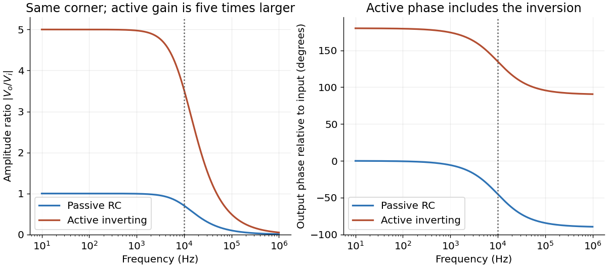

<h1 id="10/a/solution">Solution</h1>

↑ **Parent:** [A](../a.md)

Use complex [phasors](../../../../phasor.md) with time dependence $e^{i\omega t}$ and assume an unloaded output. The [capacitor](../../../../capacitor.md) has [electrical impedance](../../../../electrical-impedance.md) $Z_C=1/(i\omega C)$. The [voltage divider](../../../../voltage-divider.md) formed with the [resistor](../../../../resistor.md) gives the [transfer function](../../../../transfer-function.md)

$$
\boxed{H(\omega)=\frac{\widetilde V_o}{\widetilde V_i}=\frac{Z_C}{R+Z_C}=\frac1{1+i\omega RC}.}
$$

For input $V_i(t)=V_{i0}\cos\omega t$, the output [amplitude](../../../../wave-amplitude.md) and [phase shift](../../../../phase-shift.md) are

$$
|\widetilde V_o|=\frac{V_{i0}}{\sqrt{1+(\omega RC)^2}},\qquad
\phi_o-\phi_i=-\tan^{-1}(\omega RC),
$$

so $V_o(t)=|\widetilde V_o|\cos(\omega t-\tan^{-1}(\omega RC))$.

Here $\tau=RC=16.0\,\mu\mathrm s$, and the [cutoff frequency](../../../../cutoff-frequency.md) is $f_c=1/(2\pi RC)=9.947\,\mathrm{kHz}$. This is an [RC low-pass filter](../../../../rc-low-pass-filter.md): at small [frequency](../../../../frequency.md) the [capacitor](../../../../capacitor.md) has large [electrical impedance](../../../../electrical-impedance.md) and the output nearly equals the input; at large [frequency](../../../../frequency.md) it increasingly shunts the signal to ground. The [amplitude](../../../../wave-amplitude.md) then falls as $1/f$, and the [phase shift](../../../../phase-shift.md) approaches $-90^\circ$.

| [Frequency](../../../../frequency.md) $f$ | Output [amplitude](../../../../wave-amplitude.md) divided by $V_{i0}$ | Output [phase shift](../../../../phase-shift.md) \\ | $100\,\mathrm{Hz}$ | $0.99995$ | $-0.576^\circ$ \\ | $10^4\,\mathrm{Hz}$ | $0.70523$ | $-45.152^\circ$ \\ | $5\times10^4\,\mathrm{Hz}$ | $0.19512$ | $-78.748^\circ$ |
| --- | --- | --- | --- |

No numerical input [amplitude](../../../../wave-amplitude.md) is supplied, so the output voltages are specified as fractions of $V_{i0}$. An application is suppression of high-[frequency](../../../../frequency.md) [electrical noise](../../../../electronic-noise.md) on a slowly varying signal. A finite load changes the [transfer function](../../../../transfer-function.md) and must be included if its [electrical impedance](../../../../electrical-impedance.md) is comparable with the circuit's output [electrical impedance](../../../../electrical-impedance.md).

**[Figure 3](#10/a/image-passive-and-active-low-pass-amplitude-and-phase-responses). Passive and active low-pass amplitude and phase responses**.

## ↑ Ancestors (12)

1. [A](../a.md)
2. [10](../../10.md)
3. [2019](../../../2019-split.md)
4. [Past exam of the physics 2 paper of the University of Oxford](../../../split.md)
5. [Physics 2 paper of the University of Oxford](../../../../physics-2-paper-of-the-university-of-oxford.md)
6. [Year 1 of the physics course of the University of Oxford](../../../../year-1-of-the-physics-course-of-the-university-of-oxford.md)
7. [Physics course of the University of Oxford](../../../../physics-course-of-the-university-of-oxford.md)
8. [Undergraduate course of the University of Oxford](../../../../undergraduate-course-of-the-university-of-oxford.md)
9. [Course of the University of Oxford](../../../../course-of-the-university-of-oxford.md)
10. [University of Oxford](../../../../university-of-oxford-split.md)
11. [List of universities](../../../../list-of-universities.md)
12. [Codex Wiki](../../../../split.md)
