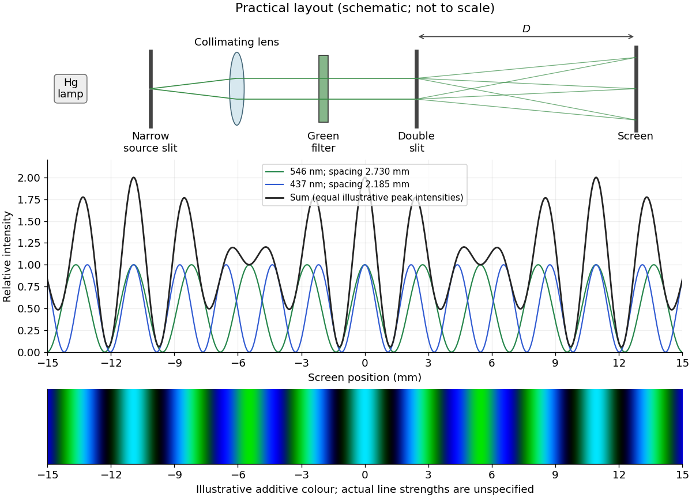

<h1 id="11/b/solution">Solution</h1>

↑ **Parent:** [B](../b.md)

Illuminate a narrow entrance slit with the [mercury-vapor lamp](../../../../mercury-vapor-lamp.md), use a collimating [lens](../../../../lens-optics.md) to illuminate two parallel narrow slits coherently, and insert a bandpass filter selecting the green line. Place a screen or scanning detector a measured distance $D$ beyond the double slit. The source slit and the two apertures should be parallel. The aperture widths should be appreciably smaller than their separation to provide an extended [diffraction](../../../../diffraction.md) envelope; the green filter should reject the other strong mercury lines. The layout is drawn below.

For slit separation $d$ and observation angle $\theta$, the [optical path difference](../../../../optical-path-difference.md) in air is $\Delta=d\sin\theta$. At a bright [interference fringe](../../../../interference-fringe.md), $\Delta=m\lambda$. For a distant screen and small angles, $\sin\theta\simeq\tan\theta\simeq y/D$, giving

$$
y_m\simeq\frac{m\lambda D}{d},\qquad \boxed{\beta=y_{m+1}-y_m=\frac{\lambda D}{d}.}
$$

Measuring several [interference fringe](../../../../interference-fringe.md) spacings and dividing by their number reduces relative position error. The derivation assumes the slits have equal [phase](../../../../phase-waves.md) on illumination and that the screen region lies within their common [diffraction](../../../../diffraction.md) envelope.

**[Figure 4](#11/b/image-double-slit-layout-and-two-colour-fringes-across-the-central-thirty-millimetres). Double-slit layout and two-colour fringes across the central thirty millimetres**.

## ↑ Ancestors (12)

1. [B](../b.md)
2. [11](../../11.md)
3. [2019](../../../2019-split.md)
4. [Past exam of the physics 2 paper of the University of Oxford](../../../split.md)
5. [Physics 2 paper of the University of Oxford](../../../../physics-2-paper-of-the-university-of-oxford.md)
6. [Year 1 of the physics course of the University of Oxford](../../../../year-1-of-the-physics-course-of-the-university-of-oxford.md)
7. [Physics course of the University of Oxford](../../../../physics-course-of-the-university-of-oxford.md)
8. [Undergraduate course of the University of Oxford](../../../../undergraduate-course-of-the-university-of-oxford.md)
9. [Course of the University of Oxford](../../../../course-of-the-university-of-oxford.md)
10. [University of Oxford](../../../../university-of-oxford-split.md)
11. [List of universities](../../../../list-of-universities.md)
12. [Codex Wiki](../../../../split.md)
