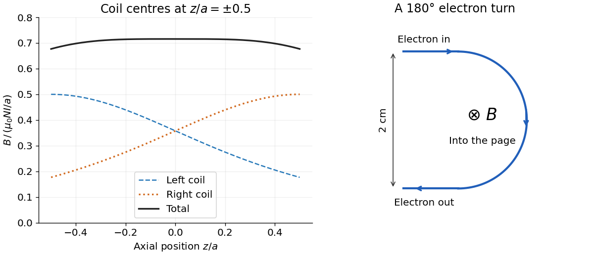

<h1 id="8/b/solution">Solution</h1>

↑ **Parent:** [B](../b.md)

Put the two [coil](../../../../electromagnetic-coil.md) centres at $z=\pm a/2$. By [superposition](../../../../superposition-principle.md), their axial [magnetic field](../../../../magnetic-field-split.md) is

$$
B(z)=\frac{\mu_0NIa^2}{2}\left\{\frac1{[a^2+(z-a/2)^2]^{3/2}}+\frac1{[a^2+(z+a/2)^2]^{3/2}}\right\}.
$$

Both [magnetic field](../../../../magnetic-field-split.md) contributions point the same way. Evaluation gives

$$
\boxed{B(0)=\left(\frac45\right)^{3/2}\frac{\mu_0NI}{a},\qquad
B(\pm a/2)=\frac{\mu_0NI}{2a}\left(1+\frac1{2\sqrt2}\right).}
$$

The corresponding coefficients are $0.715542$ and $0.676777$. Each individual [magnetic field](../../../../magnetic-field-split.md) falls as one moves away from its own [coil](../../../../electromagnetic-coil.md); their sum is much flatter near the midpoint.

For a single [coil](../../../../electromagnetic-coil.md), differentiating $(a^2+x^2)^{-3/2}$ twice produces $3(4x^2-a^2)(a^2+x^2)^{-7/2}$. At $x=a/2$ this vanishes. Thus the pair has $B'(0)=0$ by reflection [symmetry](../../../../symmetry-physics.md) and $B''(0)=0$ by its chosen separation; all odd [derivatives](../../../../derivative.md) vanish there. In fact,

$$
\frac{B(z)}{B(0)}=1-\frac{144}{125}\left(\frac za\right)^4+O\!\left((z/a)^6\right).
$$

This [Helmholtz coil](../../../../helmholtz-coil.md) arrangement produces a nearly uniform central [magnetic field](../../../../magnetic-field-split.md), useful for controlled [charged particle in a uniform magnetic field](../../../../charged-particle-in-a-uniform-magnetic-field.md) and [magnetic field](../../../../magnetic-field-split.md) calibration. The small orbit used below lies within that central region.

**[Figure 1](#8/b/image-helmholtz-axial-magnetic-field-and-a-semicircular-electron-trajectory). Helmholtz axial magnetic field and a semicircular electron trajectory**.

## ↑ Ancestors (12)

1. [B](../b.md)
2. [8](../../8.md)
3. [2019](../../../2019-split.md)
4. [Past exam of the physics 2 paper of the University of Oxford](../../../split.md)
5. [Physics 2 paper of the University of Oxford](../../../../physics-2-paper-of-the-university-of-oxford.md)
6. [Year 1 of the physics course of the University of Oxford](../../../../year-1-of-the-physics-course-of-the-university-of-oxford.md)
7. [Physics course of the University of Oxford](../../../../physics-course-of-the-university-of-oxford.md)
8. [Undergraduate course of the University of Oxford](../../../../undergraduate-course-of-the-university-of-oxford.md)
9. [Course of the University of Oxford](../../../../course-of-the-university-of-oxford.md)
10. [University of Oxford](../../../../university-of-oxford-split.md)
11. [List of universities](../../../../list-of-universities.md)
12. [Codex Wiki](../../../../split.md)
