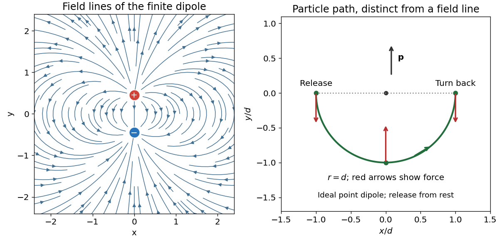

<h1 id="9/b/solution">Solution</h1>

↑ **Parent:** [B](../b.md)

The [electric dipole moment](../../../../electric-dipole-moment.md) is $\mathbf p=qa\,\hat{\mathbf y}$. Write $\theta$ for the angle measured from $+y$, with $\hat{\boldsymbol\theta}$ pointing toward increasing $\theta$. The exact [electric potential](../../../../electric-potential.md) is

$$
\phi(\mathbf r)=k_eq\left(\frac1{|\mathbf r-(a/2)\hat{\mathbf y}|}-\frac1{|\mathbf r+(a/2)\hat{\mathbf y}|}\right).
$$

For $r\gg a$, expand the reciprocals to first order in $a/r$. Their common $1/r$ terms cancel, giving the [electric dipole](../../../../electric-dipole.md) approximation

$$
\boxed{\phi(r,\theta)=\frac{k_ep\cos\theta}{r^2},\qquad
\mathbf E=\frac{k_ep}{r^3}\left(2\cos\theta\,\hat{\mathbf r}+\sin\theta\,\hat{\boldsymbol\theta}\right).}
$$

The radial [electric field](../../../../electric-field-split.md) follows from $E_r=-\partial\phi/\partial r$, and the tangential [electric field](../../../../electric-field-split.md) from $E_\theta=-(1/r)\partial\phi/\partial\theta$. The omitted terms are of relative order $a^2/r^2$ away from zeros of a component. Multiplying by the test [electric charge](../../../../electric-charge-split.md) gives the [force](../../../../force-split.md) components

$$
\boxed{F_r=\frac{2k_epQ\cos\theta}{r^3},\qquad F_\theta=\frac{k_epQ\sin\theta}{r^3}.}
$$

The [electric field lines](../../../../electric-field-line.md) emerge from the positive [electric charge](../../../../electric-charge-split.md) and terminate on the negative [electric charge](../../../../electric-charge-split.md). They are mirror-symmetric about the [electric dipole](../../../../electric-dipole.md) axis and bow out across its equatorial plane. In the point-[electric dipole](../../../../electric-dipole.md) limit their meridional curves obey $dr/(r\,d\theta)=E_r/E_\theta=2\cot\theta$, hence $r=C\sin^2\theta$.

**[Figure 2](#9/b/image-electric-dipole-field-lines-and-the-released-charge-s-ideal-trajectory). Electric dipole field lines and the released charge's ideal trajectory**.

## ↑ Ancestors (12)

1. [B](../b.md)
2. [9](../../9.md)
3. [2019](../../../2019-split.md)
4. [Past exam of the physics 2 paper of the University of Oxford](../../../split.md)
5. [Physics 2 paper of the University of Oxford](../../../../physics-2-paper-of-the-university-of-oxford.md)
6. [Year 1 of the physics course of the University of Oxford](../../../../year-1-of-the-physics-course-of-the-university-of-oxford.md)
7. [Physics course of the University of Oxford](../../../../physics-course-of-the-university-of-oxford.md)
8. [Undergraduate course of the University of Oxford](../../../../undergraduate-course-of-the-university-of-oxford.md)
9. [Course of the University of Oxford](../../../../course-of-the-university-of-oxford.md)
10. [University of Oxford](../../../../university-of-oxford-split.md)
11. [List of universities](../../../../list-of-universities.md)
12. [Codex Wiki](../../../../split.md)
