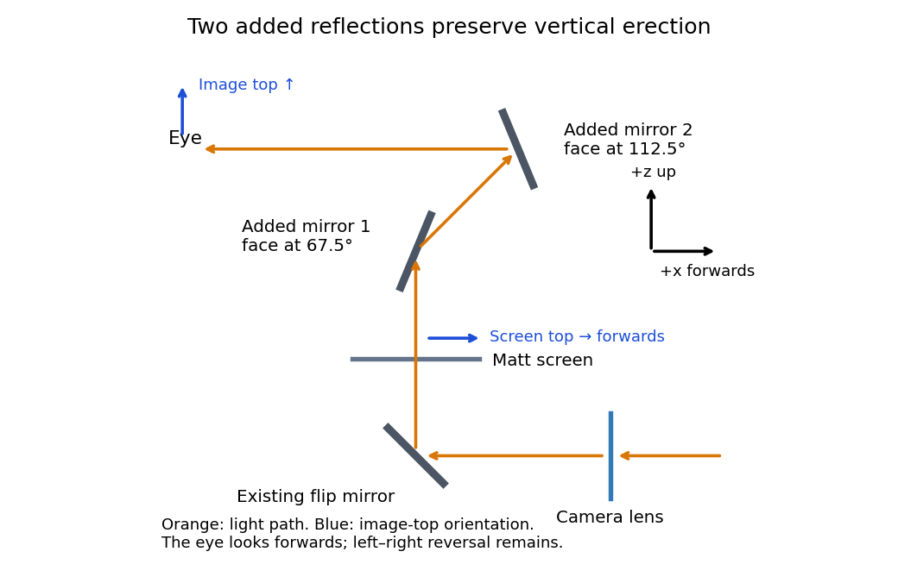
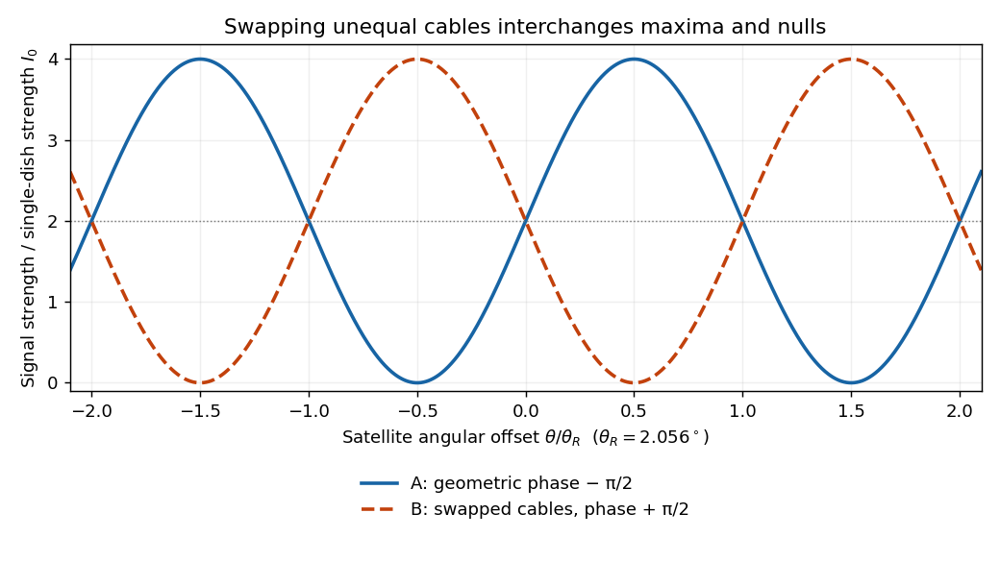

# 2021 resit

↑ **Parent:** [Past exam of the physics 2 paper of the University of Oxford](../past-exam-of-the-physics-2-paper-of-the-university-of-oxford.md)

Source paper: [https://www.whatdotheyknow.com/request/physics_preliminary_past_papers/response/2680788/attach/3/2018%202021%20Physics%20prelims.zip?cookie_passthrough=1](https://www.whatdotheyknow.com/request/physics_preliminary_past_papers/response/2680788/attach/3/2018%202021%20Physics%20prelims.zip?cookie_passthrough=1) (archive member `2020/L/a10288w1.pdf`; the cover dates this sitting to 7 September 2021).

The lettered subdivisions added to otherwise unlabelled paragraphs below follow their order in the source. Both sections and every optional question are solved.

**Table of contents**

- [1](#1)
  - [a](#1/a)
    - [Solution](#1/a/solution)
  - [b](#1/b)
    - [Solution](#1/b/solution)
  - [c](#1/c)
    - [Solution](#1/c/solution)
- [2](#2)
  - [a](#2/a)
    - [Solution](#2/a/solution)
  - [b](#2/b)
    - [Solution](#2/b/solution)
  - [c](#2/c)
    - [Solution](#2/c/solution)
  - [d](#2/d)
    - [Solution](#2/d/solution)
- [3](#3)
  - [a](#3/a)
    - [Solution](#3/a/solution)
  - [b](#3/b)
    - [Solution](#3/b/solution)
- [4](#4)
  - [a](#4/a)
    - [Solution](#4/a/solution)
  - [b](#4/b)
    - [Solution](#4/b/solution)
- [5](#5)
  - [a](#5/a)
    - [Solution](#5/a/solution)
  - [b](#5/b)
    - [Solution](#5/b/solution)
- [6](#6)
  - [a](#6/a)
    - [Solution](#6/a/solution)
  - [b](#6/b)
    - [Solution](#6/b/solution)
- [7](#7)
  - [a](#7/a)
    - [Solution](#7/a/solution)
  - [b](#7/b)
    - [Solution](#7/b/solution)
  - [c](#7/c)
    - [Solution](#7/c/solution)
  - [d](#7/d)
    - [Solution](#7/d/solution)
  - [e](#7/e)
    - [Solution](#7/e/solution)
- [8](#8)
  - [a](#8/a)
    - [Solution](#8/a/solution)
  - [b](#8/b)
    - [Solution](#8/b/solution)
- [9](#9)
  - [a](#9/a)
    - [Solution](#9/a/solution)
  - [b](#9/b)
    - [Solution](#9/b/solution)
  - [c](#9/c)
    - [Solution](#9/c/solution)
  - [d](#9/d)
    - [Solution](#9/d/solution)
- [10](#10)
  - [a](#10/a)
    - [Solution](#10/a/solution)
  - [b](#10/b)
    - [Solution](#10/b/solution)
  - [c](#10/c)
    - [Solution](#10/c/solution)

## 1

↑ **Parent:** [2021 resit](2021-resit.md)

<h3 id="1/a">a</h3>

↑ **Parent:** [1](#1)

<h4 id="1/a/solution">Solution</h4>

↑ **Parent:** [A](#1/a)

In [vacuum](../physics.md#vacuum), [Gauss's law](../maxwell-equations.md#gauss-s-law) states that the outward [electric flux](../electric-field.md#electric-flux) through a closed [surface](../topological-surface.md) is the enclosed [electric charge](../electric-charge.md) divided by the [vacuum permittivity](../permittivity.md#vacuum-permittivity):

$$
\oint_S\mathbf E\cdot d\mathbf A=\frac{Q_{\rm enc}}{\epsilon_0}.
$$

Take opposite [electric charges](../electric-charge.md) $\pm Q$ on the two [electrical conductors](../electric-charge.md#electrical-conductor), with [surface charge densities](../electrostatics.md#surface-charge-density) $\pm\sigma=\pm Q/A$. A [Gaussian pillbox](../maxwell-equations.md#gaussian-pillbox) crossing one isolated large sheet gives $2ES=\sigma S/\epsilon_0$, so each sheet contributes $\sigma/(2\epsilon_0)$ on either side. By the [superposition principle](../vector-space.md#superposition-principle), the [electric fields](../electric-field.md) add between the sheets and cancel outside. Ignoring the [fringing field of a capacitor](../electromagnetism.md#fringing-field-of-a-capacitor), the gap [electric field](../electric-field.md) is $E=\sigma/\epsilon_0$. The [electric potential difference](../electric-field.md#electric-potential-difference) and [capacitance](../electromagnetism.md#capacitance) of this [parallel-plate capacitor](../electromagnetism.md#parallel-plate-capacitor) are consequently

$$
V=\int_0^d E\,dx=\frac{Qd}{\epsilon_0A},\qquad
\boxed{C=\frac QV=\frac{\epsilon_0A}{d}.}
$$

The approximation requires $d$ much smaller than both transverse sheet dimensions. A uniform filling with [permittivity](../permittivity.md) $\epsilon$ replaces $\epsilon_0$ by $\epsilon$.

<h3 id="1/b">b</h3>

↑ **Parent:** [1](#1)

<h4 id="1/b/solution">Solution</h4>

↑ **Parent:** [B](#1/b)

Put [electric charge](../electric-charge.md) $+Q$ on the inner [electrical conductor](../electric-charge.md#electrical-conductor) and $-Q$ on the outer one. In the gap, [spherical symmetry](../geometry-and-topology.md#spherical-symmetry) makes the [electric field](../electric-field.md) radial and constant on a spherical [Gaussian surface](../maxwell-equations.md#gaussian-surface). [Gauss's law](../maxwell-equations.md#gauss-s-law) gives

$$
4\pi r^2E(r)=\frac Q{\epsilon_0},\qquad a<r<b.
$$

The inner-to-outer [electric potential difference](../electric-field.md#electric-potential-difference) is therefore

$$
V=\int_a^b\frac Q{4\pi\epsilon_0r^2}\,dr
=\frac Q{4\pi\epsilon_0}\left(\frac1a-\frac1b\right).
$$

Thus the [capacitance](../electromagnetism.md#capacitance) of the [spherical capacitor](../electromagnetism.md#spherical-capacitor) is

$$
\boxed{C=4\pi\epsilon_0\frac{ab}{b-a}.}
$$

As $b\to\infty$ this gives the [capacitance of an isolated conducting sphere](../electromagnetism.md#capacitance-of-an-isolated-conducting-sphere), $4\pi\epsilon_0a$; for $b-a\ll a$ it approaches the [parallel-plate capacitor](../electromagnetism.md#parallel-plate-capacitor) result with [area](../differential-geometry.md#surface-area) $4\pi a^2$.

<h3 id="1/c">c</h3>

↑ **Parent:** [1](#1)

<h4 id="1/c/solution">Solution</h4>

↑ **Parent:** [C](#1/c)

Use opposite [electric charges](../electric-charge.md) $\pm Q$ over a common [length](../physics.md#length) $L$, and write the inner [linear charge density](../electric-charge.md#linear-charge-density) as $\lambda=Q/L$. Away from the ends, [axisymmetry](../multivariable-calculus.md#axisymmetric-vector-field) and [Gauss's law](../maxwell-equations.md#gauss-s-law) on a coaxial cylindrical [Gaussian surface](../maxwell-equations.md#gaussian-surface) of [length](../physics.md#length) $\ell$ give

$$
E(r)\,2\pi r\ell=\frac{\lambda\ell}{\epsilon_0},\qquad
E(r)=\frac{\lambda}{2\pi\epsilon_0r},\qquad a<r<b.
$$

The [electric potential difference](../electric-field.md#electric-potential-difference) and [capacitance](../electromagnetism.md#capacitance) of the [coaxial cylindrical capacitor](../electrostatics.md#coaxial-cylindrical-capacitor) are

$$
V=\int_a^bE(r)\,dr=\frac Q{2\pi\epsilon_0L}\log\frac ba,
\qquad\boxed{C=\frac{2\pi\epsilon_0L}{\log(b/a)}.}
$$

This neglects the [fringing field of a capacitor](../electromagnetism.md#fringing-field-of-a-capacitor) at the ends, as justified when $L\gg b$.

## 2

↑ **Parent:** [2021 resit](2021-resit.md)

<h3 id="2/a">a</h3>

↑ **Parent:** [2](#2)

<h4 id="2/a/solution">Solution</h4>

↑ **Parent:** [A](#2/a)

**The [real image](../optics.md#real-image) is upside down.** A converging [optical lens](../geometrical-optics.md#lens-optics) produces negative [transverse magnification](../optics.md#transverse-magnification) on the screen: a point above the [optical axis](../geometrical-optics.md#optical-axis) sends a central [light ray](../geometrical-optics.md#light-ray) through the [optical lens](../geometrical-optics.md#lens-optics) centre to a point below the [optical axis](../geometrical-optics.md#optical-axis). The same happens in the horizontal direction. Viewed directly from behind, the screen therefore shows a picture rotated through $180^\circ$ relative to the scene.

<h3 id="2/b">b</h3>

↑ **Parent:** [2](#2)

<h4 id="2/b/solution">Solution</h4>

↑ **Parent:** [B](#2/b)

**The image is upright vertically when viewed down from behind, but left and right are interchanged.** To track the [image formation](../optics.md#image-formation), let $+x$ point forwards and $+z$ upwards. Incoming [light](../optics.md#light) travels along $-x$. The $45^\circ$ flip [plane mirror](../optical-instrument.md#plane-mirror) sends it along $+z$. Before this [reflection](../linear-algebra.md#reflection-mathematics), the [optical lens](../geometrical-optics.md#lens-optics) has inverted the scene's top into the $-z$ direction; the [law of reflection](../geometrical-optics.md#law-of-reflection) maps that direction into $+x$ on the horizontal screen. The screen's far edge is the top of the picture for someone looking down from behind. The horizontal inversion from the [optical lens](../geometrical-optics.md#lens-optics) remains, since this [plane mirror](../optical-instrument.md#plane-mirror) does not change the lateral coordinate.

<h3 id="2/c">c</h3>

↑ **Parent:** [2](#2)

<h4 id="2/c/solution">Solution</h4>

↑ **Parent:** [C](#2/c)

The minimum is **two additional [plane mirrors](../optical-instrument.md#plane-mirror)**, making three including the flip [plane mirror](../optical-instrument.md#plane-mirror). Their reflecting planes can meet at $45^\circ$ in the vertical section, as in a [pentaprism](../optical-instrument.md#pentaprism). For example, in the $xz$ section take the first added reflecting plane at $67.5^\circ$ to $+x$ and the second at $112.5^\circ$. The upward beam first travels diagonally forwards and upwards, then horizontally backwards towards an eye looking forwards. The two [reflections](../linear-algebra.md#reflection-mathematics) together rotate directions through $90^\circ$: the propagation direction $+z$ becomes $-x$, while the screen's top direction $+x$ becomes $+z$ at the eye. Thus the picture remains upright vertically.

One additional [plane mirror](../optical-instrument.md#plane-mirror) would also send $+z$ into $-x$, but it would send the top direction $+x$ into $-z$, making the image upside down. This proves minimality for ordinary [plane mirrors](../optical-instrument.md#plane-mirror). The three-[reflection](../linear-algebra.md#reflection-mathematics) arrangement still reverses left and right; correcting that additionally requires a roof arrangement or another suitable image-erecting system. Vertical erection alone is what is asked here.

**[Figure 1](#2/c/image-an-original-vertical-section-ray-construction-with-the-minimum-two-added-plane-mirrors). An original vertical-section ray construction with the minimum two added plane mirrors**.

<h3 id="2/d">d</h3>

↑ **Parent:** [2](#2)

<h4 id="2/d/solution">Solution</h4>

↑ **Parent:** [D](#2/d)

Use a converging [thin lens](../geometrical-optics.md#thin-lens) as a [magnifying glass](../optical-instrument.md#magnifying-glass), with the screen at or just inside its front [focal plane](../optical-instrument.md#focal-plane). It presents an upright [virtual image](../optics.md#virtual-image) at infinity or at the eye's [near point](../optics.md#near-point), respectively. Let the [near point](../optics.md#near-point) distance be $D$; the conventional numerical assumption is $D=250\,\mathrm{mm}$, which is not specified in the paper.

Under the usual approximation that the eye is close to the eyepiece, interpreting $50\,\mathrm{mm}$ as the [focal length](../geometrical-optics.md#focal-length) $f$ gives the familiar [angular magnifications](../optics.md#angular-magnification)

$$
M_\infty=\frac Df=5,\qquad
\boxed{M_{\rm near}=1+\frac Df=6\quad(f=50\,\mathrm{mm},\ D=250\,\mathrm{mm}).}
$$

The first is for a relaxed eye with the screen at the front [focal plane](../optical-instrument.md#focal-plane). For the second, the [virtual image](../optics.md#virtual-image) is at signed distance $v=-D$ and the [thin lens](../geometrical-optics.md#thin-lens) equation gives screen distance $u=fD/(D+f)=41.7\,\mathrm{mm}$. Thus the often intended maximum $6$ requires a screen-to-eye distance of approximately $41.7\,\mathrm{mm}$, rather than exactly $50\,\mathrm{mm}$.

If $50\,\mathrm{mm}$ instead fixes the physical screen-to-eye separation $s$, an eye adjacent to the [optical lens](../geometrical-optics.md#lens-optics) sees the [angular magnification](../optics.md#angular-magnification)

$$
\boxed{M=\frac Ds=5\quad(s=50\,\mathrm{mm},\ D=250\,\mathrm{mm}).}
$$

This is achieved by $f=s$ for relaxed viewing, or by $f=sD/(D-s)=62.5\,\mathrm{mm}$ for a [virtual image](../optics.md#virtual-image) at the [near point](../optics.md#near-point). The latter follows from $1/f=1/s-1/D$.

More generally, the source does not specify the eyepiece-to-eye distance either. If that distance is $e$, then $u=s-e$ and a [virtual image](../optics.md#virtual-image) at the [near point](../optics.md#near-point) has [transverse magnification](../optics.md#transverse-magnification) $(D-e)/u$. Its [angular magnification](../optics.md#angular-magnification) relative to unaided viewing at $D$ is

$$
M=\frac{D-e}{s-e}.
$$

For example, $s=50\,\mathrm{mm}$ and $e=25\,\mathrm{mm}$ give $M=9$, with $u=25\,\mathrm{mm}$ and $f=28.125\,\mathrm{mm}$. This is a concrete counterexample to a universal maximum of $5$ at fixed screen-to-eye separation. In ideal [geometrical optics](../geometrical-optics.md), $e\to s^-$ allows arbitrarily large $M$ with an arbitrarily short [focal length](../geometrical-optics.md#focal-length); practical [aperture](../optics.md#aperture) and [optical aberrations](../geometrical-optics.md#optical-aberration) constrain this. A unique numerical maximum therefore needs the conventional near-eye eyepiece geometry and [near point](../optics.md#near-point) assumption. The conventional $f=50\,\mathrm{mm}$ answer is $6$, with those assumptions stated explicitly.

## 3

↑ **Parent:** [2021 resit](2021-resit.md)

<h3 id="3/a">a</h3>

↑ **Parent:** [3](#3)

<h4 id="3/a/solution">Solution</h4>

↑ **Parent:** [A](#3/a)

Let $U>0$ be the drop in [electric potential](../electric-field.md#electric-potential) along the positive [electric charge](../electric-charge.md)'s path. By [conservation of energy](../mathematical-physics.md#conservation-of-energy), $qU=mv^2/2$, so the nonrelativistic exit [speed](../classical-mechanics.md#speed) is $v=\sqrt{2qU/m}$. Apply a uniform [magnetic field](../magnetic-field.md) perpendicular to the incident [velocity](../classical-mechanics.md#velocity) and to the desired orbital plane. The magnetic [Lorentz force](../relativistic-electromagnetism.md#lorentz-force) is perpendicular to the [velocity](../classical-mechanics.md#velocity), does no [work](../energy.md#work), and supplies the [centripetal force](../classical-mechanics.md#centripetal-force):

$$
qvB=\frac{mv^2}{R},\qquad
\boxed{R=\frac{mv}{qB}=\frac1B\sqrt{\frac{2U}{q/m}}.}
$$

For example, $\mathbf v=v\widehat{\mathbf x}$ and $\mathbf B=B\widehat{\mathbf z}$ give initial deflection along $-y$ for positive $q$. Reversing the [magnetic field](../magnetic-field.md) reverses the bending. A uniform [electric field](../electric-field.md) alone would give constant [acceleration](../classical-mechanics.md#acceleration) and a parabolic path, not uniform [circular motion](../classical-mechanics.md#circular-motion). The displayed result assumes $qU\ll mc^2$; the exact relativistic [momentum](../momentum.md) relation would give $R=\sqrt{q^2U^2/c^2+2mqU}/(qB)$.

<h3 id="3/b">b</h3>

↑ **Parent:** [3](#3)

<h4 id="3/b/solution">Solution</h4>

↑ **Parent:** [B](#3/b)

Add a uniform [electric field](../electric-field.md) satisfying $\mathbf E=-\mathbf v_0\times\mathbf B$. Then the [Lorentz force](../relativistic-electromagnetism.md#lorentz-force) $q(\mathbf E+\mathbf v_0\times\mathbf B)$ vanishes for the desired [velocity](../classical-mechanics.md#velocity). With the axes used above, $\mathbf E=E\widehat{\mathbf y}$, perpendicular to both $\mathbf v_0$ and $\mathbf B$, with

$$
\boxed{E=Bv_0=B\sqrt{2U(q/m)_0},\qquad (q/m)_0=\frac{E^2}{2UB^2}.}
$$

The crossed fields form a [velocity selector](../relativistic-electromagnetism.md#velocity-selector). All particles must first have traversed the same [electric potential difference](../electric-field.md#electric-potential-difference) from rest: that is what converts selection of [speed](../classical-mechanics.md#speed) into selection of [charge-to-mass ratio](../relativistic-electromagnetism.md#charge-to-mass-ratio). Equal [charge-to-mass ratios](../relativistic-electromagnetism.md#charge-to-mass-ratio) yield equal [speeds](../classical-mechanics.md#speed) even if the separate masses and charges differ. For other ratios, the initial transverse [force](../force.md) is $q(E-vB)$ and is nonzero.

## 4

↑ **Parent:** [2021 resit](2021-resit.md)

<h3 id="4/a">a</h3>

↑ **Parent:** [4](#4)

<h4 id="4/a/solution">Solution</h4>

↑ **Parent:** [A](#4/a)

Use sinusoidal [phasors](../wave.md#phasor) with physical values $v(t)=\operatorname{Re}(\widehat V e^{j\omega t})$, $i(t)=\operatorname{Re}(\widehat I e^{j\omega t})$, and $j^2=-1$. The [complex impedance](../electrical-circuit.md#electrical-impedance) is $Z=\widehat V/\widehat I=X+jY$: its [modulus](../complex-analysis.md#modulus) is the voltage-to-current [amplitude](../wave.md#wave-amplitude) ratio, and its [complex argument](../complex-analysis.md#argument-complex-analysis) is the voltage-minus-current [phase difference](../wave.md#phase-difference). Here $X$ is the [electrical resistance](../electric-charge.md#electrical-resistance) part and $Y$ the signed [electrical reactance](../electrical-circuit.md#electrical-reactance); the source's $X,Y$ notation differs from the common $R,X$ notation.

The component laws $v_R=Ri$, $v_L=L\,di/dt$ and $i_C=C\,dv_C/dt$ give the [complex impedances](../electrical-circuit.md#electrical-impedance) of an ideal [resistor](../electric-charge.md#resistor), [inductor](../electromagnetism.md#inductor) and [capacitor](../electromagnetism.md#capacitor):

$$
Z_R=R,\qquad Z_L=j\omega L,\qquad Z_C=\frac1{j\omega C}=-\frac j{\omega C}.
$$

In a [series circuit](../electrical-circuit.md#series-circuit) the same [electric current](../electric-charge.md#electric-current) flows through both components, so [Kirchhoff's voltage law](../random-walk.md#kirchhoff-cycle-law) adds their voltage [phasors](../wave.md#phasor). The resulting [series RC impedance](../electrical-circuit.md#series-rc-impedance) is

$$
Z=R-\frac j{\omega C},\qquad
\boxed{|Z|=\sqrt{R^2+\frac1{\omega^2C^2}},\qquad
\arg Z=-\arctan\frac1{\omega CR}.}
$$

For positive $R,C,\omega$, the negative [phase difference](../wave.md#phase-difference) means that [electric current](../electric-charge.md#electric-current) leads the applied [electric potential difference](../electric-field.md#electric-potential-difference).

<h3 id="4/b">b</h3>

↑ **Parent:** [4](#4)

<h4 id="4/b/solution">Solution</h4>

↑ **Parent:** [B](#4/b)

In the [parallel LC circuit](../electrical-circuit.md#parallel-lc-circuit) both components have the same voltage [phasor](../wave.md#phasor). Adding their current [phasors](../wave.md#phasor) by [Kirchhoff's current law](../random-walk.md#kirchhoff-node-law) gives the total [electrical admittance](../electrical-circuit.md#electrical-admittance):

$$
\frac1Z=\frac1{j\omega L}+j\omega C
=j\left(\omega C-\frac1{\omega L}\right).
$$

Thus

$$
\boxed{Z=\frac{j\omega L}{1-\omega^2LC},\qquad
|Z|=\frac{\omega L}{|1-\omega^2LC|},\qquad
\arg Z=\begin{cases}+\pi/2,&\omega<1/\sqrt{LC},\\-\pi/2,&\omega>1/\sqrt{LC}.\end{cases}}
$$

At the ideal parallel [resonance](../dynamical-systems.md#resonance), $\omega_0=1/\sqrt{LC}$, the two branch current [phasors](../wave.md#phasor) cancel. The net [electrical admittance](../electrical-circuit.md#electrical-admittance) is zero and the magnitude of the [complex impedance](../electrical-circuit.md#electrical-impedance) tends to infinity: the parallel combination behaves as an open circuit at that [frequency](../wave.md#frequency). Its [complex argument](../complex-analysis.md#argument-complex-analysis) is undefined exactly at the pole. Finite component losses replace the infinite peak by a large finite [electrical impedance](../electrical-circuit.md#electrical-impedance). This conclusion concerns a voltage-driven sinusoidal response; an ideal resonant current drive does not have a bounded sinusoidal steady-state voltage.

## 5

↑ **Parent:** [2021 resit](2021-resit.md)

<h3 id="5/a">a</h3>

↑ **Parent:** [5](#5)

<h4 id="5/a/solution">Solution</h4>

↑ **Parent:** [A](#5/a)

In [SI](../physics.md#international-system-of-units) units, the [Maxwell equations](../maxwell-equations.md) in [vacuum](../physics.md#vacuum) with prescribed [charge density](../electric-charge.md#charge-density) $\rho$ and [current density](../electric-charge.md#current-density) $\mathbf J$ are

$$
\nabla\cdot\mathbf E=\frac\rho{\epsilon_0},\qquad
\nabla\cdot\mathbf B=0,\qquad
\nabla\times\mathbf E=-\partial_t\mathbf B,\qquad
\nabla\times\mathbf B=\mu_0\mathbf J+\mu_0\epsilon_0\partial_t\mathbf E.
$$

When $\rho=0$ and $\mathbf J=\mathbf0$, take the [curl](../multivariable-calculus.md#curl) of the third equation and substitute the fourth. Using the [curl of the curl identity](../multivariable-calculus.md#curl-of-the-curl-identity) and $\nabla\cdot\mathbf E=0$ gives the [electromagnetic wave equation](../electromagnetic-wave.md#electromagnetic-wave-equation):

$$
\nabla\times(\nabla\times\mathbf E)=-\nabla^2\mathbf E
=-\mu_0\epsilon_0\partial_t^2\mathbf E,\qquad
\boxed{\nabla^2\mathbf E-\frac1{c^2}\partial_t^2\mathbf E=0,
\quad c=(\mu_0\epsilon_0)^{-1/2}.}
$$

For example, $\mathbf E=E_0\widehat{\mathbf x}\cos(kz-\omega t)$, $\mathbf B=(E_0/c)\widehat{\mathbf y}\cos(kz-\omega t)$ is a [plane electromagnetic wave](../electromagnetic-wave.md#plane-electromagnetic-wave) provided $\omega=ck$. The [electric field](../electric-field.md), [magnetic field](../magnetic-field.md) and propagation direction are mutually perpendicular.

The [Maxwell equations](../maxwell-equations.md) are linear, so the [superposition principle](../vector-space.md#superposition-principle) applies to fields. However, the [Poynting vector](../electromagnetic-wave.md#poynting-vector) is quadratic:

$$
\langle\mathbf S\rangle=\frac1{\mu_0}\langle
\mathbf E_1\times\mathbf B_1+\mathbf E_2\times\mathbf B_2
+\mathbf E_1\times\mathbf B_2+\mathbf E_2\times\mathbf B_1\rangle.
$$

One may add the average [wave intensities](../wave.md#intensity-physics) only when the cross terms vanish under the actual detector average. For co-propagating [plane electromagnetic waves](../electromagnetic-wave.md#plane-electromagnetic-wave) of parallel [linear polarization](../electromagnetic-wave.md#linear-polarization), averaging over optical cycles but potentially resolving the difference [frequency](../wave.md#frequency) gives

$$
I(t)=I_1+I_2+2\sqrt{I_1I_2}\cos[(\omega_1-\omega_2)t+\phi].
$$

If the detector integrates for $T$, the last term acquires $\operatorname{sinc}[(\omega_1-\omega_2)T/2]$, with [sinc function](../fourier-transform.md#sinc-function) convention $\operatorname{sinc}x=\sin x/x$, evaluated at the midpoint phase. Thus $T\gg1/|f_1-f_2|$ suppresses [beats](../physical-optics.md#beat), and the infinite-time average adds the [wave intensities](../wave.md#intensity-physics) exactly for distinct fixed [frequencies](../wave.md#frequency). Random mutually uncorrelated [wave phases](../wave.md#phase-waves) also remove the cross terms in an ensemble average; orthogonal [linear polarizations](../electromagnetic-wave.md#linear-polarization) remove them for co-propagating waves in polarization-insensitive detection. Merely having different [frequencies](../wave.md#frequency) does not remove a resolved [beat](../physical-optics.md#beat) signal: two nearly equal [frequencies](../wave.md#frequency) with fixed relative [wave phase](../wave.md#phase-waves) are a concrete counterexample. For different propagation directions, the relevant addition is of average [Poynting vectors](../electromagnetic-wave.md#poynting-vector), or their components through the chosen detector [surface](../topological-surface.md).

<h3 id="5/b">b</h3>

↑ **Parent:** [5](#5)

<h4 id="5/b/solution">Solution</h4>

↑ **Parent:** [B](#5/b)

For a sinusoidal [plane electromagnetic wave](../electromagnetic-wave.md#plane-electromagnetic-wave) in [vacuum](../physics.md#vacuum), write the maximum [electric field](../electric-field.md) as $E_0$. The [magnetic field](../magnetic-field.md) maximum is $B_0=E_0/c$, so the cycle-averaged [Poynting vector](../electromagnetic-wave.md#poynting-vector) magnitude, or [light intensity](../wave.md#light-intensity), is

$$
I=\frac{E_0B_0}{\mu_0}\langle\cos^2\omega t\rangle
=\frac12\epsilon_0cE_0^2,\qquad
\boxed{E_0=\sqrt{\frac{2I}{\epsilon_0c}}.}
$$

Each [photon](../quantum-mechanics.md#photon) carries [energy](../energy.md) $hf$, where $h$ is the [Planck constant](../quantum-mechanics.md#planck-constant). Therefore the [photon number flux density](../quantum-mechanics.md#photon-number-flux-density), namely the number per unit normal [area](../differential-geometry.md#surface-area) per unit time, is

$$
\boxed{\Phi_N=\frac I{hf}=\frac{\epsilon_0cE_0^2}{2hf}.}
$$

Multiplying by an illuminated normal [area](../differential-geometry.md#surface-area) gives the [photon](../quantum-mechanics.md#photon) arrival rate. Each absorbed [photon](../quantum-mechanics.md#photon) transfers [momentum](../momentum.md) $hf/c$ at [normal incidence](../optics.md#normal-incidence), giving the [radiation pressure on a perfectly absorbing surface](../electromagnetism.md#radiation-pressure-on-a-perfectly-absorbing-surface)

$$
\boxed{p=\frac Ic=\frac12\epsilon_0E_0^2.}
$$

These are time-averaged quantities. At oblique [angle of incidence](../optics.md#angle-of-incidence) $\theta$, the normal [radiation pressure](../pressure.md#radiation-pressure) is $I\cos^2\theta/c$; the simple displayed expression assumes [normal incidence](../optics.md#normal-incidence).

## 6

↑ **Parent:** [2021 resit](2021-resit.md)

<h3 id="6/a">a</h3>

↑ **Parent:** [6](#6)

<h4 id="6/a/solution">Solution</h4>

↑ **Parent:** [A](#6/a)

The phrase “image” does not specify whether a [real image](../optics.md#real-image) or a [virtual image](../optics.md#virtual-image) is required. The later mention of an image plane makes a projected [real image](../optics.md#real-image) a natural interpretation. Let $u>0$ be object distance and $v>0$ real-image distance from a converging [thin lens](../geometrical-optics.md#thin-lens). A [transverse magnification](../optics.md#transverse-magnification) of magnitude $15$ gives $v=15u$, and the object-to-image separation gives $u+v=200\,\mathrm{mm}$. Hence

$$
\boxed{u=12.5\,\mathrm{mm},\quad v=187.5\,\mathrm{mm},\quad
f=\frac{uv}{u+v}=11.71875\,\mathrm{mm}.}
$$

Place the [optical lens](../geometrical-optics.md#lens-optics) $12.5\,\mathrm{mm}$ beyond the object along the illuminating beam. The [real image](../optics.md#real-image) is inverted and has [transverse magnification](../optics.md#transverse-magnification) $-15$.

For the alternative single-[optical lens](../geometrical-optics.md#lens-optics) [magnifying glass](../optical-instrument.md#magnifying-glass) interpretation, the [virtual image](../optics.md#virtual-image) is upright and lies on the object's side, so signed $v=-15u$. Its separation from the object is $|v|-u=14u=200\,\mathrm{mm}$. The [thin lens](../geometrical-optics.md#thin-lens) equation then gives

$$
\boxed{u=\frac{100}{7}\,\mathrm{mm}=14.286\,\mathrm{mm},\quad
v=-\frac{1500}{7}\,\mathrm{mm},\quad
f=\frac{750}{49}\,\mathrm{mm}=15.306\,\mathrm{mm}.}
$$

The source does not explicitly select between these two geometries; they should not be conflated with a $200\,\mathrm{mm}$ lens-to-image distance.

<h3 id="6/b">b</h3>

↑ **Parent:** [6](#6)

<h4 id="6/b/solution">Solution</h4>

↑ **Parent:** [B](#6/b)

Use the principle of [dark-field microscopy](../optical-instrument.md#dark-field-microscopy): block the unscattered beam where it is concentrated, while transmitting most [light scattering](../optics.md#scattering-of-light) at nonzero angles. All direct [light rays](../geometrical-optics.md#light-ray) of the collimated illumination are parallel, so the [thin lens](../geometrical-optics.md#thin-lens) focuses them to one point in its [back focal plane](../optical-instrument.md#back-focal-plane). Put a small opaque circular stop centred on that point, one [focal length](../geometrical-optics.md#focal-length) behind the [optical lens](../geometrical-optics.md#lens-optics). In the [real image](../optics.md#real-image) geometry above this is $11.719\,\mathrm{mm}$ behind the [optical lens](../geometrical-optics.md#lens-optics), well before the [real image](../optics.md#real-image) at $187.5\,\mathrm{mm}$.

A [light ray](../geometrical-optics.md#light-ray) leaving object coordinate $y$ with a small initial direction $\theta$ reaches the [optical lens](../geometrical-optics.md#lens-optics) at $y+u\theta$. The [thin lens](../geometrical-optics.md#thin-lens) changes its direction to $\theta-(y+u\theta)/f$. At the [back focal plane](../optical-instrument.md#back-focal-plane) its coordinate is therefore

$$
y_f=y+u\theta+f\left(\theta-\frac{y+u\theta}{f}\right)=f\theta.
$$

Thus direct illumination with $\theta=0$ is concentrated at the centre, whereas scattered [light](../optics.md#light) at different directions is distributed away from it, independently of $y$. A stop of [radius](../topology.md#radius) $r_s$ removes approximately $|\theta|\lesssim r_s/f$; choose it just large enough to cover the direct beam's finite [diffraction](../quantum-scattering.md#diffraction) spot, illumination divergence and alignment errors. Scattered [light](../optics.md#light) inside that small angular cone is also lost, so negligible loss requires most useful scattered [light](../optics.md#light) to lie outside it. A stop in the object's [real image](../optics.md#real-image) plane instead removes object detail and does not generally separate scattered and direct [light](../optics.md#light). For the [virtual image](../optics.md#virtual-image) interpretation, the same physical [back focal plane](../optical-instrument.md#back-focal-plane) filtering requires a downstream observation arrangement that actually passes through this plane.

## 7

↑ **Parent:** [2021 resit](2021-resit.md)

<h3 id="7/a">a</h3>

↑ **Parent:** [7](#7)

<h4 id="7/a/solution">Solution</h4>

↑ **Parent:** [A](#7/a)

The [wavelength](../wave-equation.md#wavelength) at $12\,\mathrm{GHz}$ is $\lambda=c/f\simeq0.0250\,\mathrm m$. For an ideal circular [aperture](../optics.md#aperture) of [diameter](../topological-analysis.md#diameter) $D=0.850\,\mathrm m$, the [Rayleigh criterion](../point-spread-function.md#rayleigh-criterion) places one source at the first minimum of the other's [Airy disk](../point-spread-function.md#airy-disk):

$$
\boxed{\theta_R=1.22\frac\lambda D=0.03588\,\mathrm{rad}=2.056^\circ.}
$$

The customary full-ring packing estimate for the number of resolvable positions in a [geostationary orbit](../celestial-mechanics.md#geostationary-orbit) is

$$
\boxed{N_{\max}\simeq\left\lfloor\frac{2\pi}{\theta_R}\right\rfloor=175.}
$$

This is an ideal angular-packing estimate. It identifies apparent angular spacing with spacing around the orbital ring and disregards Earth's occultation and station location. An individual ground station cannot see the whole ring; exact conversion from orbital longitude to sky direction requires its location and the orbital [radius](../topology.md#radius). Also, a practical tapered [antenna](../electrical-engineering.md#antenna-radio) illumination changes the ideal circular-[aperture](../optics.md#aperture) response.

<h3 id="7/b">b</h3>

↑ **Parent:** [7](#7)

<h4 id="7/b/solution">Solution</h4>

↑ **Parent:** [B](#7/b)

A distant satellite supplies an approximately collimated incident beam. A [concave spherical mirror](../optical-instrument.md#concave-spherical-mirror) of [radius of curvature](../differential-geometry.md#radius-of-curvature) $R_c=1.5\,\mathrm m$ has paraxial [focal length](../geometrical-optics.md#focal-length) $f_m=R_c/2$. Put the receiving feed at the principal focus, on the [optical axis](../geometrical-optics.md#optical-axis) in front of the dish:

$$
\boxed{f_m=0.750\,\mathrm m\text{ from the dish vertex}.}
$$

The [radius of curvature](../differential-geometry.md#radius-of-curvature) relation is a [paraxial approximation](../partial-differential-equation.md#paraxial-approximation). A practical dish is usually a [parabolic reflector](../optical-instrument.md#parabolic-reflector), which focuses an on-axis collimated beam without [spherical aberration](../geometrical-optics.md#spherical-aberration); a literal spherical dish has [spherical aberration](../geometrical-optics.md#spherical-aberration), so an exact optimum over its full [aperture](../optics.md#aperture) would need a specified focusing criterion.

<h3 id="7/c">c</h3>

↑ **Parent:** [7](#7)

<h4 id="7/c/solution">Solution</h4>

↑ **Parent:** [C](#7/c)

Two nearby directions separated by $\theta_R$ focus at transverse separation $s\simeq f_m\theta_R$. To avoid a receiver covering both geometric image centres at once, its [diameter](../topological-analysis.md#diameter) $d$ should not exceed this separation along the orbital direction:

$$
\boxed{d_{\max}\sim f_m\theta_R
=(0.750)(0.03588)\,\mathrm m=26.9\,\mathrm{mm}.}
$$

This is the usual receiver-size estimate from [angular resolution](../astrophysics.md#angular-resolution). The [Airy disk](../point-spread-function.md#airy-disk) first-minimum [diameter](../topological-analysis.md#diameter) is $2f_m\theta_R=53.8\,\mathrm{mm}$, but that is a spot-size definition, not the same as the receiver's allowed angular acceptance. At the [Rayleigh criterion](../point-spread-function.md#rayleigh-criterion), the images already overlap; integrating over a finite receiver further reduces contrast. Consequently $26.9\,\mathrm{mm}$ is an order-of-resolution upper scale, not a sharp universal boundary for a specified signal discrimination probability. A detailed limit would require the receiver response and a resolving criterion.

<h3 id="7/d">d</h3>

↑ **Parent:** [7](#7)

<h4 id="7/d/solution">Solution</h4>

↑ **Parent:** [D](#7/d)

Use a [two-element radio interferometer](../physical-optics.md#two-element-radio-interferometer): couple two small dishes coherently and align the projected baseline along the angular separation of the neighbouring satellites. Each dish's broad [antenna](../electrical-engineering.md#antenna-radio) response should include both satellites. Match the electronic delays so that the desired satellite arrives in phase at the combiner. For baseline [length](../physics.md#length) $b$ perpendicular to the central line of sight, a small angular displacement $\theta$ produces geometric path difference $b\sin\theta$ and [phase difference](../wave.md#phase-difference)

$$
\phi(\theta)=\frac{2\pi b}{\lambda}\sin\theta.
$$

For equal signal [amplitudes](../wave.md#wave-amplitude) from one source, the output [wave intensity](../wave.md#intensity-physics) is $4I_0\cos^2(\phi/2)$. Put one satellite on a maximum and its neighbour on the first null: $\phi(\theta_R)=\pi$. The smallest useful projected baseline is therefore

$$
\boxed{b=\frac{\lambda}{2\sin\theta_R}\simeq\frac{\lambda}{2\theta_R}
=0.348\,\mathrm m.}
$$

The [angles](../geometry-and-topology.md#angle) here are measured near the normal to the baseline. At a general pointing angle $\theta_0$, replace $b$ in the small-separation estimate by $b\cos\theta_0$. Longer odd-half-fringe baselines can also null the neighbour but create more angular ambiguity. This arrangement provides discrimination along one direction; two collectors alone have repeated [interference fringes](../physical-optics.md#interference-fringe) and do not produce an unambiguous full image.

<h3 id="7/e">e</h3>

↑ **Parent:** [7](#7)

<h4 id="7/e/solution">Solution</h4>

↑ **Parent:** [E](#7/e)

The signal [phase velocity](../dispersion-relation.md#phase-velocity) in the coaxial cables is $v_c=c/2$, so the guided [wavelength](../wave-equation.md#wavelength) is $\lambda_c=v_c/f=12.5\,\mathrm{mm}$. The excess cable [length](../physics.md#length) is $\Delta\ell=3.125\,\mathrm{mm}=\lambda_c/4$, adding a relative delay of $20.83\,\mathrm{ps}$ and a relative [wave phase](../wave.md#phase-waves) of magnitude

$$
\delta_c=2\pi\frac{\Delta\ell}{\lambda_c}=\frac\pi2.
$$

Label the two inputs so that the first configuration has total [phase difference](../wave.md#phase-difference) $\phi-\pi/2$, where $\phi=2\pi b\sin\theta/\lambda$ is the geometric [phase difference](../wave.md#phase-difference). Swapping the unequal cables reverses that added [wave phase](../wave.md#phase-waves), giving $\phi+\pi/2$. For the same single-source received [wave intensity](../wave.md#intensity-physics) $I_0$ in each arm,

$$
\boxed{I_A(\theta)=2I_0[1+\sin\phi(\theta)],\qquad
I_B(\theta)=2I_0[1-\sin\phi(\theta)].}
$$

The two [interference](../physical-optics.md#interference-wave-propagation) patterns are shifted by half a fringe: maxima in one are nulls in the other. At broadside $\phi=0$ both give $2I_0$, so swapping does not change the strength of every possible source. For small [angles](../geometry-and-topology.md#angle), the maximum-to-maximum shift is $\lambda/(2b)\simeq\theta_R=2.056^\circ$ with the chosen baseline. Near broadside, the maxima of configuration A occur near $\theta=+\theta_R/2$ and those of B near $\theta=-\theta_R/2$; the signs are exchanged if the input labels are reversed. Independent satellites contribute separately according to these directional gains; their mutually uncorrelated signals should not be added as coherent [amplitudes](../wave.md#wave-amplitude).

**[Figure 2](#7/e/image-calculated-complementary-two-dish-signal-strengths-before-and-after-swapping-quarter-wavelength-delay-cables). Calculated complementary two-dish signal strengths before and after swapping quarter-wavelength-delay cables**.

## 8

↑ **Parent:** [2021 resit](2021-resit.md)

<h3 id="8/a">a</h3>

↑ **Parent:** [8](#8)

<h4 id="8/a/solution">Solution</h4>

↑ **Parent:** [A](#8/a)

Let the original cylinder axis be $\mathbf r=\mathbf0$, and let the hole axis be at transverse [vector](../vector-space.md#vector) $\mathbf a$, with $|\mathbf a|=a$. The [charge density](../electric-charge.md#charge-density) is reproduced by a full cylinder of [radius](../topology.md#radius) $R_1$ and [charge density](../electric-charge.md#charge-density) $+\rho$, superposed with a cylinder of [radius](../topology.md#radius) $R_2$ centred at $\mathbf a$ and [charge density](../electric-charge.md#charge-density) $-\rho$. This uses the [superposition principle](../vector-space.md#superposition-principle) for fixed insulating [electric charges](../electric-charge.md); the hole is not a hole in an [electrical conductor](../electric-charge.md#electrical-conductor).

For a complete uniformly charged infinite cylinder of [radius](../topology.md#radius) $R$, a coaxial [Gaussian surface](../maxwell-equations.md#gaussian-surface) of [length](../physics.md#length) $\ell$ gives, by [Gauss's law](../maxwell-equations.md#gauss-s-law),

$$
2\pi s\ell E(s)=\begin{cases}\rho\pi s^2\ell/\epsilon_0,&s<R,\\
\rho\pi R^2\ell/\epsilon_0,&s\geq R.
\end{cases}
$$

Consequently define

$$
\mathbf F_R(\mathbf s)=\begin{cases}\mathbf s,&|\mathbf s|\leq R,\\
R^2\mathbf s/|\mathbf s|^2,&|\mathbf s|>R.
\end{cases}
$$

The complete [electric field](../electric-field.md), including the exterior if desired, is

$$
\boxed{\mathbf E(\mathbf r)=\frac\rho{2\epsilon_0}
\left[\mathbf F_{R_1}(\mathbf r)-\mathbf F_{R_2}(\mathbf r-\mathbf a)\right].}
$$

In the insulating material, $|\mathbf r|<R_1$ and $s=|\mathbf r-\mathbf a|>R_2$, so

$$
\boxed{\mathbf E_{\rm material}(\mathbf r)=\frac\rho{2\epsilon_0}
\left[\mathbf r-\frac{R_2^2(\mathbf r-\mathbf a)}{|\mathbf r-\mathbf a|^2}\right].}
$$

Inside the hole both contributions use their interior formulas, and all dependence on $\mathbf r$ cancels:

$$
\boxed{\mathbf E_{\rm hole}=\frac\rho{2\epsilon_0}[\mathbf r-(\mathbf r-\mathbf a)]
=\frac\rho{2\epsilon_0}\mathbf a.}
$$

The [electric field](../electric-field.md) in the hole is uniform, points from the original axis towards the hole axis for $\rho>0$, and vanishes for a concentric hole. The two expressions agree at the hole wall, as expected with no imposed [surface charge density](../electrostatics.md#surface-charge-density) there. Its uniformity is the useful [uniform electric field in an off-axis cylindrical cavity](../maxwell-equations.md#uniform-electric-field-in-an-off-axis-cylindrical-cavity) result.

<h3 id="8/b">b</h3>

↑ **Parent:** [8](#8)

<h4 id="8/b/solution">Solution</h4>

↑ **Parent:** [B](#8/b)

Take the grounded [electrical conductor](../electric-charge.md#electrical-conductor) to occupy $z\leq0$ and approximate the negligible-radius charged sphere by a [point charge](../electric-field.md#point-charge) $Q$ at $\mathbf r_+=D\widehat{\mathbf z}$. Put a fictitious [image charge](../electric-field.md#image-charge) $-Q$ at $\mathbf r_-=-D\widehat{\mathbf z}$. The constructed [electric potential](../electric-field.md#electric-potential) is zero on $z=0$, has the correct [point charge](../electric-field.md#point-charge) singularity, and vanishes at infinity. The [uniqueness theorem for the electrostatic potential](../electrostatics.md#uniqueness-theorem-for-the-electrostatic-potential) makes it the physical [electric potential](../electric-field.md#electric-potential) for $z>0$:

$$
\phi(\mathbf r)=\frac Q{4\pi\epsilon_0}
\left(\frac1{|\mathbf r-D\widehat{\mathbf z}|}
-\frac1{|\mathbf r+D\widehat{\mathbf z}|}\right).
$$

Taking its negative [gradient](../multivariable-calculus.md#gradient) gives the requested [electric field](../electric-field.md) outside the small sphere:

$$
\boxed{\mathbf E(\mathbf r)=\frac Q{4\pi\epsilon_0}
\left[\frac{\mathbf r-D\widehat{\mathbf z}}{|\mathbf r-D\widehat{\mathbf z}|^3}
-\frac{\mathbf r+D\widehat{\mathbf z}}{|\mathbf r+D\widehat{\mathbf z}|^3}\right],\quad z>0.}
$$

On the plane at cylindrical [radius](../topology.md#radius) $r$, the tangential components cancel and the normal component is

$$
E_z(r,0^+)=-\frac{QD}{2\pi\epsilon_0(r^2+D^2)^{3/2}}.
$$

The [electrostatic boundary conditions at a conductor](../electrostatics.md#electrostatic-boundary-conditions-at-a-conductor), with outward [unit normal](../differential-geometry.md#unit-normal) $+\widehat{\mathbf z}$ and zero interior [electric field](../electric-field.md), give the induced [surface charge density](../electrostatics.md#surface-charge-density)

$$
\boxed{\sigma(r)=\epsilon_0 E_z(r,0^+)
=-\frac{QD}{2\pi(r^2+D^2)^{3/2}}.}
$$

Finally integrate over annuli of [area](../differential-geometry.md#surface-area) $2\pi r\,dr$:

$$
Q_{\rm ind}=\int_0^\infty\sigma(r)2\pi r\,dr
=-QD\int_0^\infty\frac{r\,dr}{(r^2+D^2)^{3/2}}
=-QD\left[-\frac1{\sqrt{r^2+D^2}}\right]_0^\infty,
\qquad\boxed{Q_{\rm ind}=-Q.}
$$

The [image charge](../electric-field.md#image-charge) is a computational device, not a real charge below the plane. For a finite conducting sphere, its induced polarization would change the point-source approximation; the stated negligible [radius](../topology.md#radius) is essential.

## 9

↑ **Parent:** [2021 resit](2021-resit.md)

<h3 id="9/a">a</h3>

↑ **Parent:** [9](#9)

<h4 id="9/a/solution">Solution</h4>

↑ **Parent:** [A](#9/a)

The [Huygens-Fresnel principle](../physical-optics.md#huygens-fresnel-principle) treats every point of an advancing [wavefront](../physical-optics.md#wavefront) as a source of secondary [spherical waves](../wave.md#spherical-wave); their forward envelope constructs the next [wavefront](../physical-optics.md#wavefront). Consider two points where an oblique plane [wavefront](../physical-optics.md#wavefront) meets a plane interface a distance $AB$ apart. After its first point reaches $A$, let time $t$ elapse until the second reaches $B$. In medium 1, the incident travel distance is $v_1t=AB\sin i$. Meanwhile, a secondary [wave](../wave.md) from $A$ has travelled distance $v_2t$ in medium 2. The tangent from $B$ to that secondary [wavefront](../physical-optics.md#wavefront) gives $v_2t=AB\sin r$. Therefore

$$
\frac{\sin i}{\sin r}=\frac{v_1}{v_2}=\frac{n_2}{n_1},
\qquad\boxed{n_1\sin i=n_2\sin r.}
$$

Here $i,r$ are the [angle of incidence](../optics.md#angle-of-incidence) and [angle of refraction](../optics.md#angle-of-refraction), measured from the interface [normal vector](../differential-geometry.md#normal-vector), and $n_j=c/v_j$ are the [refractive indices](../electromagnetic-wave.md#refractive-index) at the common [frequency](../wave.md#frequency). This is [Snell's law](../partial-differential-equation.md#snell-s-law).

<h3 id="9/b">b</h3>

↑ **Parent:** [9](#9)

<h4 id="9/b/solution">Solution</h4>

↑ **Parent:** [B](#9/b)

Let $r_1,r_2$ be the internal [angle of refraction](../optics.md#angle-of-refraction) values measured from the two face normals, and let $i,e$ be the external incidence and emergence [angles](../geometry-and-topology.md#angle). Geometry of an [optical prism](../geometrical-optics.md#prism-optics) gives $r_1+r_2=A$ and total deviation $\delta=(i-r_1)+(e-r_2)=i+e-A$.

For an isosceles [optical prism](../geometrical-optics.md#prism-optics) whose internal beam is parallel to its base, reflection symmetry gives $r_1=r_2=A/2$. Applying [Snell's law](../partial-differential-equation.md#snell-s-law) at both faces, with air [refractive index](../electromagnetic-wave.md#refractive-index) approximated by one, gives $\sin i=n\sin(A/2)=\sin e$. For transmitted forward rays, $i=e$, so $i=(\delta+A)/2$. Hence

$$
\boxed{n=\frac{\sin[(\delta+A)/2]}{\sin(A/2)}.}
$$

This is the symmetric [minimum deviation](../geometrical-optics.md#minimum-deviation) geometry at a single [wavelength](../wave-equation.md#wavelength). Transmission requires $n\sin(A/2)\leq1$; otherwise the proposed symmetric path cannot enter and leave through the two faces.

<h3 id="9/c">c</h3>

↑ **Parent:** [9](#9)

<h4 id="9/c/solution">Solution</h4>

↑ **Parent:** [C](#9/c)

Because [optical dispersion](../geometrical-optics.md#dispersion-optics) makes the [refractive index](../electromagnetic-wave.md#refractive-index) depend on [wavelength](../wave-equation.md#wavelength), no single [angle of incidence](../optics.md#angle-of-incidence) makes every component of white [light](../optics.md#light) travel parallel to the base. Choose the supplied central visible [wavelength](../wave-equation.md#wavelength) $535\,\mathrm{nm}$, with $n_0=1.86$, as the design component. [Snell's law](../partial-differential-equation.md#snell-s-law) gives

$$
\boxed{i_0=\arcsin[1.86\sin(27.5^\circ)]=59.188^\circ,\qquad
\delta_0=2i_0-55^\circ=63.376^\circ.}
$$

Keep this [angle of incidence](../optics.md#angle-of-incidence) fixed for all colours. The other components have

$$
r_1(n)=\arcsin\frac{\sin i_0}{n},\qquad
r_2(n)=A-r_1(n),\qquad
e(n)=\arcsin[n\sin r_2(n)],\qquad
\delta(n)=i_0+e(n)-A.
$$

Substitution gives

$$
\begin{array}{c|c|c|c}
\lambda\ (\mathrm{nm})&n&r_1&e\\\hline
370&1.94&26.277^\circ&68.800^\circ\\
535&1.86&27.500^\circ&59.188^\circ\\
700&1.83&27.990^\circ&56.210^\circ
\end{array}
$$

All three emerge: the largest value of $n\sin r_2$ is about $0.9323<1$. The angular spread between the extreme supplied [wavelengths](../wave-equation.md#wavelength) is

$$
\boxed{\Delta\theta=e(1.94)-e(1.83)=12.590^\circ\simeq0.21973\,\mathrm{rad}.}
$$

The respective deviations are $72.988^\circ$, $63.376^\circ$ and $60.398^\circ$. Applying the symmetric formula independently to the two extreme [refractive indices](../electromagnetic-wave.md#refractive-index) would instead give $72.221^\circ-60.344^\circ=11.877^\circ$; that compares differently oriented [optical prisms](../geometrical-optics.md#prism-optics), not the emerging components of one fixed white-light beam. It can be a rough approximation but misses the stated fixed-incidence geometry. The supplied $370\,\mathrm{nm}$ value is near [ultraviolet](../optics.md#ultraviolet), so the computed spread refers to the entire supplied band, not a universally defined visible-white spectrum.

<h3 id="9/d">d</h3>

↑ **Parent:** [9](#9)

<h4 id="9/d/solution">Solution</h4>

↑ **Parent:** [D](#9/d)

A simple converging [optical lens](../geometrical-optics.md#lens-optics) bends different [wavelengths](../wave-equation.md#wavelength) through different [angles](../geometry-and-topology.md#angle) because of [optical dispersion](../geometrical-optics.md#dispersion-optics). For a fixed shape in air, the [lensmaker's equation](../geometrical-optics.md#lensmaker-s-equation) gives $1/f\propto n(\lambda)-1$: the larger short-[wavelength](../wave-equation.md#wavelength) [refractive index](../electromagnetic-wave.md#refractive-index) gives a shorter [focal length](../geometrical-optics.md#focal-length). Different colours therefore form sharp images at different axial positions, causing [longitudinal chromatic aberration](../geometrical-optics.md#axial-chromatic-aberration), blur and coloured fringes in a white-light image. Off the [optical axis](../geometrical-optics.md#optical-axis), colour-dependent [transverse magnification](../optics.md#transverse-magnification) can also give [lateral chromatic aberration](../geometrical-optics.md#lateral-chromatic-aberration). An [achromatic doublet](../geometrical-optics.md#achromatic-doublet) combines suitable [optical glasses](../optics.md#optical-glass) and curvatures to reduce this wavelength dependence.

## 10

↑ **Parent:** [2021 resit](2021-resit.md)

<h3 id="10/a">a</h3>

↑ **Parent:** [10](#10)

<h4 id="10/a/solution">Solution</h4>

↑ **Parent:** [A](#10/a)

For a circular [current loop](../electromagnetism.md#current-loop), the [Biot-Savart law](../electromagnetism.md#biot-savart-law) is

$$
d\mathbf B=\frac{\mu_0I}{4\pi}\frac{d\boldsymbol\ell\times\mathbf s}{s^3},
$$

where $\mathbf s$ points from a [current element](../electromagnetism.md#current-element) to the field point. Choose the loop in the $yz$ plane, with observation point $x\widehat{\mathbf x}$. A parametrization consistent with positive axial [magnetic field](../magnetic-field.md) is

$$
\mathbf r'(\varphi)=(0,a\cos\varphi,a\sin\varphi),\quad
d\boldsymbol\ell=(0,-a\sin\varphi,a\cos\varphi)d\varphi,\quad
\mathbf s=(x,-a\cos\varphi,-a\sin\varphi).
$$

Then $s=\sqrt{a^2+x^2}$ and

$$
d\boldsymbol\ell\times\mathbf s
=(a^2,ax\cos\varphi,ax\sin\varphi)d\varphi.
$$

The transverse contributions cancel around the [circle](../topology.md#circle), leaving the [on-axis magnetic field of a circular current loop](../electromagnetism.md#on-axis-magnetic-field-of-a-circular-current-loop)

$$
\boxed{\mathbf B(x)=\frac{\mu_0Ia^2}{2(a^2+x^2)^{3/2}}\widehat{\mathbf x}.}
$$

The [right-hand rule](../electromagnetism.md#right-hand-rule) fixes its direction; reversing the [electric current](../electric-charge.md#electric-current) reverses the [magnetic field](../magnetic-field.md). At the centre this becomes $\mu_0I/(2a)$, and far away it decays as $|x|^{-3}$, as expected for a [magnetic dipole](../electromagnetism.md#magnetic-dipole).

<h3 id="10/b">b</h3>

↑ **Parent:** [10](#10)

<h4 id="10/b/solution">Solution</h4>

↑ **Parent:** [B](#10/b)

Model the uniformly wound air-core [solenoid](../magnetic-field.md#solenoid) as coaxial circular turns with [solenoid turn density](../magnetic-field.md#solenoid-turn-density) $n=N/L$. Put its ends at $x'=0,L$ and an internal axial point at $x\in[0,L]$. By the [superposition principle](../vector-space.md#superposition-principle), integrating the [on-axis magnetic field of a circular current loop](../electromagnetism.md#on-axis-magnetic-field-of-a-circular-current-loop) gives

$$
B(x)=\frac{\mu_0nIa^2}{2}\int_0^L\frac{dx'}{[a^2+(x-x')^2]^{3/2}}.
$$

Since $d[u/\sqrt{a^2+u^2}]/du=a^2/(a^2+u^2)^{3/2}$, this evaluates to the [on-axis magnetic field of a finite solenoid](../magnetic-field.md#on-axis-magnetic-field-of-a-finite-solenoid):

$$
B(x)=\frac{\mu_0NI}{2L}\left[
\frac{x}{\sqrt{a^2+x^2}}+
\frac{L-x}{\sqrt{a^2+(L-x)^2}}\right].
$$

The source's acute endpoint [angles](../geometry-and-topology.md#angle) satisfy $\cos\alpha=x/\sqrt{a^2+x^2}$ and $\cos\beta=(L-x)/\sqrt{a^2+(L-x)^2}$. Hence

$$
\boxed{B=\frac{\mu_0NI}{2L}(\cos\alpha+\cos\beta).}
$$

Although the paper calls this a “flux”, $B$ is [magnetic flux density](../magnetic-field.md), measured in teslas. [Magnetic flux](../magnetic-field.md#magnetic-flux) is an [surface integral](../multivariable-calculus.md#surface-integral) $\Phi_B=\int\mathbf B\cdot d\mathbf A$, measured in webers, and cannot be assigned to a point. For example, two differently sized small disks at the same point have the same limiting $B$ but different [magnetic fluxes](../magnetic-field.md#magnetic-flux), approximately $B$ times their normal [areas](../differential-geometry.md#surface-area). The displayed plus sign uses the internal-point angle convention shown in the source. Outside the coil, the [integral](../integral.md) expression still works, but one must retain signed axial projections rather than adding two acute-angle cosines.

<h3 id="10/c">c</h3>

↑ **Parent:** [10](#10)

<h4 id="10/c/solution">Solution</h4>

↑ **Parent:** [C](#10/c)

At an end, $x=0$, the [on-axis magnetic field of a finite solenoid](../magnetic-field.md#on-axis-magnetic-field-of-a-finite-solenoid) is

$$
B_{\rm end}=\frac{\mu_0NI}{2\sqrt{a^2+L^2}}.
$$

At its centre, $x=L/2$, it is

$$
B_{\rm centre}=\frac{\mu_0NI}{2\sqrt{a^2+L^2/4}}.
$$

The ratio is therefore

$$
\boxed{\frac{B_{\rm end}}{B_{\rm centre}}
=\frac{\sqrt{a^2+L^2/4}}{\sqrt{a^2+L^2}}
=\frac12\sqrt{\frac{1+4a^2/L^2}{1+a^2/L^2}}
\longrightarrow\frac12\quad(L\gg a).}
$$

For a long [solenoid](../magnetic-field.md#solenoid), $B_{\rm centre}\simeq\mu_0NI/L$ and $B_{\rm end}\simeq\mu_0NI/(2L)$. For a very short [solenoid](../magnetic-field.md#solenoid), the ratio tends to one, providing a separate check: its centre and end become nearly coincident compared with its [radius](../topology.md#radius).

## ↑ Ancestors (9)

1. [Past exam of the physics 2 paper of the University of Oxford](../past-exam-of-the-physics-2-paper-of-the-university-of-oxford.md)
2. [Physics 2 paper of the University of Oxford](../university-of-oxford.md#physics-2-paper-of-the-university-of-oxford)
3. [Year 1 of the physics course of the University of Oxford](../university-of-oxford.md#year-1-of-the-physics-course-of-the-university-of-oxford)
4. [Physics course of the University of Oxford](../university-of-oxford.md#physics-course-of-the-university-of-oxford)
5. [Undergraduate course of the University of Oxford](../university-of-oxford.md#undergraduate-course-of-the-university-of-oxford)
6. [Course of the University of Oxford](../university-of-oxford.md#course-of-the-university-of-oxford)
7. [University of Oxford](../university-of-oxford.md)
8. [List of universities](../README.md#list-of-universities)
9. [Codex Wiki](../README.md)
