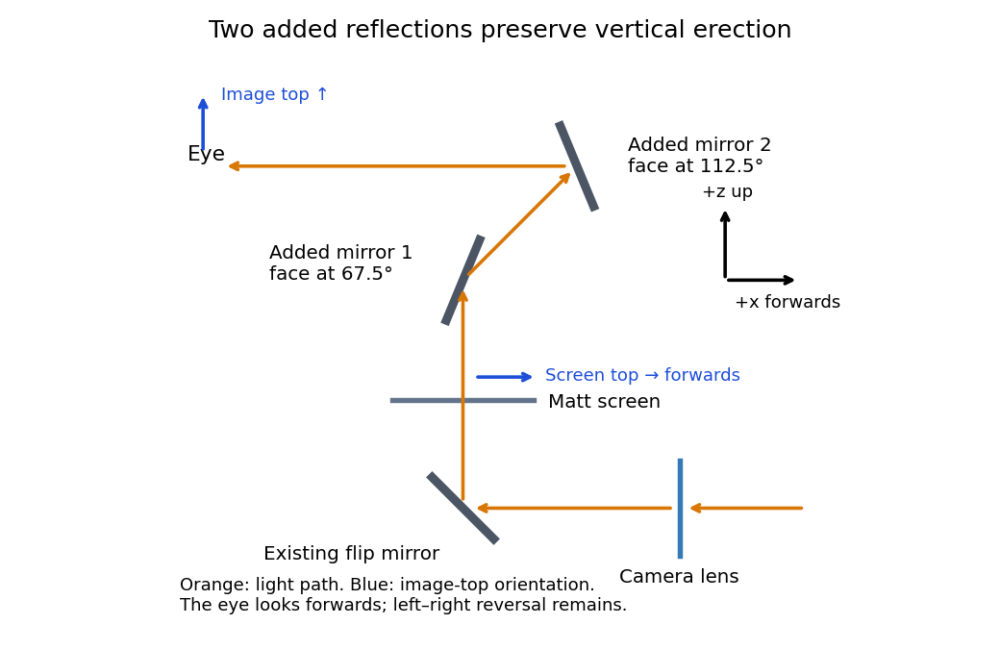

<h1 id="2/c/solution">Solution</h1>

↑ **Parent:** [C](../c.md)

The minimum is **two additional [plane mirrors](../../../../plane-mirror.md)**, making three including the flip [plane mirror](../../../../plane-mirror.md). Their reflecting planes can meet at $45^\circ$ in the vertical section, as in a [pentaprism](../../../../pentaprism.md). For example, in the $xz$ section take the first added reflecting plane at $67.5^\circ$ to $+x$ and the second at $112.5^\circ$. The upward beam first travels diagonally forwards and upwards, then horizontally backwards towards an eye looking forwards. The two [reflections](../../../../reflection-mathematics.md) together rotate directions through $90^\circ$: the propagation direction $+z$ becomes $-x$, while the screen's top direction $+x$ becomes $+z$ at the eye. Thus the picture remains upright vertically.

One additional [plane mirror](../../../../plane-mirror.md) would also send $+z$ into $-x$, but it would send the top direction $+x$ into $-z$, making the image upside down. This proves minimality for ordinary [plane mirrors](../../../../plane-mirror.md). The three-[reflection](../../../../reflection-mathematics.md) arrangement still reverses left and right; correcting that additionally requires a roof arrangement or another suitable image-erecting system. Vertical erection alone is what is asked here.

**[Figure 1](#2/c/image-an-original-vertical-section-ray-construction-with-the-minimum-two-added-plane-mirrors). An original vertical-section ray construction with the minimum two added plane mirrors**.

## ↑ Ancestors (12)

1. [C](../c.md)
2. [2](../../2.md)
3. [2021 resit](../../../2021-resit-split.md)
4. [Past exam of the physics 2 paper of the University of Oxford](../../../split.md)
5. [Physics 2 paper of the University of Oxford](../../../../physics-2-paper-of-the-university-of-oxford.md)
6. [Year 1 of the physics course of the University of Oxford](../../../../year-1-of-the-physics-course-of-the-university-of-oxford.md)
7. [Physics course of the University of Oxford](../../../../physics-course-of-the-university-of-oxford.md)
8. [Undergraduate course of the University of Oxford](../../../../undergraduate-course-of-the-university-of-oxford.md)
9. [Course of the University of Oxford](../../../../course-of-the-university-of-oxford.md)
10. [University of Oxford](../../../../university-of-oxford-split.md)
11. [List of universities](../../../../list-of-universities.md)
12. [Codex Wiki](../../../../split.md)
