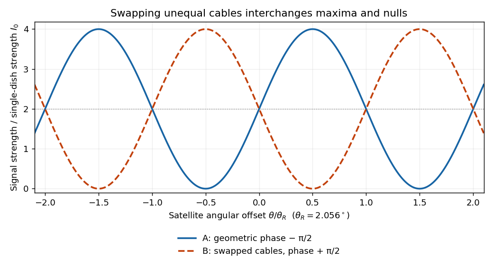

<h1 id="7/e/solution">Solution</h1>

↑ **Parent:** [E](../e.md)

The signal [phase velocity](../../../../phase-velocity.md) in the coaxial cables is $v_c=c/2$, so the guided [wavelength](../../../../wavelength.md) is $\lambda_c=v_c/f=12.5\,\mathrm{mm}$. The excess cable [length](../../../../length.md) is $\Delta\ell=3.125\,\mathrm{mm}=\lambda_c/4$, adding a relative delay of $20.83\,\mathrm{ps}$ and a relative [wave phase](../../../../phase-waves.md) of magnitude

$$
\delta_c=2\pi\frac{\Delta\ell}{\lambda_c}=\frac\pi2.
$$

Label the two inputs so that the first configuration has total [phase difference](../../../../phase-difference.md) $\phi-\pi/2$, where $\phi=2\pi b\sin\theta/\lambda$ is the geometric [phase difference](../../../../phase-difference.md). Swapping the unequal cables reverses that added [wave phase](../../../../phase-waves.md), giving $\phi+\pi/2$. For the same single-source received [wave intensity](../../../../intensity-physics.md) $I_0$ in each arm,

$$
\boxed{I_A(\theta)=2I_0[1+\sin\phi(\theta)],\qquad
I_B(\theta)=2I_0[1-\sin\phi(\theta)].}
$$

The two [interference](../../../../interference-wave-propagation.md) patterns are shifted by half a fringe: maxima in one are nulls in the other. At broadside $\phi=0$ both give $2I_0$, so swapping does not change the strength of every possible source. For small [angles](../../../../angle.md), the maximum-to-maximum shift is $\lambda/(2b)\simeq\theta_R=2.056^\circ$ with the chosen baseline. Near broadside, the maxima of configuration A occur near $\theta=+\theta_R/2$ and those of B near $\theta=-\theta_R/2$; the signs are exchanged if the input labels are reversed. Independent satellites contribute separately according to these directional gains; their mutually uncorrelated signals should not be added as coherent [amplitudes](../../../../wave-amplitude.md).

**[Figure 2](#7/e/image-calculated-complementary-two-dish-signal-strengths-before-and-after-swapping-quarter-wavelength-delay-cables). Calculated complementary two-dish signal strengths before and after swapping quarter-wavelength-delay cables**.

## ↑ Ancestors (12)

1. [E](../e.md)
2. [7](../../7.md)
3. [2021 resit](../../../2021-resit-split.md)
4. [Past exam of the physics 2 paper of the University of Oxford](../../../split.md)
5. [Physics 2 paper of the University of Oxford](../../../../physics-2-paper-of-the-university-of-oxford.md)
6. [Year 1 of the physics course of the University of Oxford](../../../../year-1-of-the-physics-course-of-the-university-of-oxford.md)
7. [Physics course of the University of Oxford](../../../../physics-course-of-the-university-of-oxford.md)
8. [Undergraduate course of the University of Oxford](../../../../undergraduate-course-of-the-university-of-oxford.md)
9. [Course of the University of Oxford](../../../../course-of-the-university-of-oxford.md)
10. [University of Oxford](../../../../university-of-oxford-split.md)
11. [List of universities](../../../../list-of-universities.md)
12. [Codex Wiki](../../../../split.md)
