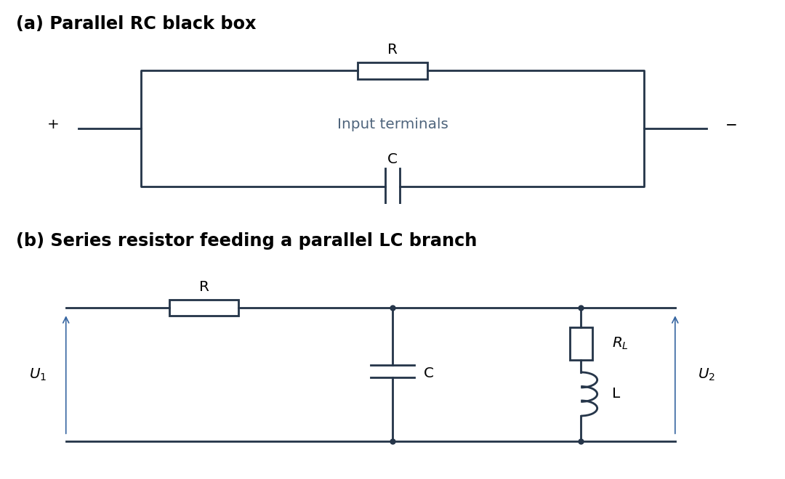
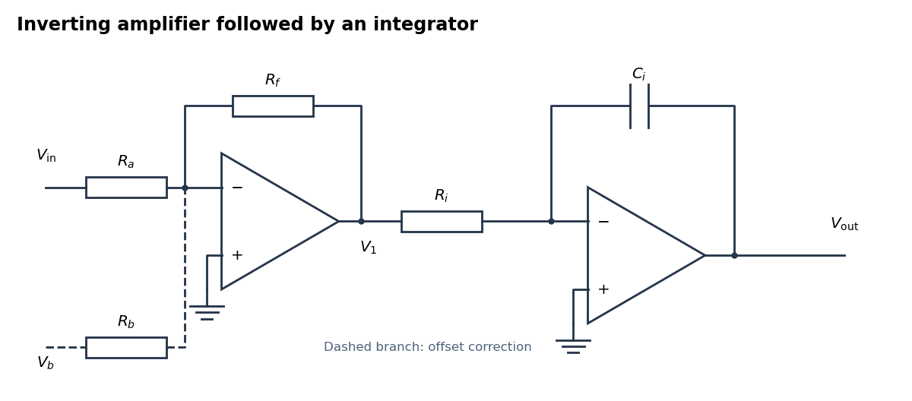
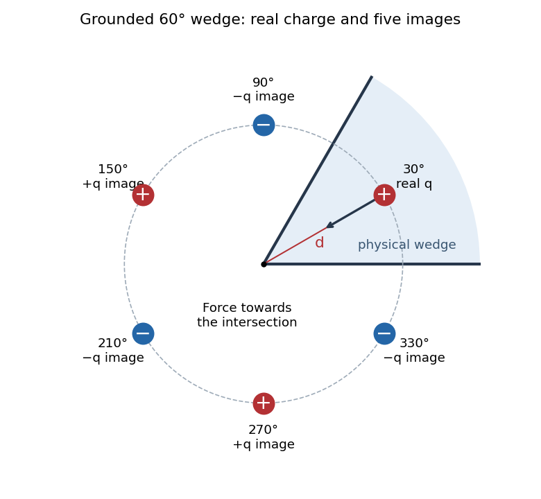
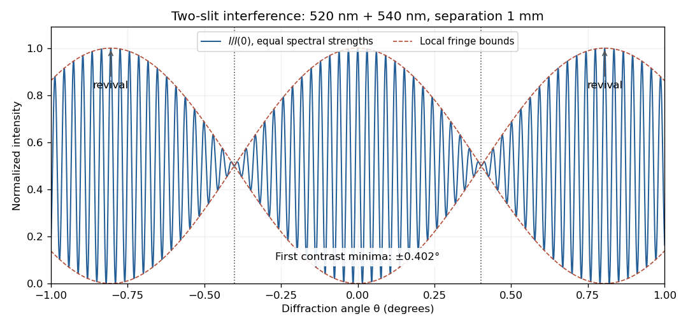

# 2021

↑ **Parent:** [Past exam of the physics 2 paper of the University of Oxford](../past-exam-of-the-physics-2-paper-of-the-university-of-oxford.md)

Source paper: [https://www.whatdotheyknow.com/request/oxford_physics_past_papers_2/response/2340696/attach/9/Physics%20Papers%202020.pdf?cookie_passthrough=1](https://www.whatdotheyknow.com/request/oxford_physics_past_papers_2/response/2340696/attach/9/Physics%20Papers%202020.pdf?cookie_passthrough=1)

The cover dates this ordinary sitting to 8 June 2021; the public bundle's filename does not identify the sitting year. Unlettered, separately marked answer blocks below are labelled a, b, and so on for navigation.

**Table of contents**

- [1](#1)
  - [a](#1/a)
    - [Solution](#1/a/solution)
  - [b](#1/b)
    - [Solution](#1/b/solution)
- [2](#2)
  - [a](#2/a)
    - [Solution](#2/a/solution)
  - [b](#2/b)
    - [Solution](#2/b/solution)
- [3](#3)
  - [a](#3/a)
    - [Solution](#3/a/solution)
  - [b](#3/b)
    - [Solution](#3/b/solution)
- [4](#4)
  - [a](#4/a)
    - [Solution](#4/a/solution)
  - [b](#4/b)
    - [Solution](#4/b/solution)
- [5](#5)
  - [a](#5/a)
    - [Solution](#5/a/solution)
  - [b](#5/b)
    - [Solution](#5/b/solution)
- [6](#6)
  - [Solution](#6/solution)
- [7](#7)
  - [a](#7/a)
    - [Solution](#7/a/solution)
  - [b](#7/b)
    - [Solution](#7/b/solution)
- [8](#8)
  - [a](#8/a)
    - [Solution](#8/a/solution)
  - [b](#8/b)
    - [Solution](#8/b/solution)
  - [c](#8/c)
    - [Solution](#8/c/solution)
- [9](#9)
  - [a](#9/a)
    - [Solution](#9/a/solution)
  - [b](#9/b)
    - [Solution](#9/b/solution)
  - [c](#9/c)
    - [Solution](#9/c/solution)
  - [d](#9/d)
    - [Solution](#9/d/solution)
- [10](#10)
  - [a](#10/a)
    - [Solution](#10/a/solution)
  - [b](#10/b)
    - [Solution](#10/b/solution)
  - [c](#10/c)
    - [Solution](#10/c/solution)
  - [d](#10/d)
    - [Solution](#10/d/solution)
- [11](#11)
  - [a](#11/a)
    - [Solution](#11/a/solution)
  - [b](#11/b)
    - [Solution](#11/b/solution)
  - [c](#11/c)
    - [Solution](#11/c/solution)
  - [d](#11/d)
    - [Solution](#11/d/solution)
  - [e](#11/e)
    - [Solution](#11/e/solution)

## 1

↑ **Parent:** [2021](2021.md)

<h3 id="1/a">a</h3>

↑ **Parent:** [1](#1)

<h4 id="1/a/solution">Solution</h4>

↑ **Parent:** [A](#1/a)

Write $k=1/(4\pi\epsilon_0)$. The separation of the two [point charges](../electric-field.md#point-charge) is $2l\sin\phi$, so [Coulomb's law](../electrostatics.md#coulomb-s-law) gives the horizontal repulsive [force](../force.md) $F=kQ^2/(4l^2\sin^2\phi)$. Resolving the rod's [tension](../force.md#tension) vertically and horizontally gives $T\cos\phi=mg$ and $T\sin\phi=F$. Hence

$$
\boxed{\sin^2\phi\tan\phi=\frac{Q^2}{16\pi\epsilon_0mgl^2}.}
$$

The left side increases from zero to infinity for $0<\phi<\pi/2$, so this determines a unique outward [equilibrium](../dynamical-systems.md#equilibrium-point-of-a-dynamical-system). For a small angle, $\phi^3\simeq Q^2/(16\pi\epsilon_0mgl^2)$. With $g=9.81\,\mathrm{m\,s^{-2}}$, direct numerical solution gives

$$
\boxed{\phi=7.71\times10^{-3}\,\mathrm{rad}=0.442^\circ.}
$$

<h3 id="1/b">b</h3>

↑ **Parent:** [1](#1)

<h4 id="1/b/solution">Solution</h4>

↑ **Parent:** [B](#1/b)

A large [electrical conductor](../electric-charge.md#electrical-conductor) between the [point charges](../electric-field.md#point-charge) provides [electrostatic shielding](../electrostatics.md#electrostatic-shielding): one must not retain their original mutual [Coulomb force](../electrostatics.md#coulomb-force) through an ideal infinite plate. In the usual broad-plate approximation, let $\sigma$ denote the unperturbed [surface charge density](../electrostatics.md#surface-charge-density) **on each face**. The [electrostatic boundary condition](../electrostatics.md#electrostatic-boundary-conditions-at-a-conductor) gives an outward [electric field](../electric-field.md) $E_0=\sigma/\epsilon_0$. Neglecting local [electrostatic induction](../electric-charge.md#electrostatic-induction), the rod's [tension](../force.md#tension) then satisfies $mg\tan\phi=QE_0$, giving

$$
\boxed{\phi\simeq\tan^{-1}\!\left(\frac{Q\sigma}{\epsilon_0mg}\right)=1.98^\circ.}
$$

There are two physical qualifications. First, if $\sigma$ means the **total charge per projected plate area**, shared equally between the two faces, then $E_0=\sigma/(2\epsilon_0)$ and the same approximation gives $\phi\simeq0.989^\circ$. The factor of two is a convention about the specified [surface charge density](../electrostatics.md#surface-charge-density), not a different [Gauss's law](../maxwell-equations.md#gauss-s-law).

Second, a [point charge](../electric-field.md#point-charge) near an [electrical conductor](../electric-charge.md#electrical-conductor) makes its [surface charge density](../electrostatics.md#surface-charge-density) nonuniform. For an infinite plane with prescribed background [electric field](../electric-field.md) $E_0$, the [method of images](../mathematics.md#method-of-images) adds an attractive [force](../force.md) $kQ^2/(4x^2)$, where $x=l\sin\phi$. The more accurate [equilibrium](../dynamical-systems.md#equilibrium-point-of-a-dynamical-system) equation is

$$
mg\tan\phi=QE_0-\frac{Q^2}{16\pi\epsilon_0l^2\sin^2\phi}.
$$

Its larger, stable root is approximately $1.96^\circ$ for the per-face convention, or $0.877^\circ$ for the total-area convention. This ideal-plane refinement is not an exact answer for an unspecified finite plate: its dimensions and the meaning of the quoted [surface charge density](../electrostatics.md#surface-charge-density) would be needed. In particular, adding a uniform-sheet [electric field](../electric-field.md) to the original mutual repulsion would describe a different, nonshielding model.

## 2

↑ **Parent:** [2021](2021.md)

<h3 id="2/a">a</h3>

↑ **Parent:** [2](#2)

<h4 id="2/a/solution">Solution</h4>

↑ **Parent:** [A](#2/a)

At [direct current](../electric-charge.md#direct-current) an ideal [capacitor](../electromagnetism.md#capacitor) is an [open circuit](../electrical-circuit.md#open-circuit). A finite measured [electrical resistance](../electric-charge.md#electrical-resistance) therefore requires the [resistor](../electric-charge.md#resistor) and [capacitor](../electromagnetism.md#capacitor) to form a [parallel circuit](../electrical-circuit.md#parallel-circuit), with $R=100\,\Omega$. Use [phasors](../wave.md#phasor) proportional to $e^{i\omega t}$. The [electrical admittance](../electrical-circuit.md#electrical-admittance) and [complex impedance](../electrical-circuit.md#electrical-impedance) are

$$
Y=\frac1R+i\omega C,\qquad Z=\frac{R}{1+i\omega RC},\qquad |Z|=\frac{R}{\sqrt{1+(\omega RC)^2}}.
$$

Interpreting the stated AC value as the measured [impedance magnitude](../electrical-circuit.md#impedance-magnitude), $\omega=2\pi(50)\,\mathrm{s^{-1}}$ and $|Z|=20\,\Omega$ give $\omega RC=\sqrt{24}$. Thus

$$
\boxed{R=100\,\Omega,\quad C=1.56\times10^{-4}\,\mathrm F,\quad Z(50\,\mathrm{Hz})=(4.00-19.60i)\,\Omega.}
$$

The [electric current](../electric-charge.md#electric-current) leads the applied [voltage](../random-walk.md#voltage) by $\tan^{-1}\sqrt{24}=78.46^\circ$. Strictly, AC “resistance” is ambiguous: if it means $\operatorname{Re}Z=20\,\Omega$, the same [parallel circuit](../electrical-circuit.md#parallel-circuit) instead gives $\omega RC=2$, $C=63.7\,\mu\mathrm F$, and $Z=20-40i\,\Omega$. A measurement of $|V|/|I|$ selects the boxed interpretation.

**[Figure 1](#2/a/image-parallel-rc-network-and-resonant-voltage-divider). Parallel RC network and resonant voltage divider**.

<h3 id="2/b">b</h3>

↑ **Parent:** [2](#2)

<h4 id="2/b/solution">Solution</h4>

↑ **Parent:** [B](#2/b)

A suitable [electrical circuit](../electrical-circuit.md) has $R$ in series with the input and a shunt branch consisting of $C$ in parallel with the lossy [inductor](../electromagnetism.md#inductor) $R_L+i\omega L$; take the output [voltage](../random-walk.md#voltage) across that shunt branch. This is the middle arrangement in the circuit figure. In terms of its [complex impedance](../electrical-circuit.md#electrical-impedance),

$$
Z_p=\left(i\omega C+\frac1{R_L+i\omega L}\right)^{-1},\qquad H(\omega)=\frac{U_2}{U_1}=\frac{Z_p}{R+Z_p}.
$$

At [direct current](../electric-charge.md#direct-current) the [capacitor](../electromagnetism.md#capacitor) is an [open circuit](../electrical-circuit.md#open-circuit) and the [inductor](../electromagnetism.md#inductor) contributes only $R_L$, so $H(0)=R_L/(R+R_L)=0.01$. Therefore

$$
\boxed{R=99\,\Omega.}
$$

When $R_L$ is neglected, $Z_p=i\omega L/(1-\omega^2LC)$. At the [antiresonance](../electrical-engineering.md#antiresonance) $\omega_0^2LC=1$ its [electrical admittance](../electrical-circuit.md#electrical-admittance) vanishes, so $|H|$ reaches its maximum value of one. Consequently

$$
\boxed{C=\frac1{L\omega_0^2}=1.78\times10^{-3}\,\mathrm F.}
$$

This value uses precisely the requested lossless approximation; keeping $R_L$ changes both the peak position and its height. A [transfer function](../control-theory.md#transfer-function) peak and one DC measurement do not uniquely identify every possible [two-port network](../electrical-circuit.md#two-port-network), but the displayed arrangement meets both observations to the stipulated approximation. Also, the angle brackets in the source must denote AC [wave amplitudes](../wave.md#wave-amplitude) or [root mean square](../analysis.md#root-mean-square) values: the literal time averages of sinusoidal [voltages](../random-walk.md#voltage) are zero, whose ratio would be undefined.

## 3

↑ **Parent:** [2021](2021.md)

<h3 id="3/a">a</h3>

↑ **Parent:** [3](#3)

<h4 id="3/a/solution">Solution</h4>

↑ **Parent:** [A](#3/a)

In [vacuum](../physics.md#vacuum), [Maxwell's equations](../maxwell-equations.md) in differential form are

$$
\nabla\cdot\mathbf E=\frac{\rho}{\epsilon_0},\qquad \nabla\cdot\mathbf B=0,\qquad
\nabla\times\mathbf E=-\frac{\partial\mathbf B}{\partial t},\qquad
\nabla\times\mathbf B=\mu_0\mathbf J+\mu_0\epsilon_0\frac{\partial\mathbf E}{\partial t}.
$$

Here $\rho$ is [charge density](../electric-charge.md#charge-density), $\mathbf J$ is [electric current density](../electric-charge.md#current-density), $\mathbf E$ is [electric field](../electric-field.md), and $\mathbf B$ is [magnetic flux density](../magnetic-field.md). In a source-free region, taking the [curl](../multivariable-calculus.md#curl) of the third equation and using $\nabla\times(\nabla\times\mathbf E)=\nabla(\nabla\cdot\mathbf E)-\nabla^2\mathbf E$ gives the [wave equation](../wave-equation.md)

$$
\nabla^2\mathbf E=\mu_0\epsilon_0\frac{\partial^2\mathbf E}{\partial t^2}.
$$

The same argument gives the [wave equation](../wave-equation.md) for $\mathbf B$. A concrete family satisfying all four [Maxwell's equations](../maxwell-equations.md) is

$$
\mathbf E=\widehat{\mathbf x}F(z-ct),\qquad \mathbf B=\frac{\widehat{\mathbf y}}{c}F(z-ct),\qquad
\boxed{c=\frac1{\sqrt{\mu_0\epsilon_0}}.}
$$

The function $F$ may be any twice differentiable profile. These are transverse [travelling waves](../analysis.md#travelling-wave); reverse the [magnetic field](../magnetic-field.md) direction for propagation in the opposite direction. Because the source-free [Maxwell's equations](../maxwell-equations.md) are homogeneous [linear differential equations](../differential-equation.md#linear-differential-equation), any finite [linear combination](../vector-space.md#linear-combination) of such paired [electric fields](../electric-field.md) and [magnetic fields](../magnetic-field.md) is again a solution. Infinite [superpositions](../vector-space.md#superposition-principle) also work whenever the required derivatives converge. A solution of the component [wave equations](../wave-equation.md) alone must still satisfy the divergence and mutual-curl constraints.

<h3 id="3/b">b</h3>

↑ **Parent:** [3](#3)

<h4 id="3/b/solution">Solution</h4>

↑ **Parent:** [B](#3/b)

For a [plane electromagnetic wave](../electromagnetic-wave.md#plane-electromagnetic-wave) with [linear polarization](../electromagnetic-wave.md#linear-polarization), write $\mathbf E=E_0\widehat{\mathbf x}\cos(kz-\omega t)$ and $\mathbf H=E_0\widehat{\mathbf y}\cos(kz-\omega t)/(\mu_0c)$. The [Poynting vector](../electromagnetic-wave.md#poynting-vector) is instantaneous [energy](../energy.md) flux:

$$
\mathbf S=\frac{E_0^2}{\mu_0c}\cos^2(kz-\omega t)\widehat{\mathbf z}.
$$

The [light intensity](../wave.md#light-intensity) is its cycle average, not its peak:

$$
\boxed{I=\langle|\mathbf S|\rangle=\frac{E_0^2}{2\mu_0c}=\frac12\epsilon_0cE_0^2.}
$$

An incident [electromagnetic wave](../electromagnetic-wave.md) transports longitudinal [momentum](../momentum.md) $\mathcal E/c$ per [energy](../energy.md) $\mathcal E$. Perfect reflection back along the incident direction reverses that [momentum](../momentum.md), transferring $2\mathcal E/c$ to the mirror. Dividing by illuminated [area](../differential-geometry.md#surface-area) and time gives the mean [radiation pressure](../pressure.md#radiation-pressure)

$$
\boxed{p=\frac{2I}{c}=\frac{2\langle|\mathbf S|\rangle}{c}.}
$$

Here $\mathbf S$ denotes the **incident travelling wave**. The average net [Poynting vector](../electromagnetic-wave.md#poynting-vector) of the incident-plus-reflected [standing wave](../mathematical-physics.md#standing-wave) is zero, although its [radiation pressure](../pressure.md#radiation-pressure) is nonzero.

## 4

↑ **Parent:** [2021](2021.md)

<h3 id="4/a">a</h3>

↑ **Parent:** [4](#4)

<h4 id="4/a/solution">Solution</h4>

↑ **Parent:** [A](#4/a)

Use positive real object and image distances $u,v$ for a [thin lens](../geometrical-optics.md#thin-lens). The required absolute [magnification](../optics.md#magnification) is $M=1000/15=200/3$, and the specified LCD-to-screen separation gives $u+v=2000\,\mathrm{mm}$, not $v=2000\,\mathrm{mm}$. Since $v/u=M$,

$$
u=\frac{2000}{1+200/3}=29.5567\,\mathrm{mm},\qquad v=1970.4433\,\mathrm{mm}.
$$

The [thin lens](../geometrical-optics.md#thin-lens) equation yields

$$
\boxed{f=\frac{uv}{u+v}=29.1198\,\mathrm{mm}.}
$$

Place the projection [lens](../geometrical-optics.md#lens-optics) $29.56\,\mathrm{mm}$ beyond the LCD towards the screen. Its real image is inverted; the signed [magnification](../optics.md#magnification) is $-200/3$.

<h3 id="4/b">b</h3>

↑ **Parent:** [4](#4)

<h4 id="4/b/solution">Solution</h4>

↑ **Parent:** [B](#4/b)

The [condenser lens](../optics.md#condenser-lens) should image the point source onto the small projection [lens](../geometrical-optics.md#lens-optics). Then every illuminated LCD point directs its central [light ray](../geometrical-optics.md#light-ray) into the projection [lens](../geometrical-optics.md#lens-optics), rather than wasting light elsewhere. In the paraxial idealization this gives approximately uniform useful illumination.

Put the LCD at $z=0$, the source at $z=-100\,\mathrm{mm}$, the projection [lens](../geometrical-optics.md#lens-optics) at $z=u=29.5567\,\mathrm{mm}$, and the [condenser lens](../optics.md#condenser-lens) at $z=-h$. The cone from the [condenser lens](../optics.md#condenser-lens)'s rim, of radius $15\,\mathrm{mm}$, to the projection [lens](../geometrical-optics.md#lens-optics) has radius

$$
r_{\rm LCD}=15\frac{u}{u+h}\,\mathrm{mm}
$$

at the LCD. Maximum approximately uniform illumination without unnecessary overfilling makes this equal the half-diagonal $7.5\,\mathrm{mm}$. Thus $h=u$: place the [condenser lens](../optics.md#condenser-lens) $29.56\,\mathrm{mm}$ before the LCD, or $70.44\,\mathrm{mm}$ after the source. Its object and image distances are $100-h$ and $u+h$, so

$$
\boxed{f_c=\frac{(100-h)(u+h)}{100+u}=32.14\,\mathrm{mm}.}
$$

The illuminated disk just contains the rectangular LCD. Exact spatially uniform [irradiance](../radiometry.md#irradiance) is not guaranteed by a single spherical [lens](../geometrical-optics.md#lens-optics) and a point source; the result uses paraxial [geometrical optics](../geometrical-optics.md), negligible [optical aberration](../geometrical-optics.md#optical-aberration), and an approximately uniform incident cone.

## 5

↑ **Parent:** [2021](2021.md)

<h3 id="5/a">a</h3>

↑ **Parent:** [5](#5)

<h4 id="5/a/solution">Solution</h4>

↑ **Parent:** [A](#5/a)

**[Figure 2](#5/a/image-an-inverting-amplifier-followed-by-an-integrator-with-an-optional-offset-correction-branch). An inverting amplifier followed by an integrator, with an optional offset-correction branch**.

Use the following arrangement: an [inverting operational amplifier](../electrical-circuit.md#inverting-operational-amplifier) with input [resistor](../electric-charge.md#resistor) $R_a$ and feedback [resistor](../electric-charge.md#resistor) $R_f$, followed by an [op amp integrator](../electrical-circuit.md#op-amp-integrator) with input [resistor](../electric-charge.md#resistor) $R_i$ and feedback [capacitor](../electromagnetism.md#capacitor) $C_i$. Ground both non-inverting inputs. Each [ideal operational amplifier](../electrical-circuit.md#ideal-operational-amplifier) has infinite [input impedance](../electrical-circuit.md#input-impedance), so its inputs draw no [electric current](../electric-charge.md#electric-current); [negative feedback](../signal-transduction.md#negative-feedback) makes the inverting input a [virtual ground](../electrical-circuit.md#virtual-ground).

[Kirchhoff's current law](../random-walk.md#kirchhoff-node-law) at the first summing junction gives $V_1=-(R_f/R_a)V_{\rm in}$. At the second summing junction it gives $V_1/R_i+C_i\,dV_{\rm out}/dt=0$. Consequently the two inversions cancel:

$$
\boxed{V_{\rm out}(t)=V_{\rm out}(t_0)+\frac{R_f}{R_aR_iC_i}\int_{t_0}^t V_{\rm in}(t')\,dt'.}
$$

The initial output [voltage](../random-walk.md#voltage) records the initial [capacitor](../electromagnetism.md#capacitor) charge. A reset switch across $C_i$ sets it to zero. The formula holds while both stages remain within their supply rails; a persistent input [voltage](../random-walk.md#voltage) otherwise produces [amplifier saturation](../electrical-circuit.md#amplifier-saturation).

<h3 id="5/b">b</h3>

↑ **Parent:** [5](#5)

<h4 id="5/b/solution">Solution</h4>

↑ **Parent:** [B](#5/b)

Write $V_{\rm in}=v(t)+V_{\rm off}$, with constant unwanted offset $V_{\rm off}$. Add an adjustable reference [voltage](../random-walk.md#voltage) $V_b$ through another [resistor](../electric-charge.md#resistor) $R_b$ to the **first** inverting summing junction, as the dashed branch in the circuit figure shows. [Kirchhoff's current law](../random-walk.md#kirchhoff-node-law) now gives

$$
V_1=-R_f\left(\frac{V_{\rm in}}{R_a}+\frac{V_b}{R_b}\right).
$$

Choose the reference polarity and magnitude so that

$$
\boxed{\frac{V_b}{R_b}=-\frac{V_{\rm off}}{R_a}.}
$$

A potentiometer between positive and negative reference supplies permits either sign. The first stage then has zero output [voltage](../random-walk.md#voltage) when $v=0$, and the [op amp integrator](../electrical-circuit.md#op-amp-integrator) integrates only $v(t)$:

$$
\boxed{V_{\rm out}(t)=V_{\rm out}(t_0)+\frac{R_f}{R_aR_iC_i}\int_{t_0}^t v(t')\,dt'.}
$$

Merely placing a large [resistor](../electric-charge.md#resistor) across the integrating [capacitor](../electromagnetism.md#capacitor) limits drift but also changes the [transfer function](../control-theory.md#transfer-function); cancellation at the summing junction preserves ideal integration of the desired signal.

## 6

↑ **Parent:** [2021](2021.md)

<h3 id="6/solution">Solution</h3>

↑ **Parent:** [6](#6)

Neglect the entrance and exit [capacitor fringing fields](../electromagnetism.md#fringing-field-of-a-capacitor) and use the coaxial [electric field](../electric-field.md) between the cylindrical plates. Let $U=V(R_1)-V(R_2)$, with $R_2>R_1$. The radial [electric field](../electric-field.md) is

$$
E_r(r)=\frac{U}{r\ln(R_2/R_1)}.
$$

For an [electron](../physics.md#electron), of [electric charge](../electric-charge.md) $-e$, to follow the circular path $R=(R_1+R_2)/2$, its inward [centripetal force](../classical-mechanics.md#centripetal-force) must be $m_ev_0^2/R$. Therefore

$$
e\frac{U}{R\ln(R_2/R_1)}=\frac{m_ev_0^2}{R},\qquad
\boxed{U=\frac{m_ev_0^2}{e}\ln\frac{R_2}{R_1}.}
$$

The **inner plate must be at higher [electric potential](../electric-field.md#electric-potential)**: the [electric field](../electric-field.md) points outward and the [electron](../physics.md#electron)'s [electric force](../electric-field.md#electric-force) inward. The [electric force](../electric-field.md#electric-force) is perpendicular to the [velocity](../classical-mechanics.md#velocity), so no [work](../energy.md#work) is done and the speed remains $v_0$. The required [voltage](../random-walk.md#voltage) is independent of the opening angle $\phi$, which only sets the transit time $R\phi/v_0$. For a narrow gap, $\ln(R_2/R_1)\simeq(R_2-R_1)/R$. This is a nonrelativistic, negligible-[capacitor fringing field](../electromagnetism.md#fringing-field-of-a-capacitor) answer; finite open cylindrical sections do not have an exactly radial [electric field](../electric-field.md) at their ends.

## 7

↑ **Parent:** [2021](2021.md)

<h3 id="7/a">a</h3>

↑ **Parent:** [7](#7)

<h4 id="7/a/solution">Solution</h4>

↑ **Parent:** [A](#7/a)

For a uniformly illuminated single slit of width $b$, summing the [wave amplitudes](../wave.md#wave-amplitude) across the slit gives the [Fraunhofer diffraction](../physical-optics.md#fraunhofer-diffraction) profile

$$
I(\theta)=I(0)\left(\frac{\sin\beta}{\beta}\right)^2,\qquad \beta=\frac{\pi b\sin\theta}{\lambda}.
$$

The first minimum occurs at $\sin\theta=\lambda/b$. The [Rayleigh criterion](../point-spread-function.md#rayleigh-criterion) places one source's central maximum at the other source's first minimum; hence the slit gives $\Delta\theta\simeq\lambda/b$. A circular [aperture](../optics.md#aperture) instead produces an [Airy disk](../point-spread-function.md#airy-disk), whose first minimum is at $1.22\lambda/D$. For the camera's circular [lens](../geometrical-optics.md#lens-optics),

$$
\boxed{\Delta\theta=\frac{1.22\lambda}{D}=4.88\times10^{-4}\,\mathrm{rad}=0.0280^\circ\simeq101\text{ arcseconds}.}
$$

The factor $1.22$ belongs to circular-[aperture](../optics.md#aperture) [diffraction](../quantum-scattering.md#diffraction), rather than the single-slit profile.

<h3 id="7/b">b</h3>

↑ **Parent:** [7](#7)

<h4 id="7/b/solution">Solution</h4>

↑ **Parent:** [B](#7/b)

The [Rayleigh criterion](../point-spread-function.md#rayleigh-criterion) gives a separation in the sensor plane $\delta=f\Delta\theta=2.44\,\mu\mathrm m$, using the $5\,\mathrm{mm}$ image distance. Counting one square [pixel](../computer-graphics.md#pixel) per such [spatial resolution element](../point-spread-function.md#spatial-resolution-element) gives

$$
\boxed{N_{\rm Rayleigh}\simeq\frac{(4\,\mathrm{mm})(3\,\mathrm{mm})}{(2.44\,\mu\mathrm m)^2}=2.02\times10^6.}
$$

This is an estimate of the number of optically distinguishable elements. To sample all the spatial information, specify a [signal sampling](../electrical-engineering.md#signal-sampling) criterion as well. For [incoherent imaging](../point-spread-function.md#incoherent-imaging) through an ideal circular [aperture](../optics.md#aperture), the [optical transfer function](../point-spread-function.md#optical-transfer-function) has cutoff spatial frequency $\nu_c=D/(\lambda f)$. The [Nyquist–Shannon sampling theorem](../fourier-analysis.md#nyquist-shannon-sampling-theorem) requires a [pixel](../computer-graphics.md#pixel) pitch

$$
p\leq\frac1{2\nu_c}=\frac{\lambda f}{2D}=1.00\,\mu\mathrm m,
\qquad \boxed{N_{\rm Nyquist}\geq4000\times3000=1.20\times10^7.}
$$

A common intermediate rule, two [pixels](../computer-graphics.md#pixel) per Rayleigh separation, gives about $8.1$ million [pixels](../computer-graphics.md#pixel); it is a heuristic and does not quite sample the full ideal [optical transfer function](../point-spread-function.md#optical-transfer-function) bandwidth. Thus about $2$ million is the elementary [spatial resolution element](../point-spread-function.md#spatial-resolution-element) count, while $12$ million is the ideal monochrome [Nyquist–Shannon sampling theorem](../fourier-analysis.md#nyquist-shannon-sampling-theorem) answer to “full use.” Color-filter layout and finite [pixel](../computer-graphics.md#pixel) area would impose further practical conditions.

## 8

↑ **Parent:** [2021](2021.md)

<h3 id="8/a">a</h3>

↑ **Parent:** [8](#8)

<h4 id="8/a/solution">Solution</h4>

↑ **Parent:** [A](#8/a)

Take the grounded plane as $z=0$. The [method of images](../mathematics.md#method-of-images) replaces it, in $z>0$, by an [image charge](../electric-field.md#image-charge) $-q$ at $z=-d$ and an [image charge](../electric-field.md#image-charge) $+q$ at $z=-2d$. These make the [electric potential](../electric-field.md#electric-potential) zero on the plane; the [uniqueness theorem for the electrostatic potential](../electrostatics.md#uniqueness-theorem-for-the-electrostatic-potential) establishes the solution in the physical half-space.

At $z=3d/2$, both real [point charges](../electric-field.md#point-charge) contribute upward [electric fields](../electric-field.md), each of magnitude $kq/(d/2)^2$. The nearer [image charge](../electric-field.md#image-charge) contributes downward and the farther one upward. Hence

$$
\mathbf E=\frac{kq}{d^2}\left(4+4-\frac4{25}+\frac4{49}\right)\widehat{\mathbf z}
=\boxed{\frac{9704}{1225}\frac{q}{4\pi\epsilon_0d^2}\widehat{\mathbf z}.}
$$

This is upward for $q>0$; retaining signed $q$ automatically handles the opposite sign. No self-[electric field](../electric-field.md) is involved because the evaluation point is distinct from every [point charge](../electric-field.md#point-charge).

<h3 id="8/b">b</h3>

↑ **Parent:** [8](#8)

<h4 id="8/b/solution">Solution</h4>

↑ **Parent:** [B](#8/b)

For [image charges in a sixty-degree conducting wedge](../mathematics.md#image-charges-in-a-sixty-degree-conducting-wedge), use [polar coordinates](../multivariable-calculus.md#polar-coordinates) in a cross-section normal to the planes' intersection, putting the physical wedge at $0<\theta<\pi/3$ and the real [point charge](../electric-field.md#point-charge) at $(r,\theta)=(d,\pi/6)$. Repeated reflection in the two grounded faces produces five [image charges](../electric-field.md#image-charge), all at radius $d$ and the same coordinate along the intersection:

$$
\begin{array}{c|rrrrrr}
\theta&30^\circ&90^\circ&150^\circ&210^\circ&270^\circ&330^\circ\\
\text{charge}&q\ (\text{real})&-q&+q&-q&+q&-q
\end{array}
$$

Equivalently, the positive copies are at $\theta=\pi/6+2k\pi/3$ and the negative copies at $\theta=-\pi/6+2k\pi/3$, for $k=0,1,2$. Only the original [point charge](../electric-field.md#point-charge) lies inside the physical wedge.

**[Figure 3](#8/b/image-five-image-charges-outside-the-physical-sixty-degree-conducting-wedge). Five image charges outside the physical sixty-degree conducting wedge**.

For any observation point on either face, reflection pairs every positive [point charge](../electric-field.md#point-charge) with an equidistant negative one. Their [Coulomb potentials](../electrostatics.md#coulomb-potential-energy) cancel, so both grounded faces have zero [electric potential](../electric-field.md#electric-potential). The [electric potential](../electric-field.md#electric-potential) also tends to zero at infinity. The [uniqueness theorem for the electrostatic potential](../electrostatics.md#uniqueness-theorem-for-the-electrostatic-potential) then identifies this [method of images](../mathematics.md#method-of-images) construction with the physical solution.

<h3 id="8/c">c</h3>

↑ **Parent:** [8](#8)

<h4 id="8/c/solution">Solution</h4>

↑ **Parent:** [C](#8/c)

Let $\widehat{\mathbf e}_r$ point from the intersection to the real [point charge](../electric-field.md#point-charge). Reflection symmetry cancels the component of [electrostatic force](../electric-field.md#electrostatic-force) perpendicular to the wedge bisector. An [image charge](../electric-field.md#image-charge) $q_j$ at angular separation $\Delta$ from the real [point charge](../electric-field.md#point-charge) gives radial [force](../force.md)

$$
F_{r,j}=kqq_j\frac{d(1-\cos\Delta)}{[2d^2(1-\cos\Delta)]^{3/2}}.
$$

The two adjacent negative [image charges](../electric-field.md#image-charge) have $\Delta=\pm60^\circ$, distance $d$, and combined radial [force](../force.md) $-kq^2/d^2$. The two positive [image charges](../electric-field.md#image-charge) have $\Delta=\pm120^\circ$, distance $\sqrt3d$, and combined radial [force](../force.md) $+kq^2/(\sqrt3d^2)$. The opposite negative [image charge](../electric-field.md#image-charge) is at distance $2d$ and contributes $-kq^2/(4d^2)$. Thus

$$
\boxed{\mathbf F=-\frac{q^2}{4\pi\epsilon_0d^2}\left(\frac54-\frac1{\sqrt3}\right)\widehat{\mathbf e}_r.}
$$

The [electrostatic force](../electric-field.md#electrostatic-force) is towards the intersection, independently of the sign of $q$. One sums the five [image charge](../electric-field.md#image-charge) [electric fields](../electric-field.md) and multiplies by $q$; the factor $1/2$ used in induced-charge [electrostatic energy](../electrostatics.md#electrostatic-energy) must not be inserted into this direct [force](../force.md) calculation.

## 9

↑ **Parent:** [2021](2021.md)

<h3 id="9/a">a</h3>

↑ **Parent:** [9](#9)

<h4 id="9/a/solution">Solution</h4>

↑ **Parent:** [A](#9/a)

Let each slit alone give local [light intensity](../wave.md#light-intensity) $I_s$, and assume equal coherent illumination. In [Fraunhofer diffraction](../physical-optics.md#fraunhofer-diffraction), the two [wave amplitudes](../wave.md#wave-amplitude) differ in [wave phase](../wave.md#phase-waves) by $\delta=2\pi s\sin\theta/\lambda$. Adding the [wave amplitudes](../wave.md#wave-amplitude) before squaring gives

$$
I(\theta)=I_s|1+e^{i\delta}|^2=4I_s\cos^2\left(\frac{\pi s\sin\theta}{\lambda}\right).
$$

For a flat screen, $\sin\theta=x/\sqrt{d^2+x^2}$. In the paraxial region $|x|\ll d$, the [double-slit interference](../physical-optics.md#double-slit-interference) profile is therefore

$$
\boxed{I(x)=4I_s\cos^2\left(\frac{\pi sx}{\lambda d}\right),\qquad \Delta x=\frac{\lambda d}{s}.}
$$

The given $d\gg s^2/\lambda$ justifies the far-field expansion. Slit widths have been neglected; a finite width multiplies this profile by the single-slit [diffraction envelope](../physical-optics.md#diffraction-envelope). At large angles the one-slit [light intensity](../wave.md#light-intensity) and geometric spreading must also be retained, rather than treating $I_s$ as constant.

<h3 id="9/b">b</h3>

↑ **Parent:** [9](#9)

<h4 id="9/b/solution">Solution</h4>

↑ **Parent:** [B](#9/b)

The screen now lies in the back [focal plane](../optical-instrument.md#focal-plane) of the [lens](../geometrical-optics.md#lens-optics). In paraxial [geometrical optics](../geometrical-optics.md), a [light ray](../geometrical-optics.md#light-ray) arriving at the [lens](../geometrical-optics.md#lens-optics) at height $y$ and angle $\theta$ leaves at angle $\theta-y/f$, and reaches the screen at

$$
x=y+f(\theta-y/f)=f\theta.
$$

Thus all [light rays](../geometrical-optics.md#light-ray) with the same incident direction reach the same screen coordinate, independently of their height at the [lens](../geometrical-optics.md#lens-optics). The [Fraunhofer diffraction](../physical-optics.md#fraunhofer-diffraction) pattern is an angular pattern mapped to $x=f\theta$:

$$
\boxed{I(x)=4I_{s,f}\cos^2\left(\frac{\pi sx}{\lambda f}\right),\qquad \Delta x=\frac{\lambda f}{s}.}
$$

Here $I_{s,f}$ is the one-slit [light intensity](../wave.md#light-intensity) after focusing. Its absolute value depends on collected light and the [lens](../geometrical-optics.md#lens-optics) [aperture](../optics.md#aperture), which are unspecified; it need not equal the no-[lens](../geometrical-optics.md#lens-optics) value $I_s$. Propagation from the slits to the [lens](../geometrical-optics.md#lens-optics) introduces a common angular [wave phase](../wave.md#phase-waves), so it does not alter the relative [wave phase](../wave.md#phase-waves) responsible for these fringes, provided the [aperture](../optics.md#aperture) passes the required light.

<h3 id="9/c">c</h3>

↑ **Parent:** [9](#9)

<h4 id="9/c/solution">Solution</h4>

↑ **Parent:** [C](#9/c)

The slide adds [optical path length](../physical-optics.md#optical-path-length) $\Delta=(n-1)t=0.5(0.1\,\mathrm{mm})=50\,\mu\mathrm m$ to the covered beam. Put the covered slit at transverse coordinate $+s/2$. For positive screen coordinate $x$ its geometrical path is shorter by approximately $sx/d$, so the total covered-minus-uncovered [optical path difference](../physical-optics.md#optical-path-difference) is

$$
\Delta_{\rm tot}=(n-1)t-\frac{sx}{d}.
$$

The zero-order fringe follows equal total [optical path lengths](../physical-optics.md#optical-path-length), $\Delta_{\rm tot}=0$. Hence

$$
\boxed{x_0=\frac{d(n-1)t}{s}=0.050\,\mathrm m=5.0\,\mathrm{cm},\quad\text{towards the covered slit}.}
$$

The covered beam needs a shorter geometric path to compensate its extra [optical path length](../physical-optics.md#optical-path-length). This is the paraxial estimate; exact point-to-point distances give $x_0\simeq5.006\,\mathrm{cm}$. “Central” here follows the zero-order fringe continuously as the slide is introduced. At one fixed [wavelength](../wave-equation.md#wavelength), the final [monochromatic wave](../wave.md#monochromatic-wave) [interference](../physical-optics.md#interference-wave-propagation) pattern is periodic, so intensity alone identifies a fringe position only modulo the fringe spacing. Slide reflections and absorption have been neglected.

<h3 id="9/d">d</h3>

↑ **Parent:** [9](#9)

<h4 id="9/d/solution">Solution</h4>

↑ **Parent:** [D](#9/d)

The two optical [frequencies](../wave.md#frequency) have no persistent mutual [optical coherence](../physical-optics.md#optical-coherence) over the detector's averaging time, so their [light intensities](../wave.md#light-intensity) add. Assuming equal strengths and using $s=1.0\,\mathrm{mm}$, let $I_s$ be the one-slit [light intensity](../wave.md#light-intensity) at either [wavelength](../wave-equation.md#wavelength). Then

$$
\boxed{I(\theta)=4I_s\left[\cos^2\left(\frac{\pi s\sin\theta}{\lambda_1}\right)+\cos^2\left(\frac{\pi s\sin\theta}{\lambda_2}\right)\right],\quad \lambda_1=520\,\mathrm{nm},\quad\lambda_2=540\,\mathrm{nm}.}
$$

The identity $\cos A+\cos B=2\cos[(A+B)/2]\cos[(A-B)/2]$ rewrites this as

$$
I(\theta)=4I_s\left[1+\cos\left(\pi s\sin\theta\left(\frac1{\lambda_1}+\frac1{\lambda_2}\right)\right)\cos\left(\pi s\sin\theta\left(\frac1{\lambda_1}-\frac1{\lambda_2}\right)\right)\right].
$$

The slowly varying [interferometric visibility](../physical-optics.md#interferometric-visibility) is approximately $\mathcal V=|\cos(\pi s\sin\theta\,[1/\lambda_1-1/\lambda_2])|$. Its first zero occurs at

$$
s\sin\theta_{\rm zero}=\frac{\lambda_1\lambda_2}{2(\lambda_2-\lambda_1)}=7.02\,\mu\mathrm m,
\qquad \theta_{\rm zero}=0.402^\circ.
$$

The rapid fringes have effective [wavelength](../wave-equation.md#wavelength) $\lambda_h=2\lambda_1\lambda_2/(\lambda_1+\lambda_2)=529.81\,\mathrm{nm}$, so the first contrast minimum is at order $7.02\,\mu\mathrm m/\lambda_h=13.25$. Thus the conventional estimate is **about 13 fringes on each side**, before their first washout, plus the central maximum. “Clearly” is not a specified visibility threshold: the last of those fringes already has low contrast.

**[Figure 4](#9/d/image-two-wavelength-interference-its-first-visibility-minima-and-contrast-revival-over-minus-one-to-plus-one-degree). Two-wavelength interference, its first visibility minima, and contrast revival over minus one to plus one degree**.

The fringes do **not** disappear permanently beyond that point. Their contrast revives; the first exact common maximum satisfies $27\lambda_1=26\lambda_2=14.04\,\mu\mathrm m$, at $|\theta|=0.804^\circ$. This is a concrete counterexample to interpreting 13 as a global bound on visible fringes. Unequal spectral strengths would leave nonzero residual contrast at the nominal washout; the plotted equal-strength case is the natural interpretation in the absence of specified strengths.

## 10

↑ **Parent:** [2021](2021.md)

<h3 id="10/a">a</h3>

↑ **Parent:** [10](#10)

<h4 id="10/a/solution">Solution</h4>

↑ **Parent:** [A](#10/a)

With [phasors](../wave.md#phasor) proportional to $e^{i\omega t}$, the [resistor](../electric-charge.md#resistor), [inductor](../electromagnetism.md#inductor), and [capacitor](../electromagnetism.md#capacitor) have [complex impedances](../electrical-circuit.md#electrical-impedance) $R$, $i\omega L$, and $1/(i\omega C)$. In a [series circuit](../electrical-circuit.md#series-circuit) they carry the same [electric current](../electric-charge.md#electric-current), so their [voltage](../random-walk.md#voltage) drops add:

$$
\boxed{Z(\omega)=R+i\left(\omega L-\frac1{\omega C}\right).}
$$

The real part describes [Joule heating](../electric-charge.md#joule-heating); the imaginary part changes sign between capacitive and inductive response, passing through zero at $\omega_0=1/\sqrt{LC}$.

<h3 id="10/b">b</h3>

↑ **Parent:** [10](#10)

<h4 id="10/b/solution">Solution</h4>

↑ **Parent:** [B](#10/b)

The [voltage divider](../electrical-engineering.md#voltage-divider) relation for the [capacitor](../electromagnetism.md#capacitor) output gives the [transfer function](../control-theory.md#transfer-function)

$$
H(\omega)=\frac{V_{\rm out}}{V_{\rm in}}=\frac{1/(i\omega C)}{R+i\omega L+1/(i\omega C)}=\boxed{\frac1{1-\omega^2LC+i\omega RC}.}
$$

Consequently the relative [wave amplitude](../wave.md#wave-amplitude) is

$$
\boxed{|H|=\frac1{\sqrt{(1-\omega^2LC)^2+(\omega RC)^2}}.}
$$

For input $V_0\cos\omega t$, the output is $V_0|H|\cos(\omega t+\phi)$, where the continuous [phase shift](../wave.md#phase-shift) is

$$
\boxed{\phi=-\operatorname{atan2}(\omega RC,\,1-\omega^2LC).}
$$

For positive [frequency](../wave.md#frequency) and $R>0$, this [phase shift](../wave.md#phase-shift) goes from $0$ towards $-\pi$, passing through $-\pi/2$ at $\omega_0$. A one-argument arctangent without a quadrant correction would wrongly predict a positive [phase shift](../wave.md#phase-shift) above $\omega_0$. The [capacitor](../electromagnetism.md#capacitor) follows a slowly varying input [voltage](../random-walk.md#voltage), while its output falls as $1/(\omega^2LC)$ at high [frequency](../wave.md#frequency).

<h3 id="10/c">c</h3>

↑ **Parent:** [10](#10)

<h4 id="10/c/solution">Solution</h4>

↑ **Parent:** [C](#10/c)

At $\omega_0=1/\sqrt{LC}$ the inductive and capacitive [electrical reactances](../electrical-circuit.md#electrical-reactance) cancel, so the [complex impedance](../electrical-circuit.md#electrical-impedance) is $R$ and the [electric current](../electric-charge.md#electric-current) amplitude is $V_0/R$. The [capacitor](../electromagnetism.md#capacitor) [voltage](../random-walk.md#voltage) amplitude is $V_0/(R\omega_0C)$. Thus the specified [quality factor](../dynamical-systems.md#q-factor) is

$$
\boxed{Q=|H(\omega_0)|=\frac1{R\omega_0C}=\frac{\omega_0L}{R}=\frac1R\sqrt{\frac LC}.}
$$

A [capacitor](../electromagnetism.md#capacitor) output exceeding the input [voltage](../random-walk.md#voltage) is consistent with a passive [electrical circuit](../electrical-circuit.md): the [inductor](../electromagnetism.md#inductor) and [capacitor](../electromagnetism.md#capacitor) [voltages](../random-walk.md#voltage) largely cancel in their sum. The expression assumes positive $R$; the ideal undamped limit $R=0$ has no finite steady resonant response.

<h3 id="10/d">d</h3>

↑ **Parent:** [10](#10)

<h4 id="10/d/solution">Solution</h4>

↑ **Parent:** [D](#10/d)

Put $x=\omega/\omega_0$. Maximizing the output [wave amplitude](../wave.md#wave-amplitude) is equivalent to minimizing

$$
D(x)=|H|^{-2}=(1-x^2)^2+\frac{x^2}{Q^2}.
$$

Its derivative is $D'(x)=2x[2x^2-2+Q^{-2}]$. An interior minimum at positive [frequency](../wave.md#frequency) therefore requires $Q>1/\sqrt2$, and occurs at

$$
\boxed{\omega_{\rm res}=\omega_0\sqrt{1-\frac1{2Q^2}},\qquad Q>\frac1{\sqrt2}.}
$$

Indeed $D''(x_{\rm res})=8x_{\rm res}^2>0$, and the peak value is $|H|_{\max}=Q/\sqrt{1-1/(4Q^2)}$. For $0<Q\leq1/\sqrt2$, $D$ increases for $x>0$ and the largest output is the DC value $|H(0)|=1$. At equality the putative peak has reached zero [frequency](../wave.md#frequency); there is no distinct nonzero-[frequency](../wave.md#frequency) [resonance](../dynamical-systems.md#resonance). This threshold concerns [capacitor](../electromagnetism.md#capacitor) [voltage](../random-walk.md#voltage) peaking: the [series RLC circuit](../electrical-circuit.md#series-rlc-circuit)'s [electric current](../electric-charge.md#electric-current) still has its maximum at $\omega_0$ for every positive $R$.

## 11

↑ **Parent:** [2021](2021.md)

<h3 id="11/a">a</h3>

↑ **Parent:** [11](#11)

<h4 id="11/a/solution">Solution</h4>

↑ **Parent:** [A](#11/a)

[Faraday's law of induction](../maxwell-equations.md#faraday-s-law-of-induction) states that the induced [electromotive force](../electric-charge.md#electromotive-force) around an oriented closed circuit equals the negative rate of change of linked [magnetic flux](../magnetic-field.md#magnetic-flux). For a stationary circuit,

$$
\boxed{\mathcal E=\oint\mathbf E\cdot d\boldsymbol\ell=-\frac{d\Phi_B}{dt},\qquad \Phi_B=\int_A\mathbf B\cdot d\mathbf A.}
$$

Here $\mathbf E$ is [electric field](../electric-field.md), $\mathbf B$ is [magnetic flux density](../magnetic-field.md), and the oriented surface $A$ has the circuit as its boundary. For $N$ identical series turns, replace $\Phi_B$ by the total [flux linkage](../electromagnetism.md#magnetic-flux-linkage) $N\Phi_B$. [Lenz's law](../maxwell-equations.md#lenz-s-law) supplies the sign: an induced [electric current](../electric-charge.md#electric-current) opposes the **change** of linked [magnetic flux](../magnetic-field.md#magnetic-flux), in agreement with [conservation of energy](../mathematical-physics.md#conservation-of-energy).

If the wire moves with local [velocity](../classical-mechanics.md#velocity) $\mathbf u$, the more general [electromotive force](../electric-charge.md#electromotive-force) includes the magnetic [Lorentz force](../relativistic-electromagnetism.md#lorentz-force) per unit [electric charge](../electric-charge.md):

$$
\mathcal E=\oint(\mathbf E+\mathbf u\times\mathbf B)\cdot d\boldsymbol\ell=-\frac{d}{dt}\int_{A(t)}\mathbf B\cdot d\mathbf A.
$$

The boundary and surface orientations in both expressions are related by the [right-hand rule](../electromagnetism.md#right-hand-rule).

<h3 id="11/b">b</h3>

↑ **Parent:** [11](#11)

<h4 id="11/b/solution">Solution</h4>

↑ **Parent:** [B](#11/b)

In the [long-solenoid approximation](../magnetic-field.md#long-solenoid-approximation), the internal [magnetic flux density](../magnetic-field.md) is uniform, $B=\mu_0nI$, and the external [magnetic field](../magnetic-field.md) is negligible. This follows from the [magnetostatic Ampère law](../maxwell-equations.md#magnetostatic-ampere-law) applied to a rectangular loop running inside and outside the [solenoid](../magnetic-field.md#solenoid). Its number of turns is $N=nD$ and its cross-sectional [area](../differential-geometry.md#surface-area) is $A=\pi a^2$. Each turn links [magnetic flux](../magnetic-field.md#magnetic-flux) $\Phi_B=BA=\mu_0nI\pi a^2$. Therefore the [flux linkage](../electromagnetism.md#magnetic-flux-linkage) is

$$
\Lambda=N\Phi_B=\mu_0n^2D\pi a^2I.
$$

Using the definition of [self-inductance](../electromagnetism.md#self-inductance), $\Lambda=LI$, gives

$$
\boxed{L=\mu_0n^2\pi a^2D.}
$$

This neglects end leakage and winding thickness and uses [vacuum permeability](../maxwell-equations.md#vacuum-permeability) for the air core.

<h3 id="11/c">c</h3>

↑ **Parent:** [11](#11)

<h4 id="11/c/solution">Solution</h4>

↑ **Parent:** [C](#11/c)

For the imposed [electric current](../electric-charge.md#electric-current) $I=I_0\cos\omega t$, [Faraday's law](../maxwell-equations.md#faraday-s-law-of-induction) gives the self-induced [electromotive force](../electric-charge.md#electromotive-force)

$$
\boxed{\mathcal E_{\rm self}=-L\frac{dI}{dt}=\omega LI_0\sin\omega t.}
$$

The externally applied terminal [voltage](../random-walk.md#voltage), with the [passive sign convention](../electrical-circuit.md#passive-sign-convention), has the opposite sign:

$$
v_L=L\frac{dI}{dt}=-\omega LI_0\sin\omega t.
$$

Thus the terminal [voltage](../random-walk.md#voltage) leads the [electric current](../electric-charge.md#electric-current) by $\pi/2$. The instantaneous input [power](../energy.md#power) is

$$
p=v_LI=-\frac12\omega LI_0^2\sin2\omega t=\frac{d}{dt}\left(\frac12LI^2\right),\qquad \boxed{\langle p\rangle=0.}
$$

An ideal [inductor](../electromagnetism.md#inductor) alternately stores [magnetic energy](../electromagnetic-wave.md#magnetic-energy) and returns it to the source. Real winding [electrical resistance](../electric-charge.md#electrical-resistance) would add mean [Joule heating](../electric-charge.md#joule-heating) $I_0^2R_w/2$; the ideal zero result assumes that loss is neglected.

<h3 id="11/d">d</h3>

↑ **Parent:** [11](#11)

<h4 id="11/d/solution">Solution</h4>

↑ **Parent:** [D](#11/d)

The single secondary turn links the primary [magnetic flux](../magnetic-field.md#magnetic-flux) $\mu_0n\pi a^2I_p$, so its [mutual inductance](../electromagnetism.md#mutual-inductance) with the primary is

$$
M=\mu_0n\pi a^2=\frac{L}{nD}.
$$

Choose positive winding directions so that positive secondary [electric current](../electric-charge.md#electric-current) would reinforce the primary [magnetic flux](../magnetic-field.md#magnetic-flux). [Faraday's law](../maxwell-equations.md#faraday-s-law-of-induction) and [Kirchhoff's voltage law](../random-walk.md#kirchhoff-cycle-law) then give

$$
L_s\frac{dI_s}{dt}+RI_s=-M\frac{dI_p}{dt}=\omega MI_0\sin\omega t.
$$

After the transient proportional to $e^{-Rt/L_s}$ has decayed, put $\alpha=\tan^{-1}(\omega L_s/R)$. The steady [electric current](../electric-charge.md#electric-current) is

$$
\boxed{I_s(t)=\frac{\omega MI_0}{\sqrt{R^2+(\omega L_s)^2}}\sin(\omega t-\alpha).}
$$

Its [wave amplitude](../wave.md#wave-amplitude) is $\omega MI_0/\sqrt{R^2+(\omega L_s)^2}$ and it lags the induced [electromotive force](../electric-charge.md#electromotive-force) by $\alpha$. Relative to the primary $I_0\cos\omega t$, its [phase shift](../wave.md#phase-shift) is $-\pi/2-\alpha$, modulo $2\pi$. Reversing the chosen secondary winding direction adds $\pi$ to this signed [phase shift](../wave.md#phase-shift) and leaves all [power](../energy.md#power) predictions unchanged.

The lamp's mean [Joule heating](../electric-charge.md#joule-heating) is

$$
\boxed{\langle P_R\rangle=\frac12R|I_s|^2=\frac{R\omega^2M^2I_0^2}{2[R^2+(\omega L_s)^2]}.}
$$

For $\omega L_s\ll R$ the response is nearly in phase with the induced [electromotive force](../electric-charge.md#electromotive-force); for $\omega L_s\gg R$ the secondary [electric current](../electric-charge.md#electric-current) nearly opposes the primary [electric current](../electric-charge.md#electric-current) in the stated winding convention.

<h3 id="11/e">e</h3>

↑ **Parent:** [11](#11)

<h4 id="11/e/solution">Solution</h4>

↑ **Parent:** [E](#11/e)

The positive lamp [power](../energy.md#power) comes from extra [work](../energy.md#work) by the primary current source. The secondary [electric current](../electric-charge.md#electric-current) creates a changing [magnetic flux](../magnetic-field.md#magnetic-flux) through the primary, so maintaining the same prescribed primary [electric current](../electric-charge.md#electric-current) requires an additional terminal [voltage](../random-walk.md#voltage). With the preceding winding convention,

$$
v_p=L\frac{dI_p}{dt}+M\frac{dI_s}{dt}.
$$

Using [phasors](../wave.md#phasor), $\widetilde I_s=-i\omega M\widetilde I_p/(R+i\omega L_s)$, hence the primary sees the [complex impedance](../electrical-circuit.md#electrical-impedance)

$$
Z_{\rm in}=i\omega L+\frac{\omega^2M^2}{R+i\omega L_s},\qquad
\operatorname{Re}Z_{\rm in}=\frac{\omega^2M^2R}{R^2+(\omega L_s)^2}>0.
$$

It follows directly that

$$
\boxed{\langle P_{\rm source}\rangle=\tfrac12I_0^2\operatorname{Re}Z_{\rm in}=\langle P_R\rangle.}
$$

This is the [reflected impedance](../electrical-engineering.md#reflected-impedance) of the secondary load. The [self-inductance](../electromagnetism.md#self-inductance) and [mutual inductance](../electromagnetism.md#mutual-inductance) terms exchange stored [magnetic energy](../electromagnetic-wave.md#magnetic-energy), while the lamp dissipates it. Multiplying the two coupled equations from [Kirchhoff's voltage law](../random-walk.md#kirchhoff-cycle-law) by their respective [electric currents](../electric-charge.md#electric-current) also gives the instantaneous [conservation of energy](../mathematical-physics.md#conservation-of-energy) identity

$$
v_pI_p=RI_s^2+\frac{d}{dt}\left(\frac12LI_p^2+MI_pI_s+\frac12L_sI_s^2\right).
$$

The derivative averages to zero in periodic steady state. A fixed primary [current source](../electrical-engineering.md#current-source) supplies the required extra [voltage](../random-walk.md#voltage); a fixed [voltage source](../electrical-engineering.md#voltage-source) would generally change its primary [electric current](../electric-charge.md#electric-current) when the lamp is connected.

## ↑ Ancestors (9)

1. [Past exam of the physics 2 paper of the University of Oxford](../past-exam-of-the-physics-2-paper-of-the-university-of-oxford.md)
2. [Physics 2 paper of the University of Oxford](../university-of-oxford.md#physics-2-paper-of-the-university-of-oxford)
3. [Year 1 of the physics course of the University of Oxford](../university-of-oxford.md#year-1-of-the-physics-course-of-the-university-of-oxford)
4. [Physics course of the University of Oxford](../university-of-oxford.md#physics-course-of-the-university-of-oxford)
5. [Undergraduate course of the University of Oxford](../university-of-oxford.md#undergraduate-course-of-the-university-of-oxford)
6. [Course of the University of Oxford](../university-of-oxford.md#course-of-the-university-of-oxford)
7. [University of Oxford](../university-of-oxford.md)
8. [List of universities](../README.md#list-of-universities)
9. [Codex Wiki](../README.md)
