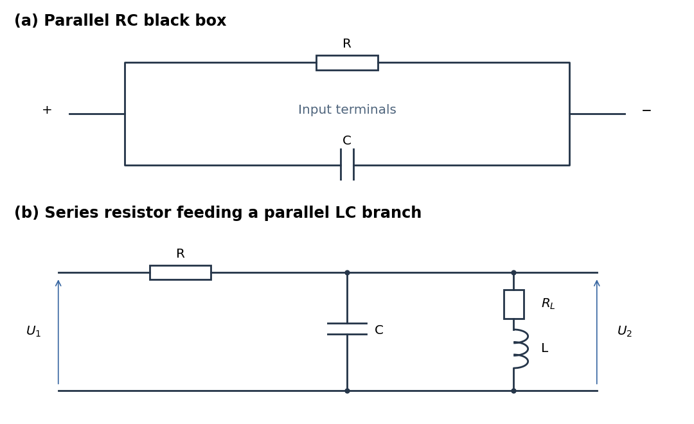

<h1 id="2/a/solution">Solution</h1>

↑ **Parent:** [A](../a.md)

At [direct current](../../../../direct-current.md) an ideal [capacitor](../../../../capacitor.md) is an [open circuit](../../../../open-circuit.md). A finite measured [electrical resistance](../../../../electrical-resistance.md) therefore requires the [resistor](../../../../resistor.md) and [capacitor](../../../../capacitor.md) to form a [parallel circuit](../../../../parallel-circuit.md), with $R=100\,\Omega$. Use [phasors](../../../../phasor.md) proportional to $e^{i\omega t}$. The [electrical admittance](../../../../electrical-admittance.md) and [complex impedance](../../../../electrical-impedance.md) are

$$
Y=\frac1R+i\omega C,\qquad Z=\frac{R}{1+i\omega RC},\qquad |Z|=\frac{R}{\sqrt{1+(\omega RC)^2}}.
$$

Interpreting the stated AC value as the measured [impedance magnitude](../../../../impedance-magnitude.md), $\omega=2\pi(50)\,\mathrm{s^{-1}}$ and $|Z|=20\,\Omega$ give $\omega RC=\sqrt{24}$. Thus

$$
\boxed{R=100\,\Omega,\quad C=1.56\times10^{-4}\,\mathrm F,\quad Z(50\,\mathrm{Hz})=(4.00-19.60i)\,\Omega.}
$$

The [electric current](../../../../electric-current.md) leads the applied [voltage](../../../../voltage.md) by $\tan^{-1}\sqrt{24}=78.46^\circ$. Strictly, AC “resistance” is ambiguous: if it means $\operatorname{Re}Z=20\,\Omega$, the same [parallel circuit](../../../../parallel-circuit.md) instead gives $\omega RC=2$, $C=63.7\,\mu\mathrm F$, and $Z=20-40i\,\Omega$. A measurement of $|V|/|I|$ selects the boxed interpretation.

**[Figure 1](#2/a/image-parallel-rc-network-and-resonant-voltage-divider). Parallel RC network and resonant voltage divider**.

## ↑ Ancestors (12)

1. [A](../a.md)
2. [2](../../2.md)
3. [2021](../../../2021-split.md)
4. [Past exam of the physics 2 paper of the University of Oxford](../../../split.md)
5. [Physics 2 paper of the University of Oxford](../../../../physics-2-paper-of-the-university-of-oxford.md)
6. [Year 1 of the physics course of the University of Oxford](../../../../year-1-of-the-physics-course-of-the-university-of-oxford.md)
7. [Physics course of the University of Oxford](../../../../physics-course-of-the-university-of-oxford.md)
8. [Undergraduate course of the University of Oxford](../../../../undergraduate-course-of-the-university-of-oxford.md)
9. [Course of the University of Oxford](../../../../course-of-the-university-of-oxford.md)
10. [University of Oxford](../../../../university-of-oxford-split.md)
11. [List of universities](../../../../list-of-universities.md)
12. [Codex Wiki](../../../../split.md)
