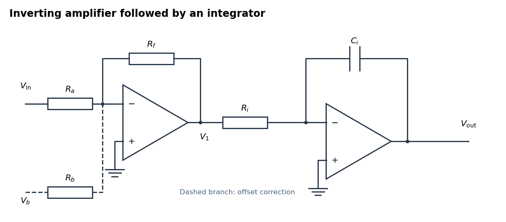

<h1 id="5/a/solution">Solution</h1>

↑ **Parent:** [A](../a.md)

**[Figure 2](#5/a/image-an-inverting-amplifier-followed-by-an-integrator-with-an-optional-offset-correction-branch). An inverting amplifier followed by an integrator, with an optional offset-correction branch**.

Use the following arrangement: an [inverting operational amplifier](../../../../inverting-operational-amplifier.md) with input [resistor](../../../../resistor.md) $R_a$ and feedback [resistor](../../../../resistor.md) $R_f$, followed by an [op amp integrator](../../../../op-amp-integrator.md) with input [resistor](../../../../resistor.md) $R_i$ and feedback [capacitor](../../../../capacitor.md) $C_i$. Ground both non-inverting inputs. Each [ideal operational amplifier](../../../../ideal-operational-amplifier.md) has infinite [input impedance](../../../../input-impedance.md), so its inputs draw no [electric current](../../../../electric-current.md); [negative feedback](../../../../negative-feedback.md) makes the inverting input a [virtual ground](../../../../virtual-ground.md).

[Kirchhoff's current law](../../../../kirchhoff-node-law.md) at the first summing junction gives $V_1=-(R_f/R_a)V_{\rm in}$. At the second summing junction it gives $V_1/R_i+C_i\,dV_{\rm out}/dt=0$. Consequently the two inversions cancel:

$$
\boxed{V_{\rm out}(t)=V_{\rm out}(t_0)+\frac{R_f}{R_aR_iC_i}\int_{t_0}^t V_{\rm in}(t')\,dt'.}
$$

The initial output [voltage](../../../../voltage.md) records the initial [capacitor](../../../../capacitor.md) charge. A reset switch across $C_i$ sets it to zero. The formula holds while both stages remain within their supply rails; a persistent input [voltage](../../../../voltage.md) otherwise produces [amplifier saturation](../../../../amplifier-saturation.md).

## ↑ Ancestors (12)

1. [A](../a.md)
2. [5](../../5.md)
3. [2021](../../../2021-split.md)
4. [Past exam of the physics 2 paper of the University of Oxford](../../../split.md)
5. [Physics 2 paper of the University of Oxford](../../../../physics-2-paper-of-the-university-of-oxford.md)
6. [Year 1 of the physics course of the University of Oxford](../../../../year-1-of-the-physics-course-of-the-university-of-oxford.md)
7. [Physics course of the University of Oxford](../../../../physics-course-of-the-university-of-oxford.md)
8. [Undergraduate course of the University of Oxford](../../../../undergraduate-course-of-the-university-of-oxford.md)
9. [Course of the University of Oxford](../../../../course-of-the-university-of-oxford.md)
10. [University of Oxford](../../../../university-of-oxford-split.md)
11. [List of universities](../../../../list-of-universities.md)
12. [Codex Wiki](../../../../split.md)
