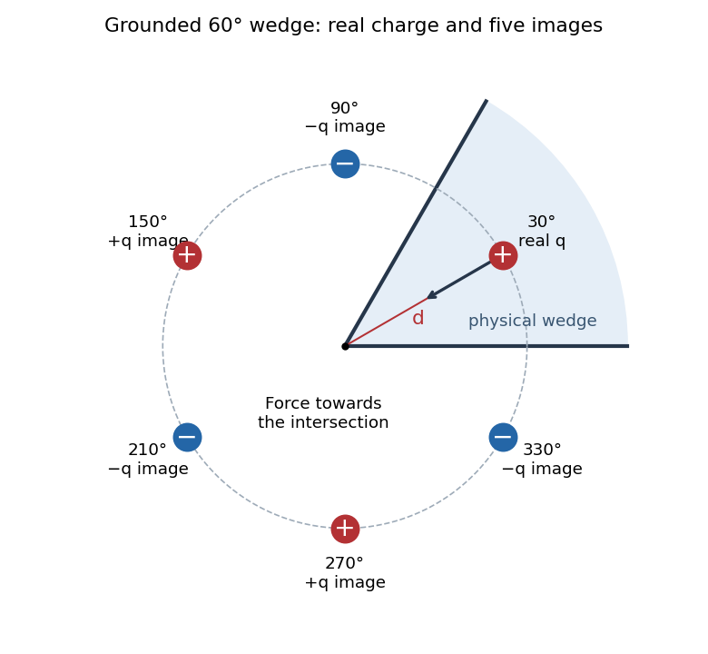

<h1 id="8/b/solution">Solution</h1>

↑ **Parent:** [B](../b.md)

For [image charges in a sixty-degree conducting wedge](../../../../image-charges-in-a-sixty-degree-conducting-wedge.md), use [polar coordinates](../../../../polar-coordinates.md) in a cross-section normal to the planes' intersection, putting the physical wedge at $0<\theta<\pi/3$ and the real [point charge](../../../../point-charge.md) at $(r,\theta)=(d,\pi/6)$. Repeated reflection in the two grounded faces produces five [image charges](../../../../image-charge.md), all at radius $d$ and the same coordinate along the intersection:

$$
\begin{array}{c|rrrrrr}
\theta&30^\circ&90^\circ&150^\circ&210^\circ&270^\circ&330^\circ\\
\text{charge}&q\ (\text{real})&-q&+q&-q&+q&-q
\end{array}
$$

Equivalently, the positive copies are at $\theta=\pi/6+2k\pi/3$ and the negative copies at $\theta=-\pi/6+2k\pi/3$, for $k=0,1,2$. Only the original [point charge](../../../../point-charge.md) lies inside the physical wedge.

**[Figure 3](#8/b/image-five-image-charges-outside-the-physical-sixty-degree-conducting-wedge). Five image charges outside the physical sixty-degree conducting wedge**.

For any observation point on either face, reflection pairs every positive [point charge](../../../../point-charge.md) with an equidistant negative one. Their [Coulomb potentials](../../../../coulomb-potential-energy.md) cancel, so both grounded faces have zero [electric potential](../../../../electric-potential.md). The [electric potential](../../../../electric-potential.md) also tends to zero at infinity. The [uniqueness theorem for the electrostatic potential](../../../../uniqueness-theorem-for-the-electrostatic-potential.md) then identifies this [method of images](../../../../method-of-images.md) construction with the physical solution.

## ↑ Ancestors (12)

1. [B](../b.md)
2. [8](../../8.md)
3. [2021](../../../2021-split.md)
4. [Past exam of the physics 2 paper of the University of Oxford](../../../split.md)
5. [Physics 2 paper of the University of Oxford](../../../../physics-2-paper-of-the-university-of-oxford.md)
6. [Year 1 of the physics course of the University of Oxford](../../../../year-1-of-the-physics-course-of-the-university-of-oxford.md)
7. [Physics course of the University of Oxford](../../../../physics-course-of-the-university-of-oxford.md)
8. [Undergraduate course of the University of Oxford](../../../../undergraduate-course-of-the-university-of-oxford.md)
9. [Course of the University of Oxford](../../../../course-of-the-university-of-oxford.md)
10. [University of Oxford](../../../../university-of-oxford-split.md)
11. [List of universities](../../../../list-of-universities.md)
12. [Codex Wiki](../../../../split.md)
