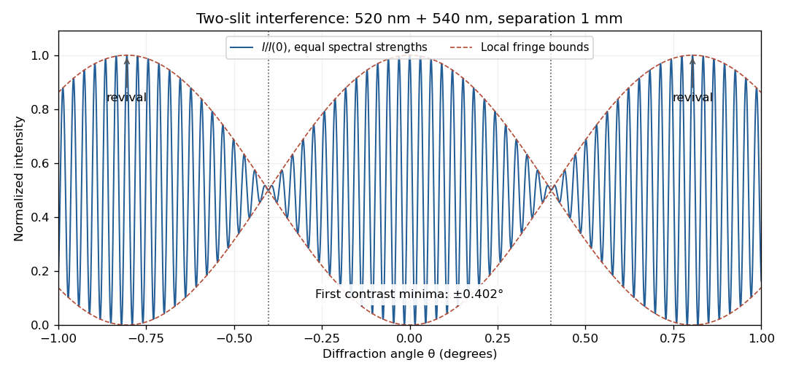

<h1 id="9/d/solution">Solution</h1>

↑ **Parent:** [D](../d.md)

The two optical [frequencies](../../../../frequency.md) have no persistent mutual [optical coherence](../../../../optical-coherence.md) over the detector's averaging time, so their [light intensities](../../../../light-intensity.md) add. Assuming equal strengths and using $s=1.0\,\mathrm{mm}$, let $I_s$ be the one-slit [light intensity](../../../../light-intensity.md) at either [wavelength](../../../../wavelength.md). Then

$$
\boxed{I(\theta)=4I_s\left[\cos^2\left(\frac{\pi s\sin\theta}{\lambda_1}\right)+\cos^2\left(\frac{\pi s\sin\theta}{\lambda_2}\right)\right],\quad \lambda_1=520\,\mathrm{nm},\quad\lambda_2=540\,\mathrm{nm}.}
$$

The identity $\cos A+\cos B=2\cos[(A+B)/2]\cos[(A-B)/2]$ rewrites this as

$$
I(\theta)=4I_s\left[1+\cos\left(\pi s\sin\theta\left(\frac1{\lambda_1}+\frac1{\lambda_2}\right)\right)\cos\left(\pi s\sin\theta\left(\frac1{\lambda_1}-\frac1{\lambda_2}\right)\right)\right].
$$

The slowly varying [interferometric visibility](../../../../interferometric-visibility.md) is approximately $\mathcal V=|\cos(\pi s\sin\theta\,[1/\lambda_1-1/\lambda_2])|$. Its first zero occurs at

$$
s\sin\theta_{\rm zero}=\frac{\lambda_1\lambda_2}{2(\lambda_2-\lambda_1)}=7.02\,\mu\mathrm m,
\qquad \theta_{\rm zero}=0.402^\circ.
$$

The rapid fringes have effective [wavelength](../../../../wavelength.md) $\lambda_h=2\lambda_1\lambda_2/(\lambda_1+\lambda_2)=529.81\,\mathrm{nm}$, so the first contrast minimum is at order $7.02\,\mu\mathrm m/\lambda_h=13.25$. Thus the conventional estimate is **about 13 fringes on each side**, before their first washout, plus the central maximum. “Clearly” is not a specified visibility threshold: the last of those fringes already has low contrast.

**[Figure 4](#9/d/image-two-wavelength-interference-its-first-visibility-minima-and-contrast-revival-over-minus-one-to-plus-one-degree). Two-wavelength interference, its first visibility minima, and contrast revival over minus one to plus one degree**.

The fringes do **not** disappear permanently beyond that point. Their contrast revives; the first exact common maximum satisfies $27\lambda_1=26\lambda_2=14.04\,\mu\mathrm m$, at $|\theta|=0.804^\circ$. This is a concrete counterexample to interpreting 13 as a global bound on visible fringes. Unequal spectral strengths would leave nonzero residual contrast at the nominal washout; the plotted equal-strength case is the natural interpretation in the absence of specified strengths.

## ↑ Ancestors (12)

1. [D](../d.md)
2. [9](../../9.md)
3. [2021](../../../2021-split.md)
4. [Past exam of the physics 2 paper of the University of Oxford](../../../split.md)
5. [Physics 2 paper of the University of Oxford](../../../../physics-2-paper-of-the-university-of-oxford.md)
6. [Year 1 of the physics course of the University of Oxford](../../../../year-1-of-the-physics-course-of-the-university-of-oxford.md)
7. [Physics course of the University of Oxford](../../../../physics-course-of-the-university-of-oxford.md)
8. [Undergraduate course of the University of Oxford](../../../../undergraduate-course-of-the-university-of-oxford.md)
9. [Course of the University of Oxford](../../../../course-of-the-university-of-oxford.md)
10. [University of Oxford](../../../../university-of-oxford-split.md)
11. [List of universities](../../../../list-of-universities.md)
12. [Codex Wiki](../../../../split.md)
