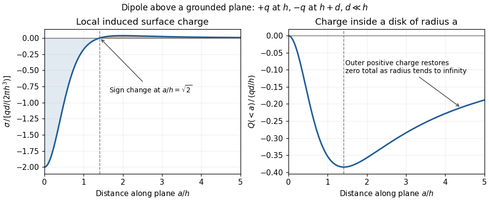

# 2022

↑ **Parent:** [Past exam of the physics 2 paper of the University of Oxford](../past-exam-of-the-physics-2-paper-of-the-university-of-oxford.md)

Source: [https://www.whatdotheyknow.com/request/physics_preliminary_past_papers/response/2680788/attach/3/2018%202021%20Physics%20prelims.zip?cookie_passthrough=1](https://www.whatdotheyknow.com/request/physics_preliminary_past_papers/response/2680788/attach/3/2018%202021%20Physics%20prelims.zip?cookie_passthrough=1)

The source cover identifies this as the 7 June 2022 CP2 examination; the archive member is labelled `2021/T/a10288w1.pdf`.

**Table of contents**

- [1](#1)
  - [i](#1/i)
    - [Solution](#1/i/solution)
  - [ii](#1/ii)
    - [Solution](#1/ii/solution)
- [2](#2)
  - [i](#2/i)
    - [Solution](#2/i/solution)
  - [ii](#2/ii)
    - [Solution](#2/ii/solution)
- [3](#3)
  - [i](#3/i)
    - [Solution](#3/i/solution)
  - [ii](#3/ii)
    - [Solution](#3/ii/solution)
- [4](#4)
  - [Solution](#4/solution)
- [5](#5)
  - [i](#5/i)
    - [Solution](#5/i/solution)
  - [ii](#5/ii)
    - [Solution](#5/ii/solution)
- [6](#6)
  - [i](#6/i)
    - [Solution](#6/i/solution)
  - [ii](#6/ii)
    - [Solution](#6/ii/solution)
- [7](#7)
  - [i](#7/i)
    - [Solution](#7/i/solution)
  - [ii](#7/ii)
    - [Solution](#7/ii/solution)
- [8](#8)
  - [a](#8/a)
    - [Solution](#8/a/solution)
    - [i](#8/a/i)
      - [Solution](#8/a/i/solution)
    - [ii](#8/a/ii)
      - [Solution](#8/a/ii/solution)
  - [b](#8/b)
    - [Solution](#8/b/solution)
    - [i](#8/b/i)
      - [Solution](#8/b/i/solution)
    - [ii](#8/b/ii)
      - [Solution](#8/b/ii/solution)
    - [iii](#8/b/iii)
      - [Solution](#8/b/iii/solution)
- [9](#9)
  - [a](#9/a)
    - [Solution](#9/a/solution)
  - [b](#9/b)
    - [Solution](#9/b/solution)
  - [c](#9/c)
    - [Solution](#9/c/solution)
- [10](#10)
  - [a](#10/a)
    - [Solution](#10/a/solution)
  - [b](#10/b)
    - [Solution](#10/b/solution)
  - [c](#10/c)
    - [Solution](#10/c/solution)
- [11](#11)
  - [a](#11/a)
    - [Solution](#11/a/solution)
  - [b](#11/b)
    - [Solution](#11/b/solution)
  - [c](#11/c)
    - [Solution](#11/c/solution)
  - [d](#11/d)
    - [Solution](#11/d/solution)

## 1

↑ **Parent:** [2022](2022.md)

<h3 id="1/i">i</h3>

↑ **Parent:** [1](#1)

<h4 id="1/i/solution">Solution</h4>

↑ **Parent:** [I](#1/i)

Position A disconnects the [battery](../electrical-circuit.md#electric-battery) and closes the [resistor](../electric-charge.md#resistor)-[inductor](../electromagnetism.md#inductor) loop. Taking clockwise [electric current](../electric-charge.md#electric-current) as positive, [Kirchhoff's voltage law](../random-walk.md#kirchhoff-cycle-law) for this [RL circuit](../electrical-circuit.md#rl-circuit) gives

$$
L\frac{dI}{dt}+RI=0.
$$

The [electric current](../electric-charge.md#electric-current) through an ideal [inductor](../electromagnetism.md#inductor) remains continuous across a switch with no impulsive [voltage](../random-walk.md#voltage). Thus $I(0^+)=I_0$, and [separation of variables](../partial-differential-equation.md#separation-of-variables) gives

$$
\boxed{I(t)=I_0e^{-Rt/L}\quad(0<t<\Delta t).}
$$

If the switch remains at A, the same result holds for every $t>0$. The [time constant](../analysis.md#time-constant) is $L/R$; the stored [magnetic energy](../electromagnetic-wave.md#magnetic-energy) is dissipated by [Joule heating](../electric-charge.md#joule-heating).

<h3 id="1/ii">ii</h3>

↑ **Parent:** [1](#1)

<h4 id="1/ii/solution">Solution</h4>

↑ **Parent:** [Ii](#1/ii)

Put $s=e^{-R\Delta t/L}$ and $J=V/R$, with $0<s<1$. The first interval leaves [electric current](../electric-charge.md#electric-current) $I_1=sI_0$. Position B reconnects the [battery](../electrical-circuit.md#electric-battery), so the driven [RL circuit](../electrical-circuit.md#rl-circuit) obeys $L\dot I+RI=V$. Multiplication by the [integrating factor](../linear-ordinary-differential-equation.md#integrating-factor) $e^{Rt/L}$, or subtraction of the constant solution $J$, gives

$$
I(t)=J+(sI_0-J)e^{-R(t-\Delta t)/L},\qquad \Delta t<t<2\Delta t.
$$

Consequently

$$
\boxed{I_2=s^2I_0+J(1-s).}
$$

The same two intervals give the [recurrence relation](../sequence-and-series.md#recurrence-relation) $I_{2n+2}=s^2I_{2n}+J(1-s)$. Its [fixed point](../function.md#fixed-point) is $I_*=J/(1+s)$. Subtracting this [fixed point](../function.md#fixed-point) makes the [recurrence relation](../sequence-and-series.md#recurrence-relation) homogeneous:

$$
I_{2n}-I_*=s^{2n}(I_0-I_*),\qquad
\boxed{\lim_{n\to\infty}I_{2n}=\frac{V/R}{1+e^{-R\Delta t/L}}.}
$$

This is the upper endpoint of the eventual [periodically switched RL circuit](../electrical-circuit.md#periodically-switched-rl-circuit) response, immediately before switching from B to A. The lower endpoint is $sJ/(1+s)$. Their sum is $J$, consistent with equal charging and discharging intervals.

## 2

↑ **Parent:** [2022](2022.md)

<h3 id="2/i">i</h3>

↑ **Parent:** [2](#2)

<h4 id="2/i/solution">Solution</h4>

↑ **Parent:** [I](#2/i)

An [ideal operational amplifier](../electrical-circuit.md#ideal-operational-amplifier) has **infinite [input impedance](../electrical-circuit.md#input-impedance)**, so neither input draws [electric current](../electric-charge.md#electric-current), and **zero [output impedance](../electrical-circuit.md#output-impedance)**, so its prescribed output [voltage](../random-walk.md#voltage) is independent of the output [electric current](../electric-charge.md#electric-current) within the ideal model. These are the two additional assumptions needed here.

<h3 id="2/ii">ii</h3>

↑ **Parent:** [2](#2)

<h4 id="2/ii/solution">Solution</h4>

↑ **Parent:** [Ii](#2/ii)

The non-inverting input is grounded, so the finite [voltage gain](../electrical-circuit.md#voltage-gain) gives $V_{\rm OUT}=-AV^-$, or $V^-=-V_{\rm OUT}/A$. Infinite [input impedance](../electrical-circuit.md#input-impedance) makes [Kirchhoff's current law](../random-walk.md#kirchhoff-node-law) at the inverting input

$$
\frac{V_{\rm IN}-V^-}{R_1}+\frac{V_{\rm OUT}-V^-}{R_2}=0.
$$

Substitute $V^-=-V_{\rm OUT}/A$ and multiply by $R_1R_2$:

$$
R_2V_{\rm IN}+\left(R_1+\frac{R_1+R_2}{A}\right)V_{\rm OUT}=0.
$$

Hence the [inverting operational amplifier](../electrical-circuit.md#inverting-operational-amplifier) has

$$
\boxed{\frac{V_{\rm OUT}}{V_{\rm IN}}=-\frac{R_2}{R_1+(R_1+R_2)/A},\qquad B=\frac{R_1+R_2}{A}.}
$$

As $A\to\infty$, the [voltage gain](../electrical-circuit.md#voltage-gain) tends to $-R_2/R_1$. Setting $V^-=0$ before taking that limit would discard precisely the correction being calculated.

## 3

↑ **Parent:** [2022](2022.md)

<h3 id="3/i">i</h3>

↑ **Parent:** [3](#3)

<h4 id="3/i/solution">Solution</h4>

↑ **Parent:** [I](#3/i)

Assume the [electrical conductor](../electric-charge.md#electrical-conductor) is nonmagnetic, with [magnetic permeability](../maxwell-equations.md#permeability-electromagnetism) $\mu_0$, and neglect end effects. [Rotational symmetry](../linear-algebra.md#rotational-symmetry) and [translational symmetry](../physics.md#translational-symmetry) make the [magnetic flux density](../magnetic-field.md) azimuthal and constant along a coaxial circle. The [magnetostatic Ampère law](../maxwell-equations.md#magnetostatic-ampere-law) therefore gives

$$
2\pi rB(r)=\mu_0 I_{\rm enc}(r).
$$

Uniform [current density](../electric-charge.md#current-density) is $j=I/(\pi a^2)$, so $I_{\rm enc}(r)=j\pi r^2=Ir^2/a^2$. Thus

$$
\boxed{B(r)=\frac{\mu_0 I r}{2\pi a^2}\quad(0\leq r\leq a).}
$$

The direction follows the [right-hand rule](../electromagnetism.md#right-hand-rule) around the [electric current](../electric-charge.md#electric-current). For a uniform linear magnetic material, replace $\mu_0$ by its [magnetic permeability](../maxwell-equations.md#permeability-electromagnetism).

<h3 id="3/ii">ii</h3>

↑ **Parent:** [3](#3)

<h4 id="3/ii/solution">Solution</h4>

↑ **Parent:** [Ii](#3/ii)

Write the axial [current density](../electric-charge.md#current-density) as $j(r)=Kr$. Normalize it using the total [electric current](../electric-charge.md#electric-current):

$$
I=\int_0^a Kr\,2\pi r\,dr=\frac{2\pi Ka^3}{3},\qquad K=\frac{3I}{2\pi a^3}.
$$

The enclosed [electric current](../electric-charge.md#electric-current) at radius $r$ is $I_{\rm enc}(r)=2\pi Kr^3/3=I(r/a)^3$. The [magnetostatic Ampère law](../maxwell-equations.md#magnetostatic-ampere-law) now yields

$$
\boxed{B(r)=\frac{\mu_0 I r^2}{2\pi a^3}\quad(0\leq r\leq a).}
$$

Both profiles join the exterior [magnetic flux density](../magnetic-field.md) $\mu_0 I/(2\pi a)$ at the surface, but the second vanishes quadratically at the axis because less [electric current](../electric-charge.md#electric-current) is concentrated near it.

## 4

↑ **Parent:** [2022](2022.md)

<h3 id="4/solution">Solution</h3>

↑ **Parent:** [4](#4)

Choose zero [electrostatic potential](../electric-field.md#electric-potential) at infinity. By [Coulomb's law](../electrostatics.md#coulomb-s-law) and the [superposition principle](../vector-space.md#superposition-principle), the two [point charges](../electric-field.md#point-charge) give

$$
\boxed{\Phi(r,\theta)=\frac1{4\pi\epsilon_0}\left[\frac{q_1}{\sqrt{r^2+r_1^2-2rr_1\cos\theta}}+\frac{q_2}{\sqrt{r^2+r_2^2-2rr_2\cos\theta}}\right].}
$$

Here $\epsilon_0$ is the [vacuum permittivity](../permittivity.md#vacuum-permittivity). For a nondegenerate zero-[equipotential curve](../energy.md#equipotential-curve), the [electric charges](../electric-charge.md) must have opposite signs. Let $d_1,d_2$ be the two distances. The equation $\Phi=0$ becomes $q_1d_2=-q_2d_1$, and hence

$$
q_1^2(r^2+r_2^2-2rr_2\cos\theta)=q_2^2(r^2+r_1^2-2rr_1\cos\theta).
$$

For a circle $r=\rho>0$ centred at the origin, its $\cos\theta$ coefficient must vanish: $q_1^2r_2=q_2^2r_1$. If $r_1,r_2>0$ and $r_1\ne r_2$, this gives

$$
\boxed{q_2=-q_1\sqrt{r_2/r_1}.}
$$

Substitute $q_2^2/q_1^2=r_2/r_1$ in the constant term:

$$
r_1\rho^2+r_1r_2^2=r_2\rho^2+r_2r_1^2,
\qquad (r_1-r_2)(\rho^2-r_1r_2)=0.
$$

Therefore

$$
\boxed{\rho=\sqrt{r_1r_2}.}
$$

This is an [Apollonius circle](../euclidean-geometry.md#circles-of-apollonius): the distance ratio $d_2/d_1$ is constant. The distinct-position assumption matters. For example, $r_1=r_2=1$, $q_2=-q_1$ gives zero [electrostatic potential](../electric-field.md#electric-potential) everywhere away from the coincident [point charges](../electric-field.md#point-charge), so there is no distinguished zero circle. If only one position is at the origin and the other is not, no nontrivial positive-radius circle centred at the origin is possible.

## 5

↑ **Parent:** [2022](2022.md)

<h3 id="5/i">i</h3>

↑ **Parent:** [5](#5)

<h4 id="5/i/solution">Solution</h4>

↑ **Parent:** [I](#5/i)

In charge-free, current-free vacuum, [Maxwell's equations](../maxwell-equations.md) are

$$
\nabla\cdot\mathbf E=0,\qquad \nabla\cdot\mathbf B=0,\qquad
\nabla\times\mathbf E=-\frac{\partial\mathbf B}{\partial t},\qquad
\nabla\times\mathbf B=\mu_0\epsilon_0\frac{\partial\mathbf E}{\partial t}.
$$

Taking the [curl](../multivariable-calculus.md#curl) of the third equation and using the fourth, the [curl of the curl identity](../multivariable-calculus.md#curl-of-the-curl-identity), and the zero [divergence](../multivariable-calculus.md#divergence) of the [electric field](../electric-field.md) gives

$$
\nabla^2\mathbf E=\mu_0\epsilon_0\frac{\partial^2\mathbf E}{\partial t^2}.
$$

The [magnetic flux density](../magnetic-field.md) obeys the same [wave equation](../wave-equation.md). For the [plane wave](../wave-function.md#plane-wave) factor $e^{i(\omega t-kx)}$, the spatial [Laplacian](../multivariable-calculus.md#laplacian) contributes $-k^2$ and the second time [derivative](../calculus.md#derivative) contributes $-\omega^2$. Thus

$$
k^2=\mu_0\epsilon_0\omega^2,\qquad
\boxed{c=\frac{\omega}{k}=\frac1{\sqrt{\mu_0\epsilon_0}}}
$$

for propagation in the positive $x$ direction. The zero-[divergence](../multivariable-calculus.md#divergence) conditions require $E_{0x}=B_{0x}=0$, while the [curl](../multivariable-calculus.md#curl) equations require $\mathbf B_0=(k/\omega)\hat{\mathbf x}\times\mathbf E_0$. These conditions show that the proposed [plane waves](../wave-function.md#plane-wave) satisfy all four [Maxwell's equations](../maxwell-equations.md), rather than only their derived [wave equations](../wave-equation.md). Physical [electric fields](../electric-field.md) and [magnetic fields](../magnetic-field.md) are the [real parts](../complex-analysis.md#real-part) of the complex expressions.

<h3 id="5/ii">ii</h3>

↑ **Parent:** [5](#5)

<h4 id="5/ii/solution">Solution</h4>

↑ **Parent:** [Ii](#5/ii)

Using $\nabla\times\mathbf E=-\partial_t\mathbf B$ directly with the specified [plane wave](../wave-function.md#plane-wave) gives

$$
-ik\hat{\mathbf x}\times\mathbf E_0=-i\omega\mathbf B_0,
\qquad
\boxed{\mathbf B_0=\frac{E_0}{c}\hat{\mathbf z}.}
$$

The [electric field](../electric-field.md), [magnetic flux density](../magnetic-field.md) and propagation direction form a right-handed triad, and for a nonzero [wave amplitude](../wave.md#wave-amplitude)

$$
\boxed{\frac{|\mathbf E_0|}{|\mathbf B_0|}=c.}
$$

The [electric field](../electric-field.md) and [magnetic field](../magnetic-field.md) have the same [wave phase](../wave.md#phase-waves) in vacuum.

## 6

↑ **Parent:** [2022](2022.md)

<h3 id="6/i">i</h3>

↑ **Parent:** [6](#6)

<h4 id="6/i/solution">Solution</h4>

↑ **Parent:** [I](#6/i)

The distance from the origin to the incident straight [light ray](../geometrical-optics.md#light-ray) is $d_a$ (taking $d_a\geq0$). At its intersection with the sphere, let $i$ and $t$ be the [angle of incidence](../optics.md#angle-of-incidence) and [angle of refraction](../optics.md#angle-of-refraction), measured from the radial [normal vector](../differential-geometry.md#normal-vector). Elementary [right triangle](../euclidean-geometry.md#right-triangle) geometry gives $d_a=r_b\sin i$. By [Snell's law](../partial-differential-equation.md#snell-s-law),

$$
n_a\sin i=n_b\sin t.
$$

The refracted straight [light ray](../geometrical-optics.md#light-ray) inside the sphere has distance $d_b=r_b\sin t$ from the origin. Therefore

$$
\boxed{d_b=\frac{n_a}{n_b}d_a,\qquad r\cos(\theta-\theta_b)=\frac{n_a}{n_b}d_a.}
$$

The angle $\theta_b$ describes the [normal vector](../differential-geometry.md#normal-vector) of the new line; it need not equal the propagation angle. The existence of a crossing requires $|d_a|<r_b$. A signed convention for $d_a$ gives the same line equation after choosing the orientation of its [normal vector](../differential-geometry.md#normal-vector) consistently.

<h3 id="6/ii">ii</h3>

↑ **Parent:** [6](#6)

<h4 id="6/ii/solution">Solution</h4>

↑ **Parent:** [Ii](#6/ii)

Approximate the atmosphere by concentric spherical layers of [refractive index](../electromagnetic-wave.md#refractive-index). At every boundary, [Snell's law](../partial-differential-equation.md#snell-s-law) conserves $nr\sin\psi$, where $\psi$ is the angle between the [light ray](../geometrical-optics.md#light-ray) and the radius. Straight propagation between boundaries conserves the same quantity because $r\sin\psi$ is the distance of that line from the origin. In the smooth limit this is the [spherical ray invariant](../geometrical-optics.md#spherical-ray-invariant)

$$
p=n(r)r\sin\psi.
$$

At the surface, a [light ray](../geometrical-optics.md#light-ray) apparently on the horizon is tangent, so $p=n_sR$. In vacuum far from the Earth, $n=1$, and the straight incident line has distance $p$ from the centre. Removing the atmosphere while retaining that incident line gives minimum altitude

$$
\boxed{H=p-R=(n_s-1)R=0.0003(6400\,\mathrm{km})=1.92\,\mathrm{km}.}
$$

The detailed variation of [refractive index](../electromagnetic-wave.md#refractive-index) with altitude changes the local curvature of the [light ray](../geometrical-optics.md#light-ray), but not the conserved $p$. This conclusion assumes a spherically stratified atmosphere and a [light ray](../geometrical-optics.md#light-ray) which actually connects the surface to space; nonspherical structure or a trapping layer would require separate analysis.

## 7

↑ **Parent:** [2022](2022.md)

<h3 id="7/i">i</h3>

↑ **Parent:** [7](#7)

<h4 id="7/i/solution">Solution</h4>

↑ **Parent:** [I](#7/i)

Take coordinate $y$ across the slit and observation angle $\theta$ from its [normal vector](../differential-geometry.md#normal-vector). Under [Fraunhofer diffraction](../physical-optics.md#fraunhofer-diffraction), the relative [optical path difference](../physical-optics.md#optical-path-difference) from $y$ is $y\sin\theta$. Uniform coherent illumination makes the [complex amplitude](../wave.md#complex-amplitude) proportional to the aperture [integral](../integral.md):

$$
\mathcal E(\theta)=K\int_{-w/2}^{w/2}e^{-iky\sin\theta}\,dy
=Kw\frac{\sin\beta}{\beta},\qquad
\beta=\frac{\pi w\sin\theta}{\lambda},\quad k=\frac{2\pi}{\lambda}.
$$

The [light intensity](../wave.md#light-intensity) is proportional to $|\mathcal E|^2$, so

$$
\boxed{I(\theta)=I(0)\left[\frac{\sin(\pi w\sin\theta/\lambda)}{\pi w\sin\theta/\lambda}\right]^2.}
$$

The central value is the continuous limit of the [sinc function](../fourier-transform.md#sinc-function). The first minima satisfy $\sin\theta=\pm\lambda/w$, if $\lambda\leq w$. Infinite slit height removes spreading in the other transverse direction; this expression describes the slit-width direction.

Strictly, distance $D\gg w$ alone does not ensure [Fraunhofer diffraction](../physical-optics.md#fraunhofer-diffraction): one also needs $w^2/(\lambda D)\ll1$, so that quadratic aperture-dependent [wave phase](../wave.md#phase-waves) is negligible, or observation in a suitable [focal plane](../optical-instrument.md#focal-plane). For example, $w=1\,\mathrm{mm}$, $\lambda=500\,\mathrm{nm}$ and $D=1\,\mathrm m$ have $D/w=1000$ but $w^2/(\lambda D)=2$; the [Fresnel diffraction](../physical-optics.md#fresnel-diffraction) correction is then substantial. The displayed result uses the intended far-field regime of the question and the usual scalar aperture approximation.

<h3 id="7/ii">ii</h3>

↑ **Parent:** [7](#7)

<h4 id="7/ii/solution">Solution</h4>

↑ **Parent:** [Ii](#7/ii)

For viewing near the nadir, the required [angular resolution](../astrophysics.md#angular-resolution) is

$$
\delta\theta\simeq\frac{s}{H}=\frac{100}{840000}=1.19048\times10^{-4}\,\mathrm{rad}.
$$

Using the [Rayleigh criterion](../point-spread-function.md#rayleigh-criterion) with the first minimum of the [single-slit diffraction](../physical-optics.md#single-slit-diffraction) pattern gives $\delta\theta\simeq\lambda/w$. Thus the minimum collecting width in that model is

$$
\boxed{w_{\min}=\frac{\lambda H}{s}=\frac{12\times10^{-6}\times840000}{100}\,\mathrm m=0.1008\,\mathrm m\simeq10.1\,\mathrm{cm}.}
$$

The numerical coefficient depends on the aperture shape and the chosen resolution criterion. If the mirror has an unobstructed circular aperture, the [Airy disk](../point-spread-function.md#airy-disk) version of the [Rayleigh criterion](../point-spread-function.md#rayleigh-criterion) is $\delta\theta=1.22\lambda/D$, giving $D_{\min}=0.12298\,\mathrm m\simeq12.3\,\mathrm{cm}$. The question does not specify mirror shape; $10.1\,\mathrm{cm}$ follows the slit-width model of part (i).

## 8

↑ **Parent:** [2022](2022.md)

<h3 id="8/a">a</h3>

↑ **Parent:** [8](#8)

<h4 id="8/a/solution">Solution</h4>

↑ **Parent:** [A](#8/a)

Use the $e^{i\omega t}$ [phasor](../wave.md#phasor) convention and interpret [impedance matching](../electrical-circuit.md#impedance-matching) as conjugate matching for the [maximum power transfer theorem](../electrical-circuit.md#maximum-power-transfer-theorem). The load [electrical impedance](../electrical-circuit.md#electrical-impedance) of the [series circuit](../electrical-circuit.md#series-circuit) is

$$
Z_{RC}=R-\frac{i}{\omega C}.
$$

For $Z=A+i\omega B$, the condition $Z_{RC}=Z^*$ equates the [real parts](../complex-analysis.md#real-part) and [imaginary parts](../complex-analysis.md#imaginary-part):

$$
\boxed{R=A,\qquad \omega^2BC=1,\qquad \omega=\frac1{\sqrt{BC}}.}
$$

These formulas require $B>0$, $C>0$ and a passive realization with $A\geq0$, evaluated at the matching [angular frequency](../lagrangian-mechanics.md#angular-frequency); if $A,B$ depend on $\omega$, the equation for $\omega$ is implicit.

There is a convention ambiguity in the word “matched”. Literal equality $Z_{RC}=Z$, as required for equal bridge arms in part (b), instead gives $R=A$ and $\omega^2BC=-1$, requiring $B<0$. The inductive cases below use conjugate matching; literal equality is impossible for either passive inductive configuration at a finite positive [angular frequency](../lagrangian-mechanics.md#angular-frequency) because its [electrical reactance](../electrical-circuit.md#electrical-reactance) is positive while that of the [series RC impedance](../electrical-circuit.md#series-rc-impedance) is negative.

<h4 id="8/a/i">i</h4>

↑ **Parent:** [A](#8/a)

<h5 id="8/a/i/solution">Solution</h5>

↑ **Parent:** [I](#8/a/i)

Let the unknown [series circuit](../electrical-circuit.md#series-circuit) contain [electrical resistance](../electric-charge.md#electrical-resistance) $R_s>0$ and [inductance](../electromagnetism.md#inductance) $L>0$. Its [electrical impedance](../electrical-circuit.md#electrical-impedance) is $Z=R_s+i\omega L$. Thus $A=R_s$, $B=L$, and conjugate [impedance matching](../electrical-circuit.md#impedance-matching) is possible with

$$
\boxed{R=R_s,\qquad \omega=\frac1{\sqrt{LC}}.}
$$

At this [angular frequency](../lagrangian-mechanics.md#angular-frequency), the [inductor](../electromagnetism.md#inductor) and load [capacitor](../electromagnetism.md#capacitor) have opposite [electrical reactances](../electrical-circuit.md#electrical-reactance) of equal magnitude. Literal equality of their separate [electrical impedances](../electrical-circuit.md#electrical-impedance) is impossible; for example, $R_s=L=C=1$ gives $1+i\omega$ versus $R-i/\omega$ for every $\omega>0$.

<h4 id="8/a/ii">ii</h4>

↑ **Parent:** [A](#8/a)

<h5 id="8/a/ii/solution">Solution</h5>

↑ **Parent:** [Ii](#8/a/ii)

For [electrical resistance](../electric-charge.md#electrical-resistance) $R_p>0$ in a [parallel circuit](../electrical-circuit.md#parallel-circuit) with [inductance](../electromagnetism.md#inductance) $L>0$, add [electrical admittances](../electrical-circuit.md#electrical-admittance) and invert:

$$
Z=\left(\frac1{R_p}+\frac1{i\omega L}\right)^{-1}
=\frac{R_p\omega^2L^2}{R_p^2+\omega^2L^2}
+i\omega\frac{R_p^2L}{R_p^2+\omega^2L^2}.
$$

Conjugate [impedance matching](../electrical-circuit.md#impedance-matching) to the [series RC impedance](../electrical-circuit.md#series-rc-impedance) requires

$$
\frac1{\omega C}=\frac{\omega R_p^2L}{R_p^2+\omega^2L^2},
\qquad R_p^2=\omega^2L(CR_p^2-L).
$$

It is possible at a finite positive [angular frequency](../lagrangian-mechanics.md#angular-frequency) exactly when $CR_p^2>L$, in which case

$$
\boxed{\omega=\frac{R_p}{\sqrt{L(CR_p^2-L)}},\qquad R=\frac{L}{CR_p}.}
$$

The expression for $R$ follows by substituting this $\omega^2$ into the [real part](../complex-analysis.md#real-part) of $Z$. If $CR_p^2\leq L$, no such finite matching [angular frequency](../lagrangian-mechanics.md#angular-frequency) exists. Under literal equality, both passive inductive configurations fail by the sign of their [imaginary parts](../complex-analysis.md#imaginary-part).

<h3 id="8/b">b</h3>

↑ **Parent:** [8](#8)

<h4 id="8/b/solution">Solution</h4>

↑ **Parent:** [B](#8/b)

Let the source's top terminal have [voltage](../random-walk.md#voltage) [phasor](../wave.md#phasor) $V_0$ and its bottom terminal zero. Denote the left and right junctions by $L$ and $R$. The two left [resistors](../electric-charge.md#resistor) are equal, so at balance $V_L=V_0/2$. Zero [electric current](../electric-charge.md#electric-current) through the [ammeter](../electric-charge.md#ammeter) requires $V_R=V_L$, and therefore equal upper and lower right-arm [electrical impedances](../electrical-circuit.md#electrical-impedance):

$$
Z=\frac{R_x}{1+i\omega R_xC_x}=W,\qquad
W=R_v+\frac1{i\omega C}=R_v-\frac{i}{\omega C}.
$$

Write $x=\omega R_xC_x$. Separating [real parts](../complex-analysis.md#real-part) and [imaginary parts](../complex-analysis.md#imaginary-part) gives

$$
R_v=\frac{R_x}{1+x^2},\qquad
\frac1{\omega C}=\frac{\omega R_x^2C_x}{1+x^2}.
$$

The second equation implies $1+x^2=\omega^2R_x^2CC_x$. Subtract $x^2=\omega^2R_x^2C_x^2$ to obtain

$$
\boxed{\omega_0=\frac1{R_x\sqrt{C_x(C-C_x)}},\qquad
\frac{C_x}{C}=1-\frac{R_v}{R_x}.}
$$

A finite balance with positive components requires $0<C_x<C$, and then $0<R_v<R_x$. This [equal-ratio RC bridge](../electrical-circuit.md#equal-ratio-rc-bridge) uses equality of arm [electrical impedances](../electrical-circuit.md#electrical-impedance), independent of the conjugate-matching convention in part (a).

**Detector convention.** The stated negligible-[electrical impedance](../electrical-circuit.md#electrical-impedance) [ammeter](../electric-charge.md#ammeter) is an ideal [short circuit](../electrical-circuit.md#short-circuit), whose actual terminal [voltage](../random-walk.md#voltage) is zero at every [angular frequency](../lagrangian-mechanics.md#angular-frequency). The nontrivial bridge output usually intended is the _open-circuit_ junction difference, obtained with the detector removed or replaced by a high-[input impedance](../electrical-circuit.md#input-impedance) [voltmeter](../electric-field.md#voltmeter). Define its polarity by

$$
V_{\rm oc}=V_R-V_L
=V_0\left(\frac{W}{Z+W}-\frac12\right)
=\frac{V_0(W-Z)}{2(W+Z)}.
$$

For a detector of finite [electrical impedance](../electrical-circuit.md#electrical-impedance) $Z_A$, its terminal [voltage](../random-walk.md#voltage) is instead

$$
V_A=V_{\rm oc}\frac{Z_A}{Z_A+Z_{\rm th}},\qquad
Z_{\rm th}=\frac R2+\frac{ZW}{Z+W}.
$$

Here $Z_{\rm th}$ is the [Thévenin equivalent](../electrical-engineering.md#thevenin-equivalent) [electrical impedance](../electrical-circuit.md#electrical-impedance), found by shorting the ideal source. This exhibits why the ideal-[ammeter](../electric-charge.md#ammeter) limit $Z_A\to0$ has zero terminal [voltage](../random-walk.md#voltage) even when the bridge is unbalanced.

<h4 id="8/b/i">i</h4>

↑ **Parent:** [B](#8/b)

<h5 id="8/b/i/solution">Solution</h5>

↑ **Parent:** [I](#8/b/i)

At zero [angular frequency](../lagrangian-mechanics.md#angular-frequency), the lower right [capacitor](../electromagnetism.md#capacitor) is an [open circuit](../electrical-circuit.md#open-circuit), while the upper right [electrical impedance](../electrical-circuit.md#electrical-impedance) tends to $R_x$. With the detector removed, no [electric current](../electric-charge.md#electric-current) flows down that branch, so $V_R=V_0$ and $V_L=V_0/2$. Therefore

$$
\boxed{V_{\rm oc}(0)=\frac{V_0}{2},\qquad V_A(0)=0\ \text{for an ideal ammeter}.}
$$

For the connected ideal [ammeter](../electric-charge.md#ammeter), the resulting [electric current](../electric-charge.md#electric-current) from right to left is $V_0/(R+2R_x)$, despite its zero terminal [voltage](../random-walk.md#voltage). This follows from $I_A=V_{\rm oc}/Z_{\rm th}$ with $Z_{\rm th}=R/2+R_x$.

<h4 id="8/b/ii">ii</h4>

↑ **Parent:** [B](#8/b)

<h5 id="8/b/ii/solution">Solution</h5>

↑ **Parent:** [Ii](#8/b/ii)

At the balance [angular frequency](../lagrangian-mechanics.md#angular-frequency), $Z=W$ and the two [voltage dividers](../electrical-engineering.md#voltage-divider) have the same ratio. Thus

$$
\boxed{V_{\rm oc}(\omega_0)=0,\qquad V_A(\omega_0)=0,\qquad I_A(\omega_0)=0.}
$$

This zero detector [electric current](../electric-charge.md#electric-current) is the operational condition used to find $R_v$ and $\omega_0$.

<h4 id="8/b/iii">iii</h4>

↑ **Parent:** [B](#8/b)

<h5 id="8/b/iii/solution">Solution</h5>

↑ **Parent:** [Iii](#8/b/iii)

As $\omega\to\infty$, both [capacitors](../electromagnetism.md#capacitor) approach [short circuits](../electrical-circuit.md#short-circuit). Thus $Z\to0$, $W\to R_v>0$, and the unloaded right junction tends to the source's top-terminal [voltage](../random-walk.md#voltage). Hence

$$
\boxed{\lim_{\omega\to\infty}V_{\rm oc}=\frac{V_0}{2},\qquad V_A=0\ \text{for an ideal ammeter}.}
$$

The connected ideal [ammeter](../electric-charge.md#ammeter) carries limiting [electric current](../electric-charge.md#electric-current) $V_0/R$ from right to left because $Z_{\rm th}\to R/2$. Reversing the output polarity reverses both nonzero open-circuit answers, without changing their magnitudes.

## 9

↑ **Parent:** [2022](2022.md)

<h3 id="9/a">a</h3>

↑ **Parent:** [9](#9)

<h4 id="9/a/solution">Solution</h4>

↑ **Parent:** [A](#9/a)

Set the grounded plane at $z=0$ and the real [point charge](../electric-field.md#point-charge) at $(0,0,h)$. The [image charge](../electric-field.md#image-charge) $-q$ at $(0,0,-h)$ makes the [electrostatic potential](../electric-field.md#electric-potential) vanish throughout the plane. The [uniqueness theorem for the electrostatic potential](../electrostatics.md#uniqueness-theorem-for-the-electrostatic-potential) then identifies the physical solution in $z>0$:

$$
\Phi(a,z)=\frac{q}{4\pi\epsilon_0}\left[\frac1{\sqrt{a^2+(z-h)^2}}-\frac1{\sqrt{a^2+(z+h)^2}}\right].
$$

The normal [electric field](../electric-field.md) is $E_z=-\partial_z\Phi$. Differentiation gives

$$
E_z(a,z)=\frac{q}{4\pi\epsilon_0}\left[\frac{z-h}{[a^2+(z-h)^2]^{3/2}}-\frac{z+h}{[a^2+(z+h)^2]^{3/2}}\right],
$$

and therefore

$$
\boxed{E_z(a,0^+)=-\frac{q}{2\pi\epsilon_0}\frac{h}{(a^2+h^2)^{3/2}}.}
$$

For $q>0$ the [electric field](../electric-field.md) points into the [electrical conductor](../electric-charge.md#electrical-conductor), consistently with negative induced [surface charge density](../electrostatics.md#surface-charge-density).

<h3 id="9/b">b</h3>

↑ **Parent:** [9](#9)

<h4 id="9/b/solution">Solution</h4>

↑ **Parent:** [B](#9/b)

Apply the [superposition principle](../vector-space.md#superposition-principle) to the result of part (a). If $F(a,h)=-qh/[2\pi\epsilon_0(a^2+h^2)^{3/2}]$, then the exact normal [electric field](../electric-field.md) from the two real [point charges](../electric-field.md#point-charge) and their [image charges](../electric-field.md#image-charge) is

$$
E_z=F(a,h)-F(a,h+d)
=\frac{q}{2\pi\epsilon_0}\left[\frac{h+d}{[a^2+(h+d)^2]^{3/2}}-\frac{h}{(a^2+h^2)^{3/2}}\right].
$$

For $d\ll h$, [Taylor's theorem](../calculus.md#taylor-s-theorem) gives $E_z=-d\partial_hF+O(d^2)$. Since

$$
\frac{d}{dh}\frac{h}{(a^2+h^2)^{3/2}}
=\frac{a^2-2h^2}{(a^2+h^2)^{5/2}},
$$

the leading [electric dipole](../electrostatics.md#electric-dipole) result is

$$
\boxed{E_z(a,0^+)=\frac{qd}{2\pi\epsilon_0}\frac{a^2-2h^2}{(a^2+h^2)^{5/2}}+O\!\left(\frac{qd^2}{\epsilon_0h^4}\right).}
$$

The [electric dipole moment](../electrostatics.md#electric-dipole-moment) is $\mathbf p=-qd\hat{\mathbf z}$. The circle $a=\sqrt2h$ is the zero of the leading normal [electric field](../electric-field.md) and hence of the induced [surface charge density](../electrostatics.md#surface-charge-density). Inside it, induced [surface charge density](../electrostatics.md#surface-charge-density) is negative; outside it, positive. The tangential [electric field](../electric-field.md) is zero everywhere on the grounded [electrical conductor](../electric-charge.md#electrical-conductor), so the leading full [electric field](../electric-field.md) vanishes on that circle. The corresponding [dipole-induced charge on a grounded plane](../electric-field.md#dipole-induced-charge-on-a-grounded-plane) integrates to zero over the whole plane: the negative central region is balanced by the positive exterior.

For finite $d$, $a=\sqrt2h$ is only the leading-order zero. With $u=h^{2/3}$ and $v=(h+d)^{2/3}$, the exact zero satisfies $a^2=uv(u+v)$, giving $a=\sqrt2(h+d/2)+O(d^2/h)$. For example, inserting any $d>0$ in the exact expression at $a=\sqrt2h$ does not give zero. This is a controlled [electric dipole](../electrostatics.md#electric-dipole) approximation, not an exact finite-separation identity.

**[Figure 1](#9/b/image-sign-reversal-and-enclosed-induced-electric-charge-for-a-normal-electric-dipole-above-a-grounded-plane). Sign reversal and enclosed induced electric charge for a normal electric dipole above a grounded plane**.

<h3 id="9/c">c</h3>

↑ **Parent:** [9](#9)

<h4 id="9/c/solution">Solution</h4>

↑ **Parent:** [C](#9/c)

The [electric field](../electric-field.md) within a [conductor in electrostatic equilibrium](../electrostatics.md#conductor-in-electrostatic-equilibrium) vanishes. The normal [electric field](../electric-field.md) boundary condition, with outward [normal vector](../differential-geometry.md#normal-vector) $+\hat{\mathbf z}$, therefore gives $\sigma=\epsilon_0E_z(0^+)$. Directly below the monopole, $a=0$:

$$
\boxed{\sigma_{\rm mono}(0)=-\frac{q}{2\pi h^2}.}
$$

For the [electric dipole](../electrostatics.md#electric-dipole),

$$
\boxed{\sigma_{\rm dip}(0)=-\frac{qd}{\pi h^3}+O(qd^2/h^4).}
$$

The exact finite-separation answer is

$$
\sigma(0)=\frac{q}{2\pi}\left[\frac1{(h+d)^2}-\frac1{h^2}\right],
$$

whose [Taylor series](../calculus.md#taylor-series) agrees with the boxed leading term. Although the real [point charges](../electric-field.md#point-charge) have zero total [electric charge](../electric-charge.md), their unequal distances leave negative induced [surface charge density](../electrostatics.md#surface-charge-density) immediately beneath them.

## 10

↑ **Parent:** [2022](2022.md)

<h3 id="10/a">a</h3>

↑ **Parent:** [10](#10)

<h4 id="10/a/solution">Solution</h4>

↑ **Parent:** [A](#10/a)

Use the source orientation, anticlockwise viewed from $+z$. The position and oriented line element are

$$
\mathbf r=a(\cos\theta,\sin\theta,0),\qquad
 d\mathbf l=a(-\sin\theta,\cos\theta,0)\,d\theta.
$$

The [Lorentz force](../relativistic-electromagnetism.md#lorentz-force) on the [electric current](../electric-charge.md#electric-current) element is $d\mathbf F=I\,d\mathbf l\times\mathbf B$. Evaluating the [cross product](../vector-space.md#cross-product) gives

$$
\boxed{d\mathbf F=Ia\bigl(B_z\cos\theta,\ B_z\sin\theta,\ -B_y\sin\theta-B_x\cos\theta\bigr)\,d\theta.}
$$

Each component integrates to zero around $0\leq\theta<2\pi$, so $\mathbf F_{\rm net}=0$. Equivalently, uniform [magnetic flux density](../magnetic-field.md) permits $I\oint d\mathbf l\times\mathbf B=I(\oint d\mathbf l)\times\mathbf B=0$. Uniformity is essential; a nonuniform [magnetic field](../magnetic-field.md) can exert a net [force](../force.md) on a [magnetic dipole](../electromagnetism.md#magnetic-dipole).

<h3 id="10/b">b</h3>

↑ **Parent:** [10](#10)

<h4 id="10/b/solution">Solution</h4>

↑ **Parent:** [B](#10/b)

The elemental [torque](../momentum.md#torque) about the origin is $d\boldsymbol\tau=\mathbf r\times d\mathbf F$. Substitution of part (a) gives

$$
d\boldsymbol\tau=Ia^2\bigl(-B_y\sin^2\theta-B_x\sin\theta\cos\theta,\ B_y\sin\theta\cos\theta+B_x\cos^2\theta,\ 0\bigr)\,d\theta.
$$

Only its $x$ component drives the allowed rotation about the $x$ axis. Using $\int_0^{2\pi}\sin^2\theta\,d\theta=\pi$ and $\int_0^{2\pi}\sin\theta\cos\theta\,d\theta=0$, the projected [torque](../momentum.md#torque) is

$$
\boxed{\boldsymbol\tau_{\text{about }x}=-I\pi a^2B_y\hat{\mathbf x}.}
$$

The [magnetic dipole moment](../electromagnetism.md#magnetic-dipole-moment) is $\mathbf m=I\pi a^2\hat{\mathbf z}$, so the full electromagnetic [torque](../momentum.md#torque) is

$$
\mathbf m\times\mathbf B=I\pi a^2(-B_y\hat{\mathbf x}+B_x\hat{\mathbf y}).
$$

Its $x$ component agrees exactly. The $y$ component is a real electromagnetic [torque](../momentum.md#torque), but the bearing constraining motion to the $x$ axis supplies a cancelling reaction [torque](../momentum.md#torque). For an allowed infinitesimal rotation $d\boldsymbol\alpha=\hat{\mathbf x}\,d\alpha$, only $\boldsymbol\tau\cdot d\boldsymbol\alpha=\tau_xd\alpha$ does mechanical [work](../energy.md#work).

<h3 id="10/c">c</h3>

↑ **Parent:** [10](#10)

<h4 id="10/c/solution">Solution</h4>

↑ **Parent:** [C](#10/c)

Define positive $\alpha$ by the [right-hand rule](../electromagnetism.md#right-hand-rule) about $+x$, starting from the loop in the $x$-$y$ plane at $\alpha=0$. Its [magnetic dipole moment](../electromagnetism.md#magnetic-dipole-moment) becomes

$$
\mathbf m(\alpha)=m(0,-\sin\alpha,\cos\alpha),\qquad m=I\pi a^2.
$$

The corresponding $x$ component of [magnetic dipole torque](../electromagnetism.md#magnetic-dipole-torque) is $\tau_x=-m(B_z\sin\alpha+B_y\cos\alpha)$. Integrating $\tau_x=-dE/d\alpha$ gives the mechanical [magnetic dipole potential energy](../electromagnetism.md#magnetic-dipole-potential-energy)

$$
E=-\mathbf m\cdot\mathbf B=m(B_y\sin\alpha-B_z\cos\alpha),
$$

where the arbitrary additive constant is chosen as zero. Set $B_\perp=\sqrt{B_y^2+B_z^2}$. For $B_\perp>0$, a positive-amplitude form is

$$
\boxed{E=E_0\cos(\alpha-\alpha_0),\qquad E_0=mB_\perp,\qquad
\cos\alpha_0=-\frac{B_z}{B_\perp},\quad \sin\alpha_0=\frac{B_y}{B_\perp}.}
$$

Equivalently, $\alpha_0=\operatorname{atan2}(B_y,-B_z)$ modulo $2\pi$. With this positive choice, minimum [potential energy](../energy.md#potential-energy) occurs at $\alpha=\alpha_0+\pi$, where the rotating [magnetic dipole moment](../electromagnetism.md#magnetic-dipole-moment) aligns with the projection of $\mathbf B$ into the $y$-$z$ plane. If $B_y=B_z=0$, the allowed [torque](../momentum.md#torque) vanishes, $E_0=0$ and $\alpha_0$ is arbitrary. Holding [electric current](../electric-charge.md#electric-current) constant includes exchange with its supply; differentiating only the isolated loop's stored [magnetic energy](../electromagnetic-wave.md#magnetic-energy) would not give the appropriate mechanical [potential energy](../energy.md#potential-energy).

## 11

↑ **Parent:** [2022](2022.md)

<h3 id="11/a">a</h3>

↑ **Parent:** [11](#11)

<h4 id="11/a/solution">Solution</h4>

↑ **Parent:** [A](#11/a)

Write $T$ for transit time and $\ell(y)=t_0-\alpha y^2$ for lens thickness to avoid using $t$ for both. In the [thin lens](../geometrical-optics.md#thin-lens) approximation, the two geometrical distances to the lens plane are $\sqrt{a^2+d^2}$ and $\sqrt{b^2+d^2}$. Their sum counts the lens segment as vacuum. Replacing that segment by material of [refractive index](../electromagnetic-wave.md#refractive-index) $n$ adds $(n-1)\ell(d)$ to the [optical path length](../physical-optics.md#optical-path-length). Thus, to the retained thin-element accuracy,

$$
cT=\sqrt{a^2+d^2}+\sqrt{b^2+d^2}+(n-1)(t_0-\alpha d^2).
$$

Using the [Taylor expansion](../calculus.md#taylor-expansion) $\sqrt{1+u}=1+u/2+O(u^2)$ for $d\ll a,b$ gives

$$
\boxed{T=\frac1c\left[a\left(1+\frac{d^2}{2a^2}\right)+b\left(1+\frac{d^2}{2b^2}\right)+(n-1)(t_0-\alpha d^2)\right].}
$$

The omitted geometrical terms include $O(d^4/a^3+d^4/b^3)$ in [optical path length](../physical-optics.md#optical-path-length), together with finite-thickness corrections discarded by the [thin lens](../geometrical-optics.md#thin-lens) and [paraxial approximations](../partial-differential-equation.md#paraxial-approximation). The addition is $n-1$, because the underlying distance already includes propagation across the thickness once in vacuum.

<h3 id="11/b">b</h3>

↑ **Parent:** [11](#11)

<h4 id="11/b/solution">Solution</h4>

↑ **Parent:** [B](#11/b)

[Fermat's principle](../mathematical-physics.md#fermat-principle) makes the [optical path length](../physical-optics.md#optical-path-length), or transit time in a stationary medium, stationary under small variations of the [light ray](../geometrical-optics.md#light-ray) with fixed endpoints. It need not be a global minimum. In the result of part (a), the coefficient of $d^2$ is

$$
\frac1{2a}+\frac1{2b}-\alpha(n-1).
$$

For a family of paraxial [light rays](../geometrical-optics.md#light-ray) from the object to its image, stationarity with respect to $d$ requires this coefficient to vanish. Therefore the [thin lens](../geometrical-optics.md#thin-lens) equation is

$$
\frac1a+\frac1b=2\alpha(n-1)=\frac1f.
$$

For a distant object, $a\to\infty$, and the image position $b=f$ defines the [focal length](../geometrical-optics.md#focal-length). Hence

$$
\boxed{f=\frac1{2\alpha(n-1)}.}
$$

The axial member $d=0$ is stationary by symmetry for arbitrary $b$; requiring the neighbouring non-axial [light rays](../geometrical-optics.md#light-ray) to meet the same image is what determines $b$.

<h3 id="11/c">c</h3>

↑ **Parent:** [11](#11)

<h4 id="11/c/solution">Solution</h4>

↑ **Parent:** [C](#11/c)

In surrounding [refractive index](../electromagnetic-wave.md#refractive-index) $n'$, the geometrical segments contribute $n'[\sqrt{a^2+d^2}+\sqrt{b^2+d^2}]$ to the [optical path length](../physical-optics.md#optical-path-length), while replacement by the lens adds $(n-n')\ell(d)$. [Fermat's principle](../mathematical-physics.md#fermat-principle) therefore gives

$$
n'\left(\frac1a+\frac1b\right)=2\alpha(n-n').
$$

The physical [focal length](../geometrical-optics.md#focal-length) measured in the surrounding medium is

$$
\boxed{f(n')=\frac{n'}{2\alpha(n-n')}=\frac1{2\alpha(n/n'-1)}.}
$$

For $\alpha>0$ and $n>1$, increasing $n'$ from $1$ towards $n$ makes the positive [focal length](../geometrical-optics.md#focal-length) grow monotonically from its vacuum value to infinity: $df/dn'=n/[2\alpha(n-n')^2]>0$. At $n'=n$, there is no [refraction](../optics.md#refraction) at the boundary, so the element has zero [optical power](../geometrical-optics.md#optical-power) and no finite [optical focus](../geometrical-optics.md#focus-optics). If $n'>n$, its [optical power](../geometrical-optics.md#optical-power) changes sign and the same shape becomes diverging.

<h3 id="11/d">d</h3>

↑ **Parent:** [11](#11)

<h4 id="11/d/solution">Solution</h4>

↑ **Parent:** [D](#11/d)

For the convex vacuum void, use internal [refractive index](../electromagnetic-wave.md#refractive-index) $1$, external [refractive index](../electromagnetic-wave.md#refractive-index) $n$, and the original $\alpha>0$ in the immersed [thin lens](../geometrical-optics.md#thin-lens) formula:

$$
\boxed{f_{\rm void}=\frac{n}{2\alpha(1-n)}=-\frac{n}{2\alpha(n-1)}.}
$$

A concave glass [thin lens](../geometrical-optics.md#thin-lens) of the same curvature magnitude in vacuum has $\alpha_{\rm concave}=-\alpha$ and therefore

$$
\boxed{f_{\rm concave}=-\frac1{2\alpha(n-1)},\qquad f_{\rm void}=n f_{\rm concave}.}
$$

Both elements diverge, but their physical [focal lengths](../geometrical-optics.md#focal-length) differ by a factor $n$ for $n>1$. For example, $n=1.5$ makes the void's [focal length](../geometrical-optics.md#focal-length) magnitude $1.5$ times that of the concave glass element. Their reduced [optical powers](../geometrical-optics.md#optical-power) $n_{\rm outside}/f$ are equal; physical [focal length](../geometrical-optics.md#focal-length) also depends on the surrounding [refractive index](../electromagnetic-wave.md#refractive-index).

## ↑ Ancestors (9)

1. [Past exam of the physics 2 paper of the University of Oxford](../past-exam-of-the-physics-2-paper-of-the-university-of-oxford.md)
2. [Physics 2 paper of the University of Oxford](../university-of-oxford.md#physics-2-paper-of-the-university-of-oxford)
3. [Year 1 of the physics course of the University of Oxford](../university-of-oxford.md#year-1-of-the-physics-course-of-the-university-of-oxford)
4. [Physics course of the University of Oxford](../university-of-oxford.md#physics-course-of-the-university-of-oxford)
5. [Undergraduate course of the University of Oxford](../university-of-oxford.md#undergraduate-course-of-the-university-of-oxford)
6. [Course of the University of Oxford](../university-of-oxford.md#course-of-the-university-of-oxford)
7. [University of Oxford](../university-of-oxford.md)
8. [List of universities](../README.md#list-of-universities)
9. [Codex Wiki](../README.md)
