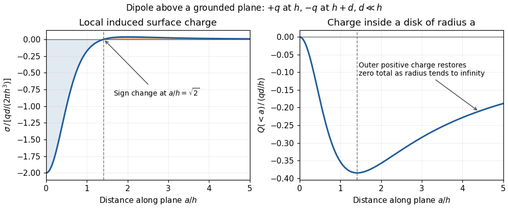

<h1 id="9/b/solution">Solution</h1>

↑ **Parent:** [B](../b.md)

Apply the [superposition principle](../../../../superposition-principle.md) to the result of part (a). If $F(a,h)=-qh/[2\pi\epsilon_0(a^2+h^2)^{3/2}]$, then the exact normal [electric field](../../../../electric-field-split.md) from the two real [point charges](../../../../point-charge.md) and their [image charges](../../../../image-charge.md) is

$$
E_z=F(a,h)-F(a,h+d)
=\frac{q}{2\pi\epsilon_0}\left[\frac{h+d}{[a^2+(h+d)^2]^{3/2}}-\frac{h}{(a^2+h^2)^{3/2}}\right].
$$

For $d\ll h$, [Taylor's theorem](../../../../taylor-s-theorem.md) gives $E_z=-d\partial_hF+O(d^2)$. Since

$$
\frac{d}{dh}\frac{h}{(a^2+h^2)^{3/2}}
=\frac{a^2-2h^2}{(a^2+h^2)^{5/2}},
$$

the leading [electric dipole](../../../../electric-dipole.md) result is

$$
\boxed{E_z(a,0^+)=\frac{qd}{2\pi\epsilon_0}\frac{a^2-2h^2}{(a^2+h^2)^{5/2}}+O\!\left(\frac{qd^2}{\epsilon_0h^4}\right).}
$$

The [electric dipole moment](../../../../electric-dipole-moment.md) is $\mathbf p=-qd\hat{\mathbf z}$. The circle $a=\sqrt2h$ is the zero of the leading normal [electric field](../../../../electric-field-split.md) and hence of the induced [surface charge density](../../../../surface-charge-density.md). Inside it, induced [surface charge density](../../../../surface-charge-density.md) is negative; outside it, positive. The tangential [electric field](../../../../electric-field-split.md) is zero everywhere on the grounded [electrical conductor](../../../../electrical-conductor.md), so the leading full [electric field](../../../../electric-field-split.md) vanishes on that circle. The corresponding [dipole-induced charge on a grounded plane](../../../../dipole-induced-charge-on-a-grounded-plane.md) integrates to zero over the whole plane: the negative central region is balanced by the positive exterior.

For finite $d$, $a=\sqrt2h$ is only the leading-order zero. With $u=h^{2/3}$ and $v=(h+d)^{2/3}$, the exact zero satisfies $a^2=uv(u+v)$, giving $a=\sqrt2(h+d/2)+O(d^2/h)$. For example, inserting any $d>0$ in the exact expression at $a=\sqrt2h$ does not give zero. This is a controlled [electric dipole](../../../../electric-dipole.md) approximation, not an exact finite-separation identity.

**[Figure 1](#9/b/image-sign-reversal-and-enclosed-induced-electric-charge-for-a-normal-electric-dipole-above-a-grounded-plane). Sign reversal and enclosed induced electric charge for a normal electric dipole above a grounded plane**.

## ↑ Ancestors (12)

1. [B](../b.md)
2. [9](../../9.md)
3. [2022](../../../2022-split.md)
4. [Past exam of the physics 2 paper of the University of Oxford](../../../split.md)
5. [Physics 2 paper of the University of Oxford](../../../../physics-2-paper-of-the-university-of-oxford.md)
6. [Year 1 of the physics course of the University of Oxford](../../../../year-1-of-the-physics-course-of-the-university-of-oxford.md)
7. [Physics course of the University of Oxford](../../../../physics-course-of-the-university-of-oxford.md)
8. [Undergraduate course of the University of Oxford](../../../../undergraduate-course-of-the-university-of-oxford.md)
9. [Course of the University of Oxford](../../../../course-of-the-university-of-oxford.md)
10. [University of Oxford](../../../../university-of-oxford-split.md)
11. [List of universities](../../../../list-of-universities.md)
12. [Codex Wiki](../../../../split.md)
