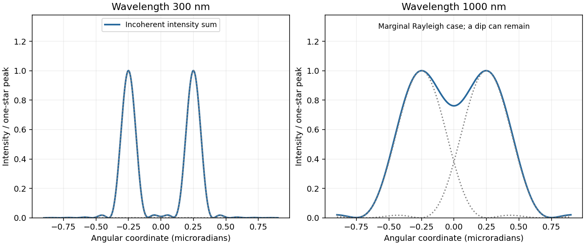
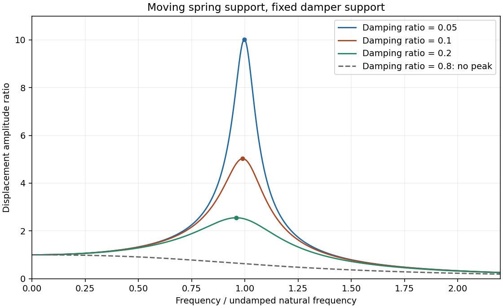
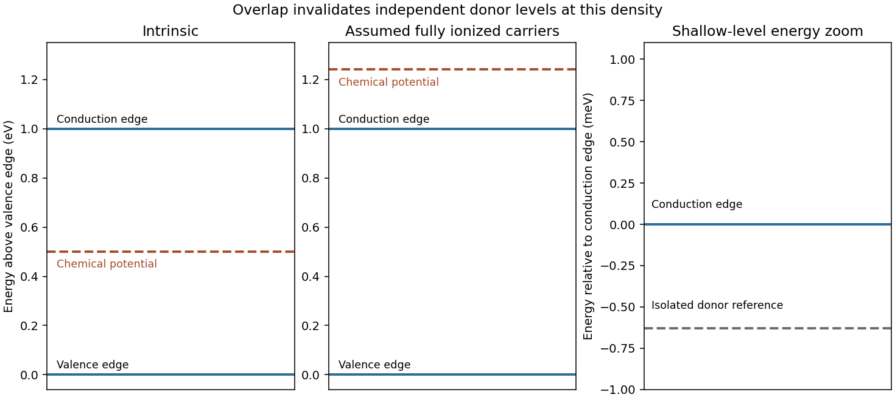
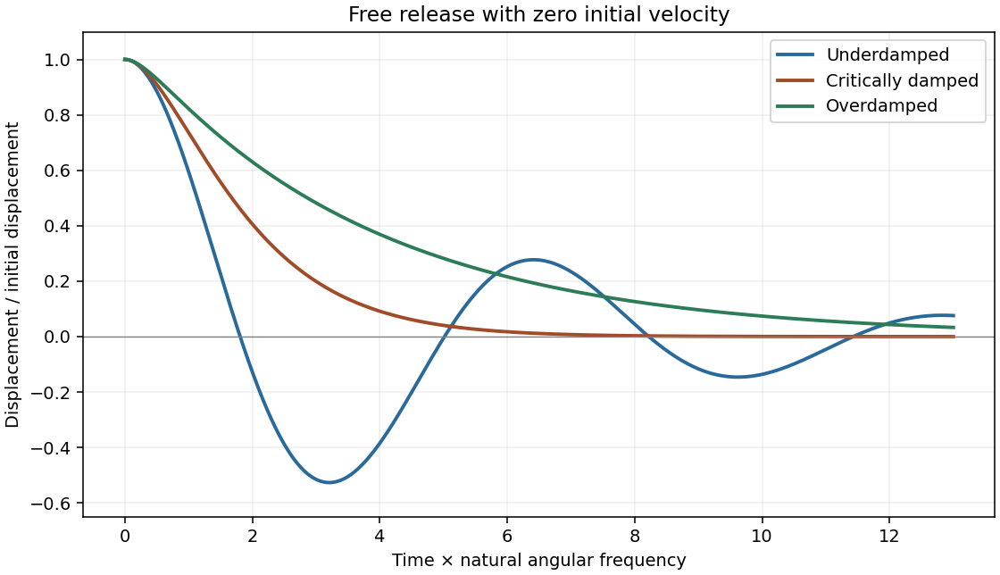

# Paper 1

↑ **Parent:** [2010](../2010.md)

[Original examination PDF, physical pages1–7](https://www.whatdotheyknow.com/request/physics_past_papers_23/response/3514893/attach/4/FOI%202026%20628%20Smith%20materials.pdf?cookie_passthrough=1#page=1)

**Table of contents**

- [Section A](#section-a)
  - [1](#section-a/1)
    - [Solution](#section-a/1/solution)
  - [2](#section-a/2)
    - [Solution](#section-a/2/solution)
  - [3](#section-a/3)
    - [a](#section-a/3/a)
      - [Solution](#section-a/3/a/solution)
    - [b](#section-a/3/b)
      - [Solution](#section-a/3/b/solution)
  - [4](#section-a/4)
    - [Solution](#section-a/4/solution)
  - [5](#section-a/5)
    - [Solution](#section-a/5/solution)
- [Section B](#section-b)
  - [B6](#section-b/b6)
    - [Solution](#section-b/b6/solution)
  - [B7](#section-b/b7)
    - [Solution](#section-b/b7/solution)
    - [a](#section-b/b7/a)
      - [Solution](#section-b/b7/a/solution)
    - [b](#section-b/b7/b)
      - [Solution](#section-b/b7/b/solution)
  - [B8](#section-b/b8)
    - [Solution](#section-b/b8/solution)
    - [a](#section-b/b8/a)
      - [Solution](#section-b/b8/a/solution)
    - [b](#section-b/b8/b)
      - [Solution](#section-b/b8/b/solution)
  - [B9](#section-b/b9)
    - [Solution](#section-b/b9/solution)
    - [a](#section-b/b9/a)
      - [Solution](#section-b/b9/a/solution)
    - [b](#section-b/b9/b)
      - [Solution](#section-b/b9/b/solution)
- [Section C](#section-c)
  - [C10](#section-c/c10)
    - [Solution](#section-c/c10/solution)
  - [C11](#section-c/c11)
    - [Solution](#section-c/c11/solution)
- [Section D](#section-d)
  - [D12](#section-d/d12)
    - [a](#section-d/d12/a)
      - [Solution](#section-d/d12/a/solution)
    - [b](#section-d/d12/b)
      - [Solution](#section-d/d12/b/solution)
    - [c](#section-d/d12/c)
      - [Solution](#section-d/d12/c/solution)
  - [D13](#section-d/d13)
    - [i](#section-d/d13/i)
      - [Solution](#section-d/d13/i/solution)
    - [ii](#section-d/d13/ii)
      - [Solution](#section-d/d13/ii/solution)
    - [iii](#section-d/d13/iii)
      - [Solution](#section-d/d13/iii/solution)
    - [iv](#section-d/d13/iv)
      - [Solution](#section-d/d13/iv/solution)

## Section A

↑ **Parent:** [Paper 1](paper-1.md)

<h3 id="section-a/1">1</h3>

↑ **Parent:** [Section A](#section-a)

<h4 id="section-a/1/solution">Solution</h4>

↑ **Parent:** [1](#section-a/1)

Let the common [tension](../../force.md#tension) be T, the linear mass densities be $\mu_1<\mu_2$ and the speeds be $c_j=\sqrt{T/\mu_j}$, so $c_2<c_1$. Displacement and transverse-force continuity give the [displacement coefficients at a string junction](../../classical-mechanics.md#displacement-coefficients-at-a-string-junction)

$$
\boxed{r=\frac{c_2-c_1}{c_2+c_1}<0,\qquad t=\frac{2c_2}{c_1+c_2},\quad0<t<1.}
$$

The reflected triangular pulse is inverted, has smaller height $|r|H$, unchanged spatial width and unchanged speed, and travels left. Its left-to-right asymmetric profile is reversed as well as vertically inverted. The transmitted pulse remains upright, has smaller height tH, travels more slowly, and has width $Wc_2/c_1$. The [string-pulse width mapping at a junction](../../classical-mechanics.md#string-pulse-width-mapping-at-a-junction) leaves its temporal duration unchanged. The transmitted slopes are steeper by $2c_1/(c_1+c_2)$; the reflected slope magnitudes are smaller by $|r|$.

The density ratio is unspecified, so only these inequalities are determined. The original plot below illustrates $\mu_2/\mu_1=4$, giving $r=-1/3$, $t=2/3$ and half-width transmission; it is not a numerical reading of the examination figure.

**[Figure 1](#section-a/1/image-pulse-junction). Pulse junction**. [Source](paper-1-pa2010-pulse-junction.py). Illustrative density ratio four; reflection inverts the pulse and transmission compresses its width.

<h3 id="section-a/2">2</h3>

↑ **Parent:** [Section A](#section-a)

<h4 id="section-a/2/solution">Solution</h4>

↑ **Parent:** [2](#section-a/2)

For the [adjacent reflected minima of an air-film-air layer](../../physical-optics.md#adjacent-reflected-minima-of-an-air-film-air-layer) in [thin-film interference](../../physical-optics.md#thin-film-interference), reflection at the front surface acquires a phase reversal, while reflection at the rear does not. Near normal incidence the reflected minima therefore obey $2nt=m\lambda$ for integral m. A single intermediate maximum means that the two stated minima are consecutive orders:

$$
\frac{2nt}{500\,\mathrm{nm}}-\frac{2nt}{600\,\mathrm{nm}}=1.
$$

Thus $2nt=3000\,\mathrm{nm}$, with orders6 and5, and

$$
\boxed{t=\frac{3000}{2(1.3)}\,\mathrm{nm}=1.15\,\mu\mathrm m.}
$$

The intermediate reflected maximum is at $\lambda=3000/5.5\simeq545\,\mathrm{nm}$. This assumes negligible dispersion of the supplied refractive index and an air environment on both sides. [§3.4, reflection phase reversals and thin-film interference](../../physics-bibliography.md#university-physics-volume-3-by-samuel-j-ling-and-others)

<h3 id="section-a/3">3</h3>

↑ **Parent:** [Section A](#section-a)

<h4 id="section-a/3/a">a</h4>

↑ **Parent:** [3](#section-a/3)

<h5 id="section-a/3/a/solution">Solution</h5>

↑ **Parent:** [A](#section-a/3/a)

The angular separation is $\Delta\theta=10^{11}/(2\times10^{17})=5.00\times10^{-7}\,\mathrm{rad}$. Each star's angular diameter is below $5\times10^{-9}\,\mathrm{rad}$, so treating it as a point source is justified at these diffraction scales.

At300nm the [Airy disk](../../point-spread-function.md#airy-disk) first-zero radius is $1.22\lambda/D=1.525\times10^{-7}\,\mathrm{rad}$. The separation is3.28 times this radius: **two well-separated bright peaks** occur. The stars are mutually incoherent, so their [point spread functions](../../point-spread-function.md) add as intensities, not amplitudes:

$$
I(\theta)=I_\star\left[A(\theta-\Delta\theta/2)+A(\theta+\Delta\theta/2)\right],\quad
A(u)=\left[\frac{2J_1(\pi Du/\lambda)}{\pi Du/\lambda}\right]^2.
$$

The value at u=0 is defined by continuity. Faint diffraction rings remain on either side of each principal peak. [§4.5, circular-aperture diffraction and Rayleigh angular scale](../../physics-bibliography.md#university-physics-volume-3-by-samuel-j-ling-and-others)

**[Figure 2](#section-a/3/a/image-two-star-profiles). Two-star profiles**. [Source](paper-1-pa2010-star-images.py). Summed Airy intensities for equal incoherent point sources at the two specified wavelengths.

<h4 id="section-a/3/b">b</h4>

↑ **Parent:** [3](#section-a/3)

<h5 id="section-a/3/b/solution">Solution</h5>

↑ **Parent:** [B](#section-a/3/b)

At1000nm the first-zero radius is $5.083\times10^{-7}\,\mathrm{rad}$, slightly larger than the $5.00\times10^{-7}\,\mathrm{rad}$ separation. The images therefore overlap strongly and **just fail the conventional [Rayleigh criterion](../../point-spread-function.md#rayleigh-criterion)**, rather than forming two clean isolated peaks.

The summed Airy profile can still have a shallow central dip and two local maxima: Rayleigh's criterion is a resolution convention, not the exact condition for a profile to become single-peaked. The two-panel original plot in part(a) shows the correct intensity sums at both wavelengths. [§4.5, resolution criterion for equal point sources](../../physics-bibliography.md#university-physics-volume-3-by-samuel-j-ling-and-others)

<h3 id="section-a/4">4</h3>

↑ **Parent:** [Section A](#section-a)

<h4 id="section-a/4/solution">Solution</h4>

↑ **Parent:** [4](#section-a/4)

For hard spheres of radius r in a [face-centered cubic lattice](../../quantum-scattering.md#face-centered-cubic-lattice), contact occurs along a face diagonal: $4r=\sqrt2a$. Four spheres belong to a conventional cell, so the [hard-sphere cubic packing fractions](../../physical-chemistry.md#hard-sphere-cubic-packing-fractions) give

$$
\boxed{\eta_{\rm FCC}=\frac{4(4\pi r^3/3)}{a^3}=\frac{\pi}{3\sqrt2}=0.7405.}
$$

For a [body-centered cubic lattice](../../quantum-scattering.md#body-centered-cubic-lattice), contact occurs along a body diagonal, $4r=\sqrt3a$, and there are two spheres per conventional cell:

$$
\boxed{\eta_{\rm BCC}=\frac{2(4\pi r^3/3)}{a^3}=\frac{\sqrt3\pi}{8}=0.6802.}
$$

Their ratio $8/(3\sqrt6)=1.0887>1$ proves that FCC packs more densely. Coordination alone would not establish the occupied volume fraction.

<h3 id="section-a/5">5</h3>

↑ **Parent:** [Section A](#section-a)

<h4 id="section-a/5/solution">Solution</h4>

↑ **Parent:** [5](#section-a/5)

For a classical ideal monatomic gas, $C_{V,\rm He}=3Nk_B/2$ and $C_{p,\rm He}=5Nk_B/2$. Treat copper as having one conduction electron per atom. Its degenerate-electron contribution is

$$
C_{e,\rm Cu}=\frac{\pi^2}{2}Nk_B\frac{k_BT}{E_F}.
$$

Consequently the **electron-only** estimates at5K are

$$
\boxed{\frac{C_{V,\rm He}}{C_{e,\rm Cu}}=4.94\times10^3,\qquad
\frac{C_{p,\rm He}}{C_{e,\rm Cu}}=8.23\times10^3.}
$$

The [constant-pressure gas versus electronic metal heat capacity](../../heat.md#constant-pressure-gas-versus-electronic-metal-heat-capacity) convention makes the second numerator appropriate to a constant-pressure gas measurement. For the solid, the low-temperature difference between $C_p$ and $C_V$ is usually small, but its [phonon](../../quantum-ideal-gas-statistics.md#phonon) contribution is not fixed by $E_F$. In a [Debye model](../../quantum-ideal-gas-statistics.md#debye-model),

$$
\frac{C_{p,\rm He}}{C_{V,\rm Cu}}\simeq
\frac{5/2}{(\pi^2/2)k_BT/E_F+(12\pi^4/5)(T/\Theta_D)^3}.
$$

The supplied $E_F$ alone therefore does not determine the ratio to copper's total [heat capacity](../../heat.md#heat-capacity); the electronic-only result is conditional.[Chapter3, §3.3.1, Debye lattice heat capacity; printedpp.96–97, distinct electronic-linear and phonon-cubic contributions in copper](../../physics-bibliography.md#statistical-physics-by-david-tong) An estimate using additional material data is possible: the specific-heat fit in [Material Properties: OFHC Copper by National Institute of Standards and Technology](../../physics-bibliography.md#material-properties-ofhc-copper-by-national-institute-of-standards-and-technology) gives $c_{p,\rm Cu}(5\,\mathrm K)\simeq0.155\,\mathrm{J\,kg^{-1}K^{-1}}$. Using copper's rounded [molar mass](../../chemistry.md#molar-mass) $0.0635\,\mathrm{kg\,mol^{-1}}$ gives $C_{p,\rm Cu}\simeq9.85\times10^{-3}\,\mathrm{J\,mol^{-1}K^{-1}}$, and hence

$$
\boxed{\frac{C_{p,\rm He}}{C_{p,\rm Cu}}\simeq\frac{5R/2}{9.85\times10^{-3}\,\mathrm{J\,mol^{-1}K^{-1}}}\simeq2.1\times10^3.}
$$

This supplementary estimate includes copper's lattice contribution and retains the ideal-gas approximation for [helium](../../chemical-substance.md#helium). The NIST fit reports a 10% deviation from its source data below 15 K; neither that fit nor the stated pressure alone supplies helium nonideality corrections.[Specific heat: 4–300 K fit, coefficient column a–i, base-ten logarithmic polynomial; stated 10% fit deviation for temperatures below 15 K](../../physics-bibliography.md#material-properties-ofhc-copper-by-national-institute-of-standards-and-technology)

## Section B

↑ **Parent:** [Paper 1](paper-1.md)

<h3 id="section-b/b6">B6</h3>

↑ **Parent:** [Section B](#section-b)

<h4 id="section-b/b6/solution">Solution</h4>

↑ **Parent:** [B6](#section-b/b6)

Measure both vertical displacements upward from static equilibrium, so gravity cancels. The spring force changes by $k(x_1-x)$, while the damper is attached to a fixed surface and supplies $-b\dot x$. [Newton's second law](../../force.md#newton-s-second-law) gives

$$
\boxed{m\ddot x+b\dot x+kx=kx_1.}
$$

For sinusoidal steady motion, substitution of $x=\operatorname{Re}(RAe^{i\omega t})$ gives the [spring-base displacement response with a grounded damper](../../analysis.md#spring-base-displacement-response-with-a-grounded-damper)

$$
\boxed{R(\omega)=\frac{k}{k-m\omega^2+i b\omega}.}
$$

A decaying homogeneous transient must be added unless initial conditions already select steady state. At low frequency, $R\to1$ and the mass follows the slowly moving support; the first correction is $-ib\omega/k$. At high frequency, $R\sim-k/(m\omega^2)$: inertia suppresses motion and reverses its phase relative to the support. There is no $ib\omega$ in the numerator because the damper's other end does not move.

Minimize the squared denominator $D=(k-m\omega^2)^2+b^2\omega^2$. Its derivative is $2\omega[2m^2\omega^2-2mk+b^2]$, giving

$$
\boxed{\omega_{\rm res}^2=k/m-b^2/(2m^2),\qquad b^2<2mk.}
$$

Write $\omega_0=\sqrt{k/m}$ and $\zeta=b/(2m\omega_0)$. Then $|R|=[(1-r^2)^2+4\zeta^2r^2]^{-1/2}$ with $r=\omega/\omega_0$, and the finite-frequency peak is $1/[2\zeta\sqrt{1-\zeta^2}]$. Increasing light damping lowers and broadens the peak and shifts it left; the low-frequency limit remains1 and the high-frequency decay remains proportional to $\omega^{-2}$.

The [resonance versus oscillatory damping thresholds](../../wave-equation.md#resonance-versus-oscillatory-damping-thresholds) differ. For $b^2\ge2mk$, the maximum is at zero frequency and the curve decreases monotonically. This threshold is $\zeta=1/\sqrt2$, distinct from the free-oscillation critical damping threshold $\zeta=1$.

**[Figure 3](#section-b/b6/image-base-displacement-response). Base displacement response**. [Source](paper-1-pa2010-base-response.py). Three light-damping levels and one monotone response; dots mark the finite-frequency peaks.

<h3 id="section-b/b7">B7</h3>

↑ **Parent:** [Section B](#section-b)

<h4 id="section-b/b7/solution">Solution</h4>

↑ **Parent:** [B7](#section-b/b7)

A [dispersive wave](../../dispersion-relation.md#dispersive-wave) has phase speed depending on frequency. Its [phase velocity](../../dispersion-relation.md#phase-velocity) is $v_p=\omega/k$, whereas the [group velocity](../../dispersion-relation.md#group-velocity) $v_g=d\omega/dk$ describes a narrow wave packet in a lossless single branch. Examples are deep-water gravity waves, $\omega^2=gk$, and electromagnetic waves in a cold plasma, $\omega^2=\omega_p^2+c^2k^2$.

The fixed-edge [membrane waveguide](../../wave-equation.md#membrane-waveguide) has transverse profiles $\sin(n\pi y/b)$ with

$$
\boxed{k_y=n\pi/b,\quad n=1,2,\ldots,\qquad
\omega_n^2=v^2[k_x^2+(n\pi/b)^2].}
$$

There is no nonzero n=0 displacement satisfying both fixed-edge conditions. Even though the unconfined membrane is nondispersive, transverse confinement makes propagation along x dispersive. The [membrane-guide phase and energy speeds](../../wave-equation.md#membrane-guide-phase-and-energy-speeds) are, for a propagating mode,

$$
\boxed{v_{p,x}=\frac\omega{k_x},\quad v_{g,x}=\frac{v^2k_x}{\omega},\quad
v_{p,x}v_{g,x}=v^2,\qquad f_{c,n}=\frac{nv}{2b}.}
$$

For positive $k_x$, the phase speed exceeds v while group speed is below v. At cutoff $k_x=0$ the formal phase speed diverges, but group speed vanishes; no finite longitudinal energy flux is implied.

With the supplied width and speed, $f_{c,n}=10n\,\mathrm{kHz}$. At15kHz only n=1 propagates:

$$
\boxed{k_x=\sqrt{(30\pi)^2-(20\pi)^2}=10\pi\sqrt5=70.2\,\mathrm{m^{-1}}.}
$$

The negative value represents travel in the opposite direction; higher transverse modes are evanescent.

<h4 id="section-b/b7/a">a</h4>

↑ **Parent:** [B7](#section-b/b7)

<h5 id="section-b/b7/a/solution">Solution</h5>

↑ **Parent:** [A](#section-b/b7/a)

At5kHz every transverse mode is below cutoff, so **no propagating guided mode exists**. A driven boundary can produce an evanescent near field. For n=1 the decay coefficient is $\sqrt{(20\pi)^2-(10\pi)^2}=10\pi\sqrt3=54.4\,\mathrm{m^{-1}}$, an e-folding distance of18.4mm. This is decay along the guide, not attenuation of an otherwise propagating lossless wave.

<h4 id="section-b/b7/b">b</h4>

↑ **Parent:** [B7](#section-b/b7)

<h5 id="section-b/b7/b/solution">Solution</h5>

↑ **Parent:** [B](#section-b/b7/b)

At25kHz, **the n=1 and n=2 modes can propagate**, with

$$
\boxed{k_{x,1}=10\pi\sqrt{21}=144\,\mathrm{m^{-1}},\qquad k_{x,2}=30\pi=94.2\,\mathrm{m^{-1}}.}
$$

They have different phase and group speeds, so a launch exciting both produces multimode propagation and possible beating. Actual mode amplitudes depend on the transverse launch profile; their existence does not guarantee both are excited. Modes n≥3 remain evanescent.

<h3 id="section-b/b8">B8</h3>

↑ **Parent:** [Section B](#section-b)

<h4 id="section-b/b8/solution">Solution</h4>

↑ **Parent:** [B8](#section-b/b8)

In [Fraunhofer diffraction](../../physical-optics.md#fraunhofer-diffraction), the phase difference from aperture coordinate y to observation angle theta is $qy$, with $q=2\pi\sin\theta/\lambda$. Coherent superposition of the transmitted field elements therefore gives

$$
\boxed{\psi(\theta)\propto\int T(y)e^{iqy}\,dy.}
$$

The common propagation factor is omitted. This is the [Fourier transform](../../fourier-transform.md) of the complex amplitude transmission, not of its intensity.

For a uniform slit of total width $W=0.2\,\mathrm{mm}$, integration gives $\psi_0=W\operatorname{sinc}(qW/2)$, where $\operatorname{sinc}s=\sin s/s$. Its normalized intensity is $\operatorname{sinc}^2(\pi W\sin\theta/\lambda)$, with a central maximum and first zeros at $\sin\theta=\pm\lambda/W=\pm0.0025$.

For a half-covered slit choose $T=+1$ on the left half and $T=-1$ on the right. Put $h=W/2$ and $s=qh/2$. The two equal rectangles have centres separated by h, so

$$
\psi_\pi=h\operatorname{sinc}s\,(e^{-is}-e^{is})=-2ih\operatorname{sinc}s\sin s,
\qquad
\boxed{\frac{I_\pi}{I_{0,\rm peak}}=\operatorname{sinc}^2s\,\sin^2s=\frac{\sin^4s}{s^2}.}
$$

This [half-slit phase-step diffraction factorization](../../physical-optics.md#half-slit-phase-step-diffraction-factorization) is the phase-reversed two-slit interference factor multiplied by the diffraction envelope of each half-slit. Here the half-slit width and centre separation both equal the earlier0.1mm separation. The central intensity is zero; the largest off-axis pair satisfies $\tan s=2s$, giving $|\sin\theta|\simeq0.00186$. Other zeros are at $s=m\pi$. The plot includes the requested uniform-slit and half-covered patterns.

**[Figure 4](#section-b/b8/image-phase-step-diffraction). Phase-step diffraction**. [Source](paper-1-pa2010-phase-apertures.py). Complex field transmissions and their computed intensities; narrow rectangle widths are illustrative.

<h4 id="section-b/b8/a">a</h4>

↑ **Parent:** [B8](#section-b/b8)

<h5 id="section-b/b8/a/solution">Solution</h5>

↑ **Parent:** [A](#section-b/b8/a)

The slit transmissions have the same magnitude but opposite phase. An ideal narrow-slit representation is

$$
\boxed{T(y)\propto\delta(y+d/2)-\delta(y-d/2),\qquad d=0.1\,\mathrm{mm}.}
$$

Equivalently draw two narrow rectangles at $y=\pm d/2$, one at+1 and the other at−1, and zero elsewhere. A finite rectangle width gives each slit its own diffraction envelope. The original aperture plot shows such rectangles with explicitly illustrative width; the negative value is a field phase reversal, not negative transmitted intensity.

<h4 id="section-b/b8/b">b</h4>

↑ **Parent:** [B8](#section-b/b8)

<h5 id="section-b/b8/b/solution">Solution</h5>

↑ **Parent:** [B](#section-b/b8/b)

For the narrow pair, the amplitude is $e^{-iqd/2}-e^{iqd/2}=-2i\sin(qd/2)$. Hence [phase-reversed double-slit diffraction](../../physical-optics.md#phase-reversed-double-slit-diffraction) gives

$$
\boxed{I(\theta)\propto4\sin^2(\pi d\sin\theta/\lambda).}
$$

There is a central dark fringe. Minima obey $d\sin\theta=m\lambda$, maxima $d\sin\theta=(m+1/2)\lambda$, and the near-axis angular fringe period is $\lambda/d=0.005\,\mathrm{rad}$. Finite slit widths multiply this interference profile by their single-slit envelope. The parent plot includes the narrow-pair profile.

<h3 id="section-b/b9">B9</h3>

↑ **Parent:** [Section B](#section-b)

<h4 id="section-b/b9/solution">Solution</h4>

↑ **Parent:** [B9](#section-b/b9)

[Fresnel diffraction](../../physical-optics.md#fresnel-diffraction) retains the quadratic transverse propagation phase; [Fraunhofer diffraction](../../physical-optics.md#fraunhofer-diffraction) neglects it and leaves an aperture Fourier transform. Expanding the propagation distance gives $z+y^2/(2z)+\cdots$. The aperture phase variation is of order $\pi\rho^2/(\lambda z)$, so the crossover scale is $z\sim\rho^2/\lambda$, with far-field propagation requiring a much smaller [Fresnel number](../../physical-optics.md#fresnel-number) than1.

Here $\lambda\simeq0.0100\,\mathrm m$ and the full gap width gives $\rho^2/\lambda=25\,\mathrm m$, comparable with the16m range. More decisively, measured from the grazing line of sight to the far gap edge, the quadratic phase reaches $\pi(0.5)^2/(0.01\times16)=4.91\,\mathrm{rad}$. **Fresnel diffraction is required**; conventions using a half-width change the quoted Fresnel number but not this phase test.

Define $F(w)=C(w)+iS(w)$ with the normalization in the paper. The grazing-edge gap spans $w=0$ to

$$
w_g=0.5\sqrt{2/(\lambda z)}=1.768.
$$

The [Cornu chord power normalization](../../physical-optics.md#cornu-chord-power-normalization) uses a received field proportional to $F(w_g)-F(0)$, while no fence gives $F(\infty)-F(-\infty)=1+i$. Numerical Fresnel integration gives $C(w_g)=0.3245$, $S(w_g)=0.4818$, and therefore

$$
\boxed{\frac{P_{\rm gap}}{P_{\rm open}}=\frac{C(w_g)^2+S(w_g)^2}{2}=0.169.}
$$

The two labelled child answers specify the corresponding vectors.

For the [largest contiguous Fresnel aperture](../../physical-optics.md#largest-contiguous-fresnel-aperture), a freely chosen single contiguous opening must maximize the chord between two points of the [Cornu spiral](../../topology.md#euler-spiral). Its longest chord joins $F(-w_*)$ to $F(w_*)$, where the first maximum radius satisfies $C(w_*)\cos(\pi w_*^2/2)+S(w_*)\sin(\pi w_*^2/2)=0$. This gives $w_*=1.2094$ and

$$
\boxed{-0.342\,\mathrm m<x<+0.342\,\mathrm m,\qquad
P_{\max}/P_{\rm open}\simeq1.80.}
$$

Here x is signed displacement along the fence from the grazing optical axis. The [pointwise Fresnel gain versus integrated transmitted power](../../physical-optics.md#pointwise-fresnel-gain-versus-integrated-transmitted-power) distinction explains why an aperture can concentrate more power at one receiver than the fully open field through constructive interference; this is not an increase of integrated transmitted power.

The [existing-opening constraint in Fresnel aperture optimization](../../physical-optics.md#existing-opening-constraint-in-fresnel-aperture-optimization) matters literally: the original gap already occupies $[0,0.5]\,\mathrm m$. The symmetric optimum would require filling its far end. If only further removal is permitted and the final opening must be connected, maximize the chord subject to $w_-\le0$ and $w_+\ge1.768$. The constrained optimum is approximately

$$
\boxed{w_-=-1.2158,\quad w_+=2.3405,\qquad
-0.344\,\mathrm m<x<0.662\,\mathrm m,\quad P/P_{\rm open}=1.60.}
$$

These are different optimization assumptions; both are stated so the original gap is not silently replaced. The model treats the fence as an ideal opaque screen and ignores ground reflections or additional propagation paths. [§7.2, normalized Fresnel integrals and their limiting values](../../mathematics-bibliography.md#nist-digital-library-of-mathematical-functions)

**[Figure 5](#section-b/b9/image-cornu-aperture-vectors). Cornu aperture vectors**. [Source](paper-1-pa2010-cornu-vectors.py). Original numerical spiral with gap, open-field and two differently constrained optimum chords.

<h4 id="section-b/b9/a">a</h4>

↑ **Parent:** [B9](#section-b/b9)

<h5 id="section-b/b9/a/solution">Solution</h5>

↑ **Parent:** [A](#section-b/b9/a)

The grazing-gap signal is the chord **from $F(0)=0$ to $F(1.768)$**, approximately $(0.3245,0.4818)$ in the (C,S) plane. Its squared length determines received power after applying the same propagation normalization used for the open field. Reversing which gap edge grazes the ray reflects both limits and leaves the power unchanged.

<h4 id="section-b/b9/b">b</h4>

↑ **Parent:** [B9](#section-b/b9)

<h5 id="section-b/b9/b/solution">Solution</h5>

↑ **Parent:** [B](#section-b/b9/b)

With the whole fence removed, the vector joins **$F(-\infty)=(-1/2,-1/2)$ to $F(+\infty)=(1/2,1/2)$**. It is $(1,1)$, with squared length2. The normalized power ratio must compare the gap chord to this full chord, not to the half-plane chord from the origin to one limiting point.

## Section C

↑ **Parent:** [Paper 1](paper-1.md)

<h3 id="section-c/c10">C10</h3>

↑ **Parent:** [Section C](#section-c)

<h4 id="section-c/c10/solution">Solution</h4>

↑ **Parent:** [C10](#section-c/c10)

Write the lattice reciprocal vector as $G=2\pi/a$ in one dimension. The [nearly-free electron model](../../bloch-s-theorem.md#nearly-free-electron-model) starts from $\varepsilon_k=\hbar^2k^2/(2m_e)$ and couples plane waves separated by G. Near a zone boundary, the two-wave [Hamiltonian](../../hamiltonian-mechanics.md#hamiltonian) is

$$
\begin{pmatrix}\varepsilon_k&V_G\\V_G^*&\varepsilon_{k-G}\end{pmatrix},\qquad
E_\pm=\frac{\varepsilon_k+\varepsilon_{k-G}}2
\pm\sqrt{\left(\frac{\varepsilon_k-\varepsilon_{k-G}}2\right)^2+|V_G|^2}.
$$

At $k=G/2$ the free waves are degenerate and the periodic potential opens a gap $2|V_G|$. A reduced-zone drawing folds k modulo G into $[-G/2,G/2]$, displaying multiple bands at each reduced wavevector. The original plot shows free folded parabolas, avoided crossings and an allowed vertical optical transition. [Chapter2, nearly-free plane-wave mixing and Brillouin-zone boundary gaps](../../physics-bibliography.md#solid-state-physics-by-david-tong)

Including two spin states, filling a free [Fermi sphere](../../fermi-liquid.md#fermi-sphere) gives $n=2(4\pi k_F^3/3)/(2\pi)^3=k_F^3/(3\pi^2)$. A monovalent BCC cell contributes two electrons, so

$$
\boxed{k_F=(3\pi^2n)^{1/3}=\frac{(6\pi^2)^{1/3}}a,\qquad
\frac{k_F}{\sqrt2\pi/a}=0.877<1.}
$$

The sphere therefore lies inside every first-zone face, since the supplied distance is the nearest boundary.

For the shortest BCC reciprocal vector, $G=2\sqrt2\pi/a$. In the zero-potential folded-band limit, the energy of a vertical transition from k along G to the neighbouring free branch is $\hbar^2(G^2-2Gk)/(2m_e)$. It decreases over the occupied interval and is smallest at $k=k_F$. Thus the [monovalent BCC direct optical threshold](../../bloch-s-theorem.md#monovalent-bcc-direct-optical-threshold) is

$$
\boxed{\frac{E_0}{E_F}=\left(\frac G{k_F}\right)^2-2\frac G{k_F}=0.6376\simeq0.64.}
$$

The final state is empty because $G-k_F>k_F$. Finite weak $V_G$ changes the energies and makes optical matrix elements nonzero; an exactly free electron gas by itself has no interband absorption. The expression is a leading weak-potential threshold, not a claim that every peak equals the onset.

Using the supplied lattice constants and bare-electron free bands gives $E_F=(3.24,2.12,1.85)\,\mathrm{eV}$ and thresholds $(2.06,1.35,1.18)\,\mathrm{eV}$ for Na,K,Rb. The source plot's broad higher-frequency features shift toward lower energy in the same order as a increases, qualitatively consistent with the predicted $a^{-2}$ scale. Their peak shapes, heights and exact positions need matrix elements, band corrections and scattering; low-frequency intraband conductivity is a separate contribution. No measured trace is reproduced.

**[Figure 6](#section-c/c10/image-nearly-free-folded-bands). Nearly-free folded bands**. [Source](paper-1-pa2010-nearly-free-bands.py). Illustrative weak periodic potential; gray curves are free bands and the arrow is a vertical transition.

<h3 id="section-c/c11">C11</h3>

↑ **Parent:** [Section C](#section-c)

<h4 id="section-c/c11/solution">Solution</h4>

↑ **Parent:** [C11](#section-c/c11)

With a positive charge magnitude e, the relaxation-time equation for electrons is $m_e^*\dot{\mathbf v}=-e\mathbf E-m_e^*\mathbf v/\tau$. Steady drift is opposite the field, $\mathbf v_d=-e\tau\mathbf E/m_e^*$, so the positive [electron mobility](../../electric-charge.md#electron-mobility) and [electrical conductivity](../../electric-charge.md#electrical-conductivity) are

$$
\boxed{\mu_e=e\tau/m_e^*,\qquad\mathbf j=-ne\mathbf v_d=ne\mu_e\mathbf E,\qquad
\sigma=ne^2\tau/m_e^*.}
$$

This is the weak-field [Drude model](../../electric-charge.md#drude-model); the mobility is a magnitude, not the signed velocity-to-field ratio.

For an intrinsic nondegenerate semiconductor, $n_i=p_i=\sqrt{N_cN_v}e^{-E_g/(2k_BT)}$. Equal electron and hole masses give $N_c=N_v$ and intrinsic chemical potential midway between the band edges. At300K, the exponential is $e^{-19.34}=3.98\times10^{-9}$. Using the later supplied mass $0.015m_e$ gives

$$
N_c=2\left(\frac{m^*k_BT}{2\pi\hbar^2}\right)^{3/2}=4.61\times10^{22}\,\mathrm{m^{-3}},\qquad
\boxed{n_i\simeq1.84\times10^{14}\,\mathrm{m^{-3}}.}
$$

This is many orders below a typical metal's carrier density. Since $\sigma_i=en_i(\mu_e+\mu_h)$, ordinary finite carrier mobilities leave its intrinsic conduction negligible on a metallic scale; the gap alone does not specify an exact conductivity without the mobilities.

Under the explicitly stipulated full donor ionization, $n\simeq N_d=10^{24}\,\mathrm{m^{-3}}$ and the supplied mobility is $0.0100\,\mathrm{m^2\,V^{-1}\,s^{-1}}$. Therefore

$$
\boxed{\sigma=eN_d\mu_e=1.60\times10^3\,\mathrm{S\,m^{-1}}.}
$$

The band diagram places the intrinsic chemical potential at midgap and a shallow isolated donor level just below the conduction edge. The doped chemical potential moves upward. Quantitatively, the [degeneracy test for a fully ionized light-mass donor gas](../../semiconductor.md#degeneracy-test-for-a-fully-ionized-light-mass-donor-gas) gives $N_d/N_c=21.7$, so a nondegenerate logarithmic chemical-potential formula is inconsistent. The parabolic-band zero-temperature estimate is $E_{F,d}-E_c=\hbar^2(3\pi^2N_d)^{2/3}/(2m^*)=0.243\,\mathrm{eV}$; its300K value is about0.241eV. The diagram accordingly shows the doped chemical potential inside the conduction band, not between an isolated donor level and the edge.

The [hydrogenic donor state](../../semiconductor.md#hydrogenic-donor-state) scaling using the supplied hydrogen values is

$$
\boxed{E_B=\frac{m^*/m_e}{\epsilon_r^2}(13.6\,\mathrm{eV})=0.630\,\mathrm{meV},\qquad
a^*=\frac{\epsilon_r}{m^*/m_e}a_0=63.6\,\mathrm{nm}.}
$$

The binding is much smaller than $k_BT=25.9\,\mathrm{meV}$, indicating a shallow donor on the isolated-state estimate. However, the mean donor spacing is only $N_d^{-1/3}=10\,\mathrm{nm}$, well below the orbit radius. The [donor-state overlap estimate](../../semiconductor.md#donor-state-overlap-estimate) invalidates an independent isolated-level ionization model at this concentration. Shallow binding supports abundant mobile carriers, but the [full ionization versus isolated donor occupation](../../semiconductor.md#full-ionization-versus-isolated-donor-occupation) distinction means full ionization cannot be justified solely by comparing binding with temperature while simultaneously retaining isolated levels and a degenerate chemical potential. The conductivity above follows the question's carrier-density assumption; an overlapping impurity/conduction-band description is needed for a self-consistent microscopic account. [§9.6, donor levels and semiconductor doping; isolated-level picture distinguished here from the high-density limit](../../physics-bibliography.md#university-physics-volume-3-by-samuel-j-ling-and-others)

**[Figure 7](#section-c/c11/image-donor-band-reference). Donor band reference**. [Source](paper-1-pa2010-donor-bands.py). The assumed density is degenerate; the isolated donor line is a reference, not an independent-level model.

## Section D

↑ **Parent:** [Paper 1](paper-1.md)

<h3 id="section-d/d12">D12</h3>

↑ **Parent:** [Section D](#section-d)

<h4 id="section-d/d12/a">a</h4>

↑ **Parent:** [D12](#section-d/d12)

<h5 id="section-d/d12/a/solution">Solution</h5>

↑ **Parent:** [A](#section-d/d12/a)

One instrument is a [diffraction grating](../../physical-optics.md#diffraction-grating) spectrometer. Its principal maxima satisfy $d\sin\theta=m\lambda$ at normal incidence. N coherently illuminated grooves give a narrow principal peak; applying the [Rayleigh criterion](../../point-spread-function.md#rayleigh-criterion) to the next wavelength yields the [resolving power of a diffraction grating](../../physical-optics.md#resolving-power-of-a-diffraction-grating)

$$
\boxed{\lambda/\delta\lambda=mN.}
$$

Higher order and more illuminated grooves improve resolution, but finite entrance-slit width, aberrations, detector sampling and overlap between spectral orders limit useful resolution. Angular dispersion $d\theta/d\lambda=m/(d\cos\theta)$ is distinct from the ability to resolve two finite-width peaks.

A second instrument is a [Fabry–Pérot interferometer](../../optical-instrument.md#fabry-perot-interferometer). For plate spacing L, refractive index n and internal angle theta, transmission resonances satisfy $2nL\cos\theta=m\lambda$. Multiple coherent reflections produce an Airy transmission profile. For identical lossless mirrors of intensity reflectivity $\mathcal R$, the high-finesse limit gives

$$
\boxed{\mathcal F\simeq\frac{\pi\sqrt{\mathcal R}}{1-\mathcal R},\qquad
\lambda/\delta\lambda\simeq m\mathcal F.}
$$

The frequency free spectral range is approximately $c/(2nL\cos\theta)$ for nondispersive n. A larger optical spacing narrows a line but also shrinks the unambiguous frequency interval; nearby orders need sorting. Mirror flatness, absorption, alignment and aperture broadening lower the effective finesse. This resolving-power formula assumes separated narrow lines and a stated line-separation convention, rather than equating transmission peak spacing with peak width.

<h4 id="section-d/d12/b">b</h4>

↑ **Parent:** [D12](#section-d/d12)

<h5 id="section-d/d12/b/solution">Solution</h5>

↑ **Parent:** [B](#section-d/d12/b)

The transient is the homogeneous part of a [damped harmonic oscillator](../../analysis.md#damped-harmonic-oscillator), $m\ddot x+b\dot x+kx=0$. Define $\alpha=b/(2m)$ and $\omega_0=\sqrt{k/m}$. Its characteristic roots are $-\alpha\pm\sqrt{\alpha^2-\omega_0^2}$.

- For $\alpha<\omega_0$, the [underdamped](../../wave-equation.md#underdamping) response is $x=e^{-\alpha t}(A\cos\omega_dt+B\sin\omega_dt)$, with $\omega_d=\sqrt{\omega_0^2-\alpha^2}$. The displacement oscillates with a decaying envelope.
- At critical damping, $x=(A+Bt)e^{-\omega_0t}$. It has a repeated root, so two identical exponentials are not an independent pair of solutions.
- For $\alpha>\omega_0$, two real negative exponentials produce an [overdamped](../../wave-equation.md#overdamping) return without sustained oscillation. In the strong-damping limit the slow decay rate is approximately $k/b$, not $b/m$.

Initial position and velocity determine A,B. For an imposed force or support motion, the full solution is a particular response plus this transient, which decays for b\>0 and k\>0. The mechanical energy obeys $d(K+U)/dt=-b\dot x^2$. In light damping its cycle-averaged envelope decays as $e^{-2\alpha t}$, with $Q\simeq\omega_0/(2\alpha)$. Initial conditions can still produce an overshoot in a nonoscillatory regime; the damping category describes the roots rather than every possible trajectory.

**[Figure 8](#section-d/d12/b/image-oscillator-transients). Oscillator transients**. [Source](paper-1-pa2010-oscillator-transients.py). Dimensionless release from unit displacement and zero velocity for three damping regimes.

<h4 id="section-d/d12/c">c</h4>

↑ **Parent:** [D12](#section-d/d12)

<h5 id="section-d/d12/c/solution">Solution</h5>

↑ **Parent:** [C](#section-d/d12/c)

Small sound disturbances in a gas couple density, pressure and longitudinal velocity. Linearizing mass conservation and the pressure-gradient force about a uniform state gives

$$
\partial_t\rho'+\rho_0\nabla\cdot\mathbf u=0,\qquad
\rho_0\partial_t\mathbf u=-\nabla p',\qquad p'=c_s^2\rho'.
$$

Eliminating velocity yields $\partial_t^2\rho'=c_s^2\nabla^2\rho'$. When local heat exchange is negligible over an oscillation, $c_s^2=(\partial p/\partial\rho)_s$. For an ideal gas,

$$
\boxed{c_s=\sqrt{\gamma p_0/\rho_0}=\sqrt{\gamma k_BT/m_{\rm molecule}}.}
$$

The adiabatic index is $\gamma=C_p/C_V$; an isothermal disturbance instead has $c_T^2=p_0/\rho_0$. Pressure and velocity in a progressive plane wave are in phase and obey $p'=\rho_0c_su$, with average energy flux $\langle p'u\rangle=p_{\rm peak}'^{\,2}/(2\rho_0c_s)$. Particle oscillation speed is not the sound propagation speed. Viscosity, heat conduction and molecular relaxation dissipate sound; changes in active internal degrees of freedom can cause dispersion. The continuum acoustic model requires wavelength large compared with the molecular mean free path and small fractional perturbations.

<h3 id="section-d/d13">D13</h3>

↑ **Parent:** [Section D](#section-d)

<h4 id="section-d/d13/i">i</h4>

↑ **Parent:** [D13](#section-d/d13)

<h5 id="section-d/d13/i/solution">Solution</h5>

↑ **Parent:** [I](#section-d/d13/i)

A solid's atoms do not travel freely through it, but its [phonons](../../quantum-ideal-gas-statistics.md#phonon) and mobile electronic [quasiparticles](../../quantum-mechanics.md#quasiparticle) carry energy between scattering events. In a near-equilibrium isotropic diffusive regime, their transport can therefore use a [kinetic thermal-conductivity approximation](../../heat.md#kinetic-thermal-conductivity-approximation). Carriers moving along the local temperature gradient sample energies characteristic of their last scattering position. Linearizing that temperature difference and averaging squared directional cosines gives

$$
\boxed{\mathbf j_Q=-\kappa\nabla T,\qquad\kappa\simeq\frac13C\langle c\rangle\ell.}
$$

Here C is the contributing carrier heat capacity per unit volume, c its group speed and ell a transport mean free path. More accurately, the formula is a mode/energy-weighted sum of heat capacities times $v_g^2\tau/3$, not a product of arbitrary separately averaged values. Anisotropic crystals require a tensor, and ballistic samples or strongly nonquasiparticle regimes need a different description.

<h4 id="section-d/d13/ii">ii</h4>

↑ **Parent:** [D13](#section-d/d13)

<h5 id="section-d/d13/ii/solution">Solution</h5>

↑ **Parent:** [Ii](#section-d/d13/ii)

Lattice energy is transported by [phonons](../../quantum-ideal-gas-statistics.md#phonon); long-wavelength acoustic modes usually dominate low-temperature conduction. Their speed is set by elastic wave propagation. In the [Debye model](../../quantum-ideal-gas-statistics.md#debye-model) their volumetric heat capacity grows as $T^3$ at low temperature and approaches the classical lattice limit at high temperature. With boundary-limited mean free path, this gives a low-temperature $T^3$ conductivity; increasing phonon scattering can instead produce a peak and a declining high-temperature trend.

In metals, electrons near the [Fermi surface](../../fermi-liquid.md#fermi-surface) carry both heat and charge. Their heat capacity is linear in T and their typical transport speed is the [Fermi velocity](../../quantum-ideal-gas-statistics.md#fermi-velocity), not a classical gas thermal speed. Degeneracy restricts the active thermal fraction but the large speed and long mean free path can make electronic heat conduction dominant. Insulators have few mobile electrons, so phonon conduction usually dominates. The approximate parallel-channel sum is $\kappa=\kappa_e+\kappa_{\rm ph}$; which channel dominates is material- and temperature-dependent. [Chapter3, phonon gas and low-temperature electron heat capacity](../../physics-bibliography.md#statistical-physics-by-david-tong)

<h4 id="section-d/d13/iii">iii</h4>

↑ **Parent:** [D13](#section-d/d13)

<h5 id="section-d/d13/iii/solution">Solution</h5>

↑ **Parent:** [Iii](#section-d/d13/iii)

Phonon paths are limited by boundaries, defects, isotopes and phonon–phonon interactions; electrons scatter from impurities, defects, boundaries and lattice vibrations. At low temperature a clean sample can be boundary-limited, while residual electronic impurity scattering survives as phonons freeze out. In a quasiparticle relaxation-time approximation, independent resistive rates are sometimes added, $\tau^{-1}\simeq\sum_j\tau_j^{-1}$, but this is not an exact rule for every coupled process.

[Umklapp scattering](../../quantum-ideal-gas-statistics.md#umklapp-scattering) transfers crystal momentum by a reciprocal lattice vector and can relax a heat current. The [normal phonon collisions and heat-current relaxation](../../quantum-ideal-gas-statistics.md#normal-phonon-collisions-and-heat-current-relaxation) distinction is that a normal phonon collision conserves the total crystal momentum of the phonon distribution; it is not automatically a resistive thermal-scattering event in the same way. Normal collisions can redistribute populations or establish hydrodynamic flow, with boundaries and other momentum-relaxing processes then setting resistance. Likewise, different angular scattering kernels distinguish a single-particle lifetime from a transport lifetime. These qualifications explain why estimating ell requires physical scattering information, not simply a collision count.

<h4 id="section-d/d13/iv">iv</h4>

↑ **Parent:** [D13](#section-d/d13)

<h5 id="section-d/d13/iv/solution">Solution</h5>

↑ **Parent:** [Iv](#section-d/d13/iv)

The [Wiedemann-Franz law](../../heat.md#wiedemann-franz-law) relates the electronic part of thermal conductivity to electrical conductivity:

$$
\boxed{\frac{\kappa_e}{\sigma T}=L_0,\qquad L_0=\frac{\pi^2}{3}\left(\frac{k_B}{e}\right)^2
=2.44\times10^{-8}\,\mathrm{W\,\Omega\,K^{-2}}.}
$$

For degenerate electrons with elastic scattering and a transport function smooth over $k_BT$, a [Sommerfeld expansion](../../quantum-ideal-gas-statistics.md#sommerfeld-expansion) makes the same Fermi-level transport factor appear in charge conduction and in heat conduction. Their ratio cancels that factor and leaves the displayed [Lorenz number](../../heat.md#lorenz-number). Heat conductivity is defined at zero electric current, so thermoelectric subtraction is part of the precise transport expression.

The law does not relate total solid heat conductivity to charge conductivity when phonons contribute substantially. Strong inelastic scattering, sharp energy dependence, nondegenerate carriers or nonstandard electronic regimes can change the ratio. Low-temperature residual elastic-scattering transport is a common setting where the standard value is recovered. The unit W·ohm/K² follows because $\kappa_e/(\sigma T)$ contains one extra inverse temperature beyond thermal conductivity itself.

## ↑ Ancestors (11)

1. [2010](../2010.md)
2. [Past exam of the physics A course of the University of Cambridge](../../past-exam-of-the-physics-a-course-of-the-university-of-cambridge.md)
3. [Physics A course of the University of Cambridge](../../university-of-cambridge.md#physics-a-course-of-the-university-of-cambridge)
4. [Physics course of the year 2 of the natural sciences course of the University of Cambridge](../../university-of-cambridge.md#physics-course-of-the-year-2-of-the-natural-sciences-course-of-the-university-of-cambridge)
5. [Year 2 of the natural sciences course of the University of Cambridge](../../university-of-cambridge.md#year-2-of-the-natural-sciences-course-of-the-university-of-cambridge)
6. [Year of the natural sciences course of the University of Cambridge](../../university-of-cambridge.md#year-of-the-natural-sciences-course-of-the-university-of-cambridge)
7. [Natural sciences course of the University of Cambridge](../../university-of-cambridge.md#natural-sciences-course-of-the-university-of-cambridge)
8. [Course of the University of Cambridge](../../university-of-cambridge.md#course-of-the-university-of-cambridge)
9. [University of Cambridge](../../university-of-cambridge.md)
10. [List of universities](../../README.md#list-of-universities)
11. [Codex Wiki](../../README.md)
