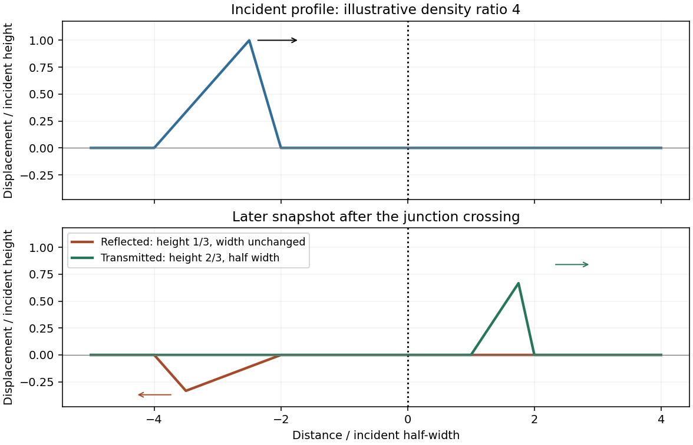

<h1 id="section-a/1/solution">Solution</h1>

↑ **Parent:** [1](../1.md)

Let the common [tension](../../../../../tension.md) be T, the linear mass densities be $\mu_1<\mu_2$ and the speeds be $c_j=\sqrt{T/\mu_j}$, so $c_2<c_1$. Displacement and transverse-force continuity give the [displacement coefficients at a string junction](../../../../../displacement-coefficients-at-a-string-junction.md)

$$
\boxed{r=\frac{c_2-c_1}{c_2+c_1}<0,\qquad t=\frac{2c_2}{c_1+c_2},\quad0<t<1.}
$$

The reflected triangular pulse is inverted, has smaller height $|r|H$, unchanged spatial width and unchanged speed, and travels left. Its left-to-right asymmetric profile is reversed as well as vertically inverted. The transmitted pulse remains upright, has smaller height tH, travels more slowly, and has width $Wc_2/c_1$. The [string-pulse width mapping at a junction](../../../../../string-pulse-width-mapping-at-a-junction.md) leaves its temporal duration unchanged. The transmitted slopes are steeper by $2c_1/(c_1+c_2)$; the reflected slope magnitudes are smaller by $|r|$.

The density ratio is unspecified, so only these inequalities are determined. The original plot below illustrates $\mu_2/\mu_1=4$, giving $r=-1/3$, $t=2/3$ and half-width transmission; it is not a numerical reading of the examination figure.

**[Figure 1](#section-a/1/image-pulse-junction). Pulse junction**. [Source](paper-1-pa2010-pulse-junction.py). Illustrative density ratio four; reflection inverts the pulse and transmission compresses its width.

## ↑ Ancestors (14)

1. [1](../1.md)
2. [Section A](../../section-a.md)
3. [Paper 1](../../../paper-1-split.md)
4. [2010](../../../split.md)
5. [Past exam of the physics A course of the University of Cambridge](../../../../split.md)
6. [Physics A course of the University of Cambridge](../../../../../physics-a-course-of-the-university-of-cambridge.md)
7. [Physics course of the year 2 of the natural sciences course of the University of Cambridge](../../../../../physics-course-of-the-year-2-of-the-natural-sciences-course-of-the-university-of-cambridge.md)
8. [Year 2 of the natural sciences course of the University of Cambridge](../../../../../year-2-of-the-natural-sciences-course-of-the-university-of-cambridge.md)
9. [Year of the natural sciences course of the University of Cambridge](../../../../../year-of-the-natural-sciences-course-of-the-university-of-cambridge.md)
10. [Natural sciences course of the University of Cambridge](../../../../../natural-sciences-course-of-the-university-of-cambridge.md)
11. [Course of the University of Cambridge](../../../../../course-of-the-university-of-cambridge.md)
12. [University of Cambridge](../../../../../university-of-cambridge-split.md)
13. [List of universities](../../../../../list-of-universities.md)
14. [Codex Wiki](../../../../../split.md)
