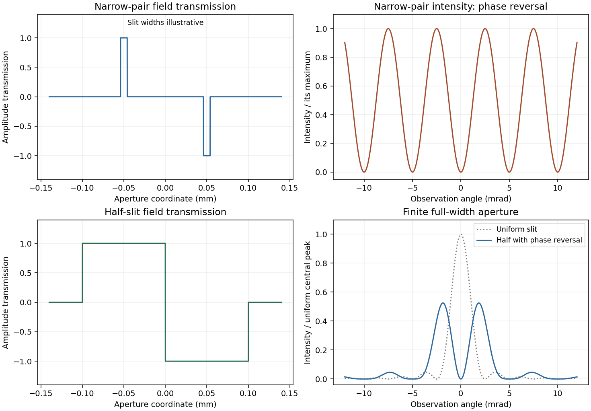

<h1 id="section-b/b8/solution">Solution</h1>

↑ **Parent:** [B8](../b8.md)

In [Fraunhofer diffraction](../../../../../fraunhofer-diffraction.md), the phase difference from aperture coordinate y to observation angle theta is $qy$, with $q=2\pi\sin\theta/\lambda$. Coherent superposition of the transmitted field elements therefore gives

$$
\boxed{\psi(\theta)\propto\int T(y)e^{iqy}\,dy.}
$$

The common propagation factor is omitted. This is the [Fourier transform](../../../../../fourier-transform-split.md) of the complex amplitude transmission, not of its intensity.

For a uniform slit of total width $W=0.2\,\mathrm{mm}$, integration gives $\psi_0=W\operatorname{sinc}(qW/2)$, where $\operatorname{sinc}s=\sin s/s$. Its normalized intensity is $\operatorname{sinc}^2(\pi W\sin\theta/\lambda)$, with a central maximum and first zeros at $\sin\theta=\pm\lambda/W=\pm0.0025$.

For a half-covered slit choose $T=+1$ on the left half and $T=-1$ on the right. Put $h=W/2$ and $s=qh/2$. The two equal rectangles have centres separated by h, so

$$
\psi_\pi=h\operatorname{sinc}s\,(e^{-is}-e^{is})=-2ih\operatorname{sinc}s\sin s,
\qquad
\boxed{\frac{I_\pi}{I_{0,\rm peak}}=\operatorname{sinc}^2s\,\sin^2s=\frac{\sin^4s}{s^2}.}
$$

This [half-slit phase-step diffraction factorization](../../../../../half-slit-phase-step-diffraction-factorization.md) is the phase-reversed two-slit interference factor multiplied by the diffraction envelope of each half-slit. Here the half-slit width and centre separation both equal the earlier0.1mm separation. The central intensity is zero; the largest off-axis pair satisfies $\tan s=2s$, giving $|\sin\theta|\simeq0.00186$. Other zeros are at $s=m\pi$. The plot includes the requested uniform-slit and half-covered patterns.

**[Figure 4](#section-b/b8/image-phase-step-diffraction). Phase-step diffraction**. [Source](paper-1-pa2010-phase-apertures.py). Complex field transmissions and their computed intensities; narrow rectangle widths are illustrative.

## ↑ Ancestors (14)

1. [B8](../b8.md)
2. [Section B](../../section-b.md)
3. [Paper 1](../../../paper-1-split.md)
4. [2010](../../../split.md)
5. [Past exam of the physics A course of the University of Cambridge](../../../../split.md)
6. [Physics A course of the University of Cambridge](../../../../../physics-a-course-of-the-university-of-cambridge.md)
7. [Physics course of the year 2 of the natural sciences course of the University of Cambridge](../../../../../physics-course-of-the-year-2-of-the-natural-sciences-course-of-the-university-of-cambridge.md)
8. [Year 2 of the natural sciences course of the University of Cambridge](../../../../../year-2-of-the-natural-sciences-course-of-the-university-of-cambridge.md)
9. [Year of the natural sciences course of the University of Cambridge](../../../../../year-of-the-natural-sciences-course-of-the-university-of-cambridge.md)
10. [Natural sciences course of the University of Cambridge](../../../../../natural-sciences-course-of-the-university-of-cambridge.md)
11. [Course of the University of Cambridge](../../../../../course-of-the-university-of-cambridge.md)
12. [University of Cambridge](../../../../../university-of-cambridge-split.md)
13. [List of universities](../../../../../list-of-universities.md)
14. [Codex Wiki](../../../../../split.md)
