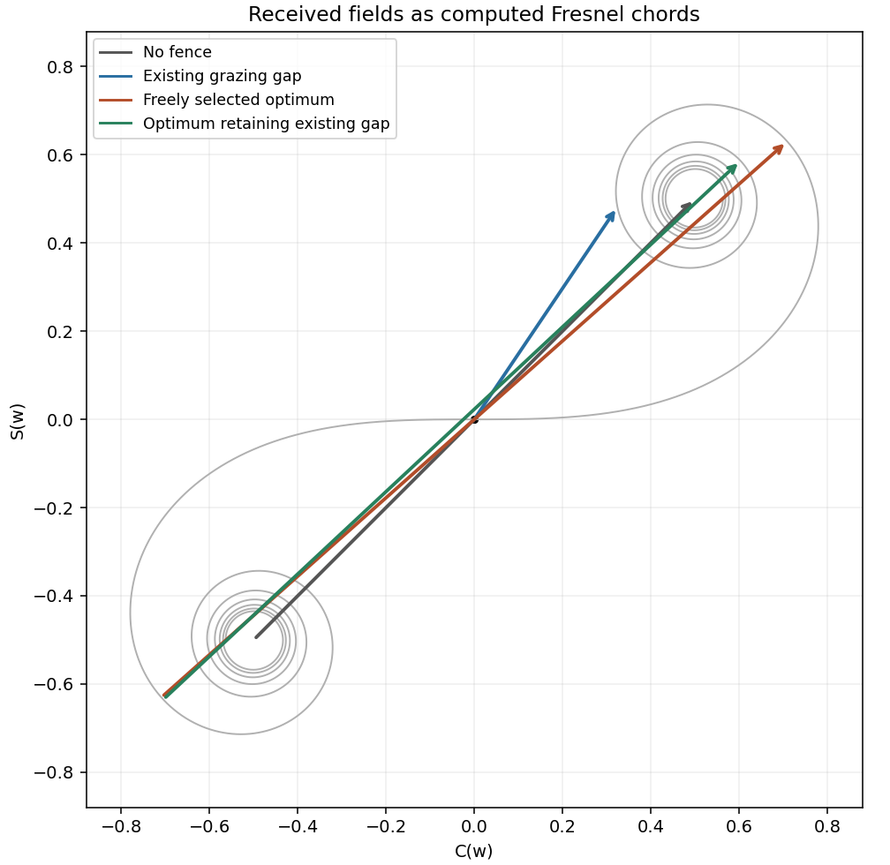

<h1 id="section-b/b9/solution">Solution</h1>

↑ **Parent:** [B9](../b9.md)

[Fresnel diffraction](../../../../../fresnel-diffraction.md) retains the quadratic transverse propagation phase; [Fraunhofer diffraction](../../../../../fraunhofer-diffraction.md) neglects it and leaves an aperture Fourier transform. Expanding the propagation distance gives $z+y^2/(2z)+\cdots$. The aperture phase variation is of order $\pi\rho^2/(\lambda z)$, so the crossover scale is $z\sim\rho^2/\lambda$, with far-field propagation requiring a much smaller [Fresnel number](../../../../../fresnel-number.md) than1.

Here $\lambda\simeq0.0100\,\mathrm m$ and the full gap width gives $\rho^2/\lambda=25\,\mathrm m$, comparable with the16m range. More decisively, measured from the grazing line of sight to the far gap edge, the quadratic phase reaches $\pi(0.5)^2/(0.01\times16)=4.91\,\mathrm{rad}$. **Fresnel diffraction is required**; conventions using a half-width change the quoted Fresnel number but not this phase test.

Define $F(w)=C(w)+iS(w)$ with the normalization in the paper. The grazing-edge gap spans $w=0$ to

$$
w_g=0.5\sqrt{2/(\lambda z)}=1.768.
$$

The [Cornu chord power normalization](../../../../../cornu-chord-power-normalization.md) uses a received field proportional to $F(w_g)-F(0)$, while no fence gives $F(\infty)-F(-\infty)=1+i$. Numerical Fresnel integration gives $C(w_g)=0.3245$, $S(w_g)=0.4818$, and therefore

$$
\boxed{\frac{P_{\rm gap}}{P_{\rm open}}=\frac{C(w_g)^2+S(w_g)^2}{2}=0.169.}
$$

The two labelled child answers specify the corresponding vectors.

For the [largest contiguous Fresnel aperture](../../../../../largest-contiguous-fresnel-aperture.md), a freely chosen single contiguous opening must maximize the chord between two points of the [Cornu spiral](../../../../../euler-spiral.md). Its longest chord joins $F(-w_*)$ to $F(w_*)$, where the first maximum radius satisfies $C(w_*)\cos(\pi w_*^2/2)+S(w_*)\sin(\pi w_*^2/2)=0$. This gives $w_*=1.2094$ and

$$
\boxed{-0.342\,\mathrm m<x<+0.342\,\mathrm m,\qquad
P_{\max}/P_{\rm open}\simeq1.80.}
$$

Here x is signed displacement along the fence from the grazing optical axis. The [pointwise Fresnel gain versus integrated transmitted power](../../../../../pointwise-fresnel-gain-versus-integrated-transmitted-power.md) distinction explains why an aperture can concentrate more power at one receiver than the fully open field through constructive interference; this is not an increase of integrated transmitted power.

The [existing-opening constraint in Fresnel aperture optimization](../../../../../existing-opening-constraint-in-fresnel-aperture-optimization.md) matters literally: the original gap already occupies $[0,0.5]\,\mathrm m$. The symmetric optimum would require filling its far end. If only further removal is permitted and the final opening must be connected, maximize the chord subject to $w_-\le0$ and $w_+\ge1.768$. The constrained optimum is approximately

$$
\boxed{w_-=-1.2158,\quad w_+=2.3405,\qquad
-0.344\,\mathrm m<x<0.662\,\mathrm m,\quad P/P_{\rm open}=1.60.}
$$

These are different optimization assumptions; both are stated so the original gap is not silently replaced. The model treats the fence as an ideal opaque screen and ignores ground reflections or additional propagation paths. [§7.2, normalized Fresnel integrals and their limiting values](../../../../../nist-digital-library-of-mathematical-functions.md)

**[Figure 5](#section-b/b9/image-cornu-aperture-vectors). Cornu aperture vectors**. [Source](paper-1-pa2010-cornu-vectors.py). Original numerical spiral with gap, open-field and two differently constrained optimum chords.

## ↑ Ancestors (14)

1. [B9](../b9.md)
2. [Section B](../../section-b.md)
3. [Paper 1](../../../paper-1-split.md)
4. [2010](../../../split.md)
5. [Past exam of the physics A course of the University of Cambridge](../../../../split.md)
6. [Physics A course of the University of Cambridge](../../../../../physics-a-course-of-the-university-of-cambridge.md)
7. [Physics course of the year 2 of the natural sciences course of the University of Cambridge](../../../../../physics-course-of-the-year-2-of-the-natural-sciences-course-of-the-university-of-cambridge.md)
8. [Year 2 of the natural sciences course of the University of Cambridge](../../../../../year-2-of-the-natural-sciences-course-of-the-university-of-cambridge.md)
9. [Year of the natural sciences course of the University of Cambridge](../../../../../year-of-the-natural-sciences-course-of-the-university-of-cambridge.md)
10. [Natural sciences course of the University of Cambridge](../../../../../natural-sciences-course-of-the-university-of-cambridge.md)
11. [Course of the University of Cambridge](../../../../../course-of-the-university-of-cambridge.md)
12. [University of Cambridge](../../../../../university-of-cambridge-split.md)
13. [List of universities](../../../../../list-of-universities.md)
14. [Codex Wiki](../../../../../split.md)
