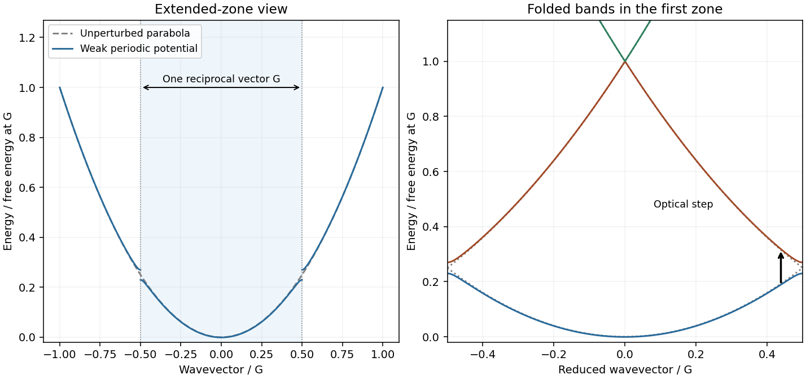

<h1 id="section-c/c10/solution">Solution</h1>

↑ **Parent:** [C10](../c10.md)

Write the lattice reciprocal vector as $G=2\pi/a$ in one dimension. The [nearly-free electron model](../../../../../nearly-free-electron-model.md) starts from $\varepsilon_k=\hbar^2k^2/(2m_e)$ and couples plane waves separated by G. Near a zone boundary, the two-wave [Hamiltonian](../../../../../hamiltonian.md) is

$$
\begin{pmatrix}\varepsilon_k&V_G\\V_G^*&\varepsilon_{k-G}\end{pmatrix},\qquad
E_\pm=\frac{\varepsilon_k+\varepsilon_{k-G}}2
\pm\sqrt{\left(\frac{\varepsilon_k-\varepsilon_{k-G}}2\right)^2+|V_G|^2}.
$$

At $k=G/2$ the free waves are degenerate and the periodic potential opens a gap $2|V_G|$. A reduced-zone drawing folds k modulo G into $[-G/2,G/2]$, displaying multiple bands at each reduced wavevector. The original plot shows free folded parabolas, avoided crossings and an allowed vertical optical transition. [Chapter2, nearly-free plane-wave mixing and Brillouin-zone boundary gaps](../../../../../solid-state-physics-by-david-tong.md)

Including two spin states, filling a free [Fermi sphere](../../../../../fermi-sphere.md) gives $n=2(4\pi k_F^3/3)/(2\pi)^3=k_F^3/(3\pi^2)$. A monovalent BCC cell contributes two electrons, so

$$
\boxed{k_F=(3\pi^2n)^{1/3}=\frac{(6\pi^2)^{1/3}}a,\qquad
\frac{k_F}{\sqrt2\pi/a}=0.877<1.}
$$

The sphere therefore lies inside every first-zone face, since the supplied distance is the nearest boundary.

For the shortest BCC reciprocal vector, $G=2\sqrt2\pi/a$. In the zero-potential folded-band limit, the energy of a vertical transition from k along G to the neighbouring free branch is $\hbar^2(G^2-2Gk)/(2m_e)$. It decreases over the occupied interval and is smallest at $k=k_F$. Thus the [monovalent BCC direct optical threshold](../../../../../monovalent-bcc-direct-optical-threshold.md) is

$$
\boxed{\frac{E_0}{E_F}=\left(\frac G{k_F}\right)^2-2\frac G{k_F}=0.6376\simeq0.64.}
$$

The final state is empty because $G-k_F>k_F$. Finite weak $V_G$ changes the energies and makes optical matrix elements nonzero; an exactly free electron gas by itself has no interband absorption. The expression is a leading weak-potential threshold, not a claim that every peak equals the onset.

Using the supplied lattice constants and bare-electron free bands gives $E_F=(3.24,2.12,1.85)\,\mathrm{eV}$ and thresholds $(2.06,1.35,1.18)\,\mathrm{eV}$ for Na,K,Rb. The source plot's broad higher-frequency features shift toward lower energy in the same order as a increases, qualitatively consistent with the predicted $a^{-2}$ scale. Their peak shapes, heights and exact positions need matrix elements, band corrections and scattering; low-frequency intraband conductivity is a separate contribution. No measured trace is reproduced.

**[Figure 6](#section-c/c10/image-nearly-free-folded-bands). Nearly-free folded bands**. [Source](paper-1-pa2010-nearly-free-bands.py). Illustrative weak periodic potential; gray curves are free bands and the arrow is a vertical transition.

## ↑ Ancestors (14)

1. [C10](../c10.md)
2. [Section C](../../section-c.md)
3. [Paper 1](../../../paper-1-split.md)
4. [2010](../../../split.md)
5. [Past exam of the physics A course of the University of Cambridge](../../../../split.md)
6. [Physics A course of the University of Cambridge](../../../../../physics-a-course-of-the-university-of-cambridge.md)
7. [Physics course of the year 2 of the natural sciences course of the University of Cambridge](../../../../../physics-course-of-the-year-2-of-the-natural-sciences-course-of-the-university-of-cambridge.md)
8. [Year 2 of the natural sciences course of the University of Cambridge](../../../../../year-2-of-the-natural-sciences-course-of-the-university-of-cambridge.md)
9. [Year of the natural sciences course of the University of Cambridge](../../../../../year-of-the-natural-sciences-course-of-the-university-of-cambridge.md)
10. [Natural sciences course of the University of Cambridge](../../../../../natural-sciences-course-of-the-university-of-cambridge.md)
11. [Course of the University of Cambridge](../../../../../course-of-the-university-of-cambridge.md)
12. [University of Cambridge](../../../../../university-of-cambridge-split.md)
13. [List of universities](../../../../../list-of-universities.md)
14. [Codex Wiki](../../../../../split.md)
