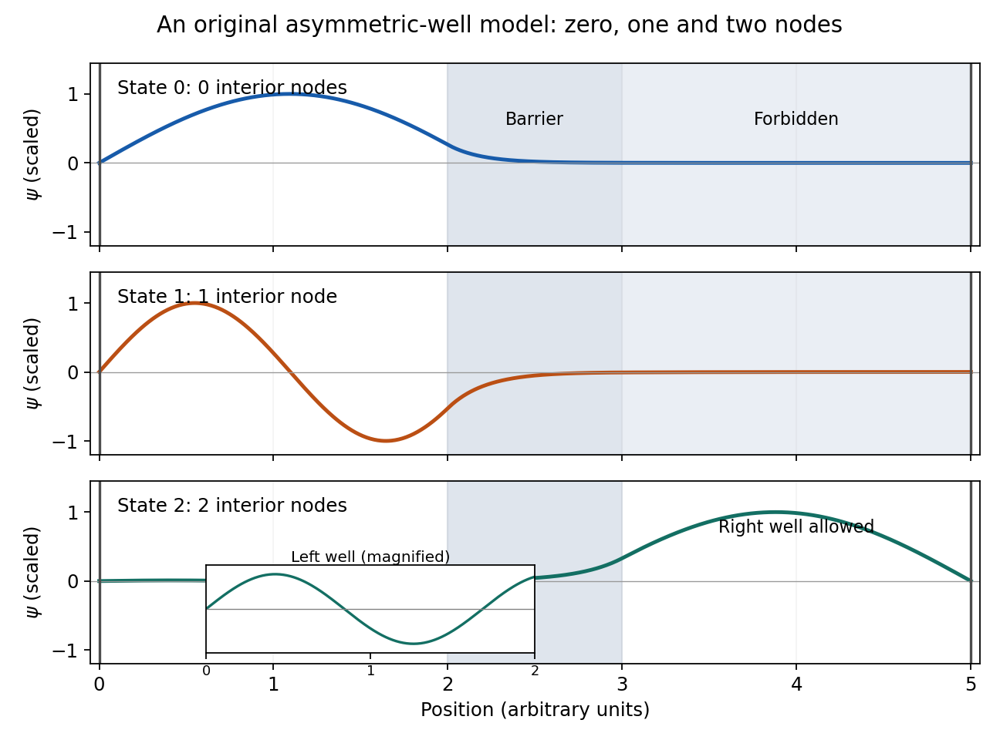

# Paper 2

↑ **Parent:** [2010](../2010.md)

Original paper: [FOI release, physical PDF pages 8–13, printed pages 1–6](https://www.whatdotheyknow.com/request/physics_past_papers_23/response/3514893/attach/4/FOI%202026%20628%20Smith%20materials.pdf?cookie_passthrough=1). Every optional question and note topic is answered.

**Table of contents**

- [Section A](#section-a)
  - [1](#section-a/1)
    - [Solution](#section-a/1/solution)
  - [2](#section-a/2)
    - [Solution](#section-a/2/solution)
  - [3](#section-a/3)
    - [Solution](#section-a/3/solution)
  - [4](#section-a/4)
    - [Solution](#section-a/4/solution)
  - [5](#section-a/5)
    - [Solution](#section-a/5/solution)
- [Section B](#section-b)
  - [B6](#section-b/b6)
    - [Solution](#section-b/b6/solution)
  - [B7](#section-b/b7)
    - [Solution](#section-b/b7/solution)
  - [B8](#section-b/b8)
    - [Solution](#section-b/b8/solution)
  - [B9](#section-b/b9)
    - [Solution](#section-b/b9/solution)
    - [a](#section-b/b9/a)
      - [Solution](#section-b/b9/a/solution)
    - [b](#section-b/b9/b)
      - [Solution](#section-b/b9/b/solution)
    - [c](#section-b/b9/c)
      - [Solution](#section-b/b9/c/solution)
- [Section C](#section-c)
  - [C10](#section-c/c10)
    - [a](#section-c/c10/a)
      - [Solution](#section-c/c10/a/solution)
    - [b](#section-c/c10/b)
      - [Solution](#section-c/c10/b/solution)
    - [c](#section-c/c10/c)
      - [Solution](#section-c/c10/c/solution)
  - [C11](#section-c/c11)
    - [Solution](#section-c/c11/solution)
- [Section D](#section-d)
  - [D12](#section-d/d12)
    - [a](#section-d/d12/a)
      - [Solution](#section-d/d12/a/solution)
    - [b](#section-d/d12/b)
      - [Solution](#section-d/d12/b/solution)
    - [c](#section-d/d12/c)
      - [Solution](#section-d/d12/c/solution)
  - [D13](#section-d/d13)
    - [Solution](#section-d/d13/solution)

## Section A

↑ **Parent:** [Paper 2](paper-2.md)

<h3 id="section-a/1">1</h3>

↑ **Parent:** [Section A](#section-a)

<h4 id="section-a/1/solution">Solution</h4>

↑ **Parent:** [1](#section-a/1)

As an estimate, model the confinement by an [infinite square well](../../quantum-mechanics.md#infinite-square-well) of width $L$ and use the stipulated [electron](../../physics.md#electron) [mass](../../classical-mechanics.md#mass). Its [energy eigenvalues](../../energy-eigenvalue.md) are $E_j=j^2\pi^2\hbar^2/(2mL^2)$, $j=1,2,\ldots$, so the gap controlling [thermal occupation of a quantum well](../../semiconductor.md#thermal-occupation-of-a-quantum-well) is

$$
\Delta E=E_2-E_1=\frac{3\pi^2\hbar^2}{2mL^2}
=1.81\times10^{-21}\,\mathrm J=11.3\,\mathrm{meV},
\qquad \boxed{\frac{\Delta E}{k_B}\simeq131\,\mathrm K}.
$$

Thus **$T\ll130\,\mathrm K$** suppresses excitation: $p_2/p_1=e^{-\Delta E/(k_BT)}$. For example $T\lesssim28\,\mathrm K$ makes this ratio below one percent in this model. There is no sharp cutoff. The [ground state](../../quantum-mechanics.md#ground-state) [energy](../../energy.md) itself corresponds to about $44\,\mathrm K$, but it is the excitation gap that enters the [Boltzmann factor](../../canonical-ensemble.md#boltzmann-factor). Finite barrier height and a different [effective mass](../../bloch-s-theorem.md#band-effective-mass) would change the numerical scale; neither is supplied.

<h3 id="section-a/2">2</h3>

↑ **Parent:** [Section A](#section-a)

<h4 id="section-a/2/solution">Solution</h4>

↑ **Parent:** [2](#section-a/2)

For normalized amplitudes $c_n,c_{n'}$ and a time-independent [observable](../../quantum-system.md#observable) $A$, the [Schrödinger equation](../../mathematical-physics.md#schrodinger-equation) gives

$$
\langle A\rangle(t)=|c_n|^2A_{nn}+|c_{n'}|^2A_{n'n'}
+2\operatorname{Re}\left[c_n^*c_{n'}A_{nn'}e^{-i(n'-n)\omega t}\right].
$$

The interference term therefore has

$$
\boxed{T=\frac{2\pi}{|n-n'|\omega}}\qquad(n\ne n').
$$

This is the [period of two-state quantum interference](../../quantum-system.md#period-of-two-state-quantum-interference). If the off-diagonal [matrix element](../../vector-space.md#matrix-element) or either amplitude vanishes, the [expectation value](../../quantum-system.md#expectation-value) is constant, so this is not its unique fundamental period. Equal [energies](../../energy.md) likewise give no beat.

<h3 id="section-a/3">3</h3>

↑ **Parent:** [Section A](#section-a)

<h4 id="section-a/3/solution">Solution</h4>

↑ **Parent:** [3](#section-a/3)

The [Sturm oscillation theorem](../../sturm-liouville-theory.md#sturm-oscillation-theorem) requires respectively **zero, one and two [nodes of a wavefunction](../../wave-function.md#node-of-a-wavefunction)**. Treating the vertical outer boundaries as hard walls, all three [wavefunctions](../../wave-function.md) vanish there. The [potential energy](../../energy.md#potential-energy) is asymmetric, so no even/odd [parity](../../quantum-mechanics.md#parity) should be imposed. At internal finite steps, both the [wavefunction](../../wave-function.md) and its first [derivative](../../calculus.md#derivative) are continuous.

For $E_0$ and $E_1$, only the left well is classically allowed. Their [wavefunctions](../../wave-function.md) oscillate there and continue as evanescent combinations through the barrier and right region, reaching zero at the far wall. The first is [nodeless](../../linear-operator-theory.md#nodeless-eigenfunction); the second has one node in the left well. For $E_2$ both wells are allowed, while the central barrier remains forbidden: the [wavefunction](../../wave-function.md) oscillates in both wells, with an evanescent bridge and two [nodes of a wavefunction](../../wave-function.md#node-of-a-wavefunction) overall. A node may lie inside a finite forbidden barrier when the matching coefficients have opposite signs. Precise node positions and relative amplitudes require dimensions and heights not specified by the qualitative drawing.

**[Figure 1](#section-a/3/image-three-asymmetric-well-states). Three asymmetric-well states**.

The original illustration solves an explicitly chosen model with the same ordering of allowed and forbidden regions. Its numerical parameters and detailed node positions are illustrative.

<h3 id="section-a/4">4</h3>

↑ **Parent:** [Section A](#section-a)

<h4 id="section-a/4/solution">Solution</h4>

↑ **Parent:** [4](#section-a/4)

Assuming independent Gaussian [measurement errors](../../probability-and-statistics.md#measurement-error) with the quoted [standard deviations](../../variance.md#standard-deviation), use the [inverse-variance weighted mean](../../statistical-modelling.md#inverse-variance-weighted-mean):

$$
w_i=\sigma_i^{-2},\qquad
\bar x_w=\frac{\sum_iw_ix_i}{\sum_iw_i},\qquad
\sigma_{\bar x_w}=(\sum_iw_i)^{-1/2}.
$$

Here $\sum_iw_i=0.654514$ and $\sum_iw_ix_i=65.805556$, giving

$$
\boxed{\bar x_w=100.54\pm1.24}.
$$

The consistency statistic is $\chi^2=4.45$ for four [degrees of freedom](../../classical-mechanics.md#degree-of-freedom), so there is no evident excess scatter requiring error rescaling. A shared [systematic error](../../physics.md#systematic-error) would require a [covariance matrix](../../variance.md#covariance-matrix) and would not be reduced by this averaging rule.

<h3 id="section-a/5">5</h3>

↑ **Parent:** [Section A](#section-a)

<h4 id="section-a/5/solution">Solution</h4>

↑ **Parent:** [5](#section-a/5)

A small constant input can repeatedly produce the same [analogue-to-digital converter](../../electrical-engineering.md#analog-to-digital-converter) code, so averaging those codes cannot reveal its position within a conversion interval. [dither](../../electrical-engineering.md#dither) makes adjacent codes toggle; their relative [frequencies](../../wave.md#frequency) then encode changes smaller than one conversion step. With adequate [oversampling](../../electrical-engineering.md#oversampling), low-pass filtering and averaging reduce the added, sufficiently uncorrelated [noise](../../electrical-engineering.md#noise-signal-processing) while retaining the slow [signal](../../electrical-engineering.md#signal).

For independent sample errors, the averaged [standard deviation](../../variance.md#standard-deviation) scales as $N^{-1/2}$; ideally four times as many samples gain about one effective bit. For example a constant input $0.2\Delta$ rounded to levels separated by $\Delta$ would always return zero. Adding uniform [dither](../../electrical-engineering.md#dither) on $[-\Delta/2,\Delta/2]$ gives output $\Delta$ with [probability](../../probability-theory.md#probability) $0.2$ and zero otherwise: the expected average is $0.2\Delta$, with error $0.4\Delta/\sqrt N$. The benefit concerns the filtered estimate, not a more accurate individual conversion. Excessive [dither](../../electrical-engineering.md#dither) wastes range, and averaging does not correct calibration bias, correlated drift or arbitrary converter nonlinearity.[Oversampling and Averaging, especially the dither and uncorrelated-noise discussion; Table 1](../../physics-bibliography.md#an-1549-performance-optimization-of-the-integrated-adc-on-the-aducm4050-by-analog-devices)

## Section B

↑ **Parent:** [Paper 2](paper-2.md)

<h3 id="section-b/b6">B6</h3>

↑ **Parent:** [Section B](#section-b)

<h4 id="section-b/b6/solution">Solution</h4>

↑ **Parent:** [B6](#section-b/b6)

The [parity operator](../../quantum-mechanics.md#parity-operator) acts as $P\psi(x)=\psi(-x)$, with $P^2=I$. For an even [potential energy](../../energy.md#potential-energy) $[H,P]=0$, so [energy eigenstates](../../energy-eigenvalue.md#energy-eigenstate) can be chosen even or odd, with [parity](../../quantum-mechanics.md#parity) [eigenvalues](../../linear-operator-theory.md#eigenvalue) $+1$ and $-1$. One-dimensional [bound states](../../quantum-system.md#bound-state) are nondegenerate; the [ground state](../../quantum-mechanics.md#ground-state) is [nodeless](../../linear-operator-theory.md#nodeless-eigenfunction) and even.

For the [finite square well](../../quantum-mechanics.md#finite-square-well), square integrability excludes the growing exterior exponential, while even [parity](../../quantum-mechanics.md#parity) excludes the interior sine. Thus the interior solution is proportional to $\cos kx$, with matching decaying tails and

$$
\boxed{k=\frac{\sqrt{2m(V_0+E_0)}}{\hbar},\qquad
q=\frac{\sqrt{-2mE_0}}{\hbar}}.
$$

Continuity at $a$ gives $B\cos ka=Ae^{-qa}$ and $-Bk\sin ka=-qAe^{-qa}$. Their ratio yields

$$
q=k\tan ka,\qquad
\boxed{\sqrt{-E_0}=\sqrt{V_0+E_0}\tan\left(\frac{a\sqrt{2m(V_0+E_0)}}{\hbar}\right)}.
$$

The conditions at $-a$ follow from the same [parity](../../quantum-mechanics.md#parity).

For a narrow weak well, $ka\ll1$, hence $q\simeq k^2a\simeq2mV_0a/\hbar^2$ and

$$
\boxed{E_0\simeq-\frac{2mV_0^2a^2}{\hbar^2}}.
$$

This is self-consistent because $|E_0|/V_0\simeq2mV_0a^2/\hbar^2\ll1$. It is the [shallow finite-square-well energy](../../quantum-mechanics.md#shallow-finite-square-well-energy), equivalently the attractive [delta potential](../../quantum-mechanics.md#delta-potential) limit with integrated strength $2aV_0$. An arbitrarily weak attractive well of this form still has its even bound [ground state](../../quantum-mechanics.md#ground-state).

The first excited state must be odd. Replace the interior cosine by $\sin kx$ and choose exterior tails with opposite signs. The matching condition becomes $q=-k\cot ka$. Its first root requires $\pi/2<ka<\pi$. At the binding threshold $q\to0$, so

$$
\boxed{\frac{a\sqrt{2mV_0}}{\hbar}>\frac{\pi}{2}}
$$

is necessary and sufficient for the first odd [bound state](../../quantum-system.md#bound-state). Equality gives a zero-energy nonnormalizable threshold solution, not an additional [bound state](../../quantum-system.md#bound-state).

<h3 id="section-b/b7">B7</h3>

↑ **Parent:** [Section B](#section-b)

<h4 id="section-b/b7/solution">Solution</h4>

↑ **Parent:** [B7](#section-b/b7)

Writing $a=cx+idp$, where $c=\sqrt{m\omega/(2\hbar)}$ and $d=1/\sqrt{2m\omega\hbar}$, the [canonical commutation relation](../../quantum-mechanics.md#canonical-commutation-relation) gives

$$
[a,a^\dagger]=-2icd[x,p]=2cd\hbar=\boxed{1}.
$$

Consequently $[a^\dagger a,a]=-a$ and $\boxed{[H,a]=-\hbar\omega a}$. If $a|\phi_0\rangle$ were nonzero, this [commutator](../../lie-algebra.md#commutator) would make it an [energy eigenstate](../../energy-eigenvalue.md#energy-eigenstate) with [energy](../../energy.md) $E_0-\hbar\omega$, contradicting the lowest-energy property. Therefore **$a|\phi_0\rangle=0$**.

The [commutator product rule](../../lie-algebra.md#commutator-product-rule) and induction give

$$
[a,(a^\dagger)^{n+1}]
=[a,(a^\dagger)^n]a^\dagger+(a^\dagger)^n[a,a^\dagger]
=(n+1)(a^\dagger)^n.
$$

Acting on the vacuum and shifting the sum then shows that the [unnormalized bosonic coherent state](../../quantum-theory.md#unnormalized-bosonic-coherent-state) $|\widetilde\psi\rangle=e^{\alpha a^\dagger}|0\rangle$ satisfies $a|\widetilde\psi\rangle=\alpha|\widetilde\psi\rangle$.

**The displayed series lacks its [wavefunction normalization](../../wave-function.md#wavefunction-normalization) factor.** Since $(a^\dagger)^n|0\rangle=\sqrt{n!}|n\rangle$, its squared norm is $\sum_n|\alpha|^{2n}/n!=e^{|\alpha|^2}$. The normalized [coherent state](../../quantum-theory.md#coherent-state) needed for the stated [expectation values](../../quantum-system.md#expectation-value) is

$$
|\alpha\rangle=e^{-|\alpha|^2/2}\sum_{n=0}^{\infty}\frac{\alpha^n}{\sqrt{n!}}|n\rangle,
\qquad a|\alpha\rangle=\alpha|\alpha\rangle.
$$

Use $\langle a\rangle=\alpha$, $\langle a^\dagger\rangle=\alpha^*$, $\langle a^\dagger a\rangle=|\alpha|^2$ and $\langle aa^\dagger\rangle=|\alpha|^2+1$. For $x=x_0(a+a^\dagger)$, $x_0=\sqrt{\hbar/(2m\omega)}$,

$$
\langle x\rangle=x_0(\alpha+\alpha^*),\qquad
\langle x^2\rangle=x_0^2\left[(\alpha+\alpha^*)^2+1\right],
\qquad \boxed{\Delta x=\sqrt{\frac{\hbar}{2m\omega}}}.
$$

The displacement changes the mean position but not its ground-state uncertainty. Unnormalized bras and kets give the same physical [expectation values](../../quantum-system.md#expectation-value) only after division by their squared norm.

<h3 id="section-b/b8">B8</h3>

↑ **Parent:** [Section B](#section-b)

<h4 id="section-b/b8/solution">Solution</h4>

↑ **Parent:** [B8](#section-b/b8)

The angular-momentum [commutators](../../lie-algebra.md#commutator) give

$$
\boxed{[L_+,L_z]=-\hbar L_+,\qquad
[L_-,L_z]=+\hbar L_-,\qquad
[L_+,L_-]=2\hbar L_z}.
$$

For example $[L_x+iL_y,L_z]=-i\hbar L_y+i(i\hbar L_x)=-\hbar L_+$. In the displayed basis $|1,1\rangle,|1,0\rangle,|1,-1\rangle$, the only nonzero upper entries of $L_+$ connect adjacent magnetic quantum numbers. Subtracting their column and row $L_z$ [eigenvalues](../../linear-operator-theory.md#eigenvalue) multiplies each by $-\hbar$, proving the first [matrix](../../vector-space.md#matrix) [commutator](../../lie-algebra.md#commutator); the lower [matrix](../../vector-space.md#matrix) similarly gives the second. Direct multiplication gives

$$
L_+L_-=2\hbar^2\operatorname{diag}(1,1,0),\quad
L_-L_+=2\hbar^2\operatorname{diag}(0,1,1),
$$

whose difference is $2\hbar L_z$. Also $L^2=L_z^2+(L_+L_-+L_-L_+)/2=2\hbar^2I$, confirming $\ell=1$.

A [rotation](../../riemannian-geometry.md#rotation-mathematics) changes the quantization axis without changing the spectrum, so **$L_{\mathbf n}$ has [eigenvalues](../../linear-operator-theory.md#eigenvalue) $+\hbar,0,-\hbar$**. Its dimensionless [matrix](../../vector-space.md#matrix) is

$$
\frac{L_{\mathbf n}}{\hbar}=
\begin{pmatrix}
\cos\theta&\sin\theta/\sqrt2&0\\
\sin\theta/\sqrt2&0&\sin\theta/\sqrt2\\
0&\sin\theta/\sqrt2&-\cos\theta
\end{pmatrix}.
$$

Solving $(L_{\mathbf n}-\hbar I)v=0$ and normalizing gives the [spin-one maximum-projection eigenvector](../../angular-momentum-operator.md#spin-one-maximum-projection-eigenvector)

$$
\boxed{v_+(\theta)=
\begin{pmatrix}
\cos^2(\theta/2)\\
\sin\theta/\sqrt2\\
\sin^2(\theta/2)
\end{pmatrix}}.
$$

For instance the first equation is $(\cos\theta-1)\cos^2(\theta/2)+\sin^2\theta/2=0$, and the squared components sum to one. An overall [phase](../../wave.md#phase-waves) is immaterial.

At $\theta=\pi/3$, $v_+=(3/4,\sqrt6/4,1/4)^{\mathsf T}$. The [Born rule](../../wave-function.md#born-rule) therefore predicts, in the requested order,

$$
\boxed{P(L_z=-\hbar)=\frac1{16},\qquad P(L_z=0)=\frac38,\qquad P(L_z=+\hbar)=\frac9{16}}.
$$

This treats the [Stern-Gerlach experiment](../../angular-momentum-operator.md#stern-gerlach-experiment) as the stipulated ideal measurement of orbital projection. In an actual atom, other [magnetic moments](../../electromagnetism.md#magnetic-dipole-moment) and [spin-orbit coupling](../../atomic-physics.md#spin-orbit-interaction) can change which [angular momentum](../../momentum.md#angular-momentum) the apparatus resolves.

<h3 id="section-b/b9">B9</h3>

↑ **Parent:** [Section B](#section-b)

<h4 id="section-b/b9/solution">Solution</h4>

↑ **Parent:** [B9](#section-b/b9)

With angular-coordinate measure $d\phi$, the normalized one-particle orbitals are $u_l(\phi)=e^{il\phi}/\sqrt{2\pi}$. Single-valuedness requires integer $l$. Their products obey

$$
\int_0^{2\pi}\!\!\int_0^{2\pi}|\psi|^2\,d\phi_1d\phi_2=1,\qquad
\boxed{E_{l_1l_2}=\epsilon_R(l_1^2+l_2^2),\quad
\epsilon_R=\frac{\hbar^2}{2mR^2}}.
$$

If arc-length measure is used instead, each one-particle [wavefunction normalization](../../wave-function.md#wavefunction-normalization) includes $R^{-1/2}$; the physical [energy](../../energy.md) is unchanged. For the following parts impose antisymmetry on the full spatial-and-spin state of the two [fermions](../../tensor-product-of-quantum-systems.md#fermion).

<h4 id="section-b/b9/a">a</h4>

↑ **Parent:** [B9](#section-b/b9)

<h5 id="section-b/b9/a/solution">Solution</h5>

↑ **Parent:** [A](#section-b/b9/a)

Both particles can occupy $l=0$ with opposite [spins](../../angular-momentum-operator.md#spin), giving a unique [singlet state](../../angular-momentum-operator.md#singlet-state) at **$E=0$, [quantum degeneracy](../../quantum-mechanics.md#degenerate-energy-levels) 1**. At the next distinct [energy](../../energy.md) $\epsilon_R$, one orbital is $l=0$ and the other is $l=+1$ or $-1$. For each orbital choice there is one symmetric spatial state paired with the [singlet state](../../angular-momentum-operator.md#singlet-state), and one antisymmetric spatial state paired with three [triplet state](../../angular-momentum-operator.md#spin-one-half-triplet-state) [spin](../../angular-momentum-operator.md#spin) projections. Hence

$$
\boxed{g(E=\epsilon_R)=2(1+3)=8}.
$$

Swapping particle labels adds no independent state after the required exchange symmetry is imposed.

<h4 id="section-b/b9/b">b</h4>

↑ **Parent:** [B9](#section-b/b9)

<h5 id="section-b/b9/b/solution">Solution</h5>

↑ **Parent:** [B](#section-b/b9/b)

The lowest [singlet state](../../angular-momentum-operator.md#singlet-state) is

$$
\boxed{\Psi_{\rm s}=\frac1{2\pi}|0,0\rangle,\qquad E_{\rm s}=0,\quad g_{\rm s}=1}.
$$

For the lowest [triplet states](../../angular-momentum-operator.md#spin-one-half-triplet-state) take $\lambda=\pm1$ and $m_s=-1,0,1$:

$$
\boxed{\Psi_{{\rm t},\lambda,m_s}(\phi_1,\phi_2)=
\frac{e^{i\lambda\phi_2}-e^{i\lambda\phi_1}}{2\pi\sqrt2}|1,m_s\rangle,\qquad
E_{\rm t}=\epsilon_R,\quad g_{\rm t}=6}.
$$

[orthogonality](../../inner-product.md#orthogonal-vectors) of $u_0$ and $u_\lambda$ verifies [wavefunction normalization](../../wave-function.md#wavefunction-normalization) of the antisymmetric spatial factor. At this same [energy](../../energy.md) there are also two excited [singlet states](../../angular-momentum-operator.md#singlet-state), obtained by replacing its minus sign with a plus sign and the [spin](../../angular-momentum-operator.md#spin) factor by $|0,0\rangle$. Together they reproduce the eight states counted in part a.

<h4 id="section-b/b9/c">c</h4>

↑ **Parent:** [B9](#section-b/b9)

<h5 id="section-b/b9/c/solution">Solution</h5>

↑ **Parent:** [C](#section-b/b9/c)

At coincidence $\phi_1=\phi_2$, the [triplet state](../../angular-momentum-operator.md#spin-one-half-triplet-state) spatial factor vanishes, while the lowest [singlet state](../../angular-momentum-operator.md#singlet-state) has finite, uniform pair [probability](../../probability-theory.md#probability). Consequently a weak short-range repulsion raises the [singlet state](../../angular-momentum-operator.md#singlet-state) [energy](../../energy.md) more strongly: **antisymmetry suppresses close encounters in the [triplet state](../../angular-momentum-operator.md#spin-one-half-triplet-state)**. In the contact-interaction limit the [triplet state](../../angular-momentum-operator.md#spin-one-half-triplet-state) contribution is exactly zero, whereas the [singlet state](../../angular-momentum-operator.md#singlet-state) shift is positive. A finite-range interaction gives a nonzero but suppressed [triplet state](../../angular-momentum-operator.md#spin-one-half-triplet-state) shift. This explains a relative [energy](../../energy.md) increase; it does not by itself establish a crossing or justify using unchanged noninteracting [wavefunctions](../../wave-function.md) for arbitrarily strong repulsion.

## Section C

↑ **Parent:** [Paper 2](paper-2.md)

<h3 id="section-c/c10">C10</h3>

↑ **Parent:** [Section C](#section-c)

<h4 id="section-c/c10/a">a</h4>

↑ **Parent:** [C10](#section-c/c10)

<h5 id="section-c/c10/a/solution">Solution</h5>

↑ **Parent:** [A](#section-c/c10/a)

For a time-independent [Hamiltonian operator](../../quantum-system.md#hamiltonian-quantum-mechanics), a [symmetry operator](../../quantum-mechanics.md#symmetry-operator) $U$ satisfies $UHU^\dagger=H$, or $[U,H]=0$. Thus applying $U$ to an [energy eigenstate](../../energy-eigenvalue.md#energy-eigenstate) preserves its [energy](../../energy.md). Commuting Hermitian [observables](../../quantum-system.md#observable) can be diagonalized within each degenerate [energy eigenspace](../../energy-eigenvalue.md#energy-eigenspace), allowing states to be labelled by symmetry quantum numbers.

A continuous unitary symmetry $U(\varepsilon)=e^{-i\varepsilon Q/\hbar}$ has Hermitian generator $Q$. Differentiating the invariance condition gives $[H,Q]=0$. The [Heisenberg equation of motion](../../quantum-system.md#heisenberg-equation-of-motion) then yields

$$
\boxed{\frac{d\langle Q\rangle}{dt}=\frac{i}{\hbar}\langle[H,Q]\rangle=0}
$$

when $Q$ has no explicit time dependence. [spatial translations](../../general-relativity.md#spatial-translation) connect to [momentum](../../momentum.md) conservation, [rotations](../../riemannian-geometry.md#rotation-mathematics) to angular-momentum conservation, and time-translation invariance to [energy](../../energy.md) conservation. A central [potential energy](../../energy.md#potential-energy) conserves all components of [angular momentum](../../momentum.md#angular-momentum), but they cannot all be assigned sharp simultaneous values because they do not commute; $H,L^2,L_z$ are a compatible choice. Discrete reflection symmetry gives [parity](../../quantum-mechanics.md#parity) labels without a continuously variable generator. A [quantum degeneracy](../../quantum-mechanics.md#degenerate-energy-levels) can be protected by a symmetry, but a [quantum degeneracy](../../quantum-mechanics.md#degenerate-energy-levels) alone does not identify its physical origin.

<h4 id="section-c/c10/b">b</h4>

↑ **Parent:** [C10](#section-c/c10)

<h5 id="section-c/c10/b/solution">Solution</h5>

↑ **Parent:** [B](#section-c/c10/b)

In [Compton scattering](../../mathematical-physics.md#compton-scattering), a [photon](../../quantum-mechanics.md#photon) transfers [energy](../../energy.md) and [momentum](../../momentum.md) to an initially stationary, approximately free [electron](../../physics.md#electron). With incident and scattered [wavelengths](../../wave-equation.md#wavelength) $\lambda,\lambda'$ and [photon](../../quantum-mechanics.md#photon) deflection angle $\theta$, [momentum](../../momentum.md) conservation gives

$$
p_e^2=h^2\left(\lambda^{-2}+\lambda'^{-2}-\frac{2\cos\theta}{\lambda\lambda'}\right).
$$

Combine this with $hc/\lambda+mc^2=hc/\lambda'+\sqrt{m^2c^4+p_e^2c^2}$ to obtain

$$
\boxed{\lambda'-\lambda=\frac{h}{mc}(1-\cos\theta)}.
$$

The [photon](../../quantum-mechanics.md#photon) loses [energy](../../energy.md) to [electron](../../physics.md#electron) [recoil](../../momentum.md#recoil); the shift is independent of incident [wavelength](../../wave-equation.md#wavelength) in this free-electron model and is largest at backscattering. At [energies](../../energy.md) comparable with atomic binding, initial [electron](../../physics.md#electron) motion, binding and coherent scattering from the atom require additional treatment. Classical elastic scattering from a fixed charge alone does not produce this [recoil](../../momentum.md#recoil) [wavelength](../../wave-equation.md#wavelength) shift.

In [Arthur Holly Compton](../../physicist.md#arthur-holly-compton)'s spectral test, molybdenum-target X-rays scattered from [graphite](../../chemical-substance.md#graphite) at $90^\circ$ were compared with the primary spectrum using the same slits, crystal and tube [potential energy](../../energy.md#potential-energy). A [calcite](../../chemical-substance.md#calcite) crystal resolved the shifted line by [Bragg's law](../../quantum-scattering.md#bragg-s-law); lines on both sides established angular zero. The crystal glancing angle on the plotted axis differs from the [photon](../../quantum-mechanics.md#photon) scattering angle. The compared curves had different intensity scales, and the paper did not directly observe the [recoil](../../momentum.md#recoil) [electrons](../../physics.md#electron) in this [X-ray](../../electromagnetic-radiation.md#x-ray) test. These controls support the [wavelength](../../wave-equation.md#wavelength) comparison without converting it into a direct recoil-track measurement.[pp. 494–496, Experimental Test, Fig. 4 and opening of Velocity of recoil of the scattering electrons](../../physics-bibliography.md#a-quantum-theory-of-the-scattering-of-x-rays-by-light-elements-by-arthur-holly-compton)

<h4 id="section-c/c10/c">c</h4>

↑ **Parent:** [C10](#section-c/c10)

<h5 id="section-c/c10/c/solution">Solution</h5>

↑ **Parent:** [C](#section-c/c10/c)

For independent angular momenta $\mathbf J_1,\mathbf J_2$, set $\mathbf J=\mathbf J_1+\mathbf J_2$. Since different subsystems commute, $\mathbf J$ satisfies the same angular-momentum algebra. The product basis $|j_1m_1\rangle|j_2m_2\rangle$ diagonalizes $J_1^2,J_2^2,J_{1z},J_{2z}$; the coupled basis diagonalizes $J_1^2,J_2^2,J^2,J_z$. Its labels obey

$$
\boxed{j=|j_1-j_2|,|j_1-j_2|+1,\ldots,j_1+j_2,\qquad m=m_1+m_2}.
$$

The [Clebsch-Gordan coefficients](../../representation-theory.md#clebsch-gordan-coefficients) are the unitary change of basis between them. Start from the maximum-weight state $j=j_1+j_2,m=j$, apply $J_-=J_{1-}+J_{2-}$ with [wavefunction normalization](../../wave-function.md#wavefunction-normalization), and construct the remaining multiplets by [orthogonality](../../inner-product.md#orthogonal-vectors).

For two spin-one-half systems, the symmetric [triplet state](../../angular-momentum-operator.md#spin-one-half-triplet-state) is $|\uparrow\uparrow\rangle$, $(|\uparrow\downarrow\rangle+|\downarrow\uparrow\rangle)/\sqrt2$, $|\downarrow\downarrow\rangle$, with $j=1$; the antisymmetric [singlet state](../../angular-momentum-operator.md#singlet-state) $(|\uparrow\downarrow\rangle-|\downarrow\uparrow\rangle)/\sqrt2$ has $j=0$. The dimension identity $\sum_j(2j+1)=(2j_1+1)(2j_2+1)$ checks completeness. Coupling orbital and intrinsic [spin](../../angular-momentum-operator.md#spin) similarly gives total atomic [angular momentum](../../momentum.md#angular-momentum) and organizes spin-orbit [energy](../../energy.md) splittings. Exchange symmetry is an additional restriction when the constituents are identical.

<h3 id="section-c/c11">C11</h3>

↑ **Parent:** [Section C](#section-c)

<h4 id="section-c/c11/solution">Solution</h4>

↑ **Parent:** [C11](#section-c/c11)

[quantum tunnelling](../../quantum-mechanics.md#quantum-tunnelling) is transmission through a finite region in which the classical kinetic [energy](../../energy.md) $E-V$ is negative. The [wavefunction](../../wave-function.md) need not vanish there: the [Schrödinger equation](../../mathematical-physics.md#schrodinger-equation) permits evanescent solutions. The transmitted particle retains its conserved [energy](../../energy.md); it does not borrow [energy](../../energy.md) to surmount the barrier.

For a rectangular barrier of height $V_b$ on $0<x<d$, with $0<E<V_b$ and zero exterior [potential energy](../../energy.md#potential-energy), define $k=\sqrt{2mE}/\hbar$ and $\kappa=\sqrt{2m(V_b-E)}/\hbar$. A left-incident scattering solution has the three pieces

$$
\psi_{\rm L}=e^{ikx}+re^{-ikx},\qquad
\psi_{\rm B}=b e^{\kappa x}+c e^{-\kappa x},\qquad
\psi_{\rm R}=te^{ikx}.
$$

Continuity of $\psi,\psi'$ at both boundaries imposes

$$
1+r=b+c,\quad ik(1-r)=\kappa(b-c),\quad
be^{\kappa d}+ce^{-\kappa d}=te^{ikd},\quad
\kappa(be^{\kappa d}-ce^{-\kappa d})=ik te^{ikd}.
$$

Eliminating $b,c,r$ gives

$$
t=\frac{e^{-ikd}}{\cosh\kappa d+i\frac{\kappa^2-k^2}{2k\kappa}\sinh\kappa d},\qquad
\boxed{T=|t|^2=\left[1+\frac{V_b^2\sinh^2(\kappa d)}{4E(V_b-E)}\right]^{-1}}.
$$

Equal incident and exit velocities justify $T=|t|^2$; different exterior [potential energies](../../energy.md#potential-energy) require the velocity ratio. Probability-current conservation gives $R+T=1$. Although either real exponential alone has zero current, their complex-coefficient combination can carry the current crossing the barrier.

For $\kappa d\gg1$, $T\simeq16E(V_b-E)V_b^{-2}e^{-2\kappa d}$. A slowly varying barrier generalizes this to the [WKB approximation](../../analysis.md#wkb-approximation) $T\sim\exp[-2\int_{x_1}^{x_2}\sqrt{2m(V-E)}\,dx/\hbar]$, with matching prefactors and turning-point limitations. This exponential sensitivity explains why very small geometric or [energy](../../energy.md) changes can produce large changes in a tunnelling rate.

In [alpha decay](../../physics.md#alpha-decay), a quasibound alpha particle penetrates the nuclear [Coulomb barrier](../../physics.md#coulomb-barrier); penetration [probability](../../probability-theory.md#probability), attempt [frequency](../../wave.md#frequency) and nuclear preformation determine the rate. In a [scanning tunnelling microscope](../../quantum-mechanics.md#scanning-tunneling-microscope), a bias between a conducting tip and sample gives current approximately proportional to $e^{-2\kappa d}$. Piezoelectric positioning and constant-current feedback probe surfaces, while vibration isolation and electronic-state dependence limit a purely geometric interpretation. Atomic-scale steps and surface reconstruction were resolved in the original surface-imaging study.[Abstract and pp. 57–61, atomic-scale surface images](../../physics-bibliography.md#surface-studies-by-scanning-tunneling-microscopy-by-gerd-binnig-and-others) In a [Josephson junction](../../superconductivity.md#josephson-junction), coherent tunnelling of [Cooper pairs](../../fermi-liquid.md#cooper-pair) permits $I=I_c\sin\varphi$, a phase-dependent supercurrent through a weak link. Thus the same barrier physics explains natural decay and underpins sensitive surface and superconducting devices.

## Section D

↑ **Parent:** [Paper 2](paper-2.md)

<h3 id="section-d/d12">D12</h3>

↑ **Parent:** [Section D](#section-d)

<h4 id="section-d/d12/a">a</h4>

↑ **Parent:** [D12](#section-d/d12)

<h5 id="section-d/d12/a/solution">Solution</h5>

↑ **Parent:** [A](#section-d/d12/a)

For independent Gaussian measurements with correctly specified [standard deviations](../../variance.md#standard-deviation), model residuals give the [chi-squared test](../../statistical-inference.md#chi-squared-test) statistic

$$
X^2=\sum_{i=1}^n\frac{[y_i-f_i(\widehat\theta)]^2}{\sigma_i^2}.
$$

For a linear fit of $p$ identifiable parameters under the null model, it has a [chi-squared distribution](../../probability-distribution.md#chi-squared-distribution) with $\nu=n-p$ [degrees of freedom](../../classical-mechanics.md#degree-of-freedom). The upper-tail [p-value](../../statistical-hypothesis-test.md#p-value) $P(\chi_\nu^2\geq X_{\rm obs}^2)$ tests unusually large residuals; a nonlinear fit generally uses this distribution only approximately. Correlated Gaussian errors instead require $X^2=\mathbf r^{\mathsf T}\Sigma^{-1}\mathbf r$.

For counts, [Pearson's chi-squared test](../../statistical-hypothesis-test.md#pearson-s-chi-squared-test) uses $X^2=\sum_j(O_j-E_j)^2/E_j$, with $E_j$ calculated under the [null hypothesis](../../statistical-hypothesis-test.md#null-hypothesis). For $k$ multinomial categories and $p$ fitted parameters the usual asymptotic [degrees of freedom](../../classical-mechanics.md#degree-of-freedom) are $k-1-p$; the subtraction of one reflects the fixed total count. Sparse expected counts can invalidate this approximation, requiring a suitable exact or simulation-based test. Contingency-table independence gives $(r-1)(c-1)$ [degrees of freedom](../../classical-mechanics.md#degree-of-freedom).

**A small [p-value](../../statistical-hypothesis-test.md#p-value) indicates tension with the specified model and error assumptions; it is not the [probability](../../probability-theory.md#probability) that the null is true.** Excessive $X^2$ may reflect a wrong model, underestimated errors, correlations or outliers. An implausibly small value may suggest overestimated errors or hidden constraints. For an adequate fitted model $X^2/\nu$ is typically near one, with fluctuations, rather than required to equal one.

<h4 id="section-d/d12/b">b</h4>

↑ **Parent:** [D12](#section-d/d12)

<h5 id="section-d/d12/b/solution">Solution</h5>

↑ **Parent:** [B](#section-d/d12/b)

Measure an unwanted effect separately or design a comparison in which it cancels. Calibration against reference standards at several settings tests zero offset, gain and nonlinearity. Blanks reveal background. Reversal is useful when the wanted response is odd and the nuisance is even: $D_\pm=\pm S+b$ gives $S=(D_+-D_-)/2$ and $b=(D_++D_-)/2$. For example reversing current in a resistance measurement cancels a stable thermoelectric [voltage](../../random-walk.md#voltage), but does not cancel the current-scale error or even-in-current [Joule heating](../../electric-charge.md#joule-heating).

Interleave reversals to detect drift; interchange sensors or leads to expose asymmetry. Null or bridge methods reduce dependence on detector gain. Alignment checks, shielding and [temperature](../../temperature.md) control target specified physical couplings. Independent measurement methods provide a stronger test than repetition of the same setup. **Repeated readings reduce independent random errors, not a shared bias.** Correct significant identified effects and propagate the uncertainty of the correction and standards; complete removal of an unknown [systematic error](../../physics.md#systematic-error) cannot generally be certified.[§5.2, uncertainty remaining after systematic-effect corrections](../../physics-bibliography.md#guidelines-for-evaluating-and-expressing-the-uncertainty-of-nist-measurement-results-by-barry-n-taylor-and-chris-e-kuyatt)

<h4 id="section-d/d12/c">c</h4>

↑ **Parent:** [D12](#section-d/d12)

<h5 id="section-d/d12/c/solution">Solution</h5>

↑ **Parent:** [C](#section-d/d12/c)

Use an enclosure with [thermal insulation](../../heat.md#thermal-insulation) and sufficient [heat capacity](../../heat.md#heat-capacity) to slow the response to ambient changes. Block draughts and direct radiant heating, use low-conductance supports and thermal breaks in wiring, and reduce [thermal radiation](../../electromagnetic-radiation.md#thermal-radiation) with low-emissivity shields. Vacuum suppresses gas [thermal conduction](../../heat.md#thermal-conduction) and [convection](../../convection.md) but leaves [thermal radiation](../../electromagnetic-radiation.md#thermal-radiation) and solid [thermal conduction](../../heat.md#thermal-conduction). A conducting inner shield helps make [temperature](../../temperature.md) uniform; it is not by itself [thermal insulation](../../heat.md#thermal-insulation).

For a lumped load of [heat capacity](../../heat.md#heat-capacity) $C_{\rm th}$ coupled to the room by [thermal conductance](../../heat.md#thermal-conductance) $G$, the [first-order thermal isolation](../../heat.md#first-order-thermal-isolation) model is

$$
C_{\rm th}\frac{d\delta T}{dt}+G\delta T=G\delta T_a+\delta P,\qquad
\boxed{\frac{\delta T(\omega)}{\delta T_a(\omega)}=\frac1{1+i\omega\tau},\quad\tau=\frac{C_{\rm th}}G}.
$$

Large [thermal resistance](../../heat.md#thermal-resistance) and [heat capacity](../../heat.md#heat-capacity) attenuate fast fluctuations; nested shields can provide several filtering stages. **Passive [thermal insulation](../../heat.md#thermal-insulation) does not reject arbitrarily slow ambient drift**, since this transfer approaches one at zero [frequency](../../wave.md#frequency). It also increases the [temperature](../../temperature.md) rise $\delta P/G$ caused by internal dissipation.

For long-term stability use a regulated bath or [thermostat](../../thermal-equilibrium.md#thermostat), placing a calibrated sensor near the sensitive component. Heater feedback rejects slow disturbances, provided sensor lag, loop stability, actuator range and electrical pickup are controlled. Maintain stable internal power, allow equilibration, record both room and load [temperatures](../../temperature.md), and test rejection by a deliberate ambient-temperature step or sinusoidal modulation. These measurements reveal gradients and thermal bypasses that an [thermal insulation](../../heat.md#thermal-insulation) label alone cannot establish.

<h3 id="section-d/d13">D13</h3>

↑ **Parent:** [Section D](#section-d)

<h4 id="section-d/d13/solution">Solution</h4>

↑ **Parent:** [D13](#section-d/d13)

An [ideal operational amplifier](../../electrical-circuit.md#ideal-operational-amplifier) has infinite [input impedance](../../electrical-circuit.md#input-impedance) and [open-loop gain](../../electrical-circuit.md#open-loop-gain), zero [output impedance](../../electrical-circuit.md#output-impedance) and no offsets or response limits. Its input currents vanish. Stable [operational-amplifier negative feedback](../../electrical-circuit.md#operational-amplifier-negative-feedback), a finite output and unsaturated linear operation then imply a [virtual short](../../electrical-circuit.md#virtual-short), $v_+=v_-$. Real amplifiers have finite frequency-dependent gain, [input bias currents](../../electrical-circuit.md#input-bias-current), offset [voltage](../../random-walk.md#voltage), output loading, finite [bandwidth](../../electrical-engineering.md#bandwidth-signal-processing), [slew rate](../../electrical-circuit.md#slew-rate) and supply-rail limits. Equal input [voltages](../../random-walk.md#voltage) cannot be assumed in an open-loop or saturated circuit.

Here the noninverting input is grounded. In the ideal-feedback limit the inverting node is a [virtual ground](../../electrical-circuit.md#virtual-ground), so the [resistor](../../electric-charge.md#resistor) current charges the feedback [capacitor](../../electromagnetism.md#capacitor):

$$
\frac{V_{\rm in}}R=C\frac{d(0-V_{\rm out})}{dt},\qquad
\boxed{V_{\rm out}(t)=V_{\rm out}(t_0)-\frac1{RC}\int_{t_0}^t V_{\rm in}(u)\,du}.
$$

The initial [capacitor](../../electromagnetism.md#capacitor) charge fixes the integration constant. This is an [op amp integrator](../../electrical-circuit.md#op-amp-integrator), with $H(i\omega)=-1/(i\omega RC)$.

A tiny direct-current input, [input bias current](../../electrical-circuit.md#input-bias-current) or offset can drive the output towards saturation. A parallel feedback [resistor](../../electric-charge.md#resistor) $R_f$ provides a direct-current return path, giving $H(s)=-(R_f/R)/(1+sR_fC)$; choose $\omega R_fC\gg1$ over the intended integration band. A reset switch sets initial charge; low-offset components and suitable [signal](../../electrical-engineering.md#signal) amplitude reduce drift and saturation. The useful band must also remain below the amplifier's [bandwidth](../../electrical-engineering.md#bandwidth-signal-processing) and slew-rate limits.

For the stipulated finite but constant real gain $A=100$, infinite [input impedance](../../electrical-circuit.md#input-impedance) and negligible [output impedance](../../electrical-circuit.md#output-impedance), write the inverting-node [voltage](../../random-walk.md#voltage) as $v=-V_{\rm out}/A$. With [phasors](../../wave.md#phasor) proportional to $e^{i\omega t}$,

$$
\frac{V_{\rm in}-v}{R}=i\omega C(v-V_{\rm out}),\qquad
\boxed{H(i\omega)=\frac{V_{\rm out}}{V_{\rm in}}=-\frac{A}{1+i(1+A)\omega RC}}.
$$

Therefore

$$
\boxed{|H|=\frac{100}{\sqrt{1+(101\omega RC)^2}},\qquad
\arg H=\pi-\tan^{-1}(101\omega RC)\quad(\omega>0)}.
$$

The low-frequency gain is $-100$. The corner is $\omega_c=1/(101RC)$; above it the amplitude falls as $100/(101\omega RC)$ and the [phase](../../wave.md#phase-waves) approaches $+\pi/2$. [phase](../../wave.md#phase-waves) $+\pi$ and $-\pi$ describe the same low-frequency inversion. This finite-gain circuit is a low-pass response with an integrating high-frequency regime, not an ideal integrator down to zero [frequency](../../wave.md#frequency). A genuinely frequency-dependent $A(i\omega)$ would introduce additional high-frequency limitations beyond this specified model.

**[Figure 2](#section-d/d13/image-finite-gain-integrator-response). Finite-gain integrator response**.

## ↑ Ancestors (11)

1. [2010](../2010.md)
2. [Past exam of the physics A course of the University of Cambridge](../../past-exam-of-the-physics-a-course-of-the-university-of-cambridge.md)
3. [Physics A course of the University of Cambridge](../../university-of-cambridge.md#physics-a-course-of-the-university-of-cambridge)
4. [Physics course of the year 2 of the natural sciences course of the University of Cambridge](../../university-of-cambridge.md#physics-course-of-the-year-2-of-the-natural-sciences-course-of-the-university-of-cambridge)
5. [Year 2 of the natural sciences course of the University of Cambridge](../../university-of-cambridge.md#year-2-of-the-natural-sciences-course-of-the-university-of-cambridge)
6. [Year of the natural sciences course of the University of Cambridge](../../university-of-cambridge.md#year-of-the-natural-sciences-course-of-the-university-of-cambridge)
7. [Natural sciences course of the University of Cambridge](../../university-of-cambridge.md#natural-sciences-course-of-the-university-of-cambridge)
8. [Course of the University of Cambridge](../../university-of-cambridge.md#course-of-the-university-of-cambridge)
9. [University of Cambridge](../../university-of-cambridge.md)
10. [List of universities](../../README.md#list-of-universities)
11. [Codex Wiki](../../README.md)
