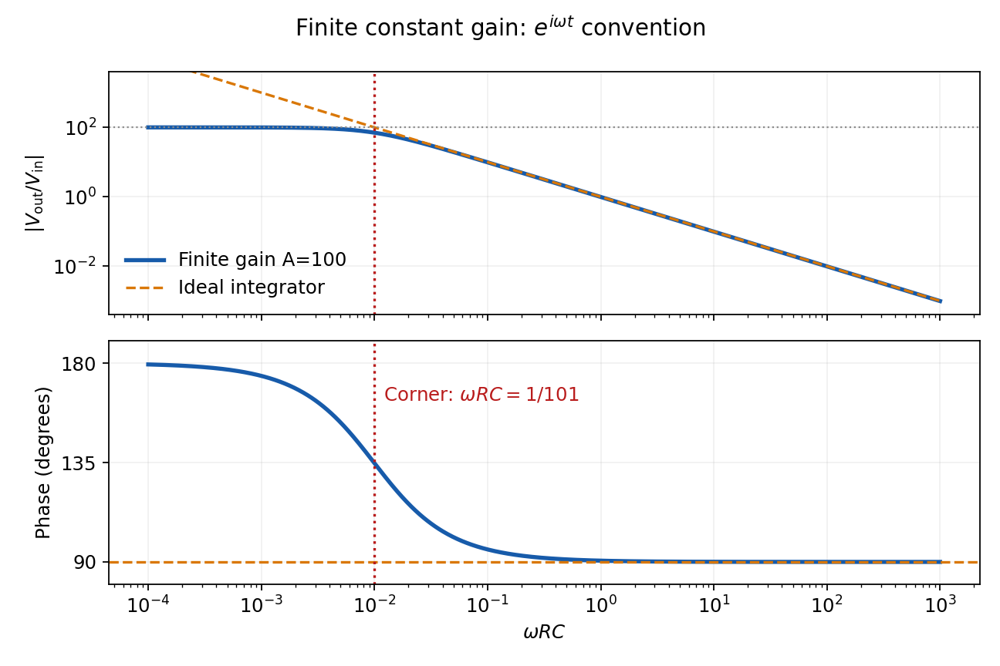

<h1 id="section-d/d13/solution">Solution</h1>

↑ **Parent:** [D13](../d13.md)

An [ideal operational amplifier](../../../../../ideal-operational-amplifier.md) has infinite [input impedance](../../../../../input-impedance.md) and [open-loop gain](../../../../../open-loop-gain.md), zero [output impedance](../../../../../output-impedance.md) and no offsets or response limits. Its input currents vanish. Stable [operational-amplifier negative feedback](../../../../../operational-amplifier-negative-feedback.md), a finite output and unsaturated linear operation then imply a [virtual short](../../../../../virtual-short.md), $v_+=v_-$. Real amplifiers have finite frequency-dependent gain, [input bias currents](../../../../../input-bias-current.md), offset [voltage](../../../../../voltage.md), output loading, finite [bandwidth](../../../../../bandwidth-signal-processing.md), [slew rate](../../../../../slew-rate.md) and supply-rail limits. Equal input [voltages](../../../../../voltage.md) cannot be assumed in an open-loop or saturated circuit.

Here the noninverting input is grounded. In the ideal-feedback limit the inverting node is a [virtual ground](../../../../../virtual-ground.md), so the [resistor](../../../../../resistor.md) current charges the feedback [capacitor](../../../../../capacitor.md):

$$
\frac{V_{\rm in}}R=C\frac{d(0-V_{\rm out})}{dt},\qquad
\boxed{V_{\rm out}(t)=V_{\rm out}(t_0)-\frac1{RC}\int_{t_0}^t V_{\rm in}(u)\,du}.
$$

The initial [capacitor](../../../../../capacitor.md) charge fixes the integration constant. This is an [op amp integrator](../../../../../op-amp-integrator.md), with $H(i\omega)=-1/(i\omega RC)$.

A tiny direct-current input, [input bias current](../../../../../input-bias-current.md) or offset can drive the output towards saturation. A parallel feedback [resistor](../../../../../resistor.md) $R_f$ provides a direct-current return path, giving $H(s)=-(R_f/R)/(1+sR_fC)$; choose $\omega R_fC\gg1$ over the intended integration band. A reset switch sets initial charge; low-offset components and suitable [signal](../../../../../signal.md) amplitude reduce drift and saturation. The useful band must also remain below the amplifier's [bandwidth](../../../../../bandwidth-signal-processing.md) and slew-rate limits.

For the stipulated finite but constant real gain $A=100$, infinite [input impedance](../../../../../input-impedance.md) and negligible [output impedance](../../../../../output-impedance.md), write the inverting-node [voltage](../../../../../voltage.md) as $v=-V_{\rm out}/A$. With [phasors](../../../../../phasor.md) proportional to $e^{i\omega t}$,

$$
\frac{V_{\rm in}-v}{R}=i\omega C(v-V_{\rm out}),\qquad
\boxed{H(i\omega)=\frac{V_{\rm out}}{V_{\rm in}}=-\frac{A}{1+i(1+A)\omega RC}}.
$$

Therefore

$$
\boxed{|H|=\frac{100}{\sqrt{1+(101\omega RC)^2}},\qquad
\arg H=\pi-\tan^{-1}(101\omega RC)\quad(\omega>0)}.
$$

The low-frequency gain is $-100$. The corner is $\omega_c=1/(101RC)$; above it the amplitude falls as $100/(101\omega RC)$ and the [phase](../../../../../phase-waves.md) approaches $+\pi/2$. [phase](../../../../../phase-waves.md) $+\pi$ and $-\pi$ describe the same low-frequency inversion. This finite-gain circuit is a low-pass response with an integrating high-frequency regime, not an ideal integrator down to zero [frequency](../../../../../frequency.md). A genuinely frequency-dependent $A(i\omega)$ would introduce additional high-frequency limitations beyond this specified model.

**[Figure 2](#section-d/d13/image-finite-gain-integrator-response). Finite-gain integrator response**.

## ↑ Ancestors (14)

1. [D13](../d13.md)
2. [Section D](../../section-d.md)
3. [Paper 2](../../../paper-2-split.md)
4. [2010](../../../split.md)
5. [Past exam of the physics A course of the University of Cambridge](../../../../split.md)
6. [Physics A course of the University of Cambridge](../../../../../physics-a-course-of-the-university-of-cambridge.md)
7. [Physics course of the year 2 of the natural sciences course of the University of Cambridge](../../../../../physics-course-of-the-year-2-of-the-natural-sciences-course-of-the-university-of-cambridge.md)
8. [Year 2 of the natural sciences course of the University of Cambridge](../../../../../year-2-of-the-natural-sciences-course-of-the-university-of-cambridge.md)
9. [Year of the natural sciences course of the University of Cambridge](../../../../../year-of-the-natural-sciences-course-of-the-university-of-cambridge.md)
10. [Natural sciences course of the University of Cambridge](../../../../../natural-sciences-course-of-the-university-of-cambridge.md)
11. [Course of the University of Cambridge](../../../../../course-of-the-university-of-cambridge.md)
12. [University of Cambridge](../../../../../university-of-cambridge-split.md)
13. [List of universities](../../../../../list-of-universities.md)
14. [Codex Wiki](../../../../../split.md)
