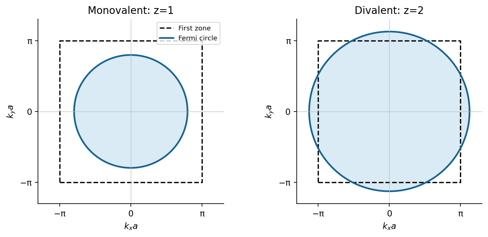
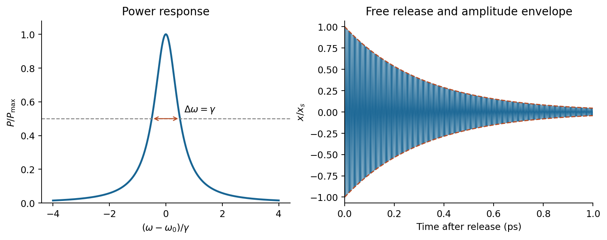
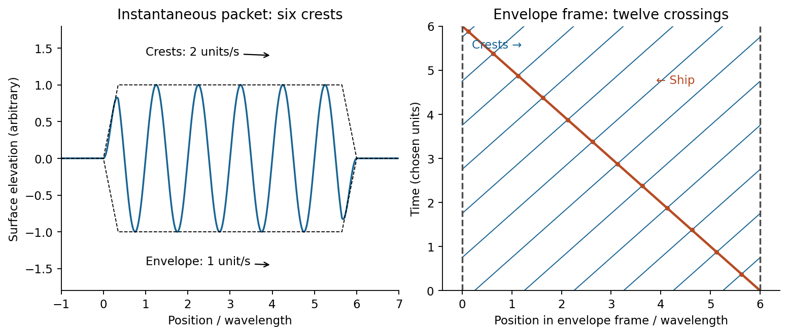
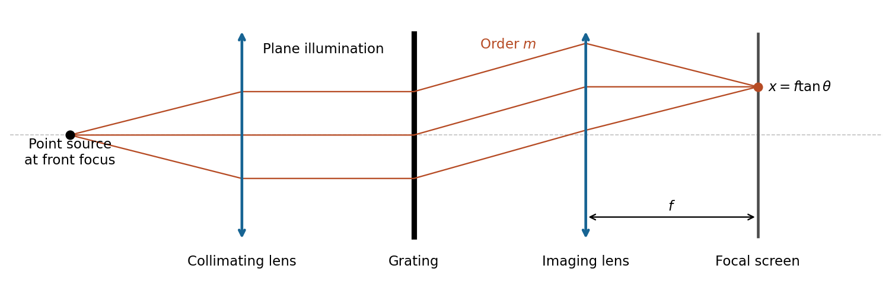
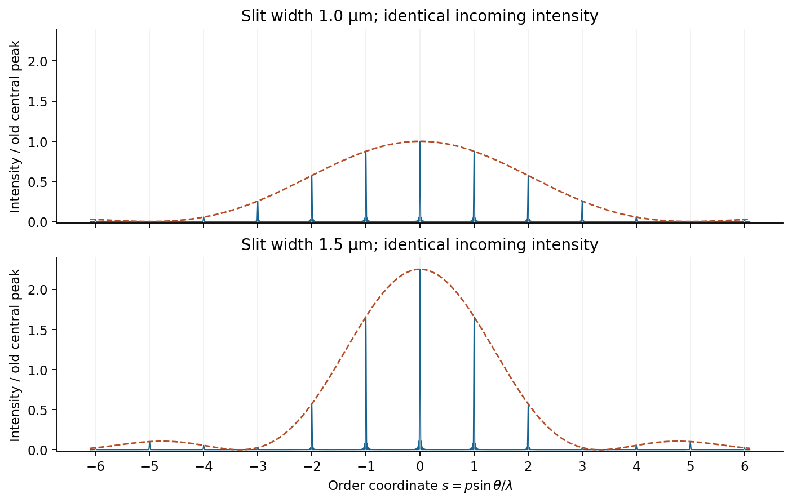
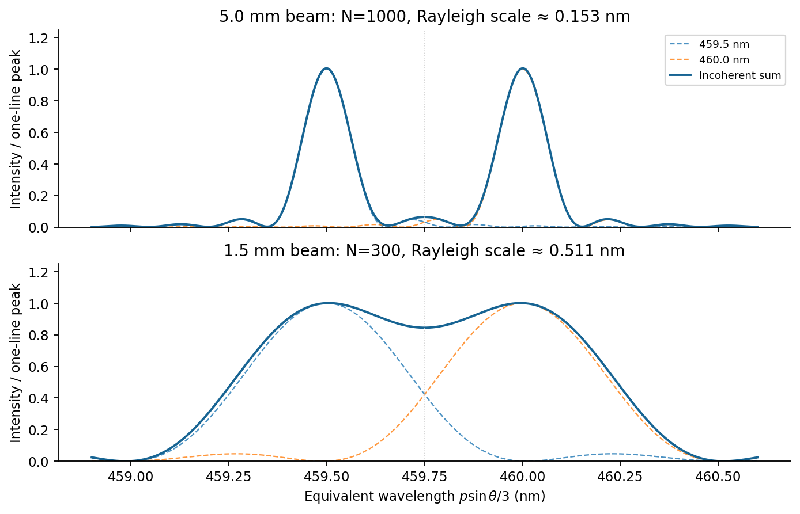
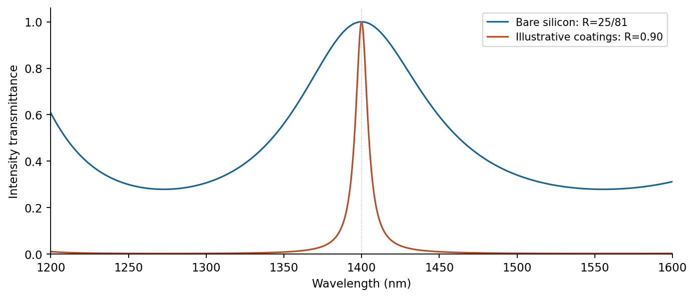
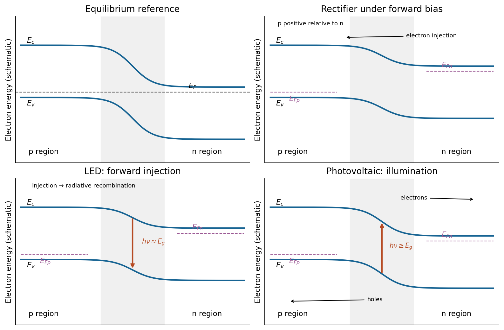

# Paper 1

↑ **Parent:** [2011](../2011.md)

Original paper: [Physics A (1), 28 May 2011; physical PDF pages 14–20](https://www.whatdotheyknow.com/request/physics_past_papers_23/response/3514893/attach/4/FOI%202026%20628%20Smith%20materials.pdf?cookie_passthrough=1).

**Table of contents**

- [Section A](#section-a)
  - [1](#section-a/1)
    - [Solution](#section-a/1/solution)
  - [2](#section-a/2)
    - [Solution](#section-a/2/solution)
  - [3](#section-a/3)
    - [Solution](#section-a/3/solution)
  - [4](#section-a/4)
    - [Solution](#section-a/4/solution)
  - [5](#section-a/5)
    - [a](#section-a/5/a)
      - [Solution](#section-a/5/a/solution)
    - [b](#section-a/5/b)
      - [Solution](#section-a/5/b/solution)
- [Section B](#section-b)
  - [B6](#section-b/b6)
    - [Solution](#section-b/b6/solution)
  - [B7](#section-b/b7)
    - [Solution](#section-b/b7/solution)
  - [B8](#section-b/b8)
    - [Solution](#section-b/b8/solution)
    - [a (slit width)](#section-b/b8/a-slit-width)
      - [Solution](#section-b/b8/a-slit-width/solution)
    - [b (slit width)](#section-b/b8/b-slit-width)
      - [Solution](#section-b/b8/b-slit-width/solution)
    - [a (beam width)](#section-b/b8/a-beam-width)
      - [Solution](#section-b/b8/a-beam-width/solution)
    - [b (beam width)](#section-b/b8/b-beam-width)
      - [Solution](#section-b/b8/b-beam-width/solution)
  - [B9](#section-b/b9)
    - [Solution](#section-b/b9/solution)
- [Section C](#section-c)
  - [C10](#section-c/c10)
    - [Solution](#section-c/c10/solution)
    - [a](#section-c/c10/a)
      - [Solution](#section-c/c10/a/solution)
    - [b](#section-c/c10/b)
      - [Solution](#section-c/c10/b/solution)
  - [C11](#section-c/c11)
    - [Solution](#section-c/c11/solution)
    - [a (internal energy)](#section-c/c11/a-internal-energy)
      - [Solution](#section-c/c11/a-internal-energy/solution)
    - [b (internal energy)](#section-c/c11/b-internal-energy)
      - [Solution](#section-c/c11/b-internal-energy/solution)
    - [a (heat capacity)](#section-c/c11/a-heat-capacity)
      - [Solution](#section-c/c11/a-heat-capacity/solution)
    - [b (heat capacity)](#section-c/c11/b-heat-capacity)
      - [Solution](#section-c/c11/b-heat-capacity/solution)
- [Section D](#section-d)
  - [D12](#section-d/d12)
    - [a](#section-d/d12/a)
      - [Solution](#section-d/d12/a/solution)
    - [b](#section-d/d12/b)
      - [Solution](#section-d/d12/b/solution)
    - [c](#section-d/d12/c)
      - [Solution](#section-d/d12/c/solution)
  - [D13](#section-d/d13)
    - [a](#section-d/d13/a)
      - [Solution](#section-d/d13/a/solution)
    - [b](#section-d/d13/b)
      - [Solution](#section-d/d13/b/solution)
    - [c](#section-d/d13/c)
      - [Solution](#section-d/d13/c/solution)

## Section A

↑ **Parent:** [Paper 1](paper-1.md)

<h3 id="section-a/1">1</h3>

↑ **Parent:** [Section A](#section-a)

<h4 id="section-a/1/solution">Solution</h4>

↑ **Parent:** [1](#section-a/1)

For weak [damping](../../wave-equation.md#damping), the [ringdown comparison bound for two resonator modes](../../dynamical-systems.md#ringdown-comparison-bound-for-two-resonator-modes) gives $I(t)=I(0)e^{-\omega t/Q}$. Interpreting the stated loudness comparison as an [intensity](../../wave.md#intensity-physics) comparison,

$$
\frac{I_L(2)}{I_H(2)}=2\exp\!\left[-2\left(\frac{2\pi(700)}{Q_L}-\frac{2\pi(6000)}{10^5}\right)\right]<1.
$$

Therefore **the information gives an upper bound**, not a unique value:

$$
\boxed{Q_L<\frac{2\pi(700)}{2\pi(6000)/10^5+\ln2/2}\simeq6.08\times10^3.}
$$

Equality would describe equal [intensities](../../wave.md#intensity-physics) at two seconds; the stated strict inequality allows every smaller positive $Q_L$ consistent with the weak-damping model.

<h3 id="section-a/2">2</h3>

↑ **Parent:** [Section A](#section-a)

<h4 id="section-a/2/solution">Solution</h4>

↑ **Parent:** [2](#section-a/2)

By linear [scalar diffraction theory](../../physical-optics.md#scalar-diffraction-theory), complementary [aperture](../../optics.md#aperture) transmissions $t$ and $1-t$ give $U_t+U_{1-t}=U_{\rm open}$ under identical illumination. In [Fraunhofer diffraction](../../physical-optics.md#fraunhofer-diffraction), away from the direct forward beam $U_{\rm open}=0$, so $U_{1-t}=-U_t$: **the complementary screens have identical off-axis diffraction [intensities](../../wave.md#intensity-physics)**. This is [Babinet's principle](../../physical-optics.md#babinet-s-principle). Their [complex amplitudes](../../wave.md#complex-amplitude), rather than their [intensities](../../wave.md#intensity-physics), add. The direct beam is the exception; real conducting-edge vector effects are outside this ideal scalar statement.

<h3 id="section-a/3">3</h3>

↑ **Parent:** [Section A](#section-a)

<h4 id="section-a/3/solution">Solution</h4>

↑ **Parent:** [3](#section-a/3)

For source and screen distances $s,r$, the paraxial optical path excess at [aperture](../../optics.md#aperture) radius $u$ is $u^2(1/s+1/r)/2$. The outer boundary of [Fresnel half-period zone](../../physical-optics.md#fresnel-half-period-zone) $n$ has excess $n\lambda/2$, hence

$$
u_n^2=\frac{n\lambda sr}{s+r},\qquad \boxed{u_2=\sqrt{\frac{2(500\times10^{-9})(0.5)^2}{1.0}}=0.500\,\mathrm{mm}.}
$$

This is the outer radius of the second zone, measured from the axis.

<h3 id="section-a/4">4</h3>

↑ **Parent:** [Section A](#section-a)

<h4 id="section-a/4/solution">Solution</h4>

↑ **Parent:** [4](#section-a/4)

A conventional [body-centred cubic](../../quantum-scattering.md#body-centered-cubic-lattice) cell contains two atoms, so its edge $a$ obeys $\rho a^3=2(23m_u)$. Taking $m_u=1.66054\times10^{-27}\,\mathrm{kg}$ gives $a\simeq4.29\times10^{-10}\,\mathrm m$. The [neighbour shells of a body-centred cubic lattice](../../quantum-scattering.md#neighbour-shells-of-a-body-centred-cubic-lattice) have eight nearest neighbours that are at $\sqrt3a/2$; the six next-nearest neighbours lie along the cell axes. Thus **the next-nearest-neighbour distance is $a\simeq0.429\,\mathrm{nm}$**.

<h3 id="section-a/5">5</h3>

↑ **Parent:** [Section A](#section-a)

<h4 id="section-a/5/a">a</h4>

↑ **Parent:** [5](#section-a/5)

<h5 id="section-a/5/a/solution">Solution</h5>

↑ **Parent:** [A](#section-a/5/a)

For a [free-electron Fermi circle in a square lattice](../../fermi-liquid.md#free-electron-fermi-circle-in-a-square-lattice), include two spin states per [wavevector](../../elasticity-physics.md#wavevector). A square cell of side $a$ supplies $z/a^2$ [electrons](../../physics.md#electron) per unit area; counting the disk of occupied states gives

$$
\frac{z}{a^2}=\frac{2\pi k_F^2}{(2\pi)^2},\qquad k_F=\frac{\sqrt{2\pi z}}a.
$$

The [first Brillouin zone](../../bloch-s-theorem.md#first-brillouin-zone) is $|k_x|,|k_y|\leq\pi/a$. For $z=1$, **$k_F=2.507/a$**, so the circular [Fermi surface](../../fermi-liquid.md#fermi-surface) lies wholly inside this square and encloses half its area. The figure uses the stated free-electron approximation; the lattice symmetry alone does not prescribe an exact circular surface.

**[Figure 1](#section-a/5/a/image-free-electron-circles-and-the-square-brillouin-zone). Free-electron circles and the square Brillouin zone**. Original state-counting construction. Dashed squares are first-zone boundaries; the right-hand circle is shown in the extended-zone representation.

<h4 id="section-a/5/b">b</h4>

↑ **Parent:** [5](#section-a/5)

<h5 id="section-a/5/b/solution">Solution</h5>

↑ **Parent:** [B](#section-a/5/b)

For $z=2$, **$k_F=\sqrt{4\pi}/a=3.545/a$**. The circle encloses one whole zone's area, crosses each face because $k_F>\pi/a$, and misses the corners because $k_F<\sqrt2\pi/a$. In a [reduced Brillouin zone](../../bloch-s-theorem.md#reduced-brillouin-zone), fold the portions outside the square into neighbouring band branches. A weak [periodic potential](../../bloch-s-theorem.md#periodic-potential) opens [band gaps](../../bloch-s-theorem.md#band-gap) at crossings and deforms these pieces; divalence alone does not establish a [band insulator](../../bloch-s-theorem.md#band-insulator).

## Section B

↑ **Parent:** [Paper 1](paper-1.md)

<h3 id="section-b/b6">B6</h3>

↑ **Parent:** [Section B](#section-b)

<h4 id="section-b/b6/solution">Solution</h4>

↑ **Parent:** [B6](#section-b/b6)

The restoring, [damping](../../wave-equation.md#damping) and [electric forces](../../electric-field.md#electric-force) on the [electron](../../physics.md#electron) give $m_e\ddot x=-kx-b\dot x-eE(t)$. Dividing by $m_e$ gives a [Lorentz oscillator model](../../permittivity.md#lorentz-oscillator-model) with

$$
\omega_0=\sqrt{k/m_e}=\boxed{1.785\times10^{15}\,\mathrm{rad\,s^{-1}}},\qquad
\gamma=b/m_e=\boxed{6.264\times10^{12}\,\mathrm{s^{-1}}}.
$$

For the $e^{i\omega t}$ convention, substitute $x=\operatorname{Re}(x_0e^{i\omega t})$. Then $x_0=-eE_0/[m_e(\omega_0^2-\omega^2+i\gamma\omega)]$ and

$$
\boxed{v_0=i\omega x_0=\frac{-i\omega eE_0}{m_e(\omega_0^2-\omega^2+i\gamma\omega)}.}
$$

The time-averaged dissipated [power](../../energy.md#power) is

$$
P=\frac{be^2|E_0|^2}{2m_e^2}\frac{\omega^2}{(\omega_0^2-\omega^2)^2+\gamma^2\omega^2},\qquad
\frac P{P_{\max}}=\frac{\gamma^2}{(\omega_0^2/\omega-\omega)^2+\gamma^2}.
$$

For positive [frequency](../../wave.md#frequency) the squared term is minimized to zero only at **$\omega=\omega_0$**. Thus the [power](../../energy.md#power) maximum is exactly at the undamped [natural frequency](../../classical-mechanics.md#natural-frequency), even though the [displacement](../../classical-mechanics.md#displacement) maximum is slightly shifted. Here $P_{\max}=e^2|E_0|^2/(2b)$. The half-power equation is $|\omega_0^2-\omega^2|=\gamma\omega$, whose two positive roots are

$$
\omega_\pm=\frac{\sqrt{4\omega_0^2+\gamma^2}\pm\gamma}{2},\qquad
\boxed{\Delta\omega=\omega_+-\omega_-=\gamma.}
$$

This is the [absorbed-power bandwidth of a viscously damped oscillator](../../dynamical-systems.md#absorbed-power-bandwidth-of-a-viscously-damped-oscillator), exact within the model. Near [resonance](../../dynamical-systems.md#resonance) the profile is approximately a [Lorentzian line shape](../../stellar-astrophysics.md#lorentzian-line-shape). With $c=2.99792458\times10^8\,\mathrm{m\,s^{-1}}$,

$$
\boxed{\lambda_{\rm peak}=\frac{2\pi c}{\omega_0}=1055.2\,\mathrm{nm}},\qquad
\boxed{\Delta\lambda=2\pi c\left(\frac1{\omega_-}-\frac1{\omega_+}\right)=\frac{2\pi c\gamma}{\omega_0^2}=3.70\,\mathrm{nm}.}
$$

For this [wavelength linewidth of a damped-oscillator power resonance](../../dynamical-systems.md#wavelength-linewidth-of-a-damped-oscillator-power-resonance) we used $\omega_+\omega_-=\omega_0^2$. The half-power [wavelength](../../wave-equation.md#wavelength) endpoints are not exactly symmetric around $\lambda_{\rm peak}$, although that distinction is tiny here.

**[Figure 2](#section-b/b6/image-absorption-resonance-and-release-of-a-polarized-oscillator). Absorption resonance and release of a polarized oscillator**. Original model curves. Frequency is offset from resonance in linewidth units. The release panel uses the supplied mechanical parameters and a unit initial displacement.

In a constant field the settled [displacement](../../classical-mechanics.md#displacement) is $x_s=-eE_{\rm dc}/k$. On sudden removal, with zero initial [velocity](../../classical-mechanics.md#velocity), the free motion is

$$
x(t)=x_s e^{-\gamma t/2}\left[\cos\Omega t+\frac{\gamma}{2\Omega}\sin\Omega t\right],\qquad
\Omega=\sqrt{\omega_0^2-\gamma^2/4}.
$$

The [electron](../../physics.md#electron) oscillates about its original equilibrium, losing the previously stored spring [energy](../../energy.md). The period is **$3.52\,\mathrm{fs}$**, the amplitude decay time is **$2/\gamma=0.319\,\mathrm{ps}$**, and the cycle-averaged [energy](../../energy.md) decay time is **$1/\gamma=0.160\,\mathrm{ps}$**. This is the effective classical model supplied, not a prediction of the full hydrogen line [radiation spectrum](../../electromagnetic-radiation.md#radiation-spectrum).

<h3 id="section-b/b7">B7</h3>

↑ **Parent:** [Section B](#section-b)

<h4 id="section-b/b7/solution">Solution</h4>

↑ **Parent:** [B7](#section-b/b7)

A [wave packet](../../dispersion-relation.md#wave-packet) is a localized [superposition](../../vector-space.md#superposition-principle) of nearby [wavenumbers](../../wave-equation.md#wavenumber). Its rapid carrier crests have [phase velocity](../../dispersion-relation.md#phase-velocity) $v_p=\omega/k$; the slowly varying envelope translates at the [group velocity](../../dispersion-relation.md#group-velocity). Dispersion means that $\omega(k)$ is not simply a constant times $k$, so different carrier components have different [phase velocities](../../dispersion-relation.md#phase-velocity). Expand around $k_0$:

$$
u(x,t)=\operatorname{Re}\!\int A(k)e^{i[kx-\omega(k)t]}\,dk
\simeq\operatorname{Re}\!\left\{e^{i(k_0x-\omega_0t)}\int A(k_0+\kappa)e^{i\kappa[x-\omega'(k_0)t]}\,d\kappa\right\}.
$$

The integral is an envelope depending on $x-\omega'(k_0)t$, so **$v_g=d\omega/dk$** at the central [frequency](../../wave.md#frequency). Neglected curvature causes packet spreading. For a [deep-water gravity wave](../../fluid-mechanics.md#deep-water-gravity-wave), $\omega=\sqrt{gk}$, hence $v_p=\sqrt{g/k}$ and

$$
\boxed{v_g=\tfrac12\sqrt{g/k}=v_p/2=\frac{gT}{4\pi}.}
$$

For [crest crossings through a dispersive wave packet](../../dispersion-relation.md#crest-crossings-through-a-dispersive-wave-packet), an instantaneous group containing six crests has length approximately $L=6\lambda$. A stationary ship takes $L/v_g$ to encounter the group; its crest-arrival [frequency](../../wave.md#frequency) is $v_p/\lambda$. Consequently

$$
\boxed{N=\frac{v_p}{\lambda}\frac L{v_g}=12.}
$$

In the envelope frame the ship moves backwards at $v_g$ while crests move forwards at $v_p-v_g=v_g$. Their relative speed is $2v_g$, explaining why counting a snapshot and counting crossings differ.

**[Figure 3](#section-b/b7/image-six-crests-in-a-packet-and-twelve-ship-crossings). Six crests in a packet and twelve ship crossings**. Original narrow-band deep-water model. The right panel is in the envelope frame; only crest trajectories intersecting the ship while it is inside the packet are drawn.

To estimate [deep-water swell distance from period-dependent arrival times](../../fluid-mechanics.md#deep-water-swell-distance-from-period-dependent-arrival-times), assume a localized storm emits both periods at the same time and place, propagation is in deep water, and currents and refraction can be neglected. If its distance is $D$, the arrival lag obeys

$$
86400=D\left(\frac1{v_g(15\,\mathrm s)}-\frac1{v_g(20\,\mathrm s)}\right)
=\frac{4\pi D}{g}\left(\frac1{15}-\frac1{20}\right).
$$

With $g=9.81\,\mathrm{m\,s^{-2}}$, **$D=15g(86400)/\pi\simeq4.05\times10^6\,\mathrm m$**, about **4050 km**. The corresponding travel times are three and four days. A moving or long-lived storm with frequency-dependent emission times would invalidate the unique distance inference.

<h3 id="section-b/b8">B8</h3>

↑ **Parent:** [Section B](#section-b)

<h4 id="section-b/b8/solution">Solution</h4>

↑ **Parent:** [B8](#section-b/b8)

At screen coordinate $X$, the propagation length from [aperture](../../optics.md#aperture) coordinate $x$ is $[D^2+(X-x)^2]^{1/2}$. Its expansion has a constant term, a term linear in $x$ giving the observation angle, and a quadratic term of order $x^2/(2D)$. For $|x|\leq d/2$, the quadratic [wave phase](../../wave.md#phase-waves) is at most of order $\pi d^2/(4\lambda D)$. Requiring it to be much smaller than one gives the sufficient condition **$D\gg d^2/\lambda$**; higher terms are then smaller in the paraxial geometry. In the [lens](../../geometrical-optics.md#lens-optics) arrangement, put the source at the first [lens](../../geometrical-optics.md#lens-optics)'s front focus, illuminate the grating with its collimated output, and put the screen at the second [lens](../../geometrical-optics.md#lens-optics)'s back [focal plane](../../optical-instrument.md#focal-plane). This obtains the angular [Fraunhofer diffraction](../../physical-optics.md#fraunhofer-diffraction) pattern without a physically very distant screen.

**[Figure 4](#section-b/b8/image-two-lens-arrangement-for-a-grating-diffraction-pattern). Two-lens arrangement for a grating diffraction pattern**. Original schematic ray construction. Equal outgoing ray slopes meet at a common back-focal-plane position; distances and angles are illustrative.

The slit pitch is $p=1/(200\,\mathrm{mm^{-1}})=5.00\,\mathrm{\mu m}$. Normal-incidence maxima satisfy $p\sin\theta=m\lambda$. Thus $\sin\theta_3=0.276$ and, using rectilinear focal-plane geometry,

$$
\boxed{x_3=\pm f\tan\theta_3=\pm86.1\,\mathrm{mm}.}
$$

The paraxial result $x_3\simeq fm\lambda/p=\pm82.8\,\mathrm{mm}$ is a roughly 4% lower approximation; an actual wide-angle [lens](../../geometrical-optics.md#lens-optics)'s mapping depends on its design. The angular result does not depend on that convention.

For $N$ uniformly illuminated equal slits of width $w$, the diffraction [intensity](../../wave.md#intensity-physics) has the form

$$
I(\theta)=Cw^2\operatorname{sinc}^2\!\left(\frac{\pi w\sin\theta}{\lambda}\right)
\left[\frac{\sin(N\pi p\sin\theta/\lambda)}{\sin(\pi p\sin\theta/\lambda)}\right]^2,\quad \operatorname{sinc}u=\frac{\sin u}u.
$$

Here $C$ is unchanged when the incoming [intensity](../../wave.md#intensity-physics) is fixed. The broad [single-slit diffraction](../../physical-optics.md#single-slit-diffraction) envelope multiplies the narrow grating orders. At a principal maximum,

$$
I_m=CN^2w^2\operatorname{sinc}^2(\pi mw/p).
$$

The [fixed-illumination grating peak change with slit width](../../physical-optics.md#fixed-illumination-grating-peak-change-with-slit-width) gives the changes from $w=1.0$ to $1.5\,\mathrm{\mu m}$ are

$$
\boxed{I_{0,\rm new}/I_{0,\rm old}=2.25},\qquad
\boxed{I_{3,\rm new}/I_{3,\rm old}=\left[\frac{\sin(0.9\pi)}{\sin(0.6\pi)}\right]^2=0.1056.}
$$

The central peak increases by 125%, while the third-order peak decreases by about 89.4%. Separate normalizations to each central peak would hide this effect. The following width-specific solutions and profiles use a common incoming normalization.

<h4 id="section-b/b8/a-slit-width">a (slit width)</h4>

↑ **Parent:** [B8](#section-b/b8)

<h5 id="section-b/b8/a-slit-width/solution">Solution</h5>

↑ **Parent:** [A (slit width)](#section-b/b8/a-slit-width)

With $w=1.0\,\mathrm{\mu m}$ the order positions are unchanged from the [grating equation](../../physical-optics.md#grating-equation), and the envelope's first zeros satisfy $|\sin\theta|=\lambda/w$. Equivalently the first missing integer orders are **$m=\pm5$**. The third-order peaks remain appreciable. The displayed order-coordinate $s=p\sin\theta/\lambda$ places all principal maxima at integers.

**[Figure 5](#section-b/b8/a-slit-width/image-slit-width-envelopes-on-a-common-incident-intensity-scale). Slit-width envelopes on a common incident-intensity scale**. Original finite-array model with an illustrative 60 illuminated slits to make the peaks visible. Dashed lines show single-slit envelopes; the supplied slit pitch and widths set the peak ratios independently of this illustrative slit count.

<h4 id="section-b/b8/b-slit-width">b (slit width)</h4>

↑ **Parent:** [B8](#section-b/b8)

<h5 id="section-b/b8/b-slit-width/solution">Solution</h5>

↑ **Parent:** [B (slit width)](#section-b/b8/b-slit-width)

With $w=1.5\,\mathrm{\mu m}$ the same principal maxima sit inside a narrower envelope, whose first zeros are at **$s=\pm10/3$**. The third order is now close to a zero and is strongly suppressed, whereas the central peak is taller. The first exact missing nonzero integer orders are $m=\pm10$; $m=3$ is suppressed rather than identically missing.

<h4 id="section-b/b8/a-beam-width">a (beam width)</h4>

↑ **Parent:** [B8](#section-b/b8)

<h5 id="section-b/b8/a-beam-width/solution">Solution</h5>

↑ **Parent:** [A (beam width)](#section-b/b8/a-beam-width)

A $5.0\,\mathrm{mm}$ beam illuminates $N=5.0\,\mathrm{mm}/p=1000$ slits. The [resolving power of a diffraction grating](../../physical-optics.md#resolving-power-of-a-diffraction-grating) in order $m=3$ is $mN=3000$, corresponding to a [Rayleigh criterion](../../point-spread-function.md#rayleigh-criterion) separation $\delta\lambda_R\simeq460/3000=0.153\,\mathrm{nm}$. The $0.5\,\mathrm{nm}$ separation therefore gives **two well separated main peaks**. The [finite-grating incoherent doublet profile](../../physical-optics.md#finite-grating-incoherent-doublet-profile) adds the mutually incoherent lamp [intensities](../../wave.md#intensity-physics), not their amplitudes.

**[Figure 6](#section-b/b8/a-beam-width/image-third-order-doublet-for-two-illuminated-grating-widths). Third-order doublet for two illuminated grating widths**. Original finite-N intensity sums, with equal line strengths and narrow slits. The horizontal coordinate is the wavelength inferred from the third-order grating equation. Each component is dashed and their incoherent sum is solid.

<h4 id="section-b/b8/b-beam-width">b (beam width)</h4>

↑ **Parent:** [B8](#section-b/b8)

<h5 id="section-b/b8/b-beam-width/solution">Solution</h5>

↑ **Parent:** [B (beam width)](#section-b/b8/b-beam-width)

A $1.5\,\mathrm{mm}$ beam illuminates only $N=300$ slits, giving $mN=900$ and **$\delta\lambda_R\simeq0.511\,\mathrm{nm}$**. The two main lobes broaden by $1000/300$ compared with the wider beam. Their $0.5\,\mathrm{nm}$ separation is slightly below the stated Rayleigh threshold: **marginally unresolved by that criterion**. This is not an assertion that the profile has only one maximum: the ideal equal-line sum still has two maxima and a modest central dip, as plotted. Inference from real data also requires adequate [signal-to-noise ratio](../../electrical-engineering.md#signal-to-noise-ratio) and a known instrumental profile.

<h3 id="section-b/b9">B9</h3>

↑ **Parent:** [Section B](#section-b)

<h4 id="section-b/b9/solution">Solution</h4>

↑ **Parent:** [B9](#section-b/b9)

The [wave impedance](../../electromagnetic-wave.md#wave-impedance) is the travelling-wave field ratio $Z=E/H$; for the stated nonmagnetic media it is $Z_0/n$. A [reflection coefficient](../../partial-differential-equation.md#reflection-coefficient) is a reflected-to-incident [complex amplitude](../../wave.md#complex-amplitude) ratio with an explicitly chosen field orientation. With this [reflection-amplitude sign convention](../../electromagnetic-wave.md#reflection-amplitude-sign-convention), using the question's formula for incidence inside silicon gives

$$
\boxed{r=\frac{Z_0/3.5-Z_0}{Z_0/3.5+Z_0}=-\frac59},\qquad R=|r|^2=\frac{25}{81}.
$$

With a common tangential electric-field direction, the usual electric-field [Fresnel equations](../../electromagnetic-wave.md#fresnel-equations) instead give $r_E=(Z_2-Z_1)/(Z_2+Z_1)=+5/9$ for this incidence. The printed formula corresponds to the opposite reflected-field sign convention, for example the magnetic amplitude convention. It gives the same [reflectance](../../radiometry.md#reflectance) and the same round-trip factor $r^2$.

Each extra internal round trip multiplies the transmitted amplitude by $r^2e^{i\delta}$, with $\delta=4\pi nd/\lambda$. A [geometric series](../../sequence-and-series.md#geometric-series) therefore gives

$$
A_{\rm out}=A_{\rm first}\sum_{j=0}^\infty(r^2e^{i\delta})^j=\frac{A_{\rm first}}{1-r^2e^{i\delta}},\qquad
\boxed{I\propto\frac1{1+R^2-2R\cos\delta}.}
$$

This is [Fabry–Pérot transmission from multiple reflections](../../optical-instrument.md#fabry-perot-transmission-from-multiple-reflections). Assuming lossless silicon with wavelength-independent $n$, the full [intensity](../../wave.md#intensity-physics) transmittance between air regions is

$$
T=\frac{(1-R)^2}{(1-R)^2+4R\sin^2(\delta/2)}.
$$

Maxima have $2nd/\lambda=j$, minima $2nd/\lambda=j+\tfrac12$. Here $2nd=7000\,\mathrm{nm}$, so within the specified tuning range the only maximum is **$1400\,\mathrm{nm}$**, and the two minima are **$1555.6\,\mathrm{nm}$** and **$1272.7\,\mathrm{nm}$**. The contrast is

$$
\boxed{\frac{I_{\max}}{I_{\min}}=\left(\frac{1+R}{1-R}\right)^2=\left(\frac{53}{28}\right)^2=3.583.}
$$

**[Figure 7](#section-b/b9/image-transmission-contrast-and-resonance-narrowing-with-reflectivity). Transmission contrast and resonance narrowing with reflectivity**. Original ideal lossless symmetric-etalon curves. The coating example uses chosen R=0.90, unchanged optical thickness and zero additional round-trip phase.

Identical highly reflecting coatings increase the [finesse](../../optical-instrument.md#finesse): transmission maxima become narrower and the [intensity](../../wave.md#intensity-physics) between them falls. Ideal symmetric lossless coatings retain $T_{\max}=1$; absorption or unequal mirrors reduce it. The illustrated maxima stay fixed only because additional reflection [wave phases](../../wave.md#phase-waves) are held unchanged. Real coating [wave phases](../../wave.md#phase-waves) can also shift the [resonances](../../dynamical-systems.md#resonance).

## Section C

↑ **Parent:** [Paper 1](paper-1.md)

<h3 id="section-c/c10">C10</h3>

↑ **Parent:** [Section C](#section-c)

<h4 id="section-c/c10/solution">Solution</h4>

↑ **Parent:** [C10](#section-c/c10)

For this calculation define the net [wavevector](../../elasticity-physics.md#wavevector) gained by the [neutron](../../neutron.md) as $\mathbf Q=\mathbf k_f-\mathbf k_i$, the opposite of a common sample-transfer convention. Since $\mathbf Q\perp\mathbf k_i$,

$$
E_f-E_i=\frac{\hbar^2}{2m_n}\bigl[(\mathbf k_i+\mathbf Q)^2-k_i^2\bigr]=\frac{\hbar^2Q^2}{2m_n}.
$$

The [perpendicular neutron recoil and phonon absorption](../../neutron.md#perpendicular-neutron-recoil-and-phonon-absorption) condition therefore requires **$\omega(Q)=\hbar Q^2/(2m_n)$**. In the supplied periodic dispersion, interpret its $q$ as this transfer $Q$ in the [extended-zone representation of a phonon dispersion](../../quantum-ideal-gas-statistics.md#extended-zone-representation-of-a-phonon-dispersion). Put $x=Qa/2$ and $C=m_nav/\hbar\simeq15.84$. Nonzero intersections obey

$$
x^2=C|\sin x|.
$$

There is no root in $0<x\leq\pi/2$: $\sin x\geq2x/\pi$ there and $C>\pi^2/4$. On $(\pi/2,\pi)$ the ratio $x^2/\sin x$ increases strictly from $\pi^2/4$ to infinity, so exactly one root occurs. Nor can there be a higher root: $x\geq\sqrt C$ gives $x^2\geq C\geq C|\sin x|$, with strict inequality at the possible boundary. For $\pi\leq x\leq\sqrt C$, use $|\sin x|\leq x-\pi$; $x^2-C(x-\pi)>0$ throughout this short interval, since its minimum there is $C(1+\pi-\sqrt C)>0$. Thus the only nonzero magnitude satisfies

$$
\boxed{\pi/a<Q<2\pi/a.}
$$

Solving the exact dispersion, which is permitted instead of the linear approximation, gives

$$
\boxed{Q=1.069\times10^{10}\,\mathrm{m^{-1}},\quad \omega=3.610\times10^{12}\,\mathrm{rad\,s^{-1}},\quad f=0.575\,\mathrm{THz}.}
$$

A straight chord between the zone edge and the next zone centre gives $\omega\simeq4v/a-2vQ/\pi$. Its intersection solves $(\hbar/2m_n)Q^2+(2v/\pi)Q-4v/a=0$, yielding $Q\simeq1.006\times10^{10}\,\mathrm{m^{-1}}$ and $f\simeq0.508\,\mathrm{THz}$ as a less accurate estimate.

**[Figure 8](#section-c/c10/image-neutron-recoil-intersects-a-periodic-acoustic-branch). Neutron recoil intersects a periodic acoustic branch**. Original dispersion and recoil curves using the supplied parameters. The nonzero exact intersection lies in the second extended-zone interval; the dashed chord is the permitted linear approximation.

The reduced-zone [phonon](../../quantum-ideal-gas-statistics.md#phonon) [wavevector](../../elasticity-physics.md#wavevector) is $q_{\rm red}=Q-2\pi/a=-1.873\times10^9\,\mathrm{m^{-1}}$ along the chosen positive transfer direction. The difference is a reciprocal-lattice vector, not an additional independent [phonon](../../quantum-ideal-gas-statistics.md#phonon) outside the first zone. At low [temperature](../../temperature.md) the absorption probability contains the [Bose-Einstein distribution](../../quantum-ideal-gas-statistics.md#bose-einstein-distribution) factor $n_B(\omega)=[e^{\hbar\omega/k_BT}-1]^{-1}$, which tends to zero. Here $\hbar\omega/k_B\simeq27.6\,\mathrm K$, so this absorption channel is strongly suppressed well below that scale. [elastic scattering](../../quantum-scattering.md#elastic-scattering) and kinematically allowed spontaneous [phonon](../../quantum-ideal-gas-statistics.md#phonon) creation need not disappear.

<h4 id="section-c/c10/a">a</h4>

↑ **Parent:** [C10](#section-c/c10)

<h5 id="section-c/c10/a/solution">Solution</h5>

↑ **Parent:** [A](#section-c/c10/a)

For [elastic scattering](../../quantum-scattering.md#elastic-scattering), **$E_f=E_i$** and **$\mathbf k_f-\mathbf k_i=\mathbf G$**, where $\mathbf G$ is a [reciprocal lattice vector](../../quantum-scattering.md#reciprocal-lattice-vector). In the ideal static crystal, coherent scattering obeys this lattice selection rule; the crystal as a whole can take the mechanical recoil with negligible [energy](../../energy.md). [crystal momentum](../../bloch-s-theorem.md#crystal-momentum) is defined modulo $\hbar\mathbf G$, not as unconstrained free-particle [momentum](../../momentum.md).

<h4 id="section-c/c10/b">b</h4>

↑ **Parent:** [C10](#section-c/c10)

<h5 id="section-c/c10/b/solution">Solution</h5>

↑ **Parent:** [B](#section-c/c10/b)

For annihilation of a [phonon](../../quantum-ideal-gas-statistics.md#phonon) $(\mathbf q,\omega)$,

$$
\boxed{E_f=E_i+\hbar\omega,\quad\mathbf k_f=\mathbf k_i+\mathbf q+\mathbf G.}
$$

For [phonon](../../quantum-ideal-gas-statistics.md#phonon) creation,

$$
\boxed{E_f=E_i-\hbar\omega,\quad\mathbf k_f=\mathbf k_i-\mathbf q+\mathbf G.}
$$

The signs follow whether the [neutron](../../neutron.md) gains or loses the [phonon](../../quantum-ideal-gas-statistics.md#phonon)'s [energy](../../energy.md) and [crystal momentum](../../bloch-s-theorem.md#crystal-momentum). These are one-phonon coherent [inelastic neutron scattering](../../neutron.md#inelastic-neutron-scattering) conditions, with $\mathbf G$ accounting for lattice periodicity.

<h3 id="section-c/c11">C11</h3>

↑ **Parent:** [Section C](#section-c)

<h4 id="section-c/c11/solution">Solution</h4>

↑ **Parent:** [C11](#section-c/c11)

For the [electronic and lattice heat-capacity crossover in a monovalent metal](../../quantum-ideal-gas-statistics.md#electronic-and-lattice-heat-capacity-crossover-in-a-monovalent-metal), to obtain a numerical estimate from $E_F$ alone, assume monovalent potassium is a three-dimensional [free electron gas](../../physics.md#free-electron-model) with a parabolic band. Including both spins, the molar [density of states](../../quantum-ideal-gas-statistics.md#density-of-states) is $g(E_F)=3N_A/(2E_F)$. Using the supplied approximate coefficient $3$, rather than silently replacing it by $\pi^2/3$, gives

$$
C_{el}=\frac92R\frac{k_B T}{E_F}.
$$

Equating it to the stated low-temperature [Debye heat capacity](../../quantum-ideal-gas-statistics.md#debye-heat-capacity) yields the nonzero crossover

$$
\boxed{T=\left[\frac{15}{8\pi^4}\frac{k_B}{E_F}\theta_D^3\right]^{1/2}=0.911\,\mathrm K.}
$$

We used $k_B=8.61733\times10^{-5}\,\mathrm{eV\,K^{-1}}$ and $E_F=2\,\mathrm{eV}$. This is self-consistently far below $\theta_D=100\,\mathrm K$ and the [Fermi temperature](../../quantum-ideal-gas-statistics.md#fermi-temperature). Using the exact Sommerfeld coefficient instead gives $0.954\,\mathrm K$; that is a change of approximation, not a discrepancy in the algebra. Without a band/DOS assumption, the supplied [Fermi energy](../../quantum-ideal-gas-statistics.md#fermi-energy) does not by itself determine $g(E_F)$.

<h4 id="section-c/c11/a-internal-energy">a (internal energy)</h4>

↑ **Parent:** [C11](#section-c/c11)

<h5 id="section-c/c11/a-internal-energy/solution">Solution</h5>

↑ **Parent:** [A (internal energy)](#section-c/c11/a-internal-energy)

For independent conduction-electron states labelled by band, [wavevector](../../elasticity-physics.md#wavevector) and spin, combine those labels into $j$. Then

$$
\boxed{U_{el}=\sum_j\epsilon_j f_{\rm FD}(\epsilon_j;\mu,T)=\int g(\epsilon)\,\epsilon\frac{d\epsilon}{e^{(\epsilon-\mu)/k_BT}+1}.}
$$

Here $g$ counts the same spin and band states as the sum, and $\mu(T)$ is fixed by the number constraint $N=\int g f_{\rm FD}\,d\epsilon$. The [energy](../../energy.md) zero is a fixed band reference. Use the total DOS for total [internal energy](../../internal-energy.md) or the molar DOS for molar [internal energy](../../internal-energy.md); these conventions must not be mixed.

<h4 id="section-c/c11/b-internal-energy">b (internal energy)</h4>

↑ **Parent:** [C11](#section-c/c11)

<h5 id="section-c/c11/b-internal-energy/solution">Solution</h5>

↑ **Parent:** [B (internal energy)](#section-c/c11/b-internal-energy)

In the harmonic approximation, sum over [wavevector](../../elasticity-physics.md#wavevector) $\mathbf q$ and [phonon](../../quantum-ideal-gas-statistics.md#phonon) branch $s$:

$$
\boxed{U_{la}=\sum_{\mathbf q,s}\hbar\omega_{\mathbf q s}\left[\frac1{e^{\hbar\omega_{\mathbf q s}/k_BT}-1}+\frac12\right].}
$$

The occupation factor is the [Bose-Einstein distribution](../../quantum-ideal-gas-statistics.md#bose-einstein-distribution) with zero [phonon](../../quantum-ideal-gas-statistics.md#phonon) [chemical potential](../../chemical-potential.md); $\tfrac12\hbar\omega$ is the [zero-point energy](../../quantum-harmonic-oscillator.md#zero-point-energy). A temperature-independent zero-point term does not contribute to the [heat capacity](../../heat.md#heat-capacity) in this fixed-frequency approximation.

<h4 id="section-c/c11/a-heat-capacity">a (heat capacity)</h4>

↑ **Parent:** [C11](#section-c/c11)

<h5 id="section-c/c11/a-heat-capacity/solution">Solution</h5>

↑ **Parent:** [A (heat capacity)](#section-c/c11/a-heat-capacity)

Only states within an [energy](../../energy.md) shell of width roughly $k_BT$ around $E_F$ appreciably change occupation at low [temperature](../../temperature.md). There are roughly $g(E_F)k_BT$ such states and each excitation costs [energy](../../energy.md) of order $k_BT$. Thus $\Delta U\propto g(E_F)(k_BT)^2$, giving **$C_{el}\propto g(E_F)k_B^2T$**. This is the [thermal-shell estimate of electronic heat capacity](../../heat.md#thermal-shell-estimate-of-electronic-heat-capacity); filled states far below $E_F$ are blocked by the [Pauli exclusion principle](../../tensor-product-of-quantum-systems.md#pauli-exclusion-principle). A smooth DOS and fixed particle number give the more precise Sommerfeld result $C_{el}=(\pi^2/3)g(E_F)k_B^2T$ to leading order.

<h4 id="section-c/c11/b-heat-capacity">b (heat capacity)</h4>

↑ **Parent:** [C11](#section-c/c11)

<h5 id="section-c/c11/b-heat-capacity/solution">Solution</h5>

↑ **Parent:** [B (heat capacity)](#section-c/c11/b-heat-capacity)

For three-dimensional acoustic modes, $\omega\propto q$ and the mode count in a spherical shell is proportional to $q^2dq$, giving [phonon](../../quantum-ideal-gas-statistics.md#phonon) DOS proportional to $\omega^2$. Thermally occupied modes have $\hbar\omega$ of order $k_BT$, so $U_{la}-U_0\propto\int\omega^3n_B(\omega)\,d\omega\propto T^4$. Differentiation gives **$C_{la}\propto T^3$**. At $T\gg\theta_D$, all $3N$ harmonic modes are classically populated; each has mean [energy](../../energy.md) $k_BT$ by equipartition. Thus the [molar heat capacity](../../heat.md#molar-heat-capacity) tends to **$3R$**, the [Dulong-Petit law](../../heat.md#dulong-petit-law). Anharmonic expansion and electronic contributions are not included in that lattice limit.

## Section D

↑ **Parent:** [Paper 1](paper-1.md)

<h3 id="section-d/d12">D12</h3>

↑ **Parent:** [Section D](#section-d)

<h4 id="section-d/d12/a">a</h4>

↑ **Parent:** [D12](#section-d/d12)

<h5 id="section-d/d12/a/solution">Solution</h5>

↑ **Parent:** [A](#section-d/d12/a)

In [Fourier transform spectroscopy](../../optical-instrument.md#fourier-transform-spectroscopy), a scanning [Michelson interferometer](../../physical-optics.md#michelson-interferometer) measures [intensity](../../wave.md#intensity-physics) against [optical path difference](../../physical-optics.md#optical-path-difference) $\ell$ rather than selecting one narrow [wavelength](../../wave-equation.md#wavelength) at a time. After subtraction of the constant background, an ideal stationary source gives an [interferogram](../../physical-optics.md#interferogram)

$$
J(\ell)=\int_0^\infty S(\nu)\cos(2\pi\nu\ell/c)\,d\nu.
$$

A cosine [Fourier transform](../../fourier-transform.md) recovers the spectral [power](../../energy.md#power) density $S(\nu)$ after instrumental calibration. A mirror [displacement](../../classical-mechanics.md#displacement) $x$ changes the round-trip path by $2x$; the zero-path-difference burst aligns the scan, and a reference laser can calibrate the [displacement](../../classical-mechanics.md#displacement).

Finite maximum path difference $L$ multiplies the [interferogram](../../physical-optics.md#interferogram) by a window and convolves the recovered [radiation spectrum](../../electromagnetic-radiation.md#radiation-spectrum) with that window's [Fourier transform](../../fourier-transform.md). Thus **$\delta\nu$ is of order $c/L$**; precise factors depend on scan range and resolution convention. Uniform path samples of separation $\Delta\ell$ need **$\nu_{\max}<c/(2\Delta\ell)$** to avoid [aliasing](../../fourier-analysis.md#aliasing) without bandpass information. [interferogram apodization](../../optical-instrument.md#interferogram-apodization) reduces sidelobes at the price of broader lines. The broad accepted optical throughput can be advantageous; the multiplex signal-to-noise advantage depends on detector noise and is not universal in photon-noise-limited measurements. Source drift during a scan, finite beam divergence, imperfect sampling and [wave phase](../../wave.md#phase-waves) errors require control. The finite-window reasoning is the [delay-range resolution in Fourier transform spectroscopy](../../optical-instrument.md#delay-range-resolution-in-fourier-transform-spectroscopy).[NBSIR 86-3339, chapters 13–16, printed pp.51–80: basic equation, apodization, resolution and sampling](../../physics-bibliography.md#introduction-to-fourier-transform-spectroscopy-by-julius-cohen)

<h4 id="section-d/d12/b">b</h4>

↑ **Parent:** [D12](#section-d/d12)

<h5 id="section-d/d12/b/solution">Solution</h5>

↑ **Parent:** [B](#section-d/d12/b)

A finite [optical pupil](../../optics.md#optical-pupil) spreads a point into a [point spread function](../../point-spread-function.md). In [incoherent imaging](../../point-spread-function.md#incoherent-imaging) an extended [intensity](../../wave.md#intensity-physics) distribution is convolved with that function; its [Fourier transform](../../fourier-transform.md) is the [optical transfer function](../../point-spread-function.md#optical-transfer-function), which attenuates and ultimately removes high spatial [frequencies](../../wave.md#frequency). For an ideal circular pupil the point response is an [Airy disk](../../point-spread-function.md#airy-disk). The [Rayleigh criterion](../../point-spread-function.md#rayleigh-criterion) for two equally bright incoherent points is

$$
\boxed{\theta_R\simeq1.22\lambda/D},\qquad \Delta x_R\simeq1.22\lambda f/D.
$$

A microscope's object-space scale is of order $\lambda/(2\,\mathrm{NA})$, with the numerical factor depending on illumination and the criterion; $\mathrm{NA}=n\sin\alpha$ measures the accepted ray cone. A larger pupil or shorter [wavelength](../../wave-equation.md#wavelength) improves the diffraction scale. Aberrations, [defocus](../../point-spread-function.md#defocus-aberration), detector pixel sampling, motion, background and [photon](../../quantum-mechanics.md#photon) noise can worsen practical performance. Merely magnifying the same blurred image adds no information. Coherent sources require amplitude [superposition](../../vector-space.md#superposition-principle) instead of the incoherent [intensity](../../wave.md#intensity-physics) rule. Rayleigh resolution is a convention for separating a pair, distinct from the precision of localizing one isolated point; information does not abruptly vanish below it.

<h4 id="section-d/d12/c">c</h4>

↑ **Parent:** [D12](#section-d/d12)

<h5 id="section-d/d12/c/solution">Solution</h5>

↑ **Parent:** [C](#section-d/d12/c)

Boundary conditions quantize the transverse [wavevector](../../elasticity-physics.md#wavevector) of an [electromagnetic waveguide](../../electromagnetic-wave.md#electromagnetic-waveguide). For an ideal hollow rectangular conducting guide of sides $a,b$, filled with a nondispersive medium of wave speed $u$, a [transverse electric mode of a rectangular waveguide](../../electromagnetic-wave.md#transverse-electric-mode-of-a-rectangular-waveguide) or [transverse magnetic mode of a rectangular waveguide](../../electromagnetic-wave.md#transverse-magnetic-mode-of-a-rectangular-waveguide) obeys

$$
\boxed{\omega^2=\omega_c^2+u^2\beta^2},\qquad
\omega_c=u\pi\sqrt{(m/a)^2+(n/b)^2}.
$$

The allowed integer pairs differ: TE permits one zero index, but not both; TM requires both positive. Here $\beta$ is the longitudinal propagation constant. Below cutoff $\beta$ is imaginary, so the mode is evanescent. Above cutoff,

$$
v_p=\frac\omega\beta=\frac{u}{\sqrt{1-(\omega_c/\omega)^2}},\qquad
v_g=\frac{d\omega}{d\beta}=u\sqrt{1-(\omega_c/\omega)^2},\qquad
\boxed{v_pv_g=u^2.}
$$

The positive branch approaches the straight line $\omega=u\beta$ far above cutoff, while near cutoff its slope tends to zero. Different [frequencies](../../wave.md#frequency) acquire different group delays and a pulse can spread. A [wave phase](../../wave.md#phase-waves) speed above $u$ does not convey superluminal information; in this ideal guide [energy](../../energy.md) transport follows the [group velocity](../../dispersion-relation.md#group-velocity). A single hollow conductor cannot support a TEM mode; two-conductor guides can have a zero-cutoff TEM branch. Material dispersion, dielectric fibres and lossy boundaries require their actual [dispersion relation](../../dispersion-relation.md) and need not preserve the product rule.

<h3 id="section-d/d13">D13</h3>

↑ **Parent:** [Section D](#section-d)

<h4 id="section-d/d13/a">a</h4>

↑ **Parent:** [D13](#section-d/d13)

<h5 id="section-d/d13/a/solution">Solution</h5>

↑ **Parent:** [A](#section-d/d13/a)

Joining p-type and n-type regions initially allows majority carriers to diffuse across and recombine. Exposed negative acceptor charge on the p side and positive donor charge on the n side form a [depletion region](../../semiconductor.md#depletion-region). Its [electric field](../../electric-field.md) points from n to p and balances [diffusion](../../thermodynamics.md#diffusion) at equilibrium. The [Fermi level](../../quantum-ideal-gas-statistics.md#fermi-level) is then spatially constant, while the conduction and [valence band](../../quantum-mechanics.md#valence-band) edges bend across the [built-in potential](../../semiconductor.md#built-in-potential); this equilibrium barrier cannot supply continuous [power](../../energy.md#power) to a load.

[forward bias](../../electrical-circuit.md#forward-bias) makes p positive relative to n, reducing the barrier from $qV_{bi}$ to $q(V_{bi}-V)$. [electrons](../../physics.md#electron) enter p material and holes enter n material, becoming [minority carriers](../../semiconductor.md#minority-carrier) whose [diffusion](../../thermodynamics.md#diffusion) and [recombination](../../cosmology.md#recombination-cosmology) sustain the current. [reverse bias](../../electrical-circuit.md#reverse-bias) enlarges the barrier and leaves a much smaller minority-carrier current until breakdown. The ideal [diffusion](../../thermodynamics.md#diffusion) model gives **$I=I_0[e^{qV/k_BT}-1]$**, the [Shockley diode equation](../../electrical-circuit.md#shockley-diode-equation); depletion-region [recombination](../../cosmology.md#recombination-cosmology), series resistance and breakdown limit this approximation. Minority-carrier injection on both sides is essential to the junction theory.[1949, pp.435–436: rectification, electron and hole currents, and injection](../../physics-bibliography.md#the-theory-of-p-n-junctions-in-semiconductors-and-p-n-junction-transistors-by-william-shockley)

**[Figure 9](#section-d/d13/a/image-junction-band-bending-and-three-device-functions). Junction band bending and three device functions**. Original schematic electron-energy diagrams, not quantitative band solutions. Equilibrium has one flat Fermi level; biased and illuminated panels indicate separate carrier quasi-Fermi levels. The photon arrows distinguish LED emission from solar-cell absorption.

<h4 id="section-d/d13/b">b</h4>

↑ **Parent:** [D13](#section-d/d13)

<h5 id="section-d/d13/b/solution">Solution</h5>

↑ **Parent:** [B](#section-d/d13/b)

[forward bias](../../electrical-circuit.md#forward-bias) injects [electrons](../../physics.md#electron) and holes into a common active region. Their [electron-hole recombination](../../quantum-mechanics.md#electron-hole-recombination) can emit a [photon](../../quantum-mechanics.md#photon) as an [electron](../../physics.md#electron) falls from a conduction-band state into an empty valence-band state, with **$h\nu$ approximately the [band gap](../../bloch-s-theorem.md#band-gap) $E_g$** near the band edges. A [direct band gap](../../bloch-s-theorem.md#direct-band-gap) makes this radiative transition much more probable than an indirect gap requiring simultaneous [phonon](../../quantum-ideal-gas-statistics.md#phonon) participation. Carrier confinement improves their overlap; [nonradiative recombination](../../semiconductor.md#nonradiative-recombination) and [photon](../../quantum-mechanics.md#photon) trapping reduce the external efficiency. This is spontaneous electroluminescence and does not require [population inversion](../../laser.md#population-inversion). The biased carriers have separate [quasi-Fermi levels](../../chemical-potential.md#quasi-fermi-level), rather than one global equilibrium [Fermi level](../../quantum-ideal-gas-statistics.md#fermi-level). The band-diagram downward arrow shows [photon](../../quantum-mechanics.md#photon) emission. As a concrete implementation, an InGaN/AlGaN double heterostructure was used for a bright blue junction LED.[1994, Applied Physics Letters 64, pp.1687–1689: double-heterostructure blue LED](../../physics-bibliography.md#candela-class-high-brightness-ingan⁄algan-double-heterostructure-blue-light-emitting-diodes-by-shuji-nakamura-and-others)

<h4 id="section-d/d13/c">c</h4>

↑ **Parent:** [D13](#section-d/d13)

<h5 id="section-d/d13/c/solution">Solution</h5>

↑ **Parent:** [C](#section-d/d13/c)

Absorption of [photons](../../quantum-mechanics.md#photon) with $h\nu\gtrsim E_g$ creates electron-hole pairs, the upward band-diagram arrow. In the [depletion region](../../semiconductor.md#depletion-region) the built-in field drives [electrons](../../physics.md#electron) towards n material and holes towards p material; [diffusion](../../thermodynamics.md#diffusion) also delivers carriers generated within a [diffusion length](../../mathematical-biology.md#diffusion-length) outside that region. Selective contacts collect the two signs. Illumination maintains a nonequilibrium [quasi-Fermi-level splitting](../../chemical-potential.md#quasi-fermi-level-splitting), allowing a voltage and useful current through an external load; it is the light, rather than the equilibrium barrier, that supplies the [energy](../../energy.md).

Taking forward diode current as positive, an ideal illuminated junction has

$$
\boxed{I=I_0(e^{qV/k_BT}-1)-I_{ph}},\qquad
\boxed{I_{sc}=-I_{ph},\quad V_{oc}=\frac{k_BT}{q}\ln(1+I_{ph}/I_0).}
$$

[power](../../energy.md#power) is delivered where $VI<0$ in this convention. Reflection, below-gap transmission, carrier thermalization, [recombination](../../cosmology.md#recombination-cosmology) and resistive losses limit real conversion; even an ideal single junction has radiative detailed-balance limits.[1961, Journal of Applied Physics 32, pp.510–519: radiative detailed-balance limit](../../physics-bibliography.md#detailed-balance-limit-of-efficiency-of-p-n-junction-solar-cells-by-william-shockley-and-hans-joachim-queisser)

## ↑ Ancestors (11)

1. [2011](../2011.md)
2. [Past exam of the physics A course of the University of Cambridge](../../past-exam-of-the-physics-a-course-of-the-university-of-cambridge.md)
3. [Physics A course of the University of Cambridge](../../university-of-cambridge.md#physics-a-course-of-the-university-of-cambridge)
4. [Physics course of the year 2 of the natural sciences course of the University of Cambridge](../../university-of-cambridge.md#physics-course-of-the-year-2-of-the-natural-sciences-course-of-the-university-of-cambridge)
5. [Year 2 of the natural sciences course of the University of Cambridge](../../university-of-cambridge.md#year-2-of-the-natural-sciences-course-of-the-university-of-cambridge)
6. [Year of the natural sciences course of the University of Cambridge](../../university-of-cambridge.md#year-of-the-natural-sciences-course-of-the-university-of-cambridge)
7. [Natural sciences course of the University of Cambridge](../../university-of-cambridge.md#natural-sciences-course-of-the-university-of-cambridge)
8. [Course of the University of Cambridge](../../university-of-cambridge.md#course-of-the-university-of-cambridge)
9. [University of Cambridge](../../university-of-cambridge.md)
10. [List of universities](../../README.md#list-of-universities)
11. [Codex Wiki](../../README.md)
