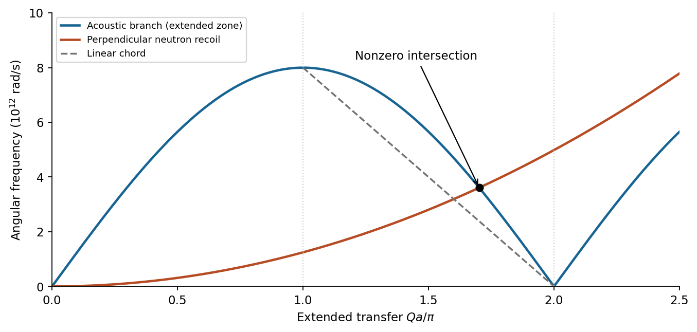

<h1 id="section-c/c10/solution">Solution</h1>

↑ **Parent:** [C10](../c10.md)

For this calculation define the net [wavevector](../../../../../wavevector.md) gained by the [neutron](../../../../../neutron-split.md) as $\mathbf Q=\mathbf k_f-\mathbf k_i$, the opposite of a common sample-transfer convention. Since $\mathbf Q\perp\mathbf k_i$,

$$
E_f-E_i=\frac{\hbar^2}{2m_n}\bigl[(\mathbf k_i+\mathbf Q)^2-k_i^2\bigr]=\frac{\hbar^2Q^2}{2m_n}.
$$

The [perpendicular neutron recoil and phonon absorption](../../../../../perpendicular-neutron-recoil-and-phonon-absorption.md) condition therefore requires **$\omega(Q)=\hbar Q^2/(2m_n)$**. In the supplied periodic dispersion, interpret its $q$ as this transfer $Q$ in the [extended-zone representation of a phonon dispersion](../../../../../extended-zone-representation-of-a-phonon-dispersion.md). Put $x=Qa/2$ and $C=m_nav/\hbar\simeq15.84$. Nonzero intersections obey

$$
x^2=C|\sin x|.
$$

There is no root in $0<x\leq\pi/2$: $\sin x\geq2x/\pi$ there and $C>\pi^2/4$. On $(\pi/2,\pi)$ the ratio $x^2/\sin x$ increases strictly from $\pi^2/4$ to infinity, so exactly one root occurs. Nor can there be a higher root: $x\geq\sqrt C$ gives $x^2\geq C\geq C|\sin x|$, with strict inequality at the possible boundary. For $\pi\leq x\leq\sqrt C$, use $|\sin x|\leq x-\pi$; $x^2-C(x-\pi)>0$ throughout this short interval, since its minimum there is $C(1+\pi-\sqrt C)>0$. Thus the only nonzero magnitude satisfies

$$
\boxed{\pi/a<Q<2\pi/a.}
$$

Solving the exact dispersion, which is permitted instead of the linear approximation, gives

$$
\boxed{Q=1.069\times10^{10}\,\mathrm{m^{-1}},\quad \omega=3.610\times10^{12}\,\mathrm{rad\,s^{-1}},\quad f=0.575\,\mathrm{THz}.}
$$

A straight chord between the zone edge and the next zone centre gives $\omega\simeq4v/a-2vQ/\pi$. Its intersection solves $(\hbar/2m_n)Q^2+(2v/\pi)Q-4v/a=0$, yielding $Q\simeq1.006\times10^{10}\,\mathrm{m^{-1}}$ and $f\simeq0.508\,\mathrm{THz}$ as a less accurate estimate.

**[Figure 8](#section-c/c10/image-neutron-recoil-intersects-a-periodic-acoustic-branch). Neutron recoil intersects a periodic acoustic branch**. Original dispersion and recoil curves using the supplied parameters. The nonzero exact intersection lies in the second extended-zone interval; the dashed chord is the permitted linear approximation.

The reduced-zone [phonon](../../../../../phonon.md) [wavevector](../../../../../wavevector.md) is $q_{\rm red}=Q-2\pi/a=-1.873\times10^9\,\mathrm{m^{-1}}$ along the chosen positive transfer direction. The difference is a reciprocal-lattice vector, not an additional independent [phonon](../../../../../phonon.md) outside the first zone. At low [temperature](../../../../../temperature-split.md) the absorption probability contains the [Bose-Einstein distribution](../../../../../bose-einstein-distribution.md) factor $n_B(\omega)=[e^{\hbar\omega/k_BT}-1]^{-1}$, which tends to zero. Here $\hbar\omega/k_B\simeq27.6\,\mathrm K$, so this absorption channel is strongly suppressed well below that scale. [elastic scattering](../../../../../elastic-scattering.md) and kinematically allowed spontaneous [phonon](../../../../../phonon.md) creation need not disappear.

## ↑ Ancestors (14)

1. [C10](../c10.md)
2. [Section C](../../section-c.md)
3. [Paper 1](../../../paper-1-split.md)
4. [2011](../../../split.md)
5. [Past exam of the physics A course of the University of Cambridge](../../../../split.md)
6. [Physics A course of the University of Cambridge](../../../../../physics-a-course-of-the-university-of-cambridge.md)
7. [Physics course of the year 2 of the natural sciences course of the University of Cambridge](../../../../../physics-course-of-the-year-2-of-the-natural-sciences-course-of-the-university-of-cambridge.md)
8. [Year 2 of the natural sciences course of the University of Cambridge](../../../../../year-2-of-the-natural-sciences-course-of-the-university-of-cambridge.md)
9. [Year of the natural sciences course of the University of Cambridge](../../../../../year-of-the-natural-sciences-course-of-the-university-of-cambridge.md)
10. [Natural sciences course of the University of Cambridge](../../../../../natural-sciences-course-of-the-university-of-cambridge.md)
11. [Course of the University of Cambridge](../../../../../course-of-the-university-of-cambridge.md)
12. [University of Cambridge](../../../../../university-of-cambridge-split.md)
13. [List of universities](../../../../../list-of-universities.md)
14. [Codex Wiki](../../../../../split.md)
