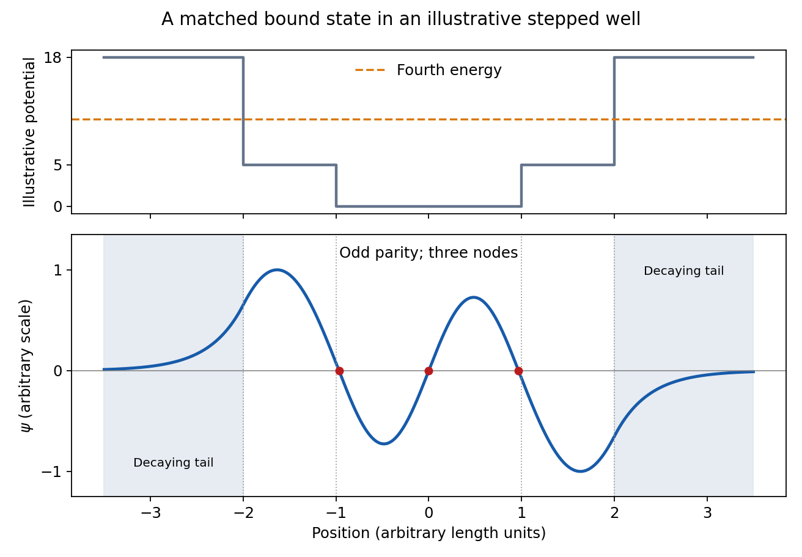

<h1 id="section-a/2/solution">Solution</h1>

↑ **Parent:** [2](../2.md)

The [Sturm oscillation theorem](../../../../../sturm-oscillation-theorem.md) gives **three [nodes of a wavefunction](../../../../../node-of-a-wavefunction.md)** for the fourth [bound state](../../../../../bound-state.md). [reflection symmetry](../../../../../reflection-symmetry.md) and [nondegeneracy of one-dimensional bound states](../../../../../nondegeneracy-of-one-dimensional-bound-states.md) make it **odd**: one [node of a wavefunction](../../../../../node-of-a-wavefunction.md) is at the centre, and the other two lie at opposite positions. In each flat allowed region the [wavefunction](../../../../../wave-function-split.md) is a [sinusoid](../../../../../sinusoid.md), with $k=\sqrt{2m(E-V)}/\hbar$; its [wavelength](../../../../../wavelength.md) is shortest in the central, deepest region. Outside the well it decays exponentially, with opposite signs on the two sides. Both $\Psi$ and $\Psi'$ remain continuous at every finite step, as required by [wavefunction matching at a finite potential step](../../../../../wavefunction-matching-at-a-finite-potential-step.md); only the curvature jumps. In particular, the [wavefunction](../../../../../wave-function-split.md) need not vanish at a step.

**[Figure 1](#section-a/2/image-fourth-bound-state). Fourth bound state**.

This original [wavefunction matching at a finite potential step](../../../../../wavefunction-matching-at-a-finite-potential-step.md) illustration uses freely chosen well dimensions and [energies](../../../../../energy-split.md). It shows the required [parity](../../../../../parity.md), node count, [wavelength](../../../../../wavelength.md) ordering and decaying tails; the source drawing supplies no numerical scale from which to fix exact node positions.

## ↑ Ancestors (14)

1. [2](../2.md)
2. [Section A](../../section-a.md)
3. [Paper 2](../../../paper-2-split.md)
4. [2011](../../../split.md)
5. [Past exam of the physics A course of the University of Cambridge](../../../../split.md)
6. [Physics A course of the University of Cambridge](../../../../../physics-a-course-of-the-university-of-cambridge.md)
7. [Physics course of the year 2 of the natural sciences course of the University of Cambridge](../../../../../physics-course-of-the-year-2-of-the-natural-sciences-course-of-the-university-of-cambridge.md)
8. [Year 2 of the natural sciences course of the University of Cambridge](../../../../../year-2-of-the-natural-sciences-course-of-the-university-of-cambridge.md)
9. [Year of the natural sciences course of the University of Cambridge](../../../../../year-of-the-natural-sciences-course-of-the-university-of-cambridge.md)
10. [Natural sciences course of the University of Cambridge](../../../../../natural-sciences-course-of-the-university-of-cambridge.md)
11. [Course of the University of Cambridge](../../../../../course-of-the-university-of-cambridge.md)
12. [University of Cambridge](../../../../../university-of-cambridge-split.md)
13. [List of universities](../../../../../list-of-universities.md)
14. [Codex Wiki](../../../../../split.md)
