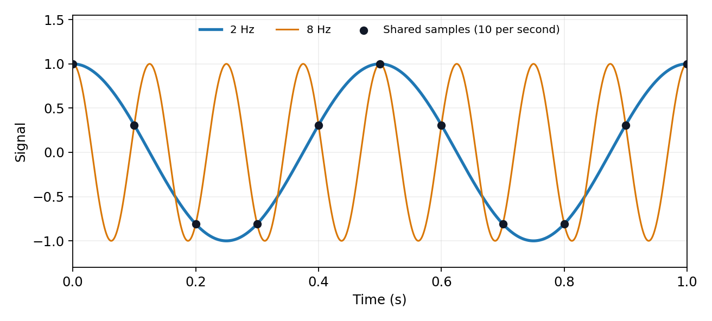

<h1 id="section-d/d12/b/solution">Solution</h1>

↑ **Parent:** [B](../b.md)

Uniform samples at $t_n=n/f_s$ cannot distinguish [frequencies](../../../../../../frequency.md) separated by integer multiples of $f_s$:

$$
e^{2\pi i(f+kf_s)t_n}=e^{2\pi ift_n},\qquad k\in\mathbb Z.
$$

For a real [cosine](../../../../../../cosine.md), opposite [frequencies](../../../../../../frequency.md) also coincide. Thus an unknown high-frequency component can appear in the sampled record at its folded [frequency](../../../../../../frequency.md) $f_{\rm alias}\in[0,f_s/2]$. For example, **2 Hz and 8 Hz [cosines](../../../../../../cosine.md) give identical samples at 10 samples per second**. This ambiguity is [aliasing](../../../../../../aliasing.md), rather than [uniform quantization error](../../../../../../uniform-quantization-error.md).

**[Figure 2](#section-d/d12/b/image-two-signals-identical-samples). Two signals, identical samples**.

The [Nyquist–Shannon sampling theorem](../../../../../../nyquist-shannon-sampling-theorem.md) permits reconstruction of an ideally [bandlimited function](../../../../../../bandlimited-function.md) of [bandwidth](../../../../../../bandwidth-signal-processing.md) $B$ when $f_s>2B$. Use an analogue [anti-aliasing filter](../../../../../../anti-aliasing-filter.md) before conversion and allow a transition band between the desired passband and the [frequencies](../../../../../../frequency.md) that fold into it. Sampling faster relaxes the filter requirement. Digital filtering after undersampling cannot separate already identical sample sequences. Finite observation time, [clock jitter](../../../../../../clock-jitter.md), [noise](../../../../../../noise-signal-processing.md) and imperfect filter rejection impose further practical limits.

## ↑ Ancestors (15)

1. [B](../b.md)
2. [D12](../../d12.md)
3. [Section D](../../../section-d.md)
4. [Paper 2](../../../../paper-2-split.md)
5. [2011](../../../../split.md)
6. [Past exam of the physics A course of the University of Cambridge](../../../../../split.md)
7. [Physics A course of the University of Cambridge](../../../../../../physics-a-course-of-the-university-of-cambridge.md)
8. [Physics course of the year 2 of the natural sciences course of the University of Cambridge](../../../../../../physics-course-of-the-year-2-of-the-natural-sciences-course-of-the-university-of-cambridge.md)
9. [Year 2 of the natural sciences course of the University of Cambridge](../../../../../../year-2-of-the-natural-sciences-course-of-the-university-of-cambridge.md)
10. [Year of the natural sciences course of the University of Cambridge](../../../../../../year-of-the-natural-sciences-course-of-the-university-of-cambridge.md)
11. [Natural sciences course of the University of Cambridge](../../../../../../natural-sciences-course-of-the-university-of-cambridge.md)
12. [Course of the University of Cambridge](../../../../../../course-of-the-university-of-cambridge.md)
13. [University of Cambridge](../../../../../../university-of-cambridge-split.md)
14. [List of universities](../../../../../../list-of-universities.md)
15. [Codex Wiki](../../../../../../split.md)
