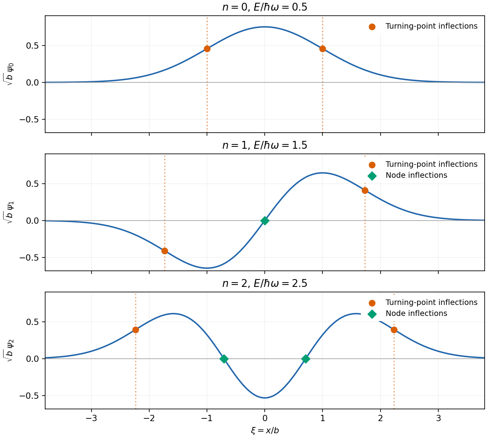
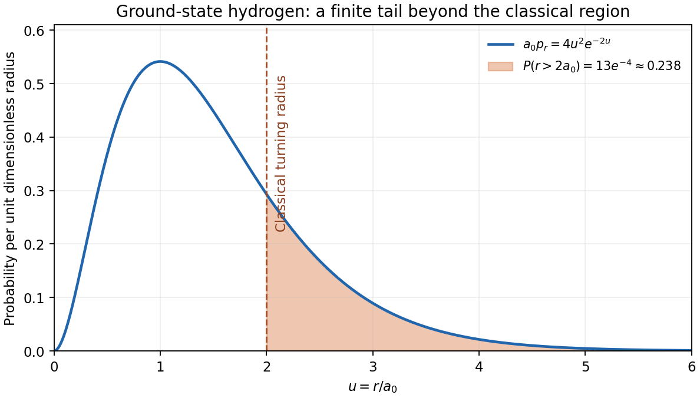

# Paper 1

↑ **Parent:** [2012](../2012.md)

[Original public PDF, physical pages 58–63; dated 26 May 2012](https://www.whatdotheyknow.com/request/natural_science_tripos_physics_e_2/response/2340776/attach/2/FOI%202023%20399%20Zahid%20materials.pdf?cookie_passthrough=1)

**Table of contents**

- [Section A](#section-a)
  - [1](#section-a/1)
    - [Solution](#section-a/1/solution)
  - [2](#section-a/2)
    - [Solution](#section-a/2/solution)
  - [3](#section-a/3)
    - [Solution](#section-a/3/solution)
  - [4](#section-a/4)
    - [Solution](#section-a/4/solution)
  - [5](#section-a/5)
    - [Solution](#section-a/5/solution)
- [Section B](#section-b)
  - [B6](#section-b/b6)
    - [Solution](#section-b/b6/solution)
  - [B7](#section-b/b7)
    - [Solution](#section-b/b7/solution)
  - [B8](#section-b/b8)
    - [Solution](#section-b/b8/solution)
  - [B9](#section-b/b9)
    - [Solution](#section-b/b9/solution)
- [Section C](#section-c)
  - [C10](#section-c/c10)
    - [Solution](#section-c/c10/solution)
  - [C11](#section-c/c11)
    - [a](#section-c/c11/a)
      - [Solution](#section-c/c11/a/solution)
    - [b](#section-c/c11/b)
      - [Solution](#section-c/c11/b/solution)
    - [c](#section-c/c11/c)
      - [Solution](#section-c/c11/c/solution)
- [Section D](#section-d)
  - [D12](#section-d/d12)
    - [a](#section-d/d12/a)
      - [Solution](#section-d/d12/a/solution)
    - [b](#section-d/d12/b)
      - [Solution](#section-d/d12/b/solution)
    - [c](#section-d/d12/c)
      - [Solution](#section-d/d12/c/solution)
  - [D13](#section-d/d13)
    - [Solution](#section-d/d13/solution)
    - [a](#section-d/d13/a)
      - [Solution](#section-d/d13/a/solution)
    - [b](#section-d/d13/b)
      - [Solution](#section-d/d13/b/solution)
    - [c](#section-d/d13/c)
      - [Solution](#section-d/d13/c/solution)

## Section A

↑ **Parent:** [Paper 1](paper-1.md)

<h3 id="section-a/1">1</h3>

↑ **Parent:** [Section A](#section-a)

<h4 id="section-a/1/solution">Solution</h4>

↑ **Parent:** [1](#section-a/1)

Subtract the two [photoelectric effect](../../quantum-mechanics.md#photoelectric-effect) equations $K_{\max}=hc/\lambda-\Phi$ to eliminate the [work function](../../quantum-mechanics.md#work-function):

$$
h=\frac{(2.3-0.9)e}{c[(200\times10^{-9})^{-1}-(258\times10^{-9})^{-1}]}
=\boxed{6.66\times10^{-34}\,\mathrm{J\,s}}.
$$

Here $e$ converts the [energy](../../energy.md) difference from [electronvolts](../../electronegativity.md#electronvolt) to joules. The precision of the rounded stopping energies justifies about two significant figures, $6.7\times10^{-34}\,\mathrm{J\,s}$.

<h3 id="section-a/2">2</h3>

↑ **Parent:** [Section A](#section-a)

<h4 id="section-a/2/solution">Solution</h4>

↑ **Parent:** [2](#section-a/2)

Let $\omega=\sqrt{k/m}$, $b=\sqrt{\hbar/(m\omega)}$ and $\xi=x/b$. With $\psi_0=\pi^{-1/4}b^{-1/2}e^{-\xi^2/2}$, the next two normalized harmonic-oscillator [wavefunctions](../../wave-function.md) are $\psi_1=\sqrt2\xi\psi_0$ and $\psi_2=(2\xi^2-1)\psi_0/\sqrt2$. Their energies are $E_n=(n+1/2)\hbar\omega$, with respectively zero, one and two [wavefunction nodes](../../wave-equation.md#wavefunction-node), alternating even and odd [parity](../../quantum-mechanics.md#parity). The [Schrödinger equation](../../mathematical-physics.md#schrodinger-equation) gives

$$
\psi_n''(x)=b^{-2}[\xi^2-(2n+1)]\psi_n(x).
$$

For [harmonic-oscillator wavefunction inflections](../../quantum-harmonic-oscillator.md#harmonic-oscillator-wavefunction-inflections), **the inflections include both [classical turning points](../../analysis.md#classical-turning-point) and simple [wavefunction](../../wave-function.md) [wavefunction nodes](../../wave-equation.md#wavefunction-node)**. In dimensionless coordinates the complete sets are

$$
\boxed{n=0:\ \xi=\pm1;\qquad
n=1:\ \xi=0,\pm\sqrt3;\qquad
n=2:\ \xi=\pm1/\sqrt2,\pm\sqrt5}.
$$

The curvature changes sign at every listed point; none of these states has a [wavefunction node](../../wave-equation.md#wavefunction-node) coinciding with its turning points.

**[Figure 1](#section-a/2/image-original-lowest-harmonic-oscillator-wavefunctions-with-turning-point-and-node-inflections-distinguished). Original lowest harmonic-oscillator wavefunctions with turning-point and node inflections distinguished**.

<h3 id="section-a/3">3</h3>

↑ **Parent:** [Section A](#section-a)

<h4 id="section-a/3/solution">Solution</h4>

↑ **Parent:** [3](#section-a/3)

Resolving a length requires [momentum transfer](../../quantum-scattering.md#momentum-transfer) $q$ of order $\hbar/\ell$. Taking a hard relativistic scale $qc\sim4\,\mathrm{TeV}$ gives

$$
\boxed{\ell\sim\frac{\hbar c}{E}\simeq4.9\times10^{-20}\,\mathrm m}.
$$

The full [de Broglie wavelength](../../wave-function.md#de-broglie-wavelength) convention gives $hc/E\simeq3.1\times10^{-19}\,\mathrm m$, differing by $2\pi$; the intended scale is roughly $10^{-19}\,\mathrm m$, far below a [proton](../../physics.md#proton) radius. Two opposing beams have a larger total collision [energy](../../energy.md), but [proton](../../physics.md#proton) [energy](../../energy.md) is shared among [partons](../../standard-model.md#parton): the actual resolution depends on the hard scattering [momentum transfer](../../quantum-scattering.md#momentum-transfer), not simply on beam [energy](../../energy.md) alone.

<h3 id="section-a/4">4</h3>

↑ **Parent:** [Section A](#section-a)

<h4 id="section-a/4/solution">Solution</h4>

↑ **Parent:** [4](#section-a/4)

For [radiative temperature uncertainty after background subtraction](../../optical-instrument.md#radiative-temperature-uncertainty-after-background-subtraction), write $P_{\rm back}=B$, so $P_{\rm total}\simeq10B$ and $P\simeq9B$. The two absolute uncertainties are both $0.1B$. If they are independent [standard uncertainties](../../physics.md#standard-uncertainty),

$$
\frac{\sigma_T}{T}=\frac14\frac{\sigma_P}{P}
=\frac{\sqrt{(0.1B)^2+(0.1B)^2}}{36B}
=\boxed{3.93\times10^{-3}\simeq0.39\%}.
$$

If the percentages instead denote absolute error bounds, linear worst-case propagation gives **0.56%**. With [correlation coefficient](../../variance.md#pearson-correlation-coefficient) $\rho$, the standard-uncertainty result is $\sqrt{2(1-\rho)}/360$; subtraction makes positive common errors partly cancel. The independence convention is therefore an assumption, not information supplied by the percentages.

<h3 id="section-a/5">5</h3>

↑ **Parent:** [Section A](#section-a)

<h4 id="section-a/5/solution">Solution</h4>

↑ **Parent:** [5](#section-a/5)

For independent [electron](../../physics.md#electron) arrivals, the shot-noise counting model gives mean transferred charge $Q=I\Delta t=10^{-15}\,\mathrm C$ and count $\bar N=Q/e\simeq6.24\times10^3$. Poisson statistics imply

$$
\boxed{\sigma_Q=e\sqrt{\bar N}=\sqrt{eI\Delta t}\simeq1.27\times10^{-17}\,\mathrm C},\qquad
\frac{\sigma_Q}{Q}\simeq1.27\%.
$$

This is about 79 [electron](../../physics.md#electron) charges rms. It assumes Poisson [shot noise](../../electrical-engineering.md#shot-noise); charge discreteness by itself does not rule out correlations, [thermal noise](../../electrical-engineering.md#thermal-noise) or other apparatus noise.

## Section B

↑ **Parent:** [Paper 1](paper-1.md)

<h3 id="section-b/b6">B6</h3>

↑ **Parent:** [Section B](#section-b)

<h4 id="section-b/b6/solution">Solution</h4>

↑ **Parent:** [B6](#section-b/b6)

The [canonical commutation relations](../../quantum-mechanics.md#canonical-commutation-relation) are $[x,p_x]=[y,p_y]=i\hbar$, with $[x,y]=[p_x,p_y]=[x,p_y]=[y,p_x]=0$. Operators from different Cartesian modes commute, so $(p_xp_y)^\dagger=p_yp_x=p_xp_y$ and $(xy)^\dagger=yx=xy$. Thus $J_1$ is Hermitian and represents an [observable](../../quantum-system.md#observable) on the usual oscillator domain.

Introduce [annihilation operators](../../quantum-harmonic-oscillator.md#annihilation-operator) $a_x=\sqrt{m\omega/(2\hbar)}x+ip_x/\sqrt{2m\hbar\omega}$ and similarly $a_y$. Set $N_x=a_x^\dagger a_x$, $N_y=a_y^\dagger a_y$ and $N=N_x+N_y$. The [Schwinger boson representation](../../quantum-mechanics.md#schwinger-boson-representation) gives

$$
H=\hbar\omega(N+1),\quad
J_1=\frac\hbar2(a_x^\dagger a_y+a_y^\dagger a_x),\quad
J_2=\frac\hbar2(N_y-N_x),\quad
J_3=\frac\hbar{2i}(a_x^\dagger a_y-a_y^\dagger a_x).
$$

For $A=a_x^\dagger a_y$ and $B=a_y^\dagger a_x$, $AB=N_x(N_y+1)$ and $BA=N_y(N_x+1)$. Therefore

$$
J_1^2+J_3^2=\frac{\hbar^2}{2}(AB+BA),\qquad
J^2=\frac{\hbar^2}{4}(N^2+2N).
$$

The [two-mode oscillator Casimir identity](../../quantum-mechanics.md#two-mode-oscillator-casimir-identity) is

$$
\boxed{H^2=4\omega^2J^2+\hbar^2\omega^2},\qquad
\boxed{\alpha=4\omega^2,\quad\beta=\hbar^2\omega^2}.
$$

Since $[N,A]=[N,B]=0$, $[H,J_1]=0$, and $J_1$ is conserved. However, $[J_1,J_2]=i\hbar J_3$ is not the zero operator, so there is no general joint eigenbasis. The exception is important: a [common eigenstate of two angular-momentum components](../../angular-momentum-operator.md#common-eigenstate-of-two-angular-momentum-components) must satisfy $J_3\psi=0$, then the other [commutators](../../lie-algebra.md#commutator) force $J_1\psi=J_2\psi=0$. Thus only the $j=0$ sector admits a common state; here that is the oscillator [ground state](../../quantum-mechanics.md#ground-state).

Using $J^2=\hbar^2j(j+1)$, with $j=0,1/2,1,\ldots$, and selecting the positive [energy](../../energy.md) branch gives

$$
\boxed{E_j=\hbar\omega(2j+1),\qquad g_j=2j+1}.
$$

Equivalently $N=2j=0,1,\ldots$, so $E_N=\hbar\omega(N+1)$ and the degeneracy is $N+1$, corresponding to $N_x=0,\ldots,N$.

<h3 id="section-b/b7">B7</h3>

↑ **Parent:** [Section B](#section-b)

<h4 id="section-b/b7/solution">Solution</h4>

↑ **Parent:** [B7](#section-b/b7)

For [observables](../../quantum-system.md#observable) with finite [variances](../../variance.md), the [Heisenberg uncertainty principle](../../quantum-theory.md#heisenberg-uncertainty-relation) gives $\Delta A\Delta B\geq|\langle[A,B]\rangle|/2$; in particular $\Delta x\Delta p\geq\hbar/2$. It concerns the spreads of measurements in a prepared state, rather than only disturbance by a measuring device. Identical integer-spin particles have symmetric full states and [Bose-Einstein statistics](../../quantum-ideal-gas-statistics.md#bose-einstein-statistics); half-integer-spin particles have antisymmetric full states and [Fermi-Dirac statistics](../../tensor-product-of-quantum-systems.md#fermi-dirac-statistics). The latter imply Pauli exclusion from one complete single-particle state, including [spin](../../angular-momentum-operator.md#spin).

Inside an [infinite square well](../../quantum-mechanics.md#infinite-square-well), solutions satisfying both zero boundary conditions are

$$
\boxed{\psi_n(x)=\sqrt{\frac2L}\sin\frac{n\pi x}{L},\qquad
E_n=\frac{n^2\pi^2\hbar^2}{2mL^2}},\quad n=1,2,\ldots,
$$

with zero [wavefunction](../../wave-function.md) outside. For the [ground state](../../quantum-mechanics.md#ground-state), direct integration gives

$$
\langle x\rangle=\frac L2,\quad
\langle x^2\rangle=L^2\left(\frac13-\frac1{2\pi^2}\right),\quad
\langle p\rangle=0,\quad\langle p^2\rangle=\frac{\pi^2\hbar^2}{L^2}.
$$

The [infinite-well ground-state uncertainty product](../../quantum-mechanics.md#infinite-well-ground-state-uncertainty-product) follows:

$$
\boxed{\Delta x=L\sqrt{\frac1{12}-\frac1{2\pi^2}},\quad
\Delta p=\frac{\pi\hbar}{L},\quad
\Delta x\Delta p=\hbar\sqrt{\frac{\pi^2}{12}-\frac12}\simeq0.568\hbar>\frac\hbar2}.
$$

The [ground state](../../quantum-mechanics.md#ground-state) is not a minimum-uncertainty Gaussian. Here [momentum](../../momentum.md) [variance](../../variance.md) is the usual kinetic-momentum second moment of the confined state; the hard-wall [momentum operator](../../quantum-mechanics.md#momentum-operator) has domain subtleties that do not alter this kinetic-energy result.

For [spin degeneracy in filling a one-dimensional well](../../tensor-product-of-quantum-systems.md#spin-degeneracy-in-filling-a-one-dimensional-well), let $E_1=\pi^2\hbar^2/(2mL^2)$ and assume the [spin](../../angular-momentum-operator.md#spin) levels are degenerate and available. Four spin-zero [bosons](../../tensor-product-of-quantum-systems.md#boson) all occupy the lowest orbital, giving **$4E_1$**. Four spin-$1/2$ [fermions](../../tensor-product-of-quantum-systems.md#fermion) fill two [spin](../../angular-momentum-operator.md#spin) states in each of $n=1,2$, giving **$10E_1$**. Spin-$3/2$ [fermions](../../tensor-product-of-quantum-systems.md#fermion) have four [spin](../../angular-momentum-operator.md#spin) projections, so all four can occupy $n=1$ in different complete states, giving **$4E_1$**. These fillings do not impose full [spin](../../angular-momentum-operator.md#spin) polarization.

<h3 id="section-b/b8">B8</h3>

↑ **Parent:** [Section B](#section-b)

<h4 id="section-b/b8/solution">Solution</h4>

↑ **Parent:** [B8](#section-b/b8)

[matrix](../../vector-space.md#matrix) multiplication gives $\sigma_i\sigma_j=\delta_{ij}I+i\epsilon_{ijk}\sigma_k$, hence $[\sigma_i,\sigma_j]=2i\epsilon_{ijk}\sigma_k$. For physical [neutron](../../neutron.md) [spin](../../angular-momentum-operator.md#spin), use $\mathbf S=(\hbar/2)\boldsymbol\sigma$, so $[S_i,S_j]=i\hbar\epsilon_{ijk}S_k$, $S^2=3\hbar^2/4$, and measurement along any axis gives **$\pm\hbar/2$**.

For the specified field, $H=(\alpha B\hbar/2)\sigma_y$. The [Time-dependent Schrödinger equation](../../mathematical-physics.md#time-dependent-schrodinger-equation) is $i\hbar\dot\psi=H\psi$ with $\psi(0)=(1,0)^T$. The [uniform-field spin precession](../../angular-momentum-operator.md#uniform-field-spin-precession) follows from $\sigma_y^2=I$:

$$
\psi(t)=e^{-i\alpha Bt\sigma_y/2}\binom10
=\boxed{\binom{\cos\phi}{\sin\phi}},\qquad
\boxed{\phi(t)=\alpha Bt/2}.
$$

The sign of the precession is contained in the given $\alpha$. The normalized $x$-axis eigenstates are **$(1,1)^T/\sqrt2$ and $(1,-1)^T/\sqrt2$**.

The measurement direction is $\mathbf n=(0,\sin\theta,\cos\theta)$, as confirmed by the original diagram. Write $c=\cos(\theta/2)$ and $s=\sin(\theta/2)$. The spinors $\chi_+=(c,is)^T$ and $\chi_-=(is,c)^T$ have unit norm and [inner product](../../inner-product.md) $ics-isc=0$. Applying $\mathbf n\cdot\boldsymbol\sigma$ gives [eigenvalues](../../linear-operator-theory.md#eigenvalue) $+1$ and $-1$. At $\theta=0$ they are the usual $z$ basis; at $\pi/2$ they are the $y$ basis up to a [phase](../../wave.md#phase-waves); at $\pi$ the $z$ up/down roles are exchanged, with a factor $i$; and at $2\pi$ both return with a minus sign. A spinor changes sign under a full rotation, while its isolated-state measurement [probabilities](../../probability-theory.md#probability) are unchanged.

For [spin measurement in the yz plane](../../angular-momentum-operator.md#spin-measurement-in-the-yz-plane), projection gives

$$
P_+=|c\cos\phi-is\sin\phi|^2
=\boxed{\frac{1+\cos\theta\cos(\alpha Bt)}2},\qquad
\boxed{P_-=\frac{1-\cos\theta\cos(\alpha Bt)}2}.
$$

For $\theta=0$ these are $\cos^2\phi,\sin^2\phi$; for $\pi/2$ both are $1/2$ at all times; for $\pi$ they are exchanged; and for $2\pi$ they are the same as at zero angle. The constant $y$ [probabilities](../../probability-theory.md#probability) also follow from conservation of $S_y$.

<h3 id="section-b/b9">B9</h3>

↑ **Parent:** [Section B](#section-b)

<h4 id="section-b/b9/solution">Solution</h4>

↑ **Parent:** [B9](#section-b/b9)

For the two inline operator labels, **(a)** $L_z$ has [eigenvalue](../../linear-operator-theory.md#eigenvalue) $m_\ell\hbar$, and **(b)** $L^2$ has [eigenvalue](../../linear-operator-theory.md#eigenvalue) $\ell(\ell+1)\hbar^2$, with $\ell=0,1,\ldots$ and $m_\ell=-\ell,\ldots,\ell$. The subscript distinguishes the [magnetic quantum number](../../quantum-mechanics.md#magnetic-quantum-number) from the [electron](../../physics.md#electron) [mass](../../classical-mechanics.md#mass).

Put $b=a_0(\ell+1)$ and $\kappa=e^2/(4\pi\epsilon_0)$. For the proposed radial shape,

$$
\frac1{r^2R}\frac{d}{dr}\left(r^2\frac{dR}{dr}\right)
=\frac{\ell(\ell+1)}{r^2}-\frac{2(\ell+1)}{br}+\frac1{b^2}.
$$

The angular-momentum term cancels the inverse-square part. The inverse-radius coefficient vanishes if $\hbar^2(\ell+1)/(mb)=\kappa$. Therefore

$$
\boxed{a_0=\frac{4\pi\epsilon_0\hbar^2}{me^2}},\qquad
\boxed{E=-\frac{\hbar^2}{2ma_0^2(\ell+1)^2}}.
$$

This [nodeless Coulomb radial eigenstate](../../mathematical-physics.md#nodeless-coulomb-radial-eigenstate) has [principal quantum number](../../mathematical-physics.md#principal-quantum-number) $n=\ell+1$, not the complete set of hydrogen radial states. Since the [spherical harmonic](../../analysis.md#spherical-harmonic) is normalized, radial normalization requires

$$
1=|A|^2(2\ell+2)!\left(\frac b2\right)^{2\ell+3},\qquad
\boxed{A=\frac{(2/b)^{\ell+3/2}}{\sqrt{(2\ell+2)!}}}
$$

up to an arbitrary [phase](../../wave.md#phase-waves).

For the [hydrogen ground-state nuclear-volume probability](../../mathematical-physics.md#hydrogen-ground-state-nuclear-volume-probability), use $R=2a_0^{-3/2}e^{-r/a_0}$. With $u=r_p/a_0\ll1$,

$$
P(r<r_p)=1-e^{-2u}(1+2u+2u^2)
\simeq\boxed{\frac43\left(\frac{r_p}{a_0}\right)^3}.
$$

No numerical [proton](../../physics.md#proton) radius is supplied or required. A sharp [proton](../../physics.md#proton) boundary is an approximation to a charge distribution, and the point-Coulomb potential changes inside an extended [proton](../../physics.md#proton). Finite [proton](../../physics.md#proton) [mass](../../classical-mechanics.md#mass), relativistic and electromagnetic corrections also limit the ideal [wavefunction](../../wave-function.md)'s precision.

Classically the [kinetic energy](../../energy.md#kinetic-energy) must satisfy $E-V(r)\geq0$. For $E=-\kappa/(2a_0)$ this demands **$r\leq2a_0$**. The [hydrogen ground-state probability beyond the classical turning point](../../mathematical-physics.md#hydrogen-ground-state-probability-beyond-the-classical-turning-point) is

$$
P(r>2a_0)=\int_{2a_0}^\infty\frac{4r^2}{a_0^3}e^{-2r/a_0}\,dr
=\boxed{13e^{-4}\simeq0.238}.
$$

A substantial [probability](../../probability-theory.md#probability) lies beyond the classical turning radius; the bound-state [wavefunction](../../wave-function.md) decays there rather than vanishing.

**[Figure 2](#section-b/b9/image-original-hydrogen-ground-state-radial-probability-density-with-its-classically-forbidden-tail-shaded). Original hydrogen ground-state radial probability density with its classically forbidden tail shaded**.

## Section C

↑ **Parent:** [Paper 1](paper-1.md)

<h3 id="section-c/c10">C10</h3>

↑ **Parent:** [Section C](#section-c)

<h4 id="section-c/c10/solution">Solution</h4>

↑ **Parent:** [C10](#section-c/c10)

[angular momentum](../../momentum.md#angular-momentum) generates rotations. Its components obey $[J_i,J_j]=i\hbar\epsilon_{ijk}J_k$, and $J^2$ commutes with each component. A compatible basis has $J^2=\hbar^2j(j+1)$ and $J_z=m\hbar$, where $m=-j,-j+1,\ldots,j$. [ladder operators](../../semisimple-lie-algebra.md#ladder-operator) change $m$ by one, terminate at $\pm j$, and give $2j+1$ magnetic substates. Different Cartesian components generally cannot all be sharp simultaneously.

[orbital angular momentum](../../quantum-mechanics.md#orbital-angular-momentum) is $\mathbf L=\mathbf r\times\mathbf p=-i\hbar\mathbf r\times\nabla$. Its angular eigenfunctions are [spherical harmonics](../../analysis.md#spherical-harmonic), with integer $\ell$ arising from their spatial rotation properties and single-valuedness. [spin](../../angular-momentum-operator.md#spin) is intrinsic [angular momentum](../../momentum.md#angular-momentum), not literal rotation of a finite charged sphere. It may be half-integer; [spin](../../angular-momentum-operator.md#spin) $1/2$ is represented by $\mathbf S=\hbar\boldsymbol\sigma/2$. For several contributions, $\mathbf J=\mathbf L+\mathbf S$ obeys the same algebra. Coupling angular momenta $j_1,j_2$ permits $J=|j_1-j_2|,\ldots,j_1+j_2$, with [Clebsch-Gordan coefficients](../../representation-theory.md#clebsch-gordan-coefficients) relating product and coupled bases. [spin-orbit coupling](../../atomic-physics.md#spin-orbit-interaction) can distinguish these total-angular-momentum sectors.

The Stern-Gerlach apparatus sends a collimated neutral atomic beam through an inhomogeneous [magnetic field](../../magnetic-field.md) and records its deflection. A [magnetic moment](../../electromagnetism.md#magnetic-dipole-moment) experiences $F_z\simeq\mu_z\,\partial B_z/\partial z$; field uniformity would produce precession but no analogous net separating force. A classically continuous distribution of moment orientations would broaden the beam continuously. Gerlach and Stern instead observed separated silver-beam components. Reversing or removing the field and comparing the undeflected profile controls the magnetic origin; collimation, velocity spread and finite resolution affect the spots. The original experiment demonstrated space quantization; its modern silver interpretation uses the unpaired [electron](../../physics.md#electron) [spin](../../angular-momentum-operator.md#spin) with nearly zero [orbital angular momentum](../../quantum-mechanics.md#orbital-angular-momentum), rather than a direct measurement of a free [electron](../../physics.md#electron)'s trajectory.[Experimental setup, recorded silver deposits and field-on/off comparison](../../physics-bibliography.md#der-experimentelle-nachweis-der-richtungsquantelung-im-magnetfeld-by-walther-gerlach-and-otto-stern)

For two spin-$1/2$ particles, the [triplet state](../../angular-momentum-operator.md#spin-one-half-triplet-state) sector has $S=1$ and symmetric [spin](../../angular-momentum-operator.md#spin) states

$$
|1,1\rangle=|\uparrow\uparrow\rangle,\quad
|1,0\rangle=\frac{|\uparrow\downarrow\rangle+|\downarrow\uparrow\rangle}{\sqrt2},\quad
|1,-1\rangle=|\downarrow\downarrow\rangle.
$$

The [spin singlet state](../../bell-state.md#spin-singlet-state) has $S=0$ and antisymmetric [spin](../../angular-momentum-operator.md#spin) state

$$
\boxed{|0,0\rangle=\frac{|\uparrow\downarrow\rangle-|\downarrow\uparrow\rangle}{\sqrt2}}.
$$

Their total $S^2$ values are $2\hbar^2$ and zero, while $\mathbf S_1\cdot\mathbf S_2$ has values $\hbar^2/4$ and $-3\hbar^2/4$. The singlet is rotationally invariant and gives anticorrelated [spin](../../angular-momentum-operator.md#spin) measurements along a common axis. For identical [fermions](../../tensor-product-of-quantum-systems.md#fermion) the complete state is antisymmetric: a symmetric spatial state pairs with a singlet [spin](../../angular-momentum-operator.md#spin) state, whereas an antisymmetric spatial state pairs with triplet [spin](../../angular-momentum-operator.md#spin). **Orbital, [spin](../../angular-momentum-operator.md#spin) and coupled angular momenta share an algebra, but their physical origins and allowed representations differ.**

<h3 id="section-c/c11">C11</h3>

↑ **Parent:** [Section C](#section-c)

<h4 id="section-c/c11/a">a</h4>

↑ **Parent:** [C11](#section-c/c11)

<h5 id="section-c/c11/a/solution">Solution</h5>

↑ **Parent:** [A](#section-c/c11/a)

In a finite potential barrier with $E<V$, the stationary [Schrödinger equation](../../mathematical-physics.md#schrodinger-equation) has exponentially decaying and growing solutions, with local decay constant $\kappa=\sqrt{2m(V-E)}/\hbar$. Matching the [wavefunction](../../wave-function.md) and its [derivative](../../calculus.md#derivative) at finite steps produces a transmitted [probability current](../../wave-function.md#probability-current) even though a classical particle at that [energy](../../energy.md) could not cross. [energy](../../energy.md) remains conserved. For a smooth thick barrier, the leading WKB transmission factor is

$$
\boxed{T\sim\exp\left[-2\int_{x_1}^{x_2}\frac{\sqrt{2m[V(x)-E]}}\hbar\,dx\right]}.
$$

For a rectangular barrier of height $V_0$, width $d$ and $0<E<V_0$, exact matching gives $T=[1+V_0^2\sinh^2(\kappa d)/(4E(V_0-E))]^{-1}$. Thickness and [energy](../../energy.md) therefore affect transmission exponentially in the opaque limit; prefactors and near-turning-point corrections require more than the leading exponent.

[alpha decay](../../physics.md#alpha-decay) illustrates escape from a nuclear well through a [Coulomb barrier](../../physics.md#coulomb-barrier). A rough decay rate is an internal encounter [frequency](../../wave.md#frequency) times barrier penetrability, multiplied by the [probability](../../probability-theory.md#probability) of forming the outgoing cluster; penetrability alone is not a complete nuclear lifetime calculation. In a [scanning tunnelling microscope](../../quantum-mechanics.md#scanning-tunneling-microscope), [electron](../../physics.md#electron) transmission through the vacuum gap gives an approximately exponential distance dependence $I\propto e^{-2\kappa d}$ at fixed conditions. A feedback loop adjusts tip height to maintain current, providing surface information. Bias, tip electronic structure and local electronic density of states also affect the current, so constant-current height is not purely geometric topography. Both applications exploit the same sensitivity of transmission to a classically forbidden region.

<h4 id="section-c/c11/b">b</h4>

↑ **Parent:** [C11](#section-c/c11)

<h5 id="section-c/c11/b/solution">Solution</h5>

↑ **Parent:** [B](#section-c/c11/b)

The [Time-dependent Schrödinger equation](../../mathematical-physics.md#time-dependent-schrodinger-equation) $i\hbar\partial_t|\psi\rangle=H(t)|\psi\rangle$ governs unitary evolution of a closed system. If $H$ is independent of time, expand in its [energy eigenstates](../../energy-eigenvalue.md#energy-eigenstate):

$$
\boxed{|\psi(t)\rangle=\sum_n c_ne^{-iE_nt/\hbar}|n\rangle}.
$$

An individual [energy eigenstate](../../energy-eigenvalue.md#energy-eigenstate) changes only by a [phase](../../wave.md#phase-waves), so its [probability density](../../wave-function.md#probability-density) and time-independent-observable expectations are stationary. Superpositions can have interference terms oscillating at $(E_n-E_m)/\hbar$; fixed [energy](../../energy.md) populations do not imply that every [observable](../../quantum-system.md#observable) is constant.

For general $H(t)$, $U(t,t_0)=\mathcal T\exp[-(i/\hbar)\int H(t')dt']$ requires [time ordering](../../perturbative-quantum-field-theory.md#time-ordering) unless [Quantum Hamiltonians](../../quantum-system.md#hamiltonian-quantum-mechanics) at different times commute. The equivalent Heisenberg description evolves [observables](../../quantum-system.md#observable) rather than the state, giving $d\langle A\rangle/dt=(i/\hbar)\langle[H,A]\rangle+\langle\partial_tA\rangle$. Explicit time dependence can transfer [energy](../../energy.md) from an applied perturbation.

For a weak perturbation $V(t)$ to a known $H_0$, the first-order transition amplitude from $n$ to $m\ne n$ is

$$
c_m^{(1)}(t)=-\frac i\hbar\int_{t_0}^t\langle m|V(t')|n\rangle e^{i(E_m-E_n)t'/\hbar}\,dt'.
$$

Its squared modulus gives the leading transition [probability](../../probability-theory.md#probability) while depletion remains small. A nearly monochromatic perturbation emphasizes [energy](../../energy.md) differences near its quantum of [frequency](../../wave.md#frequency); a continuum and suitable long-time limit yield [Fermi's golden rule](../../quantum-mechanics.md#fermi-s-golden-rule). These approximations have stated weak-coupling and time-resolution limits; they do not replace exact unitary dynamics in every regime.

<h4 id="section-c/c11/c">c</h4>

↑ **Parent:** [C11](#section-c/c11)

<h5 id="section-c/c11/c/solution">Solution</h5>

↑ **Parent:** [C](#section-c/c11/c)

For a [photon](../../quantum-mechanics.md#photon) scattering through angle $\theta$ from a free [electron](../../physics.md#electron) initially at rest, conserve [energy](../../energy.md) and [momentum](../../momentum.md). Eliminating the final [electron](../../physics.md#electron) [momentum](../../momentum.md) by its relativistic [energy](../../energy.md) relation gives

$$
mc^2(E-E')=EE'(1-\cos\theta),\qquad
\boxed{\lambda'-\lambda=\frac h{mc}(1-\cos\theta)},
$$

or $E'=E/[1+(E/mc^2)(1-\cos\theta)]$. The recoil [electron](../../physics.md#electron) gains [kinetic energy](../../energy.md#kinetic-energy) $E-E'$. The shift is zero forward, one [electron](../../physics.md#electron) [Compton wavelength](../../mathematical-physics.md#compton-wavelength) at $90^\circ$, and twice that [wavelength](../../wave-equation.md#wavelength) backward.

Compton's X-ray scattering measurements compared scattered spectra at different angles and identified an angle-dependent shifted component. This supports [photon](../../quantum-mechanics.md#photon) [momentum](../../momentum.md) $p=E/c$ and inelastic recoil, beyond the unchanged-frequency prediction of classical elastic [Thomson scattering](../../cosmic-microwave-background-anisotropy.md#thomson-scattering). Bound [electrons](../../physics.md#electron) and coherent scattering can also produce an unshifted component; initial [momentum](../../momentum.md) and binding broaden or modify the ideal free-electron result. Treating an [electron](../../physics.md#electron) as initially free and stationary is therefore a kinematic approximation appropriate when the relevant [photon](../../quantum-mechanics.md#photon) transfer dominates binding scales.[Printed pp. 494–495, experimental angular-spectrum comparison; p. 496, recoil discussion](../../physics-bibliography.md#a-quantum-theory-of-the-scattering-of-x-rays-by-light-elements-by-arthur-holly-compton)

## Section D

↑ **Parent:** [Paper 1](paper-1.md)

<h3 id="section-d/d12">D12</h3>

↑ **Parent:** [Section D](#section-d)

<h4 id="section-d/d12/a">a</h4>

↑ **Parent:** [D12](#section-d/d12)

<h5 id="section-d/d12/a/solution">Solution</h5>

↑ **Parent:** [A](#section-d/d12/a)

A [chi-squared test](../../statistical-inference.md#chi-squared-test) compares discrepancies with their expected random size. For independent Gaussian observations with known [standard deviations](../../variance.md#standard-deviation), a fitted model gives

$$
\chi^2=\sum_{i=1}^n\frac{[y_i-f(x_i;\widehat\theta)]^2}{\sigma_i^2}.
$$

Under a correct regular model with $p$ fitted parameters, its reference [statistical degrees of freedom](../../statistical-inference.md#statistical-degrees-of-freedom) are usually $\nu=n-p$. Correlated errors instead require $\chi^2=\mathbf r^TC^{-1}\mathbf r$ with the correct [covariance matrix](../../variance.md#covariance-matrix). The reduced statistic has mean about one and [standard deviation](../../variance.md#standard-deviation) $\sqrt{2/\nu}$, so it should not be forced to equal exactly one.

For binned counts, Pearson's statistic is $\sum_i(O_i-E_i)^2/E_i$. With a fixed total and $k$ populated categories, fitting $p$ distribution parameters generally gives $\nu=k-1-p$. The approximation needs adequately populated expected bins and the appropriate dependence assumptions. Sparse data may require a Poisson [likelihood](../../maximum-likelihood-estimation.md#likelihood-function), exact calculation or simulated reference distribution rather than a casual chi-squared approximation.

The upper-tail [probability](../../probability-theory.md#probability) $p_{\rm value}=P(\chi^2_\nu\geq\chi^2_{\rm obs})$ measures how unusual the discrepancy would be under the null model; it is not the [probability](../../probability-theory.md#probability) that the model is true. A large statistic can indicate a wrong model, underestimated noise or unmodelled systematic effects; an unusually small one can indicate overestimated errors or correlations. Residual plots and checks of the noise model are needed alongside the numerical test.

<h4 id="section-d/d12/b">b</h4>

↑ **Parent:** [D12](#section-d/d12)

<h5 id="section-d/d12/b/solution">Solution</h5>

↑ **Parent:** [B](#section-d/d12/b)

For an experimental-noise interpretation of Nyquist's theorem, a [resistor](../../electric-charge.md#resistor) $R$ in thermal equilibrium at [temperature](../../temperature.md) $T$ has one-sided open-circuit voltage-noise [spectral density](../../time-series.md#spectral-density-of-a-stationary-process)

$$
\boxed{S_V(f)=4k_BTR},\qquad
\boxed{\langle v_n^2\rangle=4k_BTR\,\Delta f}
$$

in the classical range $hf\ll k_BT$, over an approximately rectangular [bandwidth](../../electrical-engineering.md#bandwidth-signal-processing) $\Delta f$. Across a matched load, half the open-circuit voltage appears, giving available noise [power](../../energy.md#power) $k_BT\Delta f$. This is thermal agitation, present without a mean current, and is distinct from [shot noise](../../electrical-engineering.md#shot-noise). A real readout weights the spectrum with its [transfer function](../../control-theory.md#transfer-function): $\langle v_{\rm out}^2\rangle=\int_0^\infty S_V(f)|H(f)|^2df$. Cooling, reduced [bandwidth](../../electrical-engineering.md#bandwidth-signal-processing) and suitable impedance/noise matching reduce measured noise; the [resistor](../../electric-charge.md#resistor)'s noise does not simply disappear in an ideal amplifier model.[Printed p. 113, equations 4–8, thermal emf and bandwidth](../../physics-bibliography.md#thermal-agitation-of-electric-charge-in-conductors-by-harry-nyquist)

The bare name also has a sampling interpretation. The [Nyquist–Shannon sampling theorem](../../fourier-analysis.md#nyquist-shannon-sampling-theorem) permits exact reconstruction of a bandlimited signal from sufficiently fast uniform samples. The practical condition is **$f_s>2f_{\max}$**, with an [anti-aliasing filter](../../fourier-analysis.md#anti-aliasing-filter) before sampling; otherwise distinct continuous [frequencies](../../wave.md#frequency) produce identical samples. Ideal reconstruction uses shifted [sinc functions](../../fourier-transform.md#sinc-function). Critical-rate equality needs an appropriate signal class and can fail for unrestricted edge-frequency sinusoids with unknown [phase](../../wave.md#phase-waves). Sampling fast enough prevents [aliasing](../../fourier-analysis.md#aliasing), but does not remove [thermal noise](../../electrical-engineering.md#thermal-noise). This distinction covers the source's unspecified use of “Nyquist's theorem”.[MT-002, sampled spectra and anti-aliasing discussion](../../physics-bibliography.md#what-the-nyquist-criterion-means-to-your-sampled-data-system-design-by-walt-kester)

<h4 id="section-d/d12/c">c</h4>

↑ **Parent:** [D12](#section-d/d12)

<h5 id="section-d/d12/c/solution">Solution</h5>

↑ **Parent:** [C](#section-d/d12/c)

A closed conducting enclosure redistributes surface charge so that an empty interior is protected from an external static [electric field](../../electric-field.md). Grounding fixes a reference and drains deposited charge, but an ideal isolated closed conductor also provides inward [electrostatic shielding](../../electrostatics.md#electrostatic-shielding). Real seams, apertures and cables need careful bonding, shielding and feedthrough filtering. For time-varying fields the relevant [wavelength](../../wave-equation.md#wavelength), conductivity, geometry and penetration depth matter; a static argument alone is insufficient. Differential wiring and small pickup-loop areas can complement shielding, while careless multiple ground connections create unwanted current loops.

Ordinary copper or aluminium does not generally exclude a static [magnetic field](../../magnetic-field.md). High-permeability shells instead guide magnetic flux around the protected volume. Their effectiveness depends on shape, continuity, openings and saturation; magnetic history and mechanical stress can worsen performance. Nested shields and degaussing can reduce residual fields. Superconducting shielding can exploit the [Meissner effect](../../magnetic-field.md#meissner-effect), but trapped flux, openings and critical-field limits require attention.

At nonzero [frequency](../../wave.md#frequency), [eddy currents](../../electromagnetism.md#eddy-current) in conducting shields oppose changing magnetic flux. The [skin depth](../../electric-charge.md#skin-depth) is

$$
\boxed{\delta=\sqrt{\frac{2}{\mu\sigma\omega}}}
$$

for a good conductor in the usual diffusion approximation. Thickness of several [skin depths](../../electric-charge.md#skin-depth) suppresses penetration, but the very-low-frequency limit is weak for a normal metal. High-permeability and conducting layers can therefore complement each other. Active compensation coils are an additional method, not passive shielding. Test performance by applying known fields along relevant axes and measuring the residual field or induced signal over the apparatus [bandwidth](../../electrical-engineering.md#bandwidth-signal-processing); room-temperature shielding materials and electronics can themselves add noise.

<h3 id="section-d/d13">D13</h3>

↑ **Parent:** [Section D](#section-d)

<h4 id="section-d/d13/solution">Solution</h4>

↑ **Parent:** [D13](#section-d/d13)

The ideal operational-amplifier rules are **zero input currents** and, when stable [negative feedback](../../signal-transduction.md#negative-feedback) maintains unsaturated linear operation, **equal input voltages**. Infinite [open-loop gain](../../electrical-circuit.md#open-loop-gain) motivates the latter; it must not be assumed to guarantee [asymptotic stability](../../dynamical-systems.md#asymptotic-stability) for every external network.

For the numerical sketch and usefulness discussion, use the [transfer function](../../control-theory.md#transfer-function) derived in part (c). The chosen values give $K=5$ and $\tau=RC=10^{-4}\,\mathrm s$. With $x=\omega\tau$,

$$
G(i\omega)=\frac5{1-x^2-2ix}=\frac5{(1-ix)^2},\qquad
\boxed{|G|=\frac5{1+x^2},\quad\arg G=2\arctan x}.
$$

The formal amplitude falls from 5 to zero, with high-frequency slope $-40$ dB per decade. Its unwrapped [phase](../../wave.md#phase-waves) rises from zero through $+90^\circ$ at $\omega=10^4\,\mathrm{s^{-1}}$ to $+180^\circ$; the corresponding characteristic [frequency](../../wave.md#frequency) is 1.59 kHz. At that [frequency](../../wave.md#frequency) the amplitude is 2.5.

**These are formal sinusoidal particular-solution curves, not a stable settled filter response.** For the [formal sinusoidal response of an unstable linear system](../../control-theory.md#formal-sinusoidal-response-of-an-unstable-linear-system), replacing $i\omega$ by the Laplace variable $s$ gives $G(s)=5/(1-s\tau)^2$, with a repeated [pole](../../isolated-singularity.md#pole) at $s=+1/\tau$. A homogeneous output contains $(A+Bt)e^{t/\tau}$ and grows, so real perturbations lead to supply-limited nonlinear behaviour. With equal positive [resistors](../../electric-charge.md#resistor) and [capacitors](../../electromagnetism.md#capacitor) in the frequency-setting network, the general denominator is $1+(3-K)s\tau+s^2\tau^2$: the [Sallen-Key equal-component stability bound](../../electrical-engineering.md#sallen-key-equal-component-stability-bound) is $K<3$. For example $K=3-\sqrt2$ gives a [Butterworth filter](../../electrical-engineering.md#butterworth-filter) response. Thus the [Sallen-Key low-pass filter](../../electrical-engineering.md#sallen-key-low-pass-filter) architecture is useful for active filtering with suitable gain and damping, but the stated $K=5$ component set is unsuitable for linear filtering. The component values are retained in this diagnosis.[Sections 3 and 3.4, low-pass transfer function and equal-component gain/Q relation](../../physics-bibliography.md#analysis-of-the-sallen-key-architecture-by-james-karki)

**[Figure 3](#section-d/d13/image-original-formal-gain-and-phase-curves-for-the-stated-circuit-with-its-unstable-positive-laplace-pole-explicitly-identified). Original formal gain and phase curves for the stated circuit, with its unstable positive Laplace pole explicitly identified**.

<h4 id="section-d/d13/a">a</h4>

↑ **Parent:** [D13](#section-d/d13)

<h5 id="section-d/d13/a/solution">Solution</h5>

↑ **Parent:** [A](#section-d/d13/a)

Zero [capacitance](../../electromagnetism.md#capacitance) removes the [capacitor](../../electromagnetism.md#capacitor) branches. No current enters the non-inverting input, so no current flows through $R_1$ or $R_2$ and $V_+=V_{\rm in}$. The inverting divider gives $V_-=V_{\rm out}R_3/(R_3+R_4)$. Equating the two input voltages in the linear solution gives

$$
\boxed{\frac{V_{\rm out}}{V_{\rm in}}=1+\frac{R_4}{R_3}=K}.
$$

<h4 id="section-d/d13/b">b</h4>

↑ **Parent:** [D13](#section-d/d13)

<h5 id="section-d/d13/b/solution">Solution</h5>

↑ **Parent:** [B](#section-d/d13/b)

Let $V_B$ be the non-inverting input voltage. The feedback divider gives $V_B=V_{\rm out}/K$. With $s=i\omega$, current conservation at this [wavefunction node](../../wave-equation.md#wavefunction-node) gives $(V_A-V_B)/R_2=sC_2V_B$, because the amplifier input draws no current. Hence

$$
\boxed{V_A=\frac{V_{\rm out}}K(1+i\omega R_2C_2)}.
$$

<h4 id="section-d/d13/c">c</h4>

↑ **Parent:** [D13](#section-d/d13)

<h5 id="section-d/d13/c/solution">Solution</h5>

↑ **Parent:** [C](#section-d/d13/c)

Current conservation at A, with the [capacitor](../../electromagnetism.md#capacitor) $C_1$ connected from A to the output as verified in the PDF, gives

$$
\frac{V_{\rm in}-V_A}{R_1}
=\frac{V_A-V_B}{R_2}+sC_1(V_A-V_{\rm out}).
$$

Substitute $V_A=(1+sR_2C_2)V_B$ and $V_{\rm out}=KV_B$:

$$
\frac{V_{\rm in}}{V_B}
=1+s[C_1R_1(1-K)+C_2(R_1+R_2)]+s^2R_1R_2C_1C_2.
$$

Therefore, at $s=i\omega$,

$$
\boxed{\frac{V_{\rm out}}{V_{\rm in}}
=\frac K{1-\omega^2R_1R_2C_1C_2+i\omega[C_1R_1(1-K)+C_2(R_1+R_2)]}}.
$$

This algebraic [transfer function](../../control-theory.md#transfer-function) alone does not establish that transients decay; the [pole](../../isolated-singularity.md#pole) check in the parent solution is necessary for the requested numerical choice.

## ↑ Ancestors (11)

1. [2012](../2012.md)
2. [Past exam of the physics A course of the University of Cambridge](../../past-exam-of-the-physics-a-course-of-the-university-of-cambridge.md)
3. [Physics A course of the University of Cambridge](../../university-of-cambridge.md#physics-a-course-of-the-university-of-cambridge)
4. [Physics course of the year 2 of the natural sciences course of the University of Cambridge](../../university-of-cambridge.md#physics-course-of-the-year-2-of-the-natural-sciences-course-of-the-university-of-cambridge)
5. [Year 2 of the natural sciences course of the University of Cambridge](../../university-of-cambridge.md#year-2-of-the-natural-sciences-course-of-the-university-of-cambridge)
6. [Year of the natural sciences course of the University of Cambridge](../../university-of-cambridge.md#year-of-the-natural-sciences-course-of-the-university-of-cambridge)
7. [Natural sciences course of the University of Cambridge](../../university-of-cambridge.md#natural-sciences-course-of-the-university-of-cambridge)
8. [Course of the University of Cambridge](../../university-of-cambridge.md#course-of-the-university-of-cambridge)
9. [University of Cambridge](../../university-of-cambridge.md)
10. [List of universities](../../README.md#list-of-universities)
11. [Codex Wiki](../../README.md)
