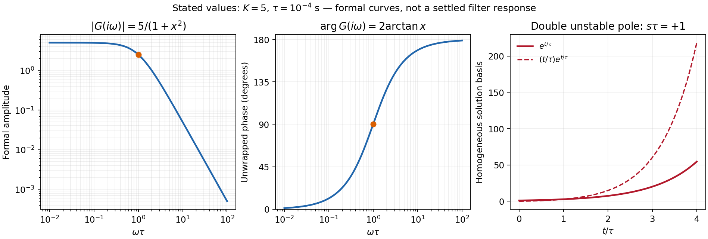

<h1 id="section-d/d13/solution">Solution</h1>

↑ **Parent:** [D13](../d13.md)

The ideal operational-amplifier rules are **zero input currents** and, when stable [negative feedback](../../../../../negative-feedback.md) maintains unsaturated linear operation, **equal input voltages**. Infinite [open-loop gain](../../../../../open-loop-gain.md) motivates the latter; it must not be assumed to guarantee [asymptotic stability](../../../../../asymptotic-stability.md) for every external network.

For the numerical sketch and usefulness discussion, use the [transfer function](../../../../../transfer-function.md) derived in part (c). The chosen values give $K=5$ and $\tau=RC=10^{-4}\,\mathrm s$. With $x=\omega\tau$,

$$
G(i\omega)=\frac5{1-x^2-2ix}=\frac5{(1-ix)^2},\qquad
\boxed{|G|=\frac5{1+x^2},\quad\arg G=2\arctan x}.
$$

The formal amplitude falls from 5 to zero, with high-frequency slope $-40$ dB per decade. Its unwrapped [phase](../../../../../phase-waves.md) rises from zero through $+90^\circ$ at $\omega=10^4\,\mathrm{s^{-1}}$ to $+180^\circ$; the corresponding characteristic [frequency](../../../../../frequency.md) is 1.59 kHz. At that [frequency](../../../../../frequency.md) the amplitude is 2.5.

**These are formal sinusoidal particular-solution curves, not a stable settled filter response.** For the [formal sinusoidal response of an unstable linear system](../../../../../formal-sinusoidal-response-of-an-unstable-linear-system.md), replacing $i\omega$ by the Laplace variable $s$ gives $G(s)=5/(1-s\tau)^2$, with a repeated [pole](../../../../../pole.md) at $s=+1/\tau$. A homogeneous output contains $(A+Bt)e^{t/\tau}$ and grows, so real perturbations lead to supply-limited nonlinear behaviour. With equal positive [resistors](../../../../../resistor.md) and [capacitors](../../../../../capacitor.md) in the frequency-setting network, the general denominator is $1+(3-K)s\tau+s^2\tau^2$: the [Sallen-Key equal-component stability bound](../../../../../sallen-key-equal-component-stability-bound.md) is $K<3$. For example $K=3-\sqrt2$ gives a [Butterworth filter](../../../../../butterworth-filter.md) response. Thus the [Sallen-Key low-pass filter](../../../../../sallen-key-low-pass-filter.md) architecture is useful for active filtering with suitable gain and damping, but the stated $K=5$ component set is unsuitable for linear filtering. The component values are retained in this diagnosis.[Sections 3 and 3.4, low-pass transfer function and equal-component gain/Q relation](../../../../../analysis-of-the-sallen-key-architecture-by-james-karki.md)

**[Figure 3](#section-d/d13/image-original-formal-gain-and-phase-curves-for-the-stated-circuit-with-its-unstable-positive-laplace-pole-explicitly-identified). Original formal gain and phase curves for the stated circuit, with its unstable positive Laplace pole explicitly identified**.

## ↑ Ancestors (14)

1. [D13](../d13.md)
2. [Section D](../../section-d.md)
3. [Paper 1](../../../paper-1-split.md)
4. [2012](../../../split.md)
5. [Past exam of the physics A course of the University of Cambridge](../../../../split.md)
6. [Physics A course of the University of Cambridge](../../../../../physics-a-course-of-the-university-of-cambridge.md)
7. [Physics course of the year 2 of the natural sciences course of the University of Cambridge](../../../../../physics-course-of-the-year-2-of-the-natural-sciences-course-of-the-university-of-cambridge.md)
8. [Year 2 of the natural sciences course of the University of Cambridge](../../../../../year-2-of-the-natural-sciences-course-of-the-university-of-cambridge.md)
9. [Year of the natural sciences course of the University of Cambridge](../../../../../year-of-the-natural-sciences-course-of-the-university-of-cambridge.md)
10. [Natural sciences course of the University of Cambridge](../../../../../natural-sciences-course-of-the-university-of-cambridge.md)
11. [Course of the University of Cambridge](../../../../../course-of-the-university-of-cambridge.md)
12. [University of Cambridge](../../../../../university-of-cambridge-split.md)
13. [List of universities](../../../../../list-of-universities.md)
14. [Codex Wiki](../../../../../split.md)
